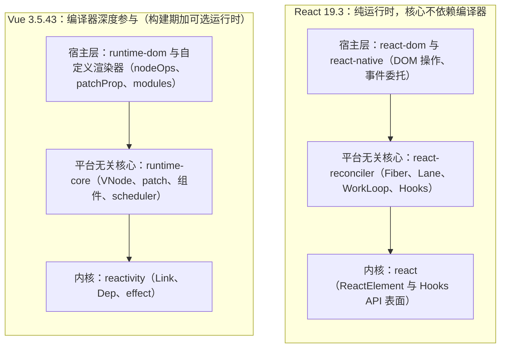
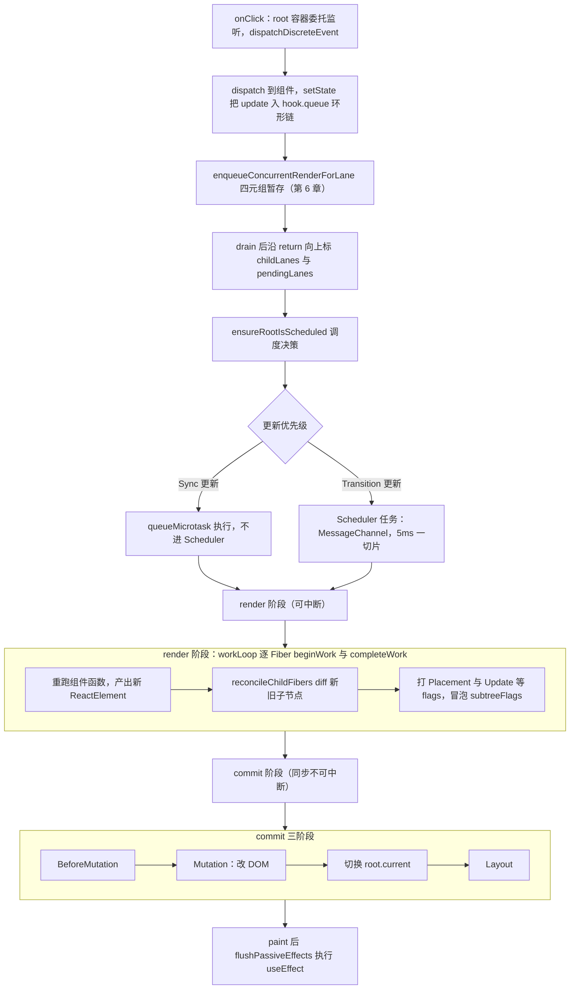
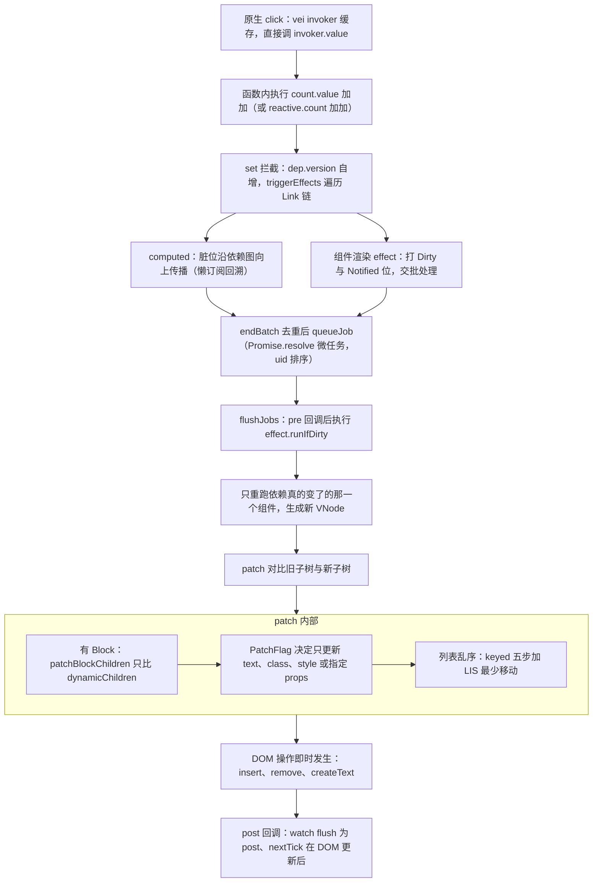
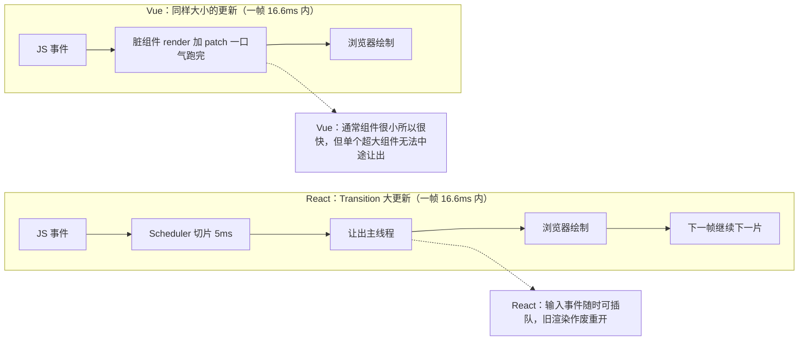

# React vs Vue：两套顶级前端架构的正面对决

> [返回教程总目录](../../README.md) ｜ [React 第 1 章](../react/01-architecture-overview.md) ｜ [Vue 第 1 章](../vue/01-architecture.md)

## 学习目标

- 用一句话说出 React 与 Vue 在「数据变化后如何更新 UI」这件事上的根本分野。
- 能画出两套框架更新链路的并排对照图，并指出每一步各自发生在哪个源码文件。
- 理解 Pull（拉取）与 Push（推送）两种响应范式的代价与收益。
- 从调度、diff、编译优化、副作用、内存模型五个维度建立完整对照知识网。
- 拿到一个真实项目需求时，能理性完成技术选型，而不是凭个人喜好站队。

> 本章是全系列的收束章。所有结论都可以在前 17 章中找到源码级证据，文中会不断用链接把你带回对应章节。

---

## 1. 先讲一个故事：两位厨师的做菜哲学

想象一家客人会不断「改菜单」的餐厅：

- **React 厨师**的做法是：不管你改了几道菜，只要菜单变了，他就把**整张菜单从头做一遍**——但他有一套精密的「出餐调度系统」：客人正在看手机的那一帧他不动手，利用间隙时间做菜（时间切片）；紧急的菜先做（Lane 优先级）；菜做到一半来了更急的单，他会把半成品丢掉重做起（可中断渲染）。最后拿新旧两份菜单逐行核对，只把真正变了的菜端上桌（commit 阶段改 DOM）。
- **Vue 厨师**的做法是：给每一样食材都装上传感器（Proxy + Link 依赖网），客人改了「不要香菜」，传感器直接通知负责那道菜的厨师，**只动那一个盘子**。而且菜单在印出来之前（编译期）就用荧光笔标好了「这一行价格可能变、这一行永远不动」（PatchFlag / Block），出餐时只看荧光标记。

两位厨师做出来的菜一样好吃，但他们解决问题的出发点截然不同：

| | React | Vue |
| --- | --- | --- |
| 底层假设 | UI = f(state)，状态不可变，**重新执行函数**得到新描述 | 状态可变，**拦截读写**，系统知道谁关心什么 |
| 更新范式 | Pull：框架不知道哪里变了，重跑组件 + diff 找变化 | Push：系统精确知道哪个 dep 通知哪个 effect |
| 优化手段 | 调度（可中断/优先级）+ 编译器自动 memo | 编译期标记（靶向更新）+ 响应式收窄影响范围 |
| 核心数据结构 | Fiber 双缓冲树 + Lane 31 位优先级 | Link 双向依赖图 + VNode Block 树 |
| 哲学倾向 | 用机制（scheduler/并发）换取声明式的纯粹 | 用编译器与响应式换取更新路径的最短 |

没有谁对谁错，这是两种**经过了十年生产检验的不同答案**。下面逐一拆解。

---

## 2. 架构分层：相似的骨架，不同的心脏

### 2.1 惊人相似的外壳

两套框架在宏观分层上几乎是「照猫画虎」：



- React 的 reconciler 通过 host config（createInstance / appendChild / insertBefore …）与 DOM 解耦，详见 [React 第 9 章](../react/09-renderer-and-events.md)；
- Vue 的 runtime-core 通过 createRenderer(options) 注入 nodeOps 与 patchProp，详见 [Vue 第 6 章](../vue/06-composition-api.md)的自定义渲染器一节。

正因为这个抽象，两者都能渲染到非 DOM 目标：React Native / Ink（React）、Weex / 小程序运行时 / runtime-test（Vue）。**「平台无关核心 + 注入宿主操作」是当代 UI 框架的共识设计。**

### 2.2 根本不同：编译器在架构中的位置

这是两张架构图上最大的差异：

- **React 核心是纯运行时的。** JSX 只是被 babel/swc 机械地转换成 `jsx()` 调用（[React 第 2 章](../react/02-element-and-fiber.md)），编译器对运行时行为零假设——它不知道哪个 prop 会变，所以 React 只能整体重跑组件再 diff。React 团队为此把全部赌注押在**调度器**上：既然无法避免重算，那就让重算变得可中断、可排序、可丢弃。
- **Vue 是编译器与运行时协同设计的。** 模板在编译期被分析出「只有 text / class / style / 指定 props 会变」，生成 PatchFlag、dynamicProps、Block（[Vue 第 7 章](../vue/07-compiler.md)）；运行时拿到这些标记做靶向更新（[Vue 第 3 章](../vue/03-vnode-and-renderer.md)）。代价是模板表达需要可被静态分析，所以 Vue 保留了 SFC 模板这个「受约束的描述语言」。

### 2.3 React Compiler：两大范式正在互相靠近

值得特别更新的认知：2025 年 10 月 7 日 **React Compiler v1.0 正式稳定**（Babel 插件，自动为组件和 Hooks 插入细粒度 memoization）。但要注意它的优化方向与 Vue 编译器**并不相同**：

| | React Compiler v1.0 | Vue 编译器 |
| --- | --- | --- |
| 输入 | 任意 JS/JSX（必须符合 Rules of React） | SFC 模板（也支持 h() 但优化信息少） |
| 优化手段 | 编译出细粒度 memo（等价自动补 useMemo/useCallback/memo），**跳过不必要的组件重渲染与重复计算** | PatchFlag/Block/静态提升，**让每次 patch 只动动态部分** |
| 解决的问题 | Pull 模型下「父组件更新导致整棵子树重渲染」的浪费 | 让 VNode diff 从全树递归退化为动态节点数组对比 |
| 中间表示 | HIR（基于控制流图的高层 IR）+ 数据流分析 | AST → transform → codegen |

一句话：**React Compiler 让「少算点」发生在重渲染之前；Vue 编译器让「少 diff 点」发生在 patch 之时。** 即便有了 React Compiler，React 的并发调度（Lane/Suspense/可中断 render）依然是 Vue 不具备的能力；而 Vue 的响应式精确追踪也依然是 React 靠 memo 模拟但机制上不相同的东西。

---

## 3. 更新全链路并排对照（全书最重要的一张图）

同样是「点击按钮 → count++ → 界面数字变化」，两边的完整路径：

第一张：React 19.3 的更新链路。



第二张：Vue 3.5.43 的更新链路。



逐点对照：

1. **入口**：React 把所有事件委托到 root container 并合成 SyntheticEvent（[React 第 9 章](../react/09-renderer-and-events.md)）；Vue 直接在元素上通过 vei invoker 绑定原生事件，更新时只换 `invoker.value`（[Vue 第 3 章](../vue/03-vnode-and-renderer.md)）。
2. **变化检测**：React 不知道 count 影响谁，整棵子树准备重渲染（靠 memo/bailout 剪枝）；Vue 精确知道只有当前组件的渲染 effect 订阅了这个 dep。
3. **调度**：React 有两条通道和可中断的工作循环（[React 第 3 章](../react/03-scheduler-and-lanes.md)）；Vue 只有一条「微任务队列 + uid 排序」通道，组件 render 一旦开始就同步跑完（[Vue 第 3 章](../vue/03-vnode-and-renderer.md)）。
4. **提交**：React 严格三分 render/commit，DOM 变更集中在 mutation 子阶段（[React 第 8 章](../react/08-commit-and-lifecycle.md)）；Vue 没有独立 commit 阶段，patch 过程中即时操作 DOM，靠调度队列保证批量。
5. **副作用时机**：React 有 layout/passive/insertion 三档 effect；Vue 有 watch 的 pre/post/sync 三时机 + watchEffect，语义不同，详见第 8 节。

---

## 4. Pull vs Push：两种响应范式的深层代价

### 4.1 React 的 Pull：无条件重算，机制兜底

React 组件是一个纯函数，状态变了就**再调用一次**。React 不追踪你在渲染里读了 state.a 还是 state.b：

```jsx
function Counter({ count, flag }) {
  // 即使只有 flag 变化，整个函数体（包括 expensive()）也会重跑，
  // 除非你自己用 useMemo / React.memo 拦住
  const v = expensive(count);
  return <div title={flag}>{v}</div>;
}
```

- 代价：默认会产生「多余的重渲染」，需要开发者具备 memo 心智（依赖数组、memo、useCallback），或交给 React Compiler 自动处理。
- 收益：模型极度统一——**不需要什么「响应式系统」**，任何 JS 值、任何库的数据都能驱动 UI；与并发渲染天然兼容（纯函数可以随时丢弃重跑）。

### 4.2 Vue 的 Push：精确追踪，读写拦截

Vue 渲染组件时，effect 会把读取过的所有响应式数据通过 Link 网登记下来（[Vue 第 2 章](../vue/02-reactivity.md)）：

```vue
<script setup>
const count = ref(0);
const v = computed(() => expensive(count.value)); // 只依赖 count
</script>
<template>
  <div>{{ v }}</div>   <!-- flag 怎么变都与本组件无关 -->
</template>
```

- 收益：更新粒度天然精确到「组件」（配合 Block 甚至到「动态节点」），默认性能好，不需要手动 memo。
- 代价一：**响应式是有税的**——每个对象要包 Proxy、每次属性读写都走 trap、dep/link 结构占内存（3.5 重构正是为了削减这笔税）。
- 代价二：解构丢失响应式（要 `toRefs`）、ref 需要 `.value`、非响应式数据不驱动更新、props 浅响应等心智负担，本质都是「这套系统需要知道你什么时候在读」。
- 代价三：同步、不可中断的组件渲染无法做「时间切片」，超大组件的一次 render 仍可能卡帧（实践中组件粒度通常较小，问题被自然规避）。

### 4.3 一张表总结

| 维度 | React（Pull） | Vue（Push） |
| --- | --- | --- |
| 谁知道「哪里变了」 | 不知道，重跑 + diff 发现 | dep→effect 依赖图精确知道 |
| 默认更新成本 | 可能重渲染大量子组件 | 只重跑订阅了该 dep 的组件 |
| 优化负担 | 手动 memo 或 React Compiler | 编译器自动，基本免 memo |
| 响应式数据税 | 无（普通对象即可） | Proxy/Link/ref 结构成本 |
| 可中断渲染 | ✅ 支持（并发模式核心） | ❌ 组件 render 同步跑完 |
| 与外部状态库对接 | useSyncExternalStore 防 tearing | 任何 shallowRef/reactive 即接入 |

---

## 5. 调度模型：精密机床 vs 精准流水线

### 5.1 React：把「操作系统」搬进浏览器

React 19 内部实现了一套微型进程调度（[React 第 3 章](../react/03-scheduler-and-lanes.md)）：

- **Lane 模型**：31 个二进制优先级通道，同步、连续输入、默认、14 条 Transition、Retry、Idle……更新可以互相纠缠（entangle）、可以过期抢跑（交互约 250ms、Transition 约 5s）。
- **Scheduler**：小顶堆管理任务，MessageChannel 拿宏任务，每帧让出 5ms 预算，`shouldYield` 检查。
- **根调度器**：Sync 更新走 queueMicrotask 立即完成；并发更新才进 Scheduler 切片。
- render 阶段每个 Fiber 单元执行后都检查「该让出了吗 / 有更高优先级更新吗」，所以**渲染可以被打断、被丢弃、从头重来**。

这带来了独一无二的用户体验能力：`startTransition` 标记的大列表过滤不会卡住输入框；`useDeferredValue` 让列表「滞后刷新」保持输入流畅；Suspense 让数据等待有声明式占位（[React 第 10 章](../react/10-concurrent-and-suspense.md)）。

### 5.2 Vue：微任务批处理，简单但够用

Vue 的调度（[Vue 第 3 章](../vue/03-vnode-and-renderer.md)）：

- `queueJob` 用 QUEUED 位 + 数组去重，按 uid（父→子顺序）二分插入；
- `Promise.resolve().then(flushJobs)` 一个微任务批量跑完所有脏组件；
- 3.5 的 job 调 `effect.runIfDirty()`，执行前再做一次脏检查短路；
- nextTick 让你 await 到 DOM 更新完成。

Vue 的选择是：**响应式已经把更新范围缩到很小，单次计算量可控，就不需要抢占式调度。** Vue 的「并发」发生在数据获取层（异步组件/Suspense 两阶段），而不是渲染层。

### 5.3 时间轴对比



⚠️ 注意一个常见误读：Vue「没有时间切片」不等于「Vue 慢」。Push 模型把 99% 的更新都收窄到了极小范围，只有「一个组件自身渲染极重」的场景 React 的并发机制才有压倒性优势——而那种场景 Vue 往往用虚拟列表+拆组件即可规避。

---

## 6. Diff 算法：贪心指针 vs 最长递增子序列

两者都对「同层、带 key 的列表」做重点优化，但算法哲学不同（[React 第 5 章](../react/05-reconciliation-diff.md) ｜ [Vue 第 4 章](../vue/04-diff-algorithm.md)）：

| 对比项 | React（ReactChildFiber） | Vue（patchKeyedChildren） |
| --- | --- | --- |
| 扫描策略 | 单轮线性快路径，中断后建 Map 扫尾 | 头部同步 + 尾部同步，再处理中段 |
| 移动判定 | `lastPlacedIndex` 单指针贪心：旧 index 比它小就移动 | 中段全量建 Map + 求 LIS，LIS 内节点不动 |
| DOM 移动次数 | 不保证最少（O(n) 贪心） | 保证最少（LIS 是最长「不用动」序列） |
| 复杂度 | O(n)（Map 摊还） | O(n log n)（LIS 贪心+回溯） |
| 更新什么 | 整体子树 reconcile，靠 flags 冒泡 | Block 内 patchBlockChildren + PatchFlag 靶向 |
| 静态节点 | 无编译信息，照常进入协调（bailout 可跳过） | 根本不在 dynamicChildren 里，完全不访问 |

同一个例子 `[A,B,C,D] → [A,D,C,B]`：

- React：单指针贪心会给 C、B 依次打上 Placement（移动多次）；
- Vue：头同步保留 A，中段 Map 求出 LIS=[C]（或等价序列），只移动 D 与 B 两次且移动集合最优。

**这体现了两边一贯的取舍：React 选「每次判断便宜、总体不追求最优」；Vue 选「编译期已经付了分析成本，运行时值得多算一点换取最少 DOM 操作」。**

工程上的共识则完全一致：key 必须稳定唯一，禁用数组 index 做 key（头部插入时两边都会产生错误复用，表现为表单/状态错位）。

---

## 7. 编译器与「静态知识」的利用方式

| 能力 | React（运行时/React Compiler） | Vue（模板编译器） |
| --- | --- | --- |
| 静态节点提升 | 无（React Element 每次渲染新建对象） | ✅ props 提升为 `_hoisted_`；3.5 静态 vnode 进 `_cache`（CACHED=-1） |
| 动态部分标注 | 无 patchFlag 概念 | PatchFlag 位（TEXT/CLASS/STYLE/PROPS…）+ dynamicProps 白名单 |
| 子树跳过 | Block 无对应物；靠 bailout/memo | Block 树让 diff 只走 dynamicChildren 数组 |
| 事件函数缓存 | React Compiler 可达成 | v-on cacheHandlers 默认开启（invoker.value 替换） |
| 静态字符串化 | 无 | stringifyStatic：连续 ≥20 节点 / ≥5 元素时变 innerHTML |
| 手写渲染函数 | JSX 是一等公民，无优化损失 | h() 可用但没有编译标记，退化为全量 diff |
| 子树手动缓存 | useMemo 缓存元素 / React Compiler | v-memo、v-once |

源码出处：Vue 的标记生成在 [cacheStatic.ts](file:///Users/yangzhijie/Desktop/practice_projects/claude-code-test/react-vue-source-deep-dive/sources/vue/packages/compiler-core/src/transforms/cacheStatic.ts) 与 transformElement，实测产物见 [Vue 第 7 章](../vue/07-compiler.md)；React Element 的「每次渲染都是新对象」见 [React 第 2 章](../react/02-element-and-fiber.md)。

**结论**：Vue 模板的表达约束（不能在标签里写任意 JS）换来的是编译器可分析性；JSX 的完全自由换来的是表达力，优化则交给「心智 + React Compiler」。

---

## 8. 副作用模型：Effect Ring vs 调度队列

| 对比项 | React | Vue |
| --- | --- | --- |
| 挂载点 | 函数组件内的 Hooks（链表按调用顺序，[React 第 7 章](../react/07-hooks.md)） | setup 中的 watch/watchEffect 与生命周期钩子 |
| 响应来源 | 手写依赖数组 `[a,b]`，漏了会读到旧值（exhaustive-deps） | 自动追踪回调里读取的响应式数据（watch 显式指定 source 也可以） |
| DOM 提交后异步执行 | useEffect（passive，paint 后） | watchEffect / watch（默认 pre，在组件 patch **前**；`flush:'post'` 在 DOM 更新后） |
| DOM 提交前同步执行 | useLayoutEffect（layout 阶段） | watch(…, {flush:'post'}) 在更新后；无完全等价物（用 nextTick 组合） |
| 清理函数 | effect return 的 cleanup（每次重跑先执行上一次） | onWatcherCleanup（3.5）/ watch 的 onCleanup 参数 / onScopeDispose |
| 生命周期 | 无命名生命周期，用 effect 模拟 mount/update/unmount | 双轨：Options API 命名钩子 + Composition 的 onMounted/onUpdated/onUnmounted…（[Vue 第 6 章](../vue/06-composition-api.md)） |
| 规则约束 | 必须顶层调用、不能条件化（链表顺序） | setup 顶层注册；watch 可任意条件创建（有独立 scope 管理） |

⚠️ 最大的语义错位：**React 的 useEffect 默认每次渲染后都可能重跑（依赖数组驱动），而 Vue 的 watch/watchEffect 只在依赖真的变化时触发。** 把 Vue watch 当 useEffect 写（在里面做「每次渲染后」的事）或反过来，都是常见 bug 来源。

---

## 9. 状态管理与上下文

### 9.1 跨层传递

- React：Context + Provider。**任何 context value 变化，消费该 context 的所有组件重渲染**（即使只用到 value 的一个字段），业务上常拆多个 Context 或上 selector 库；React 19 的 `use(Context)` 允许条件调用，机制未变。
- Vue：provide/inject + 响应式对象。因为注入的是 reactive/ref，**消费组件只追踪自己读到的字段**，一个大 store 对象 provide 下去也天然细粒度（[Vue 第 6 章](../vue/06-composition-api.md)）。

### 9.2 外部 store

- React 需要 `useSyncExternalStore`：并发渲染下 store 可能在渲染中途变化导致 tearing（同一帧 UI 不一致），该 hook 用 render 阶段快照比对 + commit 后复检两道防线（[React 第 7 章](../react/07-hooks.md)）。Redux/Zustand/Jotai 生态都建立在这套适配协议上。
- Vue 外部 store 只要用 `reactive/shallowRef`（Pinia 就是这么做的）即可零适配接入；uSES 要解决的 tearing 在 Vue 的同步渲染模型里天然不存在。

### 9.3 不可变 vs 可变的工作流

```text
React：setState({...state, count: state.count + 1})  // 新引用 = 变化信号
Vue  ：state.count++                                  // Proxy set = 变化信号
```

- React 的不可变约束让时间旅行、并发安全、结构化共享变得容易；代价是展开语法、Immer、更新嵌套数据的样板。
- Vue 的可变写法直观，但 Vue 也提供了 `$patch`/Pinia 风格的不可变批量入口；值得注意的是 Vue 3.5 的 Link 版本号协议本质上是「在可变世界里维护了一份精确的变化版本」，兼得部分调试优势。

---

## 10. 内存与生命周期管理

| | React 19.3 | Vue 3.5.43 |
| --- | --- | --- |
| 工作树 | Fiber 双缓存（current/workInProgress，alternate 复用池） | 单棵 VNode 树 + 组件 subTree 就地替换 |
| 单元上的「状态」 | Fiber 节点（含 hook 链、updateQueue、lanes） | VNode 节点（轻，组件状态在 ComponentInternalInstance） |
| 依赖关系 | fiber.dependencies 挂 Context；hook 队列 | Link 双向链表连接 dep 与 effect（3.5 内存重构，[Vue 第 2 章](../vue/02-reactivity.md)） |
| 更新排队 | Update 环形队列，按 lane 跳过/重放 | dep.version + Dirty 位，批处理双链表去重 |
| 卸载 | commitDeletion：WillUnmount/effect destroy/ref 清理 | unmountComponent：scope.stop() 停掉全部 effect/watcher，um 钩子，移除 subTree |
| 缓存与保活 | 无官方 KeepAlive（靠第三方/react-cache 模式）；Activity 隐藏保留状态 | 官方 KeepAlive（LRU + 离屏容器 + activated/deactivated） |

React 双缓存的价值是为「可中断、可丢弃、并发多版本」服务——同一时刻内存里允许两棵树，重渲染失败直接丢弃 wip 树，current 毫发无损。Vue 不需要这个机制，因为渲染不会中途被打断。

---

## 11. 服务端渲染与全栈方向（速览）

两者在 SSR 上的分歧比在客户端更大，本章只给地图：

- **React Server Components（RSC）**：组件可以在服务器运行，输出的不是 HTML 而是「组件流」协议，客户端拿到的是引用（"use client" 边界）。配套 Suspense 实现数据获取与流式渲染。心智模型变化很大（服务端组件不能用 state/effect），与 Next.js / Remix 深度绑定。
- **Vue SSR / Nuxt**：更传统的「服务端渲染成 HTML + 客户端激活（hydration）」路线，3.5 在水合调度上持续优化；Nuxt 提供目录约定式全栈能力（server routes、useFetch 去重）。Vue 的 Suspense 也支撑异步 setup 的 SSR 直出。
- 对业务团队而言：React 全栈方案上限高、范式新、心智陡；Vue 全栈方案更接近传统 MPA 渐进增强，迁移平滑。

---

## 12. 开发体验、TypeScript 与生态

| 维度 | React | Vue |
| --- | --- | --- |
| 视图载体 | JSX（JS 全能力，抽象组件容易） | 模板（指令/修饰符开箱即用）+ JSX 逃生舱 |
| 逻辑复用 | 自定义 Hook（命名 useX，调用规则严格） | 组合函数（普通函数返回响应式值，无特殊规则） |
| TS 体验 | 天然优秀（JSX 即 TS）；19 对 ref-as-prop 类型更顺 | SFC 中 template 类型检查靠 vue-tsc/IDE，已很成熟；setup 语法糖 TS 一等支持 |
| 新人上手 | 概念少（JSX+hooks），但「重渲染/deps/心智」深水区陡 | 模板直觉友好，指令多；响应式规则（.value/解构）是中期坎 |
| 官方全家桶 | 核心 + 元框架交给社区/Next 等 | 路由/状态/构建/测试/DevTools 官方统一（VueRouter/Pinia/Vite/ Vitest） |
| 生态体量 | 极大，岗位与第三方库最多 | 大，中文社区与文档极强；Vite 反哺整个前端世界 |
| 移动端 | React Native 事实标准 | 有 NativeScript-Vue/uni-app/Quasar 等，非同一量级 |

---

## 13. 性能特性总对照（速查表）

| 特性 | React 19.3 | Vue 3.5.43 |
| --- | --- | --- |
| 组件级精准更新 | 需 memo / Compiler | 默认具备（响应式） |
| 节点级靶向更新 | 否（整子树 reconcile） | ✅ Block + PatchFlag |
| 可中断渲染 / 时间切片 | ✅ Lane + Scheduler | ❌ |
| 优先级更新 | ✅ Lane 五档以上 | 区分 pre/post/sync 时机，无优先级队列 |
| 过期/饥饿保护 | ✅ 250ms/5s 升级 | 不需要（无抢占模型） |
| 列表 diff 最少移动 | ❌ 贪心 O(n) | ✅ LIS O(n log n) |
| 自动批处理 | ✅（微任务边界，19 中 batchedUpdates 已 noop） | ✅（queueJob 微任务批处理） |
| 并发数据获取 | ✅ Suspense + use + Transition | ⚠️ Suspense/异步组件（非渲染并发） |
| 状态保活 | Activity（隐藏树保留状态） | KeepAlive（LRU 官方实现） |
| 编译期优化 | React Compiler v1.0（自动 memo） | 深度内建（PatchFlag/Block/提升/_cache） |
| tearing 防护 | useSyncExternalStore 双检 | 模型天然免疫 |
| 响应式内存占用 | 无额外结构 | 3.5 Link 已大幅优化，仍有固定成本 |

---

## 14. 选型决策矩阵

| 你的情况 | 更推荐 | 理由 |
| --- | --- | --- |
| 团队熟悉 JS/TS 函数式抽象，有复杂交互（拖拽/画布/协同编辑/大型实时仪表盘） | **React** | 并发渲染保输入流畅；组件抽象能力最强；React Compiler 补上默认性能 |
| 需要 React Native 或招聘池最大化 | **React** | 生态与人才供给碾压级优势 |
| 全栈一体化、想直接用 RSC/Next App Router | **React** | 范式最新，适合愿意持续追新的团队 |
| 中小团队、后台管理/内容/营销站，要快速交付且新人多 | **Vue** | 模板直觉、默认性能好、官方全家桶、文档亲切 |
| 对更新性能敏感但不想管 memo/deps | **Vue**（或 React + Compiler） | 响应式与编译器默认兜底 |
| 已有微前端/多团队模板资产、中文团队为主 | **Vue** | SFC 约定统一、Vite 生态、维护体验平滑 |
| 强约束设计系统、跨端（Web + RN）一套人才 | **React** | RN 不可替代 |
| 想要官方把路由/状态/构建/测试都配齐 | **Vue** | 升级与工具链一致性最好 |

决策时还要诚实地考虑「你/团队更适应哪种心智」：**喜欢显式与机制、愿意理解调度器的选 React 会觉得自由；喜欢约定与自动化、希望框架替自己处理性能细节的选 Vue 会觉得省心。**

---

## 15. 各自的最佳实践

### React 侧

1. 把组件当纯函数：渲染期不读写可变外部变量、不直接订阅非 React store——用 `useSyncExternalStore`。
2. 状态下沉：`setState` 放最近公共父级，但更要学会「局部状态放局部」，从源头减少重渲染面积。
3. key 永远稳定唯一；大列表虚拟滚动；昂贵计算用 useMemo（或直接启用 React Compiler，别再手写一堆 memo）。
4. 高成本但非紧急的更新一律包进 `startTransition`；输入优先用 `useDeferredValue` 而不是手写防抖去对抗渲染。
5. useEffect 做的事大多数可以被事件处理器、派生计算（render 中直接算）、useSyncExternalStore 取代——effect 是「与外部系统同步」的工具，不是生命周期马甲。
6. 接 React Compiler 前先过 eslint-plugin-react-hooks 的 Rules of React 检查，编译器对违规组件会安全跳过。

### Vue 侧

1. 始终操作响应式数据：props 不可直接改；解构 store/setup 值用 storeToRefs/toRefs；跨函数传值保持 ref 或 reactive 引用。
2. 模板中大胆写，编译器会收窄更新；但手写 h()/JSX 时要意识到没有 Block 红利。
3. 大列表同样用虚拟滚动；key 稳定；列表项组件保持小而稳，让组件级追踪的优势最大化。
4. 合理选择 watch 时机：pre（默认，可改更新值）、post（依赖 DOM）、sync（极少用）；清理用 onWatcherCleanup。
5. 用 EffectScope / 组件 scope 管理长生命周期副作用（全局监听、轮询），卸载自动回收，避免手写 removeEventListener 泄漏。
6. Pinia store 用 `$patch` 做批量修改；computed 比 watch 更适合「派生值」——watch 只用于「产生副作用」。

---

## 16. 各自的局限与代价（不吹不黑）

**React 的代价**

- 并发模型有学习曲线：deps 数组、effect 时序、tearing、transition 心智、strict mode 双调用，让中级开发者的 bug 更隐蔽。
- 没有编译器时默认重渲染范围大，性能调优高度依赖经验（React Compiler 在收敛这个问题，但它是「补默认值」而非改变 pull 模型）。
- 官方只给核心，工程选型（路由/数据层/SSR 框架）自由度高也意味着决策疲劳。

**Vue 的代价**

- 响应式并非零成本：Proxy 兼容性（IE 彻底放弃）、ref `.value` 的模板/JS 语境差异、响应式边界（Map/Set 需劫持、Proxy 不能跨 realm 等）。
- 渲染不可抢占：极端复杂的单组件同步渲染仍可能卡帧，需要靠拆组件与虚拟列表人为治理。
- 模板的 DSL 在高度动态化场景（无固定结构的可视化编辑器）不如 JSX 灵活；跨端生态体量弱于 React。

---

## 初学者易错点 ⚠️

1. **把 Vue 的 watch 当 useEffect**：触发时机与依赖收集方式完全不同，对照第 8 节表格。
2. **以为 Vue「不用 key 也没事」**：无 key/索引 key 在头部插入时两边都会错误复用，Vue 的 LIS 优化救不了错误身份。
3. **以为 React Fiber 是「另一个虚拟 DOM」**：Fiber 是包含工作单元/调度信息的架构层，VNode（ReactElement）只是它的 `type/pendingProps` 载荷。
4. **以为 Vue 3 的响应式还是 3.0 的 targetMap**：3.5 已整体换成 Link 双向链表 + version 协议（[Vue 第 2 章](../vue/02-reactivity.md)），旧博客结论大面积过时。
5. **以为 React 并发就是多线程**：没有任何多线程，可中断性来自 render 阶段的纯函数性质与协作式让出。
6. **在 React 里解构 store 后期望它响应式**：普通变量不携带订阅；要么 selector 订阅，要么把值放进 state/context。
7. **在 Vue 里解构 props/store 后丢失响应式**：记住 toRefs/storeToRefs，或者直接保持对象访问。
8. **拿「更新快多少」做框架比较**：两者默认性能在绝大多数业务场景都远超人类感知阈值；真正该比的是模型匹配度、团队与生态。

---

## 本章小结

- 表层架构（平台无关核心 + 宿主注入）两者趋同；**心脏完全不同**：React 是「不可变 + Pull 重算 + 抢占式调度」，Vue 是「可变 + Push 追踪 + 编译期靶向」。
- React 的技术高峰是 **Lane/Scheduler/可中断渲染/Suspense**——用机制复杂度换取声明式纯粹与并发体验上限；React Compiler v1.0 在补齐默认重渲染成本。
- Vue 的技术高峰是 **Link 响应式图 + Block/PatchFlag 编译协同 + LIS 最少移动**——用编译器与代理机制把每次更新的路径缩到最短，3.5 的内存重构让这套体系更可持续。
- 没有银弹：重交互/跨端/生态广度选 React；约定优先/开箱即用/默认性能选 Vue。理解了两套源码，你甚至可以在同一团队按项目混用，并清楚地知道每一边的边界在哪。

## 结语

回到本系列最初的问题：「框架到底替我们做了什么？」读完 18 章你已经看到——

React 用 Fiber 链表把「渲染」拆成可呼吸的工作单元，用 Lane 给每种变化排定优先级，在 commit 的一个同步瞬间完成 DOM 的切换；Vue 用 Link 织出一张精密的依赖网，让每个 set 都能找到唯一该醒来的组件，再用编译期标记保证 patch 的每一刀都砍在动态节点上。

它们是同一道题（如何把状态高效、正确地映射到屏幕）的两个最优解。真正掌握一个框架的标志，不是能背出它的 API，而是理解它为什么必须长成这样——当你能在两个答案之间自由切换视角时，无论未来用什么框架，你看到的都不再是魔法，而只是一群工程师在约束下做出的、可以理解的选择。

> 推荐回头再读一次：[React 第 3 章调度器](../react/03-scheduler-and-lanes.md) 与 [Vue 第 2 章响应式](../vue/02-reactivity.md)——这两章是两套架构哲学最浓缩的体现。
