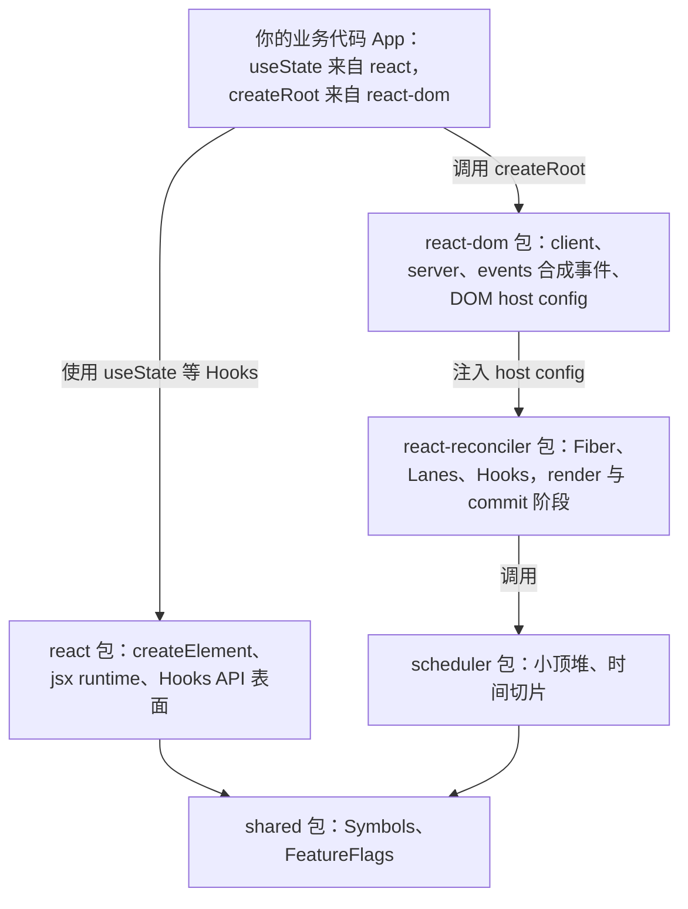
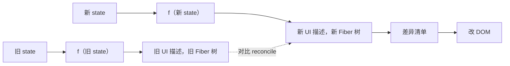
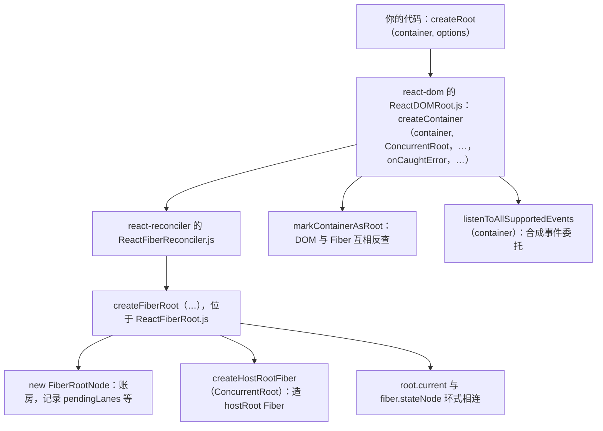
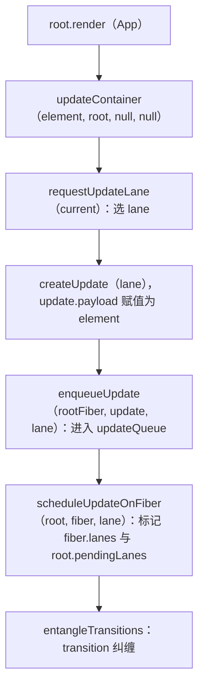
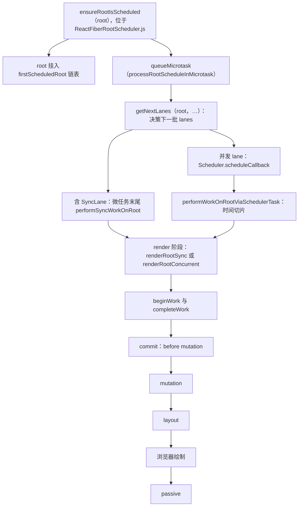

# 第 1 章 架构总览

[上一章](../../README.md) ｜ [下一章：ReactElement 与 Fiber 架构](./02-element-and-fiber.md)

> 本章基于 React `19.3.0` 源码（`packages/` 目录）。所有行号均来自实际源码文件，建议边读边点开链接对照。

## 学习目标

读完本章，你应该能够：

1. 说清楚 React monorepo 中 `react`、`react-reconciler`、`react-dom`、`scheduler`、`shared` 五个核心包各自负责什么、谁依赖谁。
2. 用「餐厅后厨」的类比解释 React 的「调度 → render → commit」三阶段，以及为什么它是 **pull-based（拉取式）** 的。
3. 理解 `UI = f(state)` 这一理念在源码里是如何落地的，以及为什么 React 核心不依赖编译器。
4. 完整背出 `createRoot(container).render(<App/>)` 在源码中的真实调用链（函数名、文件名）。
5. 说出 Reconciler 与 Renderer 如何通过 host config 解耦，以及 React 19 的新能力地图。

## 1.1 引入：为什么需要了解架构

你每天都在写这样的代码：

```jsx
import {createRoot} from 'react-dom/client';

createRoot(document.getElementById('root')).render(<App />);
```

这行代码背后发生了什么？大多数教程会告诉你「React 把虚拟 DOM 渲染成了真实 DOM」。但当你在业务里遇到以下问题时，这句话完全不够用：

- 为什么同一个事件处理函数里连续 `setState` 三次，组件只重新渲染一次？
- 为什么 `startTransition` 里的更新可以被输入框的更新「插队」，页面却不卡死？
- 为什么 `useEffect` 在浏览器绘制之后才执行，而 `useLayoutEffect` 在绘制之前？
- 为什么 React 能同时跑在浏览器 DOM、React Native、终端（Ink）甚至 Three.js 上？

这些问题的答案不在某一个 API 里，而在 React 的**整体架构**里。读源码最怕的不是看不懂某段算法，而是一上来就扎进 4000 行的 `ReactFiberWorkLoop.js`，结果完全不知道自己在哪、这段代码为谁服务。

所以第 1 章我们先坐直升机飞到天上，看清楚整片森林长什么样，后面 2、3 章再落地看树木。

## 1.2 一个生活化的类比：React 是一家餐厅

把一次更新想象成顾客在餐厅点菜：

| 餐厅角色 | React 中的对应物 | 职责 |
| --- | --- | --- |
| 顾客点菜 | `setState` / `useState` 的 setter / Action | 产生「订单」（update） |
| 前台接单、给订单排优先级 | Scheduler + Lane 模型 | 决定哪道菜先做、哪道菜可以等 |
| 后厨按菜谱做菜（不上菜） | render 阶段（Reconciler） | 对比新旧 Fiber，产出「变更清单」，可中断重来 |
| 传菜员把菜端上桌 | commit 阶段（Renderer） | 不可中断，真正操作 DOM、执行 effect |
| 厨房与餐厅之间的「出餐口协议」 | host config | 后厨不关心你是中餐厅还是西餐厅，只要你实现了约定的接口 |

关键点在于：**做菜（render）和上菜（commit）是分开的**。菜做错了可以重做，顾客根本看不见；但一旦开始端上桌，就必须一次性端完，不能端到半桌停下来去炒另一个菜。这就是 React 并发渲染（concurrent rendering）一切设计的出发点。

## 1.3 monorepo 包结构总览

React 的源码是一个 monorepo，所有包都在 `packages/` 下。截至 19.3.0，目录里有 40 个左右的包，但作为初学者，你只需要先掌握 5 个核心包。

### 1.3.1 五大核心包

| 包名 | npm 上的名字 | 角色 | 典型文件 |
| --- | --- | --- | --- |
| `packages/react` | `react` | **UI 理念的入口包**：定义 `createElement`、jsx 运行时、Hooks API 表面（`useState`、`use` 等）、`Component` 基类、`createContext` 等。它几乎是「纯 API 表面」，不知道 DOM 的存在 | [ReactJSXElement.js](file:///Users/yangzhijie/Desktop/practice_projects/claude-code-test/react-vue-source-deep-dive/sources/react/packages/react/src/jsx/ReactJSXElement.js)、[ReactHooks.js](file:///Users/yangzhijie/Desktop/practice_projects/claude-code-test/react-vue-source-deep-dive/sources/react/packages/react/src/ReactHooks.js) |
| `packages/react-reconciler` | `react-reconciler` | **平台无关的协调器**：整个 React 最大、最核心的包。Fiber 架构、更新队列、render/commit 两大阶段、Hooks 运行时、Lane 模型、根调度器全部在这里，即 `ReactFiber*.js` 系列文件 | [ReactFiberWorkLoop.js](file:///Users/yangzhijie/Desktop/practice_projects/claude-code-test/react-vue-source-deep-dive/sources/react/packages/react-reconciler/src/ReactFiberWorkLoop.js)、[ReactFiberRootScheduler.js](file:///Users/yangzhijie/Desktop/practice_projects/claude-code-test/react-vue-source-deep-dive/sources/react/packages/react-reconciler/src/ReactFiberRootScheduler.js) |
| `packages/react-dom`（含 `react-dom-bindings`） | `react-dom` | **DOM 宿主渲染器**：`client/`（`createRoot`）、`server/`（SSR/Fizz）、`events/`（合成事件系统）、DOM 的 host config 实现 | [ReactDOMRoot.js](file:///Users/yangzhijie/Desktop/practice_projects/claude-code-test/react-vue-source-deep-dive/sources/react/packages/react-dom/src/client/ReactDOMRoot.js)、[ReactFiberConfigDOM.js](file:///Users/yangzhijie/Desktop/practice_projects/claude-code-test/react-vue-source-deep-dive/sources/react/packages/react-dom-bindings/src/client/ReactFiberConfigDOM.js) |
| `packages/scheduler` | `scheduler` | **独立的协作式任务调度包**：小顶堆 + 时间切片。它甚至可以脱离 React 单独使用，API 都带着 `unstable_` 前缀 | [Scheduler.js](file:///Users/yangzhijie/Desktop/practice_projects/claude-code-test/react-vue-source-deep-dive/sources/react/packages/scheduler/src/forks/Scheduler.js) |
| `packages/shared` | （不单独发布） | **公共工具与常量**：`ReactSymbols.js`（各种 `Symbol.for(...)`）、`ReactFeatureFlags.js`（功能开关）、`ReactTypes.js`、`objectIs`、`shallowEqual` 等 | [ReactSymbols.js](file:///Users/yangzhijie/Desktop/practice_projects/claude-code-test/react-vue-source-deep-dive/sources/react/packages/shared/ReactSymbols.js) |

除此之外，「知道即可」的还有：`react-server` / `react-client`（RSC 的 Fizz/Flight）、`react-server-dom-*`（Flight 的打包器绑定）、`react-noop-renderer` / `react-test-renderer`（测试渲染器）、`react-art`（Canvas/SVG）、`react-native-renderer`，以及 `react-devtools*`、`eslint-plugin-react-hooks`、`react-refresh` 等工具链包。

### 1.3.2 包依赖关系图



注意三个方向：`react` **不依赖** `react-dom`（Hooks 通过 `ReactSharedInternals` 共享内存注入 dispatcher）；`react-reconciler` **不直接依赖** `react-dom`，反而是 `react-dom` 把 host config 喂给协调器（自定义渲染器的钥匙，见 1.5）；`scheduler` 是独立包，协调器通过内部包装模块 `./Scheduler` 引用它。

## 1.4 核心理念：UI = f(state)，以及三阶段

### 1.4.1 从「命令式改 DOM」到「描述状态」

用原生 JS 写界面，你要手动处理「这次状态变了，哪个节点要增、删、改」：

```js
// 命令式：你要亲自操作每一个副作用
if (data.loading) {
  spinner.style.display = 'block';
  list.style.display = 'none';
} else {
  spinner.style.display = 'none';
  list.textContent = JSON.stringify(data.items);
}
```

React 让你只写**关系**：`UI = f(state)`。给定同样的 state，函数必须返回同样的 UI 描述。至于状态变化后 DOM 哪里要动，由框架去算：



### 1.4.2 一次更新的三个阶段

React 内部把「响应一次更新」拆成三大步：

```mermaid
flowchart LR
    subgraph sg1 ["① 调度 Schedule（可中断）"]
        s1["产生 update"]
        s2["选择 Lane 优先级"]
        s3["微任务、Scheduler 排队"]
        s1 --> s2 --> s3
    end

    subgraph sg2 ["② render 渲染与协调（可中断、可放弃重来）"]
        r1["从根开始遍历 Fiber 树"]
        r2["调用组件函数，构建 WIP 树"]
        r3["打 flags：Placement、Update、Passive 等"]
        r1 --> r2 --> r3
    end

    subgraph sg3 ["③ commit 提交（不可中断）"]
        c1["before mutation"]
        c2["mutation：改 DOM"]
        c3["layout：useLayoutEffect、ref"]
        c4["绘制后 passive：useEffect"]
        c1 --> c2 --> c3 --> c4
    end

    s3 -->|"可被高优先级更新打断、放弃、重来后进入"| r1
    r3 -->|"进入下一阶段"| c1
```



- **render 阶段可以被打断、丢弃、重来**，因为它只在内存里算，不碰真实 DOM。这是并发特性的基石。
- **commit 阶段不可中断**，必须同步一口气做完，否则用户会看到「半更新」的界面。
- `useEffect` 属于 passive（被动）阶段，在浏览器绘制之后才异步执行；`useLayoutEffect` 属于 layout 阶段，在 DOM 变更后、绘制前执行。第 4、5 章会深入。

### 1.4.3 pull-based：React 主动来「拉」工作

另一个重要理念是 **pull-based（拉取式）**。

- push（推）模型：数据一变，立刻把新数据「推」给所有依赖者（典型：RxJS、Knockout 的细粒度响应式）。
- pull（拉）模型：组件本身不订阅数据变化。更新只是被放进队列并标记优先级；**等到调度器决定该干活了，React 才从根开始重新执行组件函数，把结果「拉」出来**。

好处是：调度器拥有绝对主动权——可以等事件处理函数跑完批量处理、可以让高优先级任务插队、可以时间切片。代价是：默认情况下 React 不知道「具体哪个组件受影响」，需要从某个起点重新跑一遍函数（当然 Fiber 上的 `lanes`、`bailout`、memoization 会大量剪枝）。

> Vue 对比埋点：Vue 3 的响应式是 **push + pull 混合**——数据变化先经依赖追踪「推」出「哪些组件要更新」的集合，再在 nextTick 统一「拉」着重渲染；React 核心则不做细粒度订阅，一切在运行时用 Fiber + 优先级解决。第 10 章后的对比章再展开。

### 1.4.4 React 核心不依赖编译器

JSX 不是 React 的一部分，只是被 Babel / SWC / esbuild 转成普通函数调用：现代转换走 `react/jsx-runtime`（最终落到 [ReactJSXElement.js](file:///Users/yangzhijie/Desktop/practice_projects/claude-code-test/react-vue-source-deep-dive/sources/react/packages/react/src/jsx/ReactJSXElement.js) 的 `jsxProd` / `jsxDEV`），经典转换走 `React.createElement`。React Compiler 也只是在编译期帮你自动 memoization，生成的仍是普通运行时调用——没有编译器 React 一样完整运行，这与 Svelte「无编译器即无框架」的路线截然不同。

## 1.5 Reconciler 与 Renderer 的解耦：host config

协调器只做「数学题」：这棵树该长什么样、差异是什么、先做谁。但「创建一个节点」「插入一个节点」长什么样，它一概不知。这些平台差异被收敛成一份 **host config（宿主配置）** 对象。

`react-reconciler` 这个 npm 包导出的就是一个工厂函数：传入 host config，拿回整套协调器 API。

出处：packages/react-reconciler/index.js:10-17（React 19.3.0）
[react-reconciler/index.js](file:///Users/yangzhijie/Desktop/practice_projects/claude-code-test/react-vue-source-deep-dive/sources/react/packages/react-reconciler/index.js#L10-L17)

```js
import typeof * as ReconcilerAPI from './src/ReactFiberReconciler';
import typeof * as HostConfig from './src/ReactFiberConfig';

export * from './src/ReactFiberReconciler';

// 构建期此模块会被包装成工厂函数（$$$reconciler）：
// 消费者传入一个 host config 对象，得到协调器 API
declare export default (hostConfig: HostConfig) => ReconcilerAPI;
```

DOM 渲染器提供的 host config 在 [ReactFiberConfigDOM.js](file:///Users/yangzhijie/Desktop/practice_projects/claude-code-test/react-vue-source-deep-dive/sources/react/packages/react-dom-bindings/src/client/ReactFiberConfigDOM.js)，里面实现了协调器要求的几十个方法，例如：

| host config 方法 | DOM 中的实现本质 |
| --- | --- |
| `createInstance(type, props)` | `document.createElement(type)` |
| `createTextInstance(text)` | `document.createTextNode(text)` |
| `appendInitialChild / appendChild` | `parent.appendChild(child)` |
| `removeChild` | `parent.removeChild(child)` |
| `prepareUpdate / commitUpdate` | diff 属性、同步 `setAttribute` / 样式 / 事件 |
| `scheduleMicrotask` | 优先 `queueMicrotask`，Promise 兜底 |
| `noTimeout / supportsMicrotasks` | 环境能力声明 |
| `isHostHoistableType` | 判断 `<title>`/`<meta>`/`<link>` 等是否可 hoist |

正因为这层协议的存在：

- **React Native** 传一份「原生视图」版 host config，`appendChild` 对应的是把 UIView/安卓 View 挂到原生视图树。
- **Ink**（终端 UI 库）传一份「Yoga 文本布局」版 host config，commit 时输出字符到终端。
- 你甚至可以写一个把 Fiber 树提交到 Web Audio 节点、Canvas 或 Three.js 场景图的渲染器。

这就是 React 生态「Learn once, write anywhere」的架构基础。

## 1.6 深入：createRoot 挂载全景

现在我们把开场那行代码拆开，逐层追踪真实调用链。所有函数名你都能在源码里搜到。

### 1.6.1 第一步：createRoot —— 在 react-dom 里建根

出处：packages/react-dom/src/client/ReactDOMRoot.js:171-191（React 19.3.0）
[ReactDOMRoot.js](file:///Users/yangzhijie/Desktop/practice_projects/claude-code-test/react-vue-source-deep-dive/sources/react/packages/react-dom/src/client/ReactDOMRoot.js#L171-L191)

```js
export function createRoot(
  container: Element | Document | DocumentFragment,
  options?: CreateRootOptions,
): RootType {
  if (!isValidContainer(container)) {
    throw new Error('Target container is not a DOM element.');
  }

  warnIfReactDOMContainerInDEV(container);

  const concurrentUpdatesByDefaultOverride = false; // 19 中已忽略的历史参数
  let isStrictMode = false;
  let identifierPrefix = '';
  let onUncaughtError = defaultOnUncaughtError;
  let onCaughtError = defaultOnCaughtError;
  let onRecoverableError = defaultOnRecoverableError;
  let onDefaultTransitionIndicator = defaultOnDefaultTransitionIndicator;
  let transitionCallbacks = null;
```

接着解析 options，然后调用协调器的 `createContainer`——注意第 2 个参数硬编码为 `ConcurrentRoot`：

出处：packages/react-dom/src/client/ReactDOMRoot.js:239-262（React 19.3.0）
[ReactDOMRoot.js](file:///Users/yangzhijie/Desktop/practice_projects/claude-code-test/react-vue-source-deep-dive/sources/react/packages/react-dom/src/client/ReactDOMRoot.js#L239-L262)

```js
  const root = createContainer(
    container,
    ConcurrentRoot,          // createRoot 永远创建并发根
    null,
    isStrictMode,
    concurrentUpdatesByDefaultOverride,
    identifierPrefix,
    onUncaughtError,         // React 19 新增的错误处理回调
    onCaughtError,
    onRecoverableError,
    onDefaultTransitionIndicator,
    transitionCallbacks,
  );
  markContainerAsRoot(root.current, container); // 在 DOM 节点上反查 Fiber

  const rootContainerElement =
    !disableCommentsAsDOMContainers && container.nodeType === COMMENT_NODE
      ? container.parentNode
      : container;
  listenToAllSupportedEvents(rootContainerElement); // 在根容器上做事件委托

  return new ReactDOMRoot(root);
}
```

`listenToAllSupportedEvents` 是合成事件系统的入口：React 19 不在每个节点上绑事件，而是把所有支持的原生事件（冒泡 + 捕获两套，少数不可委托的除外）统一挂到根容器上。

出处：packages/react-dom-bindings/src/events/DOMPluginEventSystem.js:432-444（React 19.3.0）
[DOMPluginEventSystem.js](file:///Users/yangzhijie/Desktop/practice_projects/claude-code-test/react-vue-source-deep-dive/sources/react/packages/react-dom-bindings/src/events/DOMPluginEventSystem.js#L432-L444)

```js
export function listenToAllSupportedEvents(rootContainerElement: EventTarget) {
  if (!(rootContainerElement: any)[listeningMarker]) {
    (rootContainerElement: any)[listeningMarker] = true;
    allNativeEvents.forEach(domEventName => {
      if (domEventName !== 'selectionchange') {
        if (!nonDelegatedEvents.has(domEventName)) {
          listenToNativeEvent(domEventName, false, rootContainerElement); // 冒泡
        }
        listenToNativeEvent(domEventName, true, rootContainerElement);    // 捕获
      }
    });
```

### 1.6.2 第二步：createContainer → createFiberRoot

`createContainer` 只是薄封装，真正干活的是 `createFiberRoot`：

出处：packages/react-reconciler/src/ReactFiberReconciler.js:261-279（React 19.3.0）
[ReactFiberReconciler.js](file:///Users/yangzhijie/Desktop/practice_projects/claude-code-test/react-vue-source-deep-dive/sources/react/packages/react-reconciler/src/ReactFiberReconciler.js#L261-L279)

```js
  const hydrate = false;
  const initialChildren = null;
  const root = createFiberRoot(
    containerInfo,
    tag,
    hydrate,
    initialChildren,
    hydrationCallbacks,
    isStrictMode,
    identifierPrefix,
    null,
    onUncaughtError,
    onCaughtError,
    onRecoverableError,
    onDefaultTransitionIndicator,
    transitionCallbacks,
  );
  registerDefaultIndicator(onDefaultTransitionIndicator);
  return root;
```

而 `createFiberRoot` 会同时造两样东西并把它们「环式相连」：

出处：packages/react-reconciler/src/ReactFiberRoot.js:208-213（React 19.3.0）
[ReactFiberRoot.js](file:///Users/yangzhijie/Desktop/practice_projects/claude-code-test/react-vue-source-deep-dive/sources/react/packages/react-reconciler/src/ReactFiberRoot.js#L208-L213)

```js
  // 循环构造：先有 FiberRoot，再造 hostRoot Fiber
  const uninitializedFiber = createHostRootFiber(tag, isStrictMode);
  root.current = uninitializedFiber;          // FiberRoot.current → hostRoot Fiber
  uninitializedFiber.stateNode = root;        // hostRoot Fiber.stateNode → FiberRoot
```

- **FiberRoot**：整个应用根的「账房」，记录 `pendingLanes`、`callbackNode` 等调度状态（第 2、3 章细讲）。
- **hostRoot Fiber**（`tag = HostRoot`）：Fiber 树真正的顶端节点。

### 1.6.3 第三步：root.render —— 第一个 update 入队

`ReactDOMRoot.prototype.render` 内部直接调用 `updateContainer`：

出处：packages/react-dom/src/client/ReactDOMRoot.js:109-136（React 19.3.0）
[ReactDOMRoot.js](file:///Users/yangzhijie/Desktop/practice_projects/claude-code-test/react-vue-source-deep-dive/sources/react/packages/react-dom/src/client/ReactDOMRoot.js#L109-L136)

```js
  function (children: ReactNodeList): void {
    const root = this._internalRoot;
    if (root === null) {
      throw new Error('Cannot update an unmounted root.');
    }

    if (__DEV__) {
      const args = arguments;
      if (typeof args[1] === 'function') {
        console.error(
          'does not support the second callback argument. ' +
            'To execute a side effect after rendering, declare it in a component body with useEffect().',
        );
      }
      // …另外两个误用警告省略
    }
    updateContainer(children, root, null, null); // 注意：没有 callback 了
  };
```

`updateContainer` 选 lane、造 update、入队、调度：

出处：packages/react-reconciler/src/ReactFiberReconciler.js:353-370（React 19.3.0）
[ReactFiberReconciler.js](file:///Users/yangzhijie/Desktop/practice_projects/claude-code-test/react-vue-source-deep-dive/sources/react/packages/react-reconciler/src/ReactFiberReconciler.js#L353-L370)

```js
export function updateContainer(
  element: ReactNodeList,
  container: OpaqueRoot,
  parentComponent: ?component(...props: any),
  callback: ?Function,
): Lane {
  const current = container.current;
  const lane = requestUpdateLane(current); // 根据当前上下文选一个 lane
  updateContainerImpl(
    current,
    lane,
    element,
    container,
    parentComponent,
    callback,
  );
  return lane;
}
```

`updateContainerImpl` 的收尾四步是所有更新的标准动作：

出处：packages/react-reconciler/src/ReactFiberReconciler.js:433-457（React 19.3.0）
[ReactFiberReconciler.js](file:///Users/yangzhijie/Desktop/practice_projects/claude-code-test/react-vue-source-deep-dive/sources/react/packages/react-reconciler/src/ReactFiberReconciler.js#L433-L457)

```js
  const update = createUpdate(lane);
  // Caution: React DevTools currently depends on this property
  // being called "element".
  update.payload = {element};

  callback = callback === undefined ? null : callback;
  if (callback !== null) {
    // …dev 下校验 callback 必须是函数
    update.callback = callback;
  }

  const root = enqueueUpdate(rootFiber, update, lane); // ① 入更新队列
  if (root !== null) {
    startUpdateTimerByLane(lane, 'root.render()', null);
    scheduleUpdateOnFiber(root, rootFiber, lane);      // ② 标记 lanes
    entangleTransitions(root, rootFiber, lane);        // ③ transition 纠缠
  }                                                    // ④ 内部会触发调度
```

### 1.6.4 第四步：ensureRootIsScheduled —— 进入调度世界

`scheduleUpdateOnFiber`（[ReactFiberWorkLoop.js:987](file:///Users/yangzhijie/Desktop/practice_projects/claude-code-test/react-vue-source-deep-dive/sources/react/packages/react-reconciler/src/ReactFiberWorkLoop.js#L987)）做 lane 记账后，会调用 React 19 的根调度器 `ensureRootIsScheduled`。它做两件事：把根挂到模块级的 root 链表上，并确保安排一个微任务来统一处理所有根的调度：

出处：packages/react-reconciler/src/ReactFiberRootScheduler.js:116-141（React 19.3.0）
[ReactFiberRootScheduler.js](file:///Users/yangzhijie/Desktop/practice_projects/claude-code-test/react-vue-source-deep-dive/sources/react/packages/react-reconciler/src/ReactFiberRootScheduler.js#L116-L141)

```js
export function ensureRootIsScheduled(root: FiberRoot): void {
  // 1) 保证 root 在调度链表中  2) 保证有一个待执行的微任务
  // 真正的调度决策发生在 scheduleTaskForRootDuringMicrotask
  if (root === lastScheduledRoot || root.next !== null) {
    // Fast path. This root is already scheduled.
  } else {
    if (lastScheduledRoot === null) {
      firstScheduledRoot = lastScheduledRoot = root;
    } else {
      lastScheduledRoot.next = root;
      lastScheduledRoot = root;
    }
  }

  mightHavePendingSyncWork = true;

  ensureScheduleIsScheduled(); // → queueMicrotask(processRootScheduleInMicrotask)
```

后续在微任务里，React 会用 `getNextLanes` 决定这批更新：是同步 lane（微任务末尾直接 flush），还是并发 lane（调 Scheduler 安排时间切片任务）。这部分是第 3 章的主角。

### 1.6.5 挂载全景调用链图

第一张：createRoot 建根阶段。



第二张：root.render 到更新入队。



第三张：ensureRootIsScheduled 调度决策与 render、commit 两阶段。



## 1.7 React 19 新能力地图

读 19 的源码时，你会不断遇到旧博客里没有的东西。先建立一张地图，后面章节遇到了不慌：

| 新能力 | 一句话解释 | 源码足迹 |
| --- | --- | --- |
| **ref 作为普通 prop** | 函数组件不再需要 `forwardRef`，`ref` 和 `onClick` 一样从 props 取；`element.ref` 变成读取 `props.ref` 的兼容垫片 | [ReactJSXElement.js:170-179](file:///Users/yangzhijie/Desktop/practice_projects/claude-code-test/react-vue-source-deep-dive/sources/react/packages/react/src/jsx/ReactJSXElement.js#L170-L179)（第 2 章细讲） |
| **Actions** | 异步函数可直接作为 transition 使用（`<form action={asyncFn}>`、`useActionState`、`useOptimistic`），挂在 async action lane 模型上 | `ReactFiberAsyncAction.js`、`requestTransitionLane` |
| **`use()`** | 在组件里「解包」Promise / Context，可以条件性调用、配合 Suspense | [index.js:41](file:///Users/yangzhijie/Desktop/practice_projects/claude-code-test/react-vue-source-deep-dive/sources/react/packages/react/index.js#L41) |
| **Activity** | 旧 `Offscreen` 的稳定化新名（实验特性，受 feature flag 控制），用于隐藏/缓存子树 | `ActivityComponent = 31`（见第 2 章 WorkTags） |
| **View Transition** | 结合浏览器 View Transitions API，在状态切换时自动做过渡动画 | `ViewTransitionComponent = 30`、`transitionTypes` |
| **组件元数据 hoist** | `<title>`、`<meta>`、`<link>` 等写在组件树深处也会被提升到 `<head>` 去重管理 | host config 的 `isHostHoistableType` + `HostHoistable = 26` |
| **createRoot 错误回调** | `onCaughtError` / `onUncaughtError` / `onRecoverableError`，替代过去只能覆盖 `console.error` 的窘境 | [ReactDOMRoot.js:30-50](file:///Users/yangzhijie/Desktop/practice_projects/claude-code-test/react-vue-source-deep-dive/sources/react/packages/react-dom/src/client/ReactDOMRoot.js#L30-L50) |
| **默认 Transition 指示器** | `onDefaultTransitionIndicator`（实验），框架级的 pending 兜底 | FiberRoot 的 `indicatorLanes` / `pendingIndicator` |
| **`createElement` 不再处理函数组件 defaultProps** | 函数组件的 `defaultProps` 彻底失效（class 组件仍保留） | 第 2 章给证据 |
| **根调度器微任务化** | 同步更新走 `queueMicrotask` 而非 Scheduler；Scheduler 只服务可切片的并发工作 | [ReactFiberRootScheduler.js:650-696](file:///Users/yangzhijie/Desktop/practice_projects/claude-code-test/react-vue-source-deep-dive/sources/react/packages/react-reconciler/src/ReactFiberRootScheduler.js#L650-L696)（第 3 章细讲） |

根 tag 在 19 中只剩两个值，且当 `disableLegacyMode` 打开时一切根都按并发根处理：

出处：packages/react-reconciler/src/ReactRootTags.js:10-13（React 19.3.0）
[ReactRootTags.js](file:///Users/yangzhijie/Desktop/practice_projects/claude-code-test/react-vue-source-deep-dive/sources/react/packages/react-reconciler/src/ReactRootTags.js#L10-L13)

```js
export type RootTag = 0 | 1;

export const LegacyRoot = 0;       // ReactDOM.render 的旧根（legacy 模式）
export const ConcurrentRoot = 1;   // createRoot / hydrateRoot 的并发根
```

## 端到端流程串讲

用一次按钮点击把全章串起来（括号里是对应的源码角色）：

1. 用户点击按钮。浏览器在根容器上触发原生 `click`，被第 1.6.1 步委托的监听器捕获（`DOMPluginEventSystem`）。
2. 合成事件系统派发 SyntheticEvent，执行你的 `onClick`，其中调用了 `setCount(c => c + 1)`。
3. setter 并不是立即渲染：它创建一个 update 对象，通过 Hooks 体系找到当前 Fiber 的 updateQueue 入队，并申请一个 lane（离散事件通常得到 SyncLane）。
4. 入队后调用 `scheduleUpdateOnFiber` → `ensureRootIsScheduled`：FiberRoot 被挂进 root 链表，并安排一个微任务（`ReactFiberRootScheduler`）。
5. 事件处理函数结束。微任务执行 `processRootScheduleInMicrotask`：遍历所有 root，`getNextLanes` 发现最高优先级是 SyncLane，于是在微任务末尾同步 flush。
6. **render 阶段**：从 hostRoot 开始向下遍历，对每个 Fiber 执行 `beginWork`（调用你的组件函数）、`completeWork`（向上归并），在新 workInProgress 树上打 `Update` / `Placement` 等 flags。可中断重来，用户看不见。
7. **commit 阶段**：不可中断地把 flags 落实成 DOM 操作（mutation），再执行 `useLayoutEffect`、挂 ref（layout），浏览器绘制。
8. 绘制结束后，异步 flush passive effects，执行你的 `useEffect`。
9. 如果点击处理函数里还包了 `startTransition` 的更新，它会拿到独立的 transition lane，被安排为 Scheduler 任务，按 5ms 左右的时间切片工作；SyncLane 更新可以随时插队，这就是「输入不卡顿」的来源（第 3 章）。

## 版本勘误 📌

阅读网上旧资料时，请以本节为准：

1. **「`ReactDOM.render` 是默认入口」已过时。** 18 起 `createRoot` 成为推荐；19.3 中 `createRoot` 硬编码 `ConcurrentRoot`，`ReactDOM.render` 走 legacy 路径且在 `disableLegacyMode` 下被移除。
2. **旧资料说「React 调度都走 Scheduler 的 postMessage 消息循环」不准确。** React 19 中同步工作（SyncLane）通过 `queueMicrotask` 在微任务末尾 flush；只有需要时间切片的并发工作才调用 Scheduler。
3. **`root.render(element, callback)` 的第二参数早已不支持**，源码在 dev 下直接报错；副作用请用 `useEffect`。
4. **`unstable_createRoot`、`ReactDOM.unstable_createRoot` 等 16/17 时代的实验 API 名称**在 19 中不存在。
5. 你可能在老文章里看到 `finishedWork` 是 FiberRoot 的字段——19.3 中 FiberRootNode **没有** `finishedWork` 字段，完成的树是 work loop 里的局部变量（第 2 章）。
6. 旧资料常把 reconciler 包路径写成 `packages/react-reconciler/src/ReactFiberReconciler.js`「就是整个 React」——它确实是协调器的门面，但**调度在 18 之后迁到了独立的 `ReactFiberRootScheduler.js`**，别在 `ReactFiberReconciler.js` 里找调度循环。
7. React 19 中 JSX 元素的 `$$typeof` 值是 `Symbol.for('react.transitional.element')`，不是老博客常写的 `Symbol.for('react.element')`（后者保留为 `REACT_LEGACY_ELEMENT_TYPE`）。第 2 章给证据。

## 初学者易错点 ⚠️

1. **把 `react` 和 `react-dom` 当成同一个包。** `react` 提供理念与 API 表面，`react-dom` 提供 DOM 宿主能力；`useState` 的实现运行时在 `react-reconciler` 里，`react` 包里的 `ReactHooks.js` 只是「转发器」。在同一个页面装两份 `react` 会出现「Invalid hook call」，根源就是这个架构。
2. **以为 `setState` 是同步改 DOM。** 它只做「入队 + 调度」。同步事件里多次 setState 会被微任务前的批量机制合并；读到的「新值」要等下一次渲染。
3. **以为 render 阶段可以做副作用。** render 阶段（组件函数体）可能被 React 打断后**重放多次**，在这里发请求、改外部变量、随机取值都会得到诡异行为。副作用放 commit 阶段的 effect 里。
4. **把 Fiber 树等同于 DOM 树。** Fiber 树是 React 的内部工作单元树，里面有 FunctionComponent、ContextProvider、Suspense、Mode 等大量不对应任何 DOM 节点的 Fiber；多棵 Fiber 树（current / workInProgress）也可能同时存在。
5. **以为「并发模式」就是开了多线程。** 没有 Web Worker，依然单线程。「并发」靠的是可中断的 render + 调度器协作，本质是协作式多任务。
6. **在自定义渲染器里直接改 reconciler 源码。** 正确姿势是 npm 安装 `react-reconciler`，传一份 host config；协调器通过参数注入，不需要 fork。

## 本章小结

- React monorepo 的核心是五个包：`react`（API 表面）、`react-reconciler`（Fiber 协调核心）、`react-dom`（DOM 宿主）、`scheduler`（时间切片）、`shared`（公共件）。
- 顶层心智模型：`UI = f(state)`；一次更新经历调度、render（可中断）、commit（不可中断）三阶段；更新是 pull-based 的。
- 协调器与渲染器通过 host config 解耦，这是 React 能跑在任意平台的原因，也是自定义渲染器的原理。
- `createRoot` 的真实链路是：`createRoot → createContainer → createFiberRoot`，`render → updateContainer → enqueueUpdate → scheduleUpdateOnFiber → ensureRootIsScheduled`，随后同步更新入微任务、并发更新入 Scheduler。
- React 19 的关键词：ref-as-prop、Actions、`use()`、Activity、ViewTransition、元数据 hoist、错误回调、微任务化的根调度。

## 下一章导读

架构地图有了，下一章我们落地看两种最核心的数据结构：

1. **ReactElement**：JSX 到底编译成了什么对象？`$$typeof` 为什么用 `Symbol.for`？19 里 ref 为什么能当普通 prop？
2. **Fiber**：`FiberNode` 的 30 多个字段各自是什么意思、由谁来写？双缓存（current / workInProgress / alternate）如何运作？WorkTag、Flags、Mode 三套枚举怎么读？FiberRoot 又记了哪些账？

👉 [第 2 章：ReactElement 与 Fiber 架构](./02-element-and-fiber.md)
