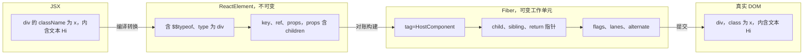
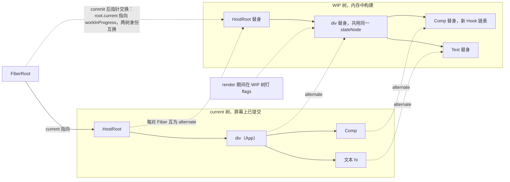
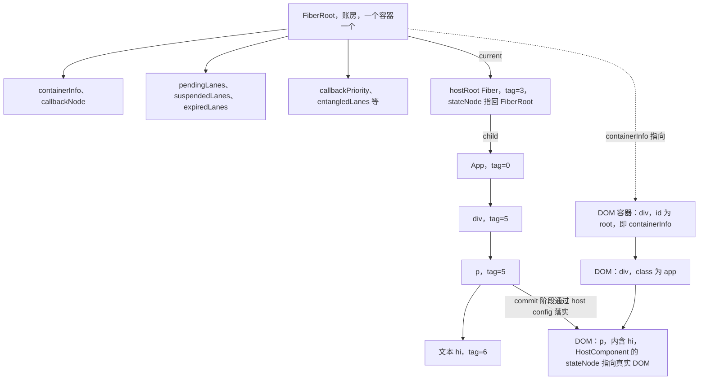

# 第 2 章 ReactElement 与 Fiber 架构

[上一章：架构总览](./01-architecture-overview.md) ｜ [下一章：Scheduler 调度器与 Lane 优先级模型](./03-scheduler-and-lanes.md)

> 本章基于 React `19.3.0` 源码。上一章我们在直升机上看清了森林，本章落地看两种最关键的「树」：描述 UI 的 **ReactElement**，以及 React 内部真正干活的 **Fiber**。

## 学习目标

1. 说清 JSX 编译后到底变成什么对象，`jsx` 运行时与 `createElement` 的差异在哪里。
2. 掌握 ReactElement 的每个字段，并理解 `$$typeof = Symbol.for('react.transitional.element')` 的安全意义。
3. 讲明白 React 19 的 ref-as-prop：为什么 `ref` 能当普通 prop 传递，`element.ref` 又是什么。
4. 完整说出 FiberNode 的核心字段含义与「谁来写」，理解 `updateQueue` / `memoizedState` 的多态性。
5. 理解双缓存（current / workInProgress / alternate）机制，并读懂 WorkTags、Flags、Mode 三套枚举和 FiberRoot 字段。

## 2.1 引入：元素是「剧本」，Fiber 是「演出档案」

先区分两个常被混淆的东西：**ReactElement（元素）** 是写 JSX 得到的普通对象，不可变、无状态，只是「页面应该长这样」的一次性快照（剧本）；**Fiber** 是 React 为每个组件/节点长期维护的工作单元，有父子兄弟指针、新旧 props、状态、flags 标记和 alternate 替身，才是协调算法的载体（演出档案）。



每次 render，React 用元素在 Fiber 树上「对账」（reconcile）：元素用完即弃，Fiber 会被复用和修改。

## 2.2 JSX 转换：jsx 与 createElement

### 2.2.1 两种编译产物

现代 JSX 转换（automatic runtime，Babel/SWC/esbuild 默认）与经典转换的产物对照：

```jsx
// 你写的
const el = <Button type="primary" key="ok">点我</Button>;
// 现代转换：import { jsx } from 'react/jsx-runtime';
const el = jsx(Button, { type: 'primary', children: '点我' }, 'ok');
// 经典转换：
const el = React.createElement(Button, { type: 'primary', key: 'ok' }, '点我');
```

两者最终都调用同一个内部工厂 `ReactElement(...)`，但参数协议不同。

### 2.2.2 jsxProd：只剔除 key，不剔除 ref

出处：packages/react/src/jsx/ReactJSXElement.js:291-348（React 19.3.0）
[ReactJSXElement.js](file:///Users/yangzhijie/Desktop/practice_projects/claude-code-test/react-vue-source-deep-dive/sources/react/packages/react/src/jsx/ReactJSXElement.js#L291-L348)

```js
export function jsxProd(type, config, maybeKey) {
  let key = null;
  if (maybeKey !== undefined) {        // 第三个参数是编译器单独传入的 key
    if (__DEV__) checkKeyStringCoercion(maybeKey);
    key = '' + maybeKey;               // key 永远被字符串化（乐观 key 分支省略）
  }
  if (hasValidKey(config)) {           // key 也可能混在 config 里（会警告）
    if (__DEV__) checkKeyStringCoercion(config.key);
    key = '' + config.key;
  }

  let props;
  if (!('key' in config)) {
    props = config;                    // 快速路径：直接复用原对象，零拷贝
  } else {
    props = {};
    for (const propName in config) {
      if (propName !== 'key') {        // 只剔除 key！ref 被原样保留在 props 里
        props[propName] = config[propName];
      }
    }
  }

  return ReactElement(type, key, props, getOwner(), undefined, undefined);
}
```

对比 `createElement`，差异主要有三点（[ReactJSXElement.js:610-711](file:///Users/yangzhijie/Desktop/practice_projects/claude-code-test/react-vue-source-deep-dive/sources/react/packages/react/src/jsx/ReactJSXElement.js#L610-L711)）：

| 差异点 | `jsx`（现代运行时） | `createElement`（经典） |
| --- | --- | --- |
| children | 放在 `config.children` 里（静态多子时编译器传数组，`jsxs`） | 从第 3 个起的可变参数收集，多子会新建数组 |
| key | 编译器作为独立的第三个参数传入 | 放在 `config.key` 里，再被提取出来 |
| defaultProps | **完全不处理** | 仍保留一段 `type.defaultProps` 兜底解析（legacy 兼容，见 2.4.2） |
| 额外字段 / 对象复用 | 无；key 不在 config 时直接复用 props 对象 | 过滤 `__self`/`__source`；总是新建 props 对象（手动调用无法保证对象新鲜度） |

## 2.3 ReactElement 数据结构

### 2.3.1 元素是怎么造出来的

`ReactElement` 是个普通工厂函数（**不能 `new`**，也不能 `instanceof`）。React 19 中它的第一件事就是从 `props.ref` 取 ref：

出处：packages/react/src/jsx/ReactJSXElement.js:170-200（React 19.3.0）
[ReactJSXElement.js](file:///Users/yangzhijie/Desktop/practice_projects/claude-code-test/react-vue-source-deep-dive/sources/react/packages/react/src/jsx/ReactJSXElement.js#L170-L200)

```js
function ReactElement(type, key, props, owner, debugStack, debugTask) {
  // 忽略传入的 ref，一切以 props.ref 为准
  const refProp = props.ref;
  const ref = refProp !== undefined ? refProp : null; // undefined 兜底为 null

  let element;
  if (__DEV__) {
    // dev：ref 是不可枚举属性，读取时会触发弃用警告（见 2.4.1）
    element = {
      $$typeof: REACT_ELEMENT_TYPE, // 身份戳
      type,                        // 'div' / 函数 / 类 / Symbol 类型
      key,                         // 字符串 key 或 null
      props,                       // 包含 children、ref 在内的全部属性
      _owner: owner,               // 是哪个组件创建了我（dev 栈追溯）
    };
    if (ref !== null) {
      Object.defineProperty(element, 'ref', {
        enumerable: false,
        get: elementRefGetterWithDeprecationWarning,
      });
    } // ref 为 null 时则定义为不可枚举的固定值 null
  }   // 以下 DEV 附加字段、prod 分支省略
}
```

生产环境则更简单：`ref` 是普通字段，没有 `_owner`（[ReactJSXElement.js:225-238](file:///Users/yangzhijie/Desktop/practice_projects/claude-code-test/react-vue-source-deep-dive/sources/react/packages/react/src/jsx/ReactJSXElement.js#L225-L238)）。

### 2.3.2 字段表

出处：packages/shared/ReactElementType.js:12-26（React 19.3.0）
[ReactElementType.js](file:///Users/yangzhijie/Desktop/practice_projects/claude-code-test/react-vue-source-deep-dive/sources/react/packages/shared/ReactElementType.js#L12-L26)

| 字段 | 类型 | 作用 |
| --- | --- | --- |
| `$$typeof` | `Symbol` | 元素身份戳，值为 `Symbol.for('react.transitional.element')` |
| `type` | `string \| function \| symbol …` | 元素类型：`'div'` 等宿主字符串、函数/类组件、`REACT_FRAGMENT_TYPE`、`REACT_PROVIDER_TYPE` 等 |
| `key` | `string \| null` | 列表 diff 时的身份标识，永远被 `'' + x` 字符串化 |
| `ref` | `RefObject \| function \| null` | 19 中来自 `props.ref`；dev 下是不可枚举的告警 getter，prod 下是普通字段 |
| `props` | `object` | 全部属性，含 `children`、`ref` |
| `_owner` | Fiber / null | 创建该元素的组件（owner），主要用于 dev 栈与告警；**prod 构建里不存在** |
| `_store.validated` | `0 \| 1 \| 2` | dev：key 是否已校验，不可枚举，放在独立 `_store` 上以便整体 freeze |
| `_debugInfo` / `_debugStack` / `_debugTask` | various | dev：RSC 调试信息 / 创建处调用栈 / ConsoleTask，用于报错组件栈 |

### 2.3.3 为什么是 Symbol.for（而不是字符串或普通 Symbol）

出处：packages/shared/ReactSymbols.js:14-18（React 19.3.0）
[ReactSymbols.js](file:///Users/yangzhijie/Desktop/practice_projects/claude-code-test/react-vue-source-deep-dive/sources/react/packages/shared/ReactSymbols.js#L14-L18)

```js
// The Symbol used to tag the ReactElement-like types.
export const REACT_LEGACY_ELEMENT_TYPE: symbol = Symbol.for('react.element');
export const REACT_ELEMENT_TYPE: symbol = Symbol.for(
  'react.transitional.element',
);
```

两个问题：**①防 XSS 注入**。服务端可能把用户输入的 JSON 塞进页面，`JSON.parse('{"type":"script",...}')` 得到的普通对象若也被当元素，攻击者就能伪造节点；而 JSON 无法携带 Symbol，伪造对象过不了校验。**②为什么用 `Symbol.for` 而不是 `Symbol()`？** 页面上可能有多个 **realm**（iframe、Worker、同页多份 React）；`Symbol()` 每次唯一、跨 realm 不相等，`Symbol.for('x')` 走全局注册表，跨 realm/多副本取到同一个值。React 只在少数需要跨 realm 共享的标签上用 `Symbol.for`。

> 名字里的 **transitional（过渡）** 是 19 的工程取舍：为让仍在判断 `Symbol.for('react.element')` 的旧生态不立刻崩，先换新值推进 ref-as-prop 改造，旧值保留为 `REACT_LEGACY_ELEMENT_TYPE`。判断元素永远用 `isValidElement`（[ReactJSXElement.js:891-897](file:///Users/yangzhijie/Desktop/practice_projects/claude-code-test/react-vue-source-deep-dive/sources/react/packages/react/src/jsx/ReactJSXElement.js#L891-L897)），不要手写字符串比较。

## 2.4 React 19 勘误：ref-as-prop 与 defaultProps

### 2.4.1 ref 成为普通 prop

18 及以前，`ref` 是保留字：运行时把它从 props 抠出来放到 `element.ref`，函数组件收不到 ref，转发必须包 `forwardRef`。19 中：jsx 运行时只剔 `key`，`ref` 留在 props 里（2.2.2），函数组件可直接 `function Input({ref}) { return <input ref={ref}/> }`；为兼容旧代码读取 `element.ref`，dev 下它是带弃用警告的 getter：

出处：packages/react/src/jsx/ReactJSXElement.js:143-160（React 19.3.0）
[ReactJSXElement.js](file:///Users/yangzhijie/Desktop/practice_projects/claude-code-test/react-vue-source-deep-dive/sources/react/packages/react/src/jsx/ReactJSXElement.js#L143-L160)

```js
function elementRefGetterWithDeprecationWarning() {
  if (__DEV__) {
    const componentName = getComponentNameFromType(this.type);
    if (!didWarnAboutElementRef[componentName]) {
      didWarnAboutElementRef[componentName] = true;
      console.error(
        'Accessing element.ref was removed in React 19. ref is now a ' +
          'regular prop. It will be removed from the JSX Element type in a future release.',
      );
    }
    // undefined 的 element.ref 为向后兼容被强制转成 null
    const refProp = this.props.ref;
    return refProp !== undefined ? refProp : null;
  }
}
```

注意：`key` 至今仍是保留字——props 里拿不到 `key`（dev 下访问 `props.key` 会触发专门告警，见 [ReactJSXElement.js:121-141](file:///Users/yangzhijie/Desktop/practice_projects/claude-code-test/react-vue-source-deep-dive/sources/react/packages/react/src/jsx/ReactJSXElement.js#L121-L141)）。

### 2.4.2 函数组件 defaultProps 已失效

现代 jsx 运行时不再解析 defaultProps；协调器的 render 路径里，函数组件直接拿 `pendingProps` 渲染，**没有** defaultProps 解析逻辑（全文件仅 class 路径解析）。唯一仍在协调器内解析 defaultProps 的是 class 组件：

出处：packages/react-reconciler/src/ReactFiberClassComponent.js:1203-1217（React 19.3.0）
[ReactFiberClassComponent.js](file:///Users/yangzhijie/Desktop/practice_projects/claude-code-test/react-vue-source-deep-dive/sources/react/packages/react-reconciler/src/ReactFiberClassComponent.js#L1203-L1217)

```js
  // Resolve default props.
  const defaultProps = Component.defaultProps;
  if (defaultProps) {
    if (newProps === baseProps) {   // 若上面为剔除 ref 复制过 props，则复用
      newProps = assign({}, newProps);
    }
    for (const propName in defaultProps) {
      if (newProps[propName] === undefined) {
        newProps[propName] = defaultProps[propName];
      }
    }
  }
```

一个旁证：`isSimpleFunctionComponent` 把「带 defaultProps 的函数」排除在快速路径之外——因为这类历史代码需要走更保守的处理：

出处：packages/react-reconciler/src/ReactFiber.js:308-314（React 19.3.0）
[ReactFiber.js](file:///Users/yangzhijie/Desktop/practice_projects/claude-code-test/react-vue-source-deep-dive/sources/react/packages/react-reconciler/src/ReactFiber.js#L308-L314)

```js
export function isSimpleFunctionComponent(type: any): boolean {
  return (
    typeof type === 'function' &&
    !shouldConstruct(type) &&        // 不是 class
    type.defaultProps === undefined  // 带 defaultProps 的函数不走简单路径
  );
}
```

> 实测细节（以源码为准）：`createElement`（经典转换）里仍保留无条件的 `type.defaultProps` 解析（[ReactJSXElement.js:703-711](file:///Users/yangzhijie/Desktop/practice_projects/claude-code-test/react-vue-source-deep-dive/sources/react/packages/react/src/jsx/ReactJSXElement.js#L703-L711)），但 19 默认的现代 jsx 转换与协调器函数组件路径都不再解析，故函数组件 defaultProps 事实上失效；18.x 那条专门 dev 警告在 19.3 已移除。请改用 ES6 默认参数：`function Comp({name = '匿名'}) {}`。

## 2.5 Fiber：React 的工作单元

### 2.5.1 FiberNode 构造函数

出处：packages/react-reconciler/src/ReactFiber.js:134-173（React 19.3.0）
[ReactFiber.js](file:///Users/yangzhijie/Desktop/practice_projects/claude-code-test/react-vue-source-deep-dive/sources/react/packages/react-reconciler/src/ReactFiber.js#L134-L173)

```js
function FiberNode(
  this: $FlowFixMe, tag: WorkTag, pendingProps: mixed,
  key: ReactKey, mode: TypeOfMode, // 形参（源码逐行换行，此处并排）
) {
  // —— 身份（Instance）——
  this.tag = tag;
  this.key = key;
  this.elementType = null; this.type = null; this.stateNode = null;
  // —— 链表树结构（Fiber）——
  this.return = null;   // 父 Fiber（「处理完我回到哪」，类似返回地址）
  this.child = null;   // 第一个子 Fiber
  this.sibling = null; // 右边第一个兄弟
  this.index = 0; this.ref = null;
  this.refCleanup = null;
  // —— 输入 / 输出 / 状态（多态）——
  this.pendingProps = pendingProps; // 本次待处理的 props
  this.memoizedProps = null;        // 上次渲染定格的 props
  this.updateQueue = null;          // 更新队列 / 副作用链 / 缓存…
  this.memoizedState = null;        // class state / Hook 链表 / root state…
  this.dependencies = null;         // 依赖的 context/event
  this.mode = mode;                 // 模式位（并发、严格等）
  // —— 副作用标记 / 调度优先级 / 替身 ——
  this.flags = NoFlags; this.subtreeFlags = NoFlags; this.deletions = null;
  this.lanes = NoLanes; this.childLanes = NoLanes;
  this.alternate = null;            // 另一棵树上的「我」
```

> 为控制篇幅，三个相邻的 `null` 初始化字段在同一条语句行内并列展示，语义与源码逐行赋值一致；其后 profiling/dev 字段（134-207 的剩余部分）见字段表末尾两行。

### 2.5.2 字段全表（是什么 + 谁来写）

| 字段 | 类型 | 是什么 / 谁来写 |
| --- | --- | --- |
| `tag` | WorkTag(number) | 节点类型枚举（2.7）。由 `createFiberFromTypeAndProps` 在创建时判定，之后不变 |
| `key` | ReactKey | 来自 element.key，diff 身份 |
| `elementType` | any | 保留「元素上写的类型」：Lazy 未解析前是 lazy 对象；一般等于 `type` |
| `type` | any | 已解析的类型：函数/类本身、`'div'`、Symbol 类型。`beginWork` 时可能被 Lazy 解析改写 |
| `stateNode` | any | 多态：HostComponent 存 DOM 节点；ClassComponent 存组件实例；HostRoot 存 FiberRoot；Profiler/ViewTransition 存数据对象 |
| `return` | Fiber\|null | 父节点，reconcile 构建链表时写 |
| `child` / `sibling` / `index` | Fiber\|null / number | 单链表树结构，reconcile 子节点时写 |
| `ref` / `refCleanup` | ref / function | 当前要附着的 ref 及其清理函数；commit 阶段 attach/detach |
| `pendingProps` / `memoizedProps` | any | 本次待处理输入（`createWorkInProgress` 传入）/ 完成后定格，作为下次 diff 基准 |
| `updateQueue` | mixed | 多态，见 2.5.3 |
| `memoizedState` | any | 多态，见 2.5.3 |
| `dependencies` | Dependencies\|null | 第一个 context 依赖的链表头，context 更新时据此找受影响 Fiber |
| `mode` | TypeOfMode | 并发/严格/Profile 等位（2.9），创建时继承自父 |
| `flags` | Flags(number) | 本节点待做的副作用位（2.8），render 阶段各 begin/completeWork 打标，commit 后清除 |
| `subtreeFlags` | Flags(number) | 子树副作用的并集，commit 遍历时用来整棵剪枝 |
| `deletions` | Array\|null | 本节点下被删除的子 Fiber 收集数组 |
| `lanes` / `childLanes` | Lanes(number) | 自身/子树的待办优先级，第 3 章主角 |
| `alternate` | Fiber\|null | 双缓存替身（2.6） |
| `actualDuration` 等 4 个 / `_debugOwner` 等 | number / any | 仅 profiling：耗时统计 / 仅 dev：调试归属、调用栈、hook 类型快照 |

### 2.5.3 updateQueue 与 memoizedState 的多态

同一个字段，在不同 `tag` 下存完全不同的东西，这是读 Fiber 源码最容易懵的点：

| Fiber tag | `updateQueue` | `memoizedState` |
| --- | --- | --- |
| `FunctionComponent` | 带 `effects`/`stores` 等的函数组件队列（useEffect/useSyncExternalStore 元数据） | **Hook 链表头**（每个 useState/useEffect 一个 Hook 节点） |
| `ClassComponent` | 状态更新队列（`update.payload` + 回调链） | class 实例的 `this.state` 快照 |
| `HostRoot` | 类更新队列，`update.payload = {element}` | `{element, isDehydrated, cache}` RootState |
| `SuspenseComponent` | retry 回调等 | SuspenseState（dehydrated/t treeLanes…） |
| `OffscreenComponent`/`ActivityComponent` | 缓存更新队列 | OffscreenState（`{baseLanes, cachePool}` 等） |
| HostComponent / HostText | 通常为 null | 通常为 null（状态在 DOM 节点本身） |

## 2.6 双缓存：current、workInProgress 与 alternate

### 2.6.1 为什么需要两棵树

如果直接在「用户正看着的树」上改，render 被打断时屏幕就会半新半旧。React 用**双缓存（double buffering）**：**current 树**（`FiberRoot.current` 指向、已提交、对应当前屏幕）与 **workInProgress 树（WIP）**（内存中构建）；同一组件在两树各有一个 Fiber，互以 `alternate` 指向对方。WIP 构建完并 commit 后 `FiberRoot.current` 一指即转正。

### 2.6.2 createWorkInProgress：从 alternate 池里「捞替身」

出处：packages/react-reconciler/src/ReactFiber.js:323-351（React 19.3.0）
[ReactFiber.js](file:///Users/yangzhijie/Desktop/practice_projects/claude-code-test/react-vue-source-deep-dive/sources/react/packages/react-reconciler/src/ReactFiber.js#L323-L351)

```js
export function createWorkInProgress(current: Fiber, pendingProps: any): Fiber {
  let workInProgress = current.alternate;
  if (workInProgress === null) {
    // 双缓存池：最多两个版本，另一个可放心复用；惰性创建
    workInProgress = createFiber(
      current.tag, pendingProps, current.key, current.mode,
    );
    workInProgress.elementType = current.elementType;
    workInProgress.type = current.type;
    workInProgress.stateNode = current.stateNode; // 共用 DOM/实例
    workInProgress.alternate = current;
    current.alternate = workInProgress;
  } else {
    workInProgress.pendingProps = pendingProps;
    workInProgress.type = current.type;
    workInProgress.flags = NoFlags;        // 复用：重置标记
    workInProgress.subtreeFlags = NoFlags;
    workInProgress.deletions = null;
```

复用时还要把上一轮的输入搬运过来（[ReactFiber.js:381-413](file:///Users/yangzhijie/Desktop/practice_projects/claude-code-test/react-vue-source-deep-dive/sources/react/packages/react-reconciler/src/ReactFiber.js#L381-L413)）：`flags = current.flags & StaticMask`、同步 `childLanes/lanes`、`child`、`memoizedProps`、`memoizedState`、`updateQueue`、`ref`。注意 `updateQueue` 是**共享引用**，更新入队时两边都能看到，这是打断/恢复能接续的关键之一。

### 2.6.3 双缓存链表结构图



## 2.7 WorkTags：节点类型枚举

出处：packages/react-reconciler/src/ReactWorkTags.js:44-73（React 19.3.0）
[ReactWorkTags.js](file:///Users/yangzhijie/Desktop/practice_projects/claude-code-test/react-vue-source-deep-dive/sources/react/packages/react-reconciler/src/ReactWorkTags.js#L44-L73)

| 值 | 常量 | 说明 |
| --- | --- | --- |
| 0 | FunctionComponent | 函数组件 |
| 1 | ClassComponent | class 组件 |
| **2** | （空洞） | 历史上是 IndeterminateComponent，已移除 |
| 3 | HostRoot | 根 Fiber（FiberRoot.current） |
| 4 | HostPortal | `createPortal` 的子树根 |
| 5 | HostComponent | 宿主节点，DOM 下即标签名元素 |
| 6 | HostText | 文本节点 |
| 7 | Fragment | `<>…</>` |
| 8 | Mode | `<StrictMode>` 等模式组件 |
| 9 / 10 | ContextConsumer / ContextProvider | Consumer / Provider |
| 11 | ForwardRef | `forwardRef` 组件 |
| 12 | Profiler | `<Profiler>` |
| 13 | SuspenseComponent | `<Suspense>` |
| 14 / 15 | MemoComponent / SimpleMemoComponent | `memo(非函数)` 包装壳 / `memo(函数)` 直接形态 |
| 16 | LazyComponent | `lazy()` 未解析时 |
| 17 / 18 | IncompleteClassComponent / DehydratedFragment | class 首次挂载未构造完的中间态 / SSR 注水前脱水 HTML 占位 |
| 19 | SuspenseListComponent | `<SuspenseList>` |
| **20** | （空洞） | 历史上是 FundamentalComponent/Block |
| 21 | ScopeComponent | 实验 scope API |
| 22 | OffscreenComponent | 隐藏/缓存子树的底层组件 |
| 23 | LegacyHiddenComponent | 旧版 hidden |
| 24 / 25 | CacheComponent / TracingMarkerComponent | `<Cache>` / transition tracing 标记 |
| 26 / 27 | HostHoistable / HostSingleton | 可提升资源（`<link>`/`<meta>`）/ 单例资源（`<html>`/`<head>`） |
| 28 | **IncompleteFunctionComponent** 🆕 | 函数组件 render 中途挂起的未完成态 |
| 29 | **Throw** 🆕 | 虚拟的「抛出节点」，begin 阶段直接 throw（类型错误/Suspense 兜底） |
| 30 | **ViewTransitionComponent** 🆕 | `<ViewTransition>` |
| 31 | **ActivityComponent** 🆕 | `<Activity>`（Offscreen 的新公开名） |

> 数字 2 和 20 是**空洞**，不要看到枚举从 0 到 31 就以为每个数字都有主。Flow 类型 `WorkTag = 0|1|…|31`（[ReactWorkTags.js:10-42](file:///Users/yangzhijie/Desktop/practice_projects/claude-code-test/react-vue-source-deep-dive/sources/react/packages/react-reconciler/src/ReactWorkTags.js#L10-L42)）只是放宽校验。

## 2.8 Flags：副作用位标志

render 阶段不直接做副作用，而是在 Fiber 上「打旗」：`fiber.flags |= Update`。commit 阶段按位筛旗、一次性执行。

出处：packages/react-reconciler/src/ReactFiberFlags.js:18-57（React 19.3.0）
[ReactFiberFlags.js](file:///Users/yangzhijie/Desktop/practice_projects/claude-code-test/react-vue-source-deep-dive/sources/react/packages/react-reconciler/src/ReactFiberFlags.js#L18-L57)

| 位（节选） | 常量 | 含义 |
| --- | --- | --- |
| bit 0 / 3 | PerformedWork / Cloned | DevTools「做过工作」标记 / 子被克隆 |
| bit 1 | Placement | 新插入/移动 |
| bit 2 | Update | 属性/状态更新 |
| bit 4 | ChildDeletion | 有子节点被删除 |
| bit 5 / 6 | ContentReset / Callback | 文本重置（防复用残留）/ `setState(cb)`、`update.callback` |
| bit 7 / 8 | DidCapture / ForceClientRender | 已捕获挂起错误 / 注水失败强制客户端渲染 |
| bit 9 | Ref | 需要附着/分离 ref |
| bit 10 | Snapshot | before-mutation 前拍快照（`getSnapshotBeforeUpdate`） |
| bit 11 | Passive | 有 `useEffect` 待执行（异步被动副作用） |
| bit 12 | Hydrating | 正在注水已有 DOM |
| bit 13 | Visibility | Offscreen/Activity 可见性变化 |
| bit 14 | StoreConsistency | 外部 store 一致性校验（与 ScheduleRetry 复用此位） |
| bit 15+ | Incomplete、ShouldCapture、Forked、SnapshotStatic、**LayoutStatic**、PassiveStatic… | 挂起捕获与静态标记（不随单次渲染重置，卸载剪枝用） |

注意源码里有**位复用**：互斥场景的标记共用一位，如 `Hydrate = Callback`、`ScheduleRetry = StoreConsistency`（[ReactFiberFlags.js:42-51](file:///Users/yangzhijie/Desktop/practice_projects/claude-code-test/react-vue-source-deep-dive/sources/react/packages/react-reconciler/src/ReactFiberFlags.js#L42-L51)），因为「快没位可用了」。

commit 阶段用三个 Mask 决定要不要遍历某棵子树：

出处：packages/react-reconciler/src/ReactFiberFlags.js:101-132（React 19.3.0）
[ReactFiberFlags.js](file:///Users/yangzhijie/Desktop/practice_projects/claude-code-test/react-vue-source-deep-dive/sources/react/packages/react-reconciler/src/ReactFiberFlags.js#L101-L132)

```js
export const BeforeMutationMask: number =
  Snapshot |
  (enableCreateEventHandleAPI
    ? Update | ChildDeletion | Visibility
    : enableEffectEventMutationPhase ? 0 : Update);

export const MutationMask =
  Placement | Update | ChildDeletion | ContentReset |
  Ref | Hydrating | Visibility | FormReset;
export const LayoutMask = Update | Callback | Ref | Visibility;

// TODO: Split into PassiveMountMask and PassiveUnmountMask
export const PassiveMask = Passive | Visibility | ChildDeletion;
```

| Mask | 对应 commit 子阶段 | 作用 |
| --- | --- | --- |
| BeforeMutationMask | before mutation | 拍快照、读 `getSnapshotBeforeUpdate` |
| MutationMask | mutation | 真实增删改 DOM、分离 ref |
| LayoutMask | layout | `useLayoutEffect`、componentDidMount/Update、附着 ref |
| PassiveMask | passive（绘制后） | `useEffect` 的 create/cleanup |

## 2.9 TypeOfMode：Fiber 的模式位

出处：packages/react-reconciler/src/ReactTypeOfMode.js:12-21（React 19.3.0）
[ReactTypeOfMode.js](file:///Users/yangzhijie/Desktop/practice_projects/claude-code-test/react-vue-source-deep-dive/sources/react/packages/react-reconciler/src/ReactTypeOfMode.js#L12-L21)

```js
export const NoMode = /*              */ 0b0000000;
export const ConcurrentMode = /*      */ 0b0000001; // 并发能力（createRoot 自带）
export const ProfileMode = /*         */ 0b0000010; // 计时/性能分析
//export const DebugTracingMode =     0b0000100;  // 已移除
export const StrictLegacyMode = /*    */ 0b0001000; // 严格模式的遗留检查
export const StrictEffectsMode = /*   */ 0b0010000; // 严格模式：effect 挂载-卸载-再挂载
export const SuspenseyImagesMode = /* */ 0b0100000; // 实验：图片可挂起
```

`createHostRootFiber` 决定根模式：`createRoot` 默认带 `ConcurrentMode`；`unstable_strictMode: true` 叠加两个 Strict 位；dev 或装了 DevTools 时叠加 `ProfileMode`（[ReactFiber.js:529-551](file:///Users/yangzhijie/Desktop/practice_projects/claude-code-test/react-vue-source-deep-dive/sources/react/packages/react-reconciler/src/ReactFiber.js#L529-L551)）；`<StrictMode>` 还会在子树追加 Strict 位。

## 2.10 FiberRoot：整棵树的「账房」

每个 `createRoot` 容器对应一个 FiberRoot，它不参与组件树，只负责记账与调度状态。

出处：packages/react-reconciler/src/ReactFiberRoot.js:63-104（React 19.3.0）
[ReactFiberRoot.js](file:///Users/yangzhijie/Desktop/practice_projects/claude-code-test/react-vue-source-deep-dive/sources/react/packages/react-reconciler/src/ReactFiberRoot.js#L63-L104)

| 字段 | 类型 | 作用 |
| --- | --- | --- |
| `tag` | 0\|1 | LegacyRoot / ConcurrentRoot |
| `containerInfo` / `pendingChildren` | any | 宿主容器（DOM 下就是那个 div）/ 持久化渲染器用 |
| `current` | Fiber | hostRoot Fiber（current 树入口） |
| `pingCache` / `timeoutHandle` / `cancelPendingCommit` | 各种 | Suspense promise 监听表 / 延迟提交定时器 / 其取消函数 |
| `context` / `pendingContext` | object\|null | 顶层 context（legacy 顶层 context 用） |
| `next` | FiberRoot\|null | 多根调度链表的下一个根（第 3 章） |
| `callbackNode` / `callbackPriority` | any / Lane | 当前挂在 Scheduler 上的任务句柄及其 lane |
| `expirationTimes` | LaneMap(number) | 每个 lane 的过期时间戳（防饥饿，第 3 章） |
| `pendingLanes` | Lanes | **所有待处理 lane 的位集合** |
| `suspendedLanes` / `pingedLanes` / `warmLanes` | Lanes | Suspense 挂起 / 被 promise resolve「ping 醒」/ 已预热 的 lanes |
| `expiredLanes` | Lanes | 已超时、必须同步抢跑的 lanes |
| `indicatorLanes` / `errorRecoveryDisabledLanes` / `shellSuspendCounter` | Lanes / number | 默认指示器（实验）/ 禁止错误恢复 / 外壳挂起计数 |
| `entangledLanes` / `entanglements` | Lanes / LaneMap | lane 纠缠关系（第 3 章，小写驼峰） |
| `hiddenUpdates` / `pooledCache` / `pooledCacheLanes` | LaneMap / Cache | 隐藏区暂存更新 / Suspense 缓存池 |
| `identifierPrefix` / `_debugRootType` | string | useId 前缀（多根/SSR 去重）/ dev 根类型标注 |
| `onUncaughtError` / `onCaughtError` / `onRecoverableError` | fn | createRoot 传入的错误回调 |
| `formState` / `incompleteTransitions` | any / Map | Action 表单状态 / transition tracing |

> 📌 勘误：19.3 的 FiberRootNode **没有 `finishedWork` 字段**，也没有 `finishedLanes` 字段（旧注释里提到的 finishedLanes 概念由 work loop 的局部状态承担）。渲染完成的 WIP 树是 `performWorkOnRoot` / work loop 里的局部变量，提交结束即弃。

## 2.11 FiberRoot ↔ hostRoot ↔ Fiber 树 ↔ DOM 树



每一层的 `stateNode` 把抽象世界和具体世界缝起来：hostRoot 的 stateNode 是 FiberRoot，宿主组件的 stateNode 是真实 DOM 节点。

## 端到端流程串讲

1. `<Button type="primary">OK</Button>` 经编译器变 `jsx(Button, {type:'primary',children:'OK'})`，产出一个冻结（dev）的 ReactElement：带 `$$typeof` 戳、`key=null`、`props`（含 children，ref 若有也在其中）。
2. 父组件 reconcile 时，`createFiberFromElement` 读取 element 的 type/key/props，调 `createFiberFromTypeAndProps` 判定 tag（函数→FunctionComponent=0，字符串→HostComponent=5，fragment/Suspense 等走 Symbol 分支），new 出 Fiber（[ReactFiber.js:739-765](file:///Users/yangzhijie/Desktop/practice_projects/claude-code-test/react-vue-source-deep-dive/sources/react/packages/react-reconciler/src/ReactFiber.js#L739-L765)）。
3. render 阶段从 root 开始，对每个 Fiber `beginWork`：`createWorkInProgress(current, pendingProps)` 取替身，执行组件函数，diff 子元素，增删改子 Fiber 并打 `Placement/Update` 等 flags，函数组件的 Hooks 挂到 `memoizedState` 链表。
4. `completeWork` 向上归并：HostComponent 创建/更新 DOM 节点（存在 `stateNode`），把子节点 append 进去，并把 flags 冒泡汇总成 `subtreeFlags`。
5. render 产出完整 WIP 树后进入 commit：按 Mask 遍历，mutation 阶段操作 DOM，layout 阶段跑 layout effect/ref，随后浏览器绘制，passive 阶段跑 useEffect。
6. 提交最后 `FiberRoot.current = workInProgress`，双树身份互换；旧 current 成为下一轮可复用的 alternate 池。

## 版本勘误 📌

1. **`$$typeof` 的值变了。** 19 中元素是 `Symbol.for('react.transitional.element')`；旧博客写的 `Symbol.for('react.element')` 对应 `REACT_LEGACY_ELEMENT_TYPE`。
2. **ref 不再从 props 中剔除。** jsx 运行时只剔 `key`；函数组件可直接接 `ref` prop，`forwardRef` 在 19 中不再是必需（仍可用）。`element.ref` 在 dev 下是告警 getter。
3. **函数组件 `defaultProps` 失效**，协调器只在 class 路径解析；18.x 的专门警告在 19.3 已移除。类组件/`memo`/`lazy` 的历史行为仍保留。
4. **ReactJSXElement 的位置变了**：19 中在 `packages/react/src/jsx/ReactJSXElement.js`，`jsx`/`jsxs`/`jsxDEV`/`createElement` 同文件；老版本路径是 `packages/react/src/ReactJSXElement.js`。
5. **WorkTags 新增 28~31**（IncompleteFunctionComponent/Throw/ViewTransitionComponent/ActivityComponent），2 与 20 是空洞。
6. **FiberRoot 没有 `finishedWork`/`finishedLanes` 字段**；`entangledLanes` 是小写驼峰（旧文章常误写为 `entangleLanes`——那是函数名风格）。
7. 16 时代 Fiber 的 effect 链表字段（`firstEffect/lastEffect/nextEffect`）已删除，副作用遍历靠 `subtreeFlags` + Mask 剪枝；旧名 `Deletion` 现在叫 `ChildDeletion`，读旧文按语义对号。

## 初学者易错点 ⚠️

1. **把元素当实例。** ReactElement 是不可变描述对象，没有状态、没有 setState；有状态的是 Fiber/class 实例。不要试图修改 element.props（dev 下它被 freeze）。
2. **以为 `$$typeof` 可以用来判断组件类型。** 它只区分「是不是 React 元素」；判断元素是 div 还是函数，要看 `element.type`（字符串/函数/Symbol）。
3. **在函数组件里继续用 `forwardRef` 包一层再从第二个参数取 ref。** 19 能跑但多余；直接解构 `ref` prop 即可。反过来，class 组件仍然需要 ref 指向实例，不走 props.ref 传递。
4. **以为每次更新都会新建整棵 Fiber 树。** 只有首次挂载或 key/type 变化导致无法复用才新建；普通更新通过 `alternate` 复用 Fiber，靠 `memoizedProps` 对比决定是否 bail out。
5. **混淆 `pendingProps` 与 `memoizedProps`。** 前者是「这次要处理的输入」，beginWork 结束后定格为后者；在组件中途读到的可能是尚未提交的中间态。
6. **在 `memoizedState` 上按 class 的思路找 `state`，或看到 tag 数字对不上表就怀疑源码。** 函数组件的 `memoizedState` 是按 Hook 调用顺序排列的链表头（这也是 Hooks 不能写在条件里的根因）；数字先核对版本——2 和 20 是空洞，28-31 是 19 新增。

## 本章小结

- JSX 经 `jsx`/`createElement` 变成带 `$$typeof` 戳的不可变 ReactElement；19 的 jsx 运行时只剔 key，ref 留在 props 里。
- Fiber 是带链表指针、输入输出 props、多态队列、flags/lanes 标记和 alternate 替身的长期工作单元。
- 双缓存让 render 可中断：构建永远发生在 WIP 树，提交时切换 `FiberRoot.current`；WorkTags、Flags（副作用位 + 四个 Mask）、Mode（并发/严格等位）是 Fiber 的三套「语言」，FiberRoot 负责 lanes、调度句柄、纠缠、过期时间等全局账务。

## 下一章导读

Fiber 上有 `lanes`、FiberRoot 上有 `pendingLanes/expiredLanes`、调度器里还有优先级——它们如何协同？下一章看：① Scheduler 的 5 档优先级、小顶堆、MessageChannel 与 5ms 时间切片；② Lane 的 31 位布局、`lanes & -lanes` 取最高优先级的补码技巧、React 19 根调度器的「微任务 + Scheduler」双通道，以及饥饿 Transition 的同步抢跑。

👉 [第 3 章：Scheduler 调度器与 Lane 优先级模型](./03-scheduler-and-lanes.md)
