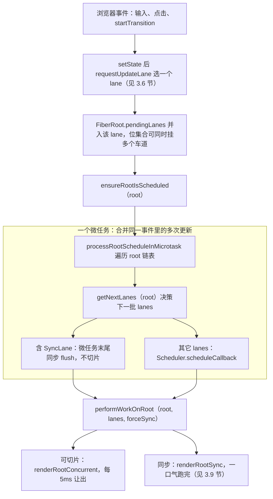
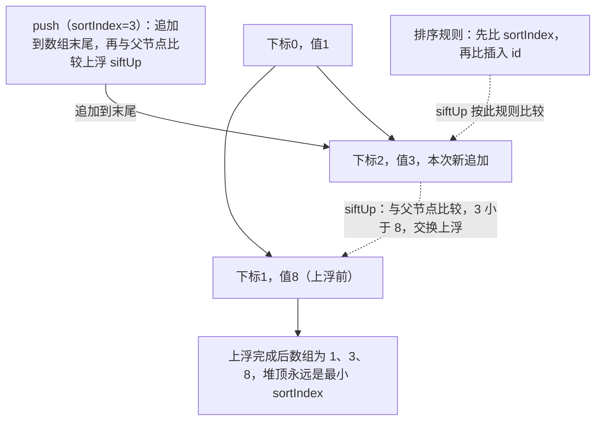
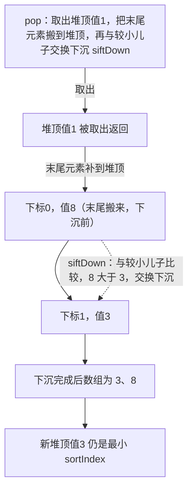
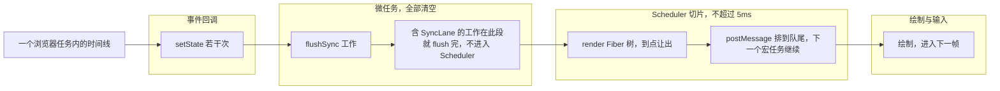
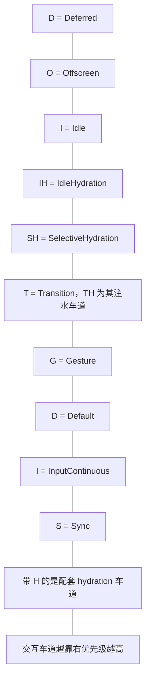

# 第 3 章 Scheduler 调度器与 Lane 优先级模型

[上一章：ReactElement 与 Fiber 架构](./02-element-and-fiber.md) ｜ [下一章：render 阶段深入](./04-render-phase.md)

> 本章基于 React `19.3.0` 源码。第 2 章我们认识了 Fiber 的字段，其中有两个字段一直没展开：Fiber 上的 `lanes` 和 FiberRoot 上的 `pendingLanes`。本章就来回答：React 凭什么让「用户输入」永远比「后台大列表渲染」先被响应？

## 学习目标

1. 分清两套调度系统：通用的 **Scheduler 包**与 reconciler 内部的 **Lane 模型**，以及桥接二者的 **ReactFiberRootScheduler**。
2. 说出 Scheduler 的 5 档优先级、任务过期时间，以及小顶堆如何保证执行顺序。
3. 讲清 5ms 时间切片预算与 `shouldYieldToHost`，以及为什么宿主回调选 MessageChannel 而不是 setTimeout/rIC。
4. 画出 Lane 的 31 位布局，能手算 `lanes & -lanes` 取最高优先级，并解释 `includesSomeLane` / `isSubsetOfLanes` / entangle 的含义。
5. 理解饥饿 lane 的过期抢跑机制，以及一次更新如何从「入队」走到「时间切片循环」。

## 3.1 引入：一次点击背后的「分诊台」

想象一个页面：搜索框的 `onChange` 里一边 `setState` 过滤候选词，一边用 `startTransition` 重新渲染上千条结果；与此同时用户又点了一下按钮。三件事同时发生，如果按「先来后到」排队，输入框必然卡顿。

医院急诊的做法不是排队，而是**分诊**：心梗先于包扎，包扎先于体检，而且急诊病人等太久会被重新提级。React 的调度也是分诊台，由三套机制组成：

- **Scheduler（`packages/scheduler`）**：与 React 无关的通用任务队列。负责「按优先级排队 + 每干 5ms 让出一次主线程」，类比叫号系统。
- **Lane（车道模型）**：reconciler 内部的更新优先级，用 31 个二进制位表示，类比分诊标签。它回答「这次 setState 算哪一类病人」。
- **ReactFiberRootScheduler**：分诊台本身，把 Lane 翻译成「微任务里同步做」或「丢给 Scheduler 切片做」。

## 3.2 两层调度体系总览



注意方向：**Lane 是 React 的语言，Scheduler 优先级是宿主任务的语言**，两者不是一一对应，中间由 ReactFiberRootScheduler 翻译。下面先从更独立、更好懂的 Scheduler 看起。

## 3.3 Scheduler：五档优先级与任务过期

### 3.3.1 五个优先级常量

出处：packages/scheduler/src/SchedulerPriorities.js:13-18（React 19.3.0）
[SchedulerPriorities.js](file:///Users/yangzhijie/Desktop/practice_projects/claude-code-test/react-vue-source-deep-dive/sources/react/packages/scheduler/src/SchedulerPriorities.js#L13-L18)

```js
export const NoPriority = 0;
export const ImmediatePriority = 1;        // 立即级
export const UserBlockingPriority = 2;    // 用户阻塞级（点击、拖拽）
export const NormalPriority = 3;          // 普通（默认）
export const LowPriority = 4;             // 低
export const IdlePriority = 5;            // 空闲
```

| 值 | 常量 | 典型场景 | 任务超时时间 |
| --- | --- | --- | --- |
| 1 | ImmediatePriority | 同步任务（React 19 浏览器里基本不经过它，见勘误 5） | -1（立即过期） |
| 2 | UserBlockingPriority | 离散/连续交互引发的渲染 | 250ms |
| 3 | NormalPriority | 默认数据更新 | 5000ms |
| 4 | LowPriority | 低优先级通知类工作 | 10000ms |
| 5 | IdlePriority | 闲时工作 | 约 24.8 天（几乎不过期） |

超时时间与切片预算都定义在特性开关文件：`frameYieldMs = 5`、`userBlockingPriorityTimeout = 250`、`normalPriorityTimeout = 5000`、`lowPriorityTimeout = 10000`、`enableRequestPaint = true`（[SchedulerFeatureFlags.js:11-16](file:///Users/yangzhijie/Desktop/practice_projects/claude-code-test/react-vue-source-deep-dive/sources/react/packages/scheduler/src/SchedulerFeatureFlags.js#L11-L16)）。

### 3.3.2 入队时计算过期时间

`unstable_scheduleCallback` 按优先级给任务算 `expirationTime = startTime + timeout`：

出处：packages/scheduler/src/forks/Scheduler.js:355-380（React 19.3.0）
[Scheduler.js](file:///Users/yangzhijie/Desktop/practice_projects/claude-code-test/react-vue-source-deep-dive/sources/react/packages/scheduler/src/forks/Scheduler.js#L355-L380)

```js
  var timeout;
  switch (priorityLevel) {
    case ImmediatePriority:
      timeout = -1;                          // 立即过期
      break;
    case UserBlockingPriority:
      timeout = userBlockingPriorityTimeout; // 250
      break;
    case IdlePriority:
      timeout = maxSigned31BitInt;           // 1073741823（:76）
      break;
    case LowPriority:
      timeout = lowPriorityTimeout;          // 10000
      break;
    case NormalPriority:
    default:
      timeout = normalPriorityTimeout;       // 5000
      break;
  }
  var expirationTime = startTime + timeout;  // :380
```

**关键理解：「过期」不是被取消，而是被允许霸占主线程。** 任务还没过期时，Scheduler 每 5ms 就可以打断它；一旦过期，为了不让用户无限等，它会一口气跑完（3.5 节 workLoop 会看到判断）。`maxSigned31BitInt = 1073741823` 定义在 [Scheduler.js:73-76](file:///Users/yangzhijie/Desktop/practice_projects/claude-code-test/react-vue-source-deep-dive/sources/react/packages/scheduler/src/forks/Scheduler.js#L73-L76)。

## 3.4 小顶堆：任务为什么总是按序执行

Scheduler 维护两个数组堆（[Scheduler.js:78-80](file:///Users/yangzhijie/Desktop/practice_projects/claude-code-test/react-vue-source-deep-dive/sources/react/packages/scheduler/src/forks/Scheduler.js#L78-L80)）：`taskQueue` 存已就绪任务（堆键是 `expirationTime`），`timerQueue` 存带 `delay` 的延迟任务（堆键是 `startTime`），到点后由 `advanceTimers` 搬到 `taskQueue`。

堆是数组表示的完全二叉树，排序规则是「先比 sortIndex，再比插入 id」：

出处：packages/scheduler/src/SchedulerMinHeap.js:91-95（React 19.3.0）
[SchedulerMinHeap.js](file:///Users/yangzhijie/Desktop/practice_projects/claude-code-test/react-vue-source-deep-dive/sources/react/packages/scheduler/src/SchedulerMinHeap.js#L91-L95)

```js
function compare(a: Node, b: Node) {
  // Compare sort index first, then task id.
  const diff = a.sortIndex - b.sortIndex;
  return diff !== 0 ? diff : a.id - b.id; // 同截止时刻：先入队的先执行
}
```

第一张：push 后 siftUp 上浮。



第二张：pop 后 siftDown 下沉。



父节点下标是 `(index - 1) >>> 1`（[SchedulerMinHeap.js:42-57](file:///Users/yangzhijie/Desktop/practice_projects/claude-code-test/react-vue-source-deep-dive/sources/react/packages/scheduler/src/SchedulerMinHeap.js#L42-L57)），`peek` 永远返回 `heap[0]`（[:23-25](file:///Users/yangzhijie/Desktop/practice_projects/claude-code-test/react-vue-source-deep-dive/sources/react/packages/scheduler/src/SchedulerMinHeap.js#L23-L25)）。还有一个容易忽略的细节：取消任务**不会**真的从堆里删除（数组堆无法高效删除任意节点），只是把 `task.callback = null`，轮到它时直接 `pop` 丢弃（[Scheduler.js:429-442](file:///Users/yangzhijie/Desktop/practice_projects/claude-code-test/react-vue-source-deep-dive/sources/react/packages/scheduler/src/forks/Scheduler.js#L429-L442)）。

## 3.5 时间切片：5ms 预算与 MessageChannel

### 3.5.1 让出判定

`frameInterval` 默认就是 5ms；`shouldYieldToHost` 在「浏览器等着绘制」或「本次切片已超过 5ms」时返回 true：

出处：packages/scheduler/src/forks/Scheduler.js:456-472（React 19.3.0）
[Scheduler.js](file:///Users/yangzhijie/Desktop/practice_projects/claude-code-test/react-vue-source-deep-dive/sources/react/packages/scheduler/src/forks/Scheduler.js#L456-L472)

```js
let frameInterval: number = frameYieldMs;   // 5ms（:456）

function shouldYieldToHost(): boolean {
  if (!enableAlwaysYieldScheduler && enableRequestPaint && needsPaint) {
    return true;                  // 浏览器有一帧等着画：立刻让出
  }
  const timeElapsed = getCurrentTime() - startTime;
  if (timeElapsed < frameInterval) {
    return false;                 // 才占用主线程不到 5ms：继续干
  }
  return true;                    // 预算用完：让出
}
```

`needsPaint` 由 `requestPaint()` 置位（[:474-479](file:///Users/yangzhijie/Desktop/practice_projects/claude-code-test/react-vue-source-deep-dive/sources/react/packages/scheduler/src/forks/Scheduler.js#L474-L479)），React 在 commit 后会调用它，保证「刚提交的界面」能尽快画到屏幕上。

### 3.5.2 workLoop：过期任务不让，未过期任务让出

出处：packages/scheduler/src/forks/Scheduler.js:193-202（React 19.3.0）
[Scheduler.js](file:///Users/yangzhijie/Desktop/practice_projects/claude-code-test/react-vue-source-deep-dive/sources/react/packages/scheduler/src/forks/Scheduler.js#L193-L202)

```js
function workLoop(initialTime: number) {
  let currentTime = initialTime;
  advanceTimers(currentTime);
  currentTask = peek(taskQueue);
  while (currentTask !== null) {
    if (!enableAlwaysYieldScheduler) {
      if (currentTask.expirationTime > currentTime && shouldYieldToHost()) {
        break; // 任务「还没过期」且「切片预算用完」：让出，下个宏任务继续
      }
    }
    // …执行回调；enableAlwaysYieldScheduler 是实验开关（默认关）
```

回调收到的参数 `didUserCallbackTimeout = expirationTime <= currentTime`（[:212-218](file:///Users/yangzhijie/Desktop/practice_projects/claude-code-test/react-vue-source-deep-dive/sources/react/packages/scheduler/src/forks/Scheduler.js#L212-L218)）——React 根调度器正是靠它把渲染切成同步模式（3.10 节）。如果回调**返回一个新函数**，说明任务没做完，这个续算函数会被重新挂回堆顶，且**无论剩余多少时间都立刻让出**（[:220-231](file:///Users/yangzhijie/Desktop/practice_projects/claude-code-test/react-vue-source-deep-dive/sources/react/packages/scheduler/src/forks/Scheduler.js#L220-L231)）。

### 3.5.3 为什么是 MessageChannel

Scheduler 每一轮工作跑在一个宏任务里，宿主回调的选择有三级降级：

出处：packages/scheduler/src/forks/Scheduler.js:546-560（React 19.3.0）
[Scheduler.js](file:///Users/yangzhijie/Desktop/practice_projects/claude-code-test/react-vue-source-deep-dive/sources/react/packages/scheduler/src/forks/Scheduler.js#L546-L560)

```js
} else if (typeof MessageChannel !== 'undefined') {
  // DOM and Worker environments.
  // We prefer MessageChannel because of the 4ms setTimeout clamping.
  const channel = new MessageChannel();
  const port = channel.port2;
  channel.port1.onmessage = performWorkUntilDeadline;
  schedulePerformWorkUntilDeadline = () => {
    port.postMessage(null);
  };
} else {
  // We should only fallback here in non-browser environments.
  schedulePerformWorkUntilDeadline = () => {
    localSetTimeout(performWorkUntilDeadline, 0);
  };
}
```

- **不用 setTimeout(fn, 0)**：嵌套超过 5 层的定时器在浏览器里会被钳制到最少 4ms，切片本该 5ms 一轮，光唤醒就等 4ms，无法接受（Node.js 下则优先 `setImmediate`，[:531-545](file:///Users/yangzhijie/Desktop/practice_projects/claude-code-test/react-vue-source-deep-dive/sources/react/packages/scheduler/src/forks/Scheduler.js#L531-L545)）。
- **不用 requestIdleCallback / requestAnimationFrame**：rIC 在后台标签页会被推迟甚至冻结、触发时机不稳，Scheduler 要的是「每 5ms 必到」的节拍；rAF 与帧率绑定，源码注释明确大多数任务不需要帧对齐（[:452-455](file:///Users/yangzhijie/Desktop/practice_projects/claude-code-test/react-vue-source-deep-dive/sources/react/packages/scheduler/src/forks/Scheduler.js#L452-L455)）。MessageChannel 的 `postMessage` 是零延迟宏任务，正好。



## 3.6 Lane 模型：为什么用 31 个二进制位

### 3.6.1 从 expirationTime 到 lanes 的动机

React 17 之前也用过「过期时间数字」表示优先级：每个更新一个时间戳，值越小优先级越高。问题是：一个数字只能表达「一条更新」，而渲染往往要处理**一批更新**；想知道「这批里有没有用户输入」「这两批是否必须一起提交」，用单个数字做集合运算既慢又绕。

Lane 的思路换成了**位集合**：一个 31 位整数就是 31 条独立车道，一位代表一类/一条更新；取最高优先级、合并、求交集全是 O(1) 位运算。`TotalLanes = 31`（[ReactFiberLane.js:41](file:///Users/yangzhijie/Desktop/practice_projects/claude-code-test/react-vue-source-deep-dive/sources/react/packages/react-reconciler/src/ReactFiberLane.js#L41)）。

### 3.6.2 31 位布局图

第一张：31 位位号布局，位30 在左、位0 在右。

```mermaid
flowchart LR
    subgraph sgA ["Deferred、Offscreen"]
        n1["位30 Deferred，D"] --- n2["位29 Offscreen，O"]
    end

    subgraph sgB ["Idle 类"]
        n3["位28 Idle，I"] --- n4["位27 IdleHydration，IH"]
    end

    subgraph sgC ["选择性注水"]
        n5["位26 SelectiveHydration，SH"]
    end

    subgraph sgD ["Retry"]
        n6["位25 至位22 Retry 共4条，R4 至 R1"]
    end

    subgraph sgE ["Transition"]
        n7["位21 至位8 Transition 共14条，T14 至 T1"]
    end

    subgraph sgF ["交互车道，越靠右优先级越高"]
        n8["位7 TransitionHydration，TH"] --- n9["位6 Gesture，G"] --- n10["位5 Default，D"] --- n11["位4 DefaultHydration，DH"] --- n12["位3 InputContinuous，I"] --- n13["位2 IH"] --- n14["位1 Sync，S"] --- n15["位0 SH"]
    end

    n2 --- n3
    n4 --- n5
    n5 --- n6
    n6 --- n7
    n7 --- n8
```



第二张：缩写图例。



同步、连续输入、默认三组车道：

出处：packages/react-reconciler/src/ReactFiberLane.js:46-57（React 19.3.0）
[ReactFiberLane.js](file:///Users/yangzhijie/Desktop/practice_projects/claude-code-test/react-vue-source-deep-dive/sources/react/packages/react-reconciler/src/ReactFiberLane.js#L46-L57)

```js
// bit0/bit2/bit4 是配套的 SyncHydration/InputContinuousHydration/DefaultHydration
export const SyncLane: Lane          = 0b0000000000000000000000000000010; // bit1
export const InputContinuousLane     = 0b0000000000000000000000000001000; // bit3
export const DefaultLane             = 0b0000000000000000000000000100000; // bit5
export const SyncUpdateLanes: Lane =
  SyncLane | InputContinuousLane | DefaultLane; // 需同步刷新语义的三车道
```

Transition 是数量最多的一族（**14 条**，bit8~bit21），因为并发更新可能同时来很多批，需要足够多的并行车道：

出处：packages/react-reconciler/src/ReactFiberLane.js:59-76（React 19.3.0）
[ReactFiberLane.js](file:///Users/yangzhijie/Desktop/practice_projects/claude-code-test/react-vue-source-deep-dive/sources/react/packages/react-reconciler/src/ReactFiberLane.js#L59-L76)

```js
export const GestureLane: Lane = 0b0000000000000000000000001000000; // bit6
const TransitionHydrationLane    = 0b0000000000000000000000010000000; // bit7
const TransitionLanes: Lanes   = 0b0000000001111111111111100000000; // bit8~21 掩码
const TransitionLane1: Lane    = 0b0000000000000000000000100000000; // bit8
// …TransitionLane2~13：每条再左移一位
const TransitionLane14: Lane   = 0b0000000001000000000000000000000; // bit21
```

高位区域（[ReactFiberLane.js:94-110](file:///Users/yangzhijie/Desktop/practice_projects/claude-code-test/react-vue-source-deep-dive/sources/react/packages/react-reconciler/src/ReactFiberLane.js#L94-L110)）依次是：`RetryLanes`（bit22~25，挂起的 promise resolve 后重试用；`RetryLane1` 在 bit22）、`SelectiveHydrationLane`（bit26）、`IdleHydrationLane`/`IdleLane`（bit27/28）、`OffscreenLane`（bit29）、`DeferredLane`（bit30）；`NonIdleLanes = 0b0000111111111111111111111111111` 即 bit0~26 的大掩码。

规律：**位越靠右（数字越小）优先级越高**；每种交互车道旁边都配一个 Hydration 车道，专供 SSR 注水；Idle 工作必须等 `pendingLanes & NonIdleLanes` 全部清空才有机会（3.8 节）。

## 3.7 Lane 位运算：取最高优先级与集合判定

### 3.7.1 `lanes & -lanes`：补码取最右一个 1

出处：packages/react-reconciler/src/ReactFiberLane.js:756-758（React 19.3.0）
[ReactFiberLane.js](file:///Users/yangzhijie/Desktop/practice_projects/claude-code-test/react-vue-source-deep-dive/sources/react/packages/react-reconciler/src/ReactFiberLane.js#L756-L758)

```js
export function getHighestPriorityLane(lanes: Lanes): Lane {
  return lanes & -lanes; // 位运算技巧：取出最右边的一个 1
}
```

手算一遍：假设同时挂着 DefaultLane（bit5）和 GestureLane（bit6）。

```text
lanes  = 0b1100000 (= 96 = 32 + 64)
-lanes  = ~lanes + 1（补码）
       = 0b0011111 + 1 = 0b0100000
lanes & -lanes = 0b0100000 = 32 = DefaultLane（bit5，靠右者胜）
```

因为「越靠右优先级越高」，最高优先级车道恰好就是集合里最右边的那个 1。`pickArbitraryLane` 只是包了一层这个函数，并注释「选哪个位都行，这里只是挑了最省指令的」（[ReactFiberLane.js:768-774](file:///Users/yangzhijie/Desktop/practice_projects/claude-code-test/react-vue-source-deep-dive/sources/react/packages/react-reconciler/src/ReactFiberLane.js#L768-L774)）。

### 3.7.2 集合的包含、子集、合并

出处：packages/react-reconciler/src/ReactFiberLane.js:784-790（React 19.3.0）
[ReactFiberLane.js](file:///Users/yangzhijie/Desktop/practice_projects/claude-code-test/react-vue-source-deep-dive/sources/react/packages/react-reconciler/src/ReactFiberLane.js#L784-L790)

```js
export function includesSomeLane(a: Lanes | Lane, b: Lanes | Lane): boolean {
  return (a & b) !== NoLanes;      // 两个集合有交集吗
}

export function isSubsetOfLanes(set: Lanes, subset: Lanes | Lane): boolean {
  return (set & subset) === subset; // subset 的每个位都在 set 里吗
}
```

合并就是按位或 `mergeLanes = a | b`（[:792-794](file:///Users/yangzhijie/Desktop/practice_projects/claude-code-test/react-vue-source-deep-dive/sources/react/packages/react-reconciler/src/ReactFiberLane.js#L792-L794)）。Fiber 节点上的 `lanes` 表示「自己有待办」，`childLanes` 是子树的并集——render 阶段靠这两个位集合做整棵子树剪枝：位上没活儿的子树连进去都不用进去。

## 3.8 选车道：getNextLanes 与车道纠缠 entangle

### 3.8.1 getNextLanes：先非 Idle，再新鲜，再 ping，再预热

每次准备渲染前，根调度器都要问 FiberRoot「下一批该处理哪些车道」。核心选择逻辑：

出处：packages/react-reconciler/src/ReactFiberLane.js:281-301（React 19.3.0）
[ReactFiberLane.js](file:///Users/yangzhijie/Desktop/practice_projects/claude-code-test/react-vue-source-deep-dive/sources/react/packages/react-reconciler/src/ReactFiberLane.js#L281-L301)

```js
  const nonIdlePendingLanes = pendingLanes & NonIdleLanes;
  if (nonIdlePendingLanes !== NoLanes) {
    // 1) 新鲜的、没挂起的非 Idle 更新；2) 没有就看 pingedLanes（挂起被唤醒）
    const nonIdleUnblockedLanes = nonIdlePendingLanes & ~suspendedLanes;
    if (nonIdleUnblockedLanes !== NoLanes) {
      nextLanes = getHighestPriorityLanes(nonIdleUnblockedLanes);
    } // 3) 都没有再考虑 warmLanes（为 Suspense 预渲染预热，:293-300）
  } // 否则才进入纯 Idle 分支（IdleLane 注释里说它已基本没被使用）
```

`getNextLanes` 还有一条重要的反打断规则：如果正在渲染某批车道，新来的车道**同级或更低**就不打断，避免丢掉已有进度；只有更高优先级才能插队（[:334-358](file:///Users/yangzhijie/Desktop/practice_projects/claude-code-test/react-vue-source-deep-dive/sources/react/packages/react-reconciler/src/ReactFiberLane.js#L334-L358)），且 Default 更新不打断 Transition 渲染。

### 3.8.2 entangle：被绑定的车道必须一起渲染

有些更新语义上必须同生共死。例如同一个事件源连续触发的更新，只希望响应最后一次的结果；若 A、B 两条车道被「纠缠」，那么渲染 A 的批次也必须包含 B。`getEntangledLanes` 在渲染前把纠缠车道并进批次（[:427-456](file:///Users/yangzhijie/Desktop/practice_projects/claude-code-test/react-vue-source-deep-dive/sources/react/packages/react-reconciler/src/ReactFiberLane.js#L427-L456)），`markRootEntangled` 还会处理**传递性**：C 缠着 A，再让 A 缠 B，则 C 也缠 B（[:1028-1057](file:///Users/yangzhijie/Desktop/practice_projects/claude-code-test/react-vue-source-deep-dive/sources/react/packages/react-reconciler/src/ReactFiberLane.js#L1028-L1057)）。另一个内建纠缠是：渲染 InputContinuousLane 时把已有的 DefaultLane 拉进同一批（[:430-436](file:///Users/yangzhijie/Desktop/practice_projects/claude-code-test/react-vue-source-deep-dive/sources/react/packages/react-reconciler/src/ReactFiberLane.js#L430-L436)）。

## 3.9 饥饿问题：过期 lane 与同步抢跑

### 3.9.1 每条 lane 的过期时刻

Scheduler 的任务有超时，Lane 也有自己的过期时间，常量定义在 shared 包：

出处：packages/shared/ReactFeatureFlags.js:145-148（React 19.3.0）
[ReactFeatureFlags.js](file:///Users/yangzhijie/Desktop/practice_projects/claude-code-test/react-vue-source-deep-dive/sources/react/packages/shared/ReactFeatureFlags.js#L145-L148)

```js
export const enableRetryLaneExpiration: boolean = false;
export const retryLaneExpirationMs = 5000;
export const syncLaneExpirationMs = 250;      // Sync/连续输入/手势类
export const transitionLaneExpirationMs = 5000; // Default/Transition 类
```

`computeExpirationTime` 按车道类型查表（[ReactFiberLane.js:477-538](file:///Users/yangzhijie/Desktop/practice_projects/claude-code-test/react-vue-source-deep-dive/sources/react/packages/react-reconciler/src/ReactFiberLane.js#L477-L538)）：SyncLane、InputContinuousLane、GestureLane 给 +250ms；DefaultLane 和 14 条 TransitionLane 给 +5000ms；RetryLane 默认不过期（受上面的开关控制）；Idle/Offscreen/Deferred **永远不会过期**（返回 `NoTimestamp`）。

### 3.9.2 markStarvedLanesAsExpired：等太久就提级

每次让出、每次调度前都会扫一遍 pending 车道，到点的并入 `root.expiredLanes`：

出处：packages/react-reconciler/src/ReactFiberLane.js:565-587（React 19.3.0）
[ReactFiberLane.js](file:///Users/yangzhijie/Desktop/practice_projects/claude-code-test/react-vue-source-deep-dive/sources/react/packages/react-reconciler/src/ReactFiberLane.js#L565-L587)

```js
  while (lanes > 0) {
    const index = pickArbitraryLaneIndex(lanes);
    const lane = 1 << index;
    const expirationTime = expirationTimes[index];
    if (expirationTime === NoTimestamp) {
      // 第一次见到的 pending lane：按当前时间登记一个截止时刻
      if ((lane & suspendedLanes) === NoLanes ||
          (lane & pingedLanes) !== NoLanes) {
        expirationTimes[index] = computeExpirationTime(lane, currentTime);
      }
    } else if (expirationTime <= currentTime) {
      root.expiredLanes |= lane;  // 已到点：打上「饥饿」标记
    }
    lanes &= ~lane;
  }
```

### 3.9.3 shouldTimeSlice：过期车道关闭切片

出处：packages/react-reconciler/src/ReactFiberWorkLoop.js:1168-1181（React 19.3.0）
[ReactFiberWorkLoop.js](file:///Users/yangzhijie/Desktop/practice_projects/claude-code-test/react-vue-source-deep-dive/sources/react/packages/react-reconciler/src/ReactFiberWorkLoop.js#L1168-L1181)

```js
  const shouldTimeSlice =
    (!forceSync &&
      !includesBlockingLane(lanes) &&
      !includesExpiredLane(root, lanes)) ||
    // prerendering 例外：即使是同步车道也保持切片，绝不阻塞主线程
    checkIfRootIsPrerendering(root, lanes);

  let exitStatus: RootExitStatus = shouldTimeSlice
    ? renderRootConcurrent(root, lanes)
    : renderRootSync(root, lanes, true);
```

三种情况下**放弃切片、同步跑完**：被显式要求同步（`forceSync`）、车道本身是阻塞型（`includesBlockingLane`，Sync/Input/Default/Gesture，[ReactFiberLane.js:684-694](file:///Users/yangzhijie/Desktop/practice_projects/claude-code-test/react-vue-source-deep-dive/sources/react/packages/react-reconciler/src/ReactFiberLane.js#L684-L694)）、或车道已过期（`includesExpiredLane = (lanes & root.expiredLanes) !== NoLanes`，[:696-700](file:///Users/yangzhijie/Desktop/practice_projects/claude-code-test/react-vue-source-deep-dive/sources/react/packages/react-reconciler/src/ReactFiberLane.js#L696-L700)）。这就是「Transition 不会被无限饿死」的最终保险：被高优先级更新插队超过 5 秒，它下次就一口气渲染完。

## 3.10 ReactFiberRootScheduler：微任务与 Scheduler 的分流者

React 19 把「多 root 调度」独立成了 [ReactFiberRootScheduler.js](file:///Users/yangzhijie/Desktop/practice_projects/claude-code-test/react-vue-source-deep-dive/sources/react/packages/react-reconciler/src/ReactFiberRootScheduler.js)。页面上可能有多个 `createRoot` 容器，它用模块级链表统一管理：`firstScheduledRoot / lastScheduledRoot`（[:95-102](file:///Users/yangzhijie/Desktop/practice_projects/claude-code-test/react-vue-source-deep-dive/sources/react/packages/react-reconciler/src/ReactFiberRootScheduler.js#L95-L102)）。

### 3.10.1 入链表 + 只排一个微任务

出处：packages/react-reconciler/src/ReactFiberRootScheduler.js:123-140（React 19.3.0）
[ReactFiberRootScheduler.js](file:///Users/yangzhijie/Desktop/practice_projects/claude-code-test/react-vue-source-deep-dive/sources/react/packages/react-reconciler/src/ReactFiberRootScheduler.js#L123-L140)

```js
  if (root === lastScheduledRoot || root.next !== null) {
    // Fast path. This root is already scheduled.
  } else {
    if (lastScheduledRoot === null) firstScheduledRoot = lastScheduledRoot = root;
    else { lastScheduledRoot.next = root; lastScheduledRoot = root; } // 挂链表尾
  }
  mightHavePendingSyncWork = true;   // flushSync 的快速判断依据
  ensureScheduleIsScheduled();       // 保证有且仅有一个待处理微任务
```

`ensureScheduleIsScheduled` 用 `didScheduleMicrotask` 去重：同一事件里无论 `setState` 多少次，只排一个微任务（[:153-168](file:///Users/yangzhijie/Desktop/practice_projects/claude-code-test/react-vue-source-deep-dive/sources/react/packages/react-reconciler/src/ReactFiberRootScheduler.js#L153-L168)）——这就是 React 18 自动批处理的落点。微任务里 `processRootScheduleInMicrotask` 遍历整条 root 链表，为每棵树调用 `scheduleTaskForRootDuringMicrotask`，**末尾**再统一 `flushSyncWorkAcrossRoots_impl` 刷掉同步工作（[:289-341](file:///Users/yangzhijie/Desktop/practice_projects/claude-code-test/react-vue-source-deep-dive/sources/react/packages/react-reconciler/src/ReactFiberRootScheduler.js#L289-L341)）。

### 3.10.2 微任务本身怎么排

DOM 环境支持微任务（[ReactFiberConfigDOM.js:870-877](file:///Users/yangzhijie/Desktop/practice_projects/claude-code-test/react-vue-source-deep-dive/sources/react/packages/react-dom-bindings/src/client/ReactFiberConfigDOM.js#L870-L877)，`queueMicrotask` 优先、Promise 兜底），根调度器据此选择投递方式：

出处：packages/react-reconciler/src/ReactFiberRootScheduler.js:666-695（React 19.3.0）
[ReactFiberRootScheduler.js](file:///Users/yangzhijie/Desktop/practice_projects/claude-code-test/react-vue-source-deep-dive/sources/react/packages/react-reconciler/src/ReactFiberRootScheduler.js#L666-L695)

```js
  if (supportsMicrotasks) {
    scheduleMicrotask(() => {
      const executionContext = getExecutionContext();
      if ((executionContext & (RenderContext | CommitContext)) !== NoContext) {
        // Safari iframe 怪癖：render/commit 中途被迫跑微任务时，
        // 改投 Immediate 宏任务，避免渲染中间重入导致死循环
        Scheduler_scheduleCallback(ImmediateSchedulerPriority,
          processRootScheduleInImmediateTask);
        return;
      }
      processRootScheduleInMicrotask(); // 正常路径
    });
  } else {
    // 不支持微任务的环境：直接降级为 Immediate 的 Scheduler 宏任务
    Scheduler_scheduleCallback(ImmediateSchedulerPriority,
      processRootScheduleInImmediateTask);
  }
```

### 3.10.3 分流：Sync 走微任务，其余走 Scheduler

`scheduleTaskForRootDuringMicrotask` 先 `markStarvedLanesAsExpired`、再 `getNextLanes`，然后按车道分流。含 SyncLane 时**直接取消已有 Scheduler 任务、不安排任何任务**（同步工作由微任务末尾的 flush 负责）：

出处：packages/react-reconciler/src/ReactFiberRootScheduler.js:442-456（React 19.3.0）
[ReactFiberRootScheduler.js](file:///Users/yangzhijie/Desktop/practice_projects/claude-code-test/react-vue-source-deep-dive/sources/react/packages/react-reconciler/src/ReactFiberRootScheduler.js#L442-L456)

```js
  if (includesSyncLane(nextLanes) &&
      !checkIfRootIsPrerendering(root, nextLanes)) {
    // 同步工作总会在微任务末尾 flush，无需再排 Scheduler 任务
    if (existingCallbackNode !== null) cancelCallback(existingCallbackNode);
    root.callbackPriority = SyncLane;
    root.callbackNode = null;   // 同步路径没有 Scheduler 任务句柄
    return SyncLane;
  } else {
```

非同步车道则翻译成 Scheduler 优先级后入队。注意这里经过的是 **`lanesToEventPriority`**（import 于 [:69](file:///Users/yangzhijie/Desktop/practice_projects/claude-code-test/react-vue-source-deep-dive/sources/react/packages/react-reconciler/src/ReactFiberRootScheduler.js#L69)），并不存在叫 `lanesToSchedulerPriority` 的函数：

出处：packages/react-reconciler/src/ReactFiberRootScheduler.js:480-503（React 19.3.0）
[ReactFiberRootScheduler.js](file:///Users/yangzhijie/Desktop/practice_projects/claude-code-test/react-vue-source-deep-dive/sources/react/packages/react-reconciler/src/ReactFiberRootScheduler.js#L480-L503)

```js
    let schedulerPriorityLevel;
    // 注释：sync 工作已走微任务，Scheduler 的 Immediate 在此不再使用
    switch (lanesToEventPriority(nextLanes)) {
      case DiscreteEventPriority:
      case ContinuousEventPriority:
        schedulerPriorityLevel = UserBlockingSchedulerPriority;
        break;
      case DefaultEventPriority:
        schedulerPriorityLevel = NormalSchedulerPriority;
        break;
      case IdleEventPriority:
        schedulerPriorityLevel = IdleSchedulerPriority;
        break;
      default:
        schedulerPriorityLevel = NormalSchedulerPriority;
        break;
    }
    const newCallbackNode = scheduleCallback(schedulerPriorityLevel,
      performWorkOnRootViaSchedulerTask.bind(null, root));
```

FiberRoot 上的 `callbackNode`（Scheduler 任务句柄）和 `callbackPriority` 是**任务复用与取消**的依据：新优先级与旧任务相同就复用（[:462-475](file:///Users/yangzhijie/Desktop/practice_projects/claude-code-test/react-vue-source-deep-dive/sources/react/packages/react-reconciler/src/ReactFiberRootScheduler.js#L462-L475)），不同则先 `cancelCallback` 再重排——避免同一棵树挂着两个重复任务。

Scheduler 回调执行时，`didTimeout`（任务是否过期）直接变成 `forceSync`：

出处：packages/react-reconciler/src/ReactFiberRootScheduler.js:585-590（React 19.3.0）
[ReactFiberRootScheduler.js](file:///Users/yangzhijie/Desktop/practice_projects/claude-code-test/react-vue-source-deep-dive/sources/react/packages/react-reconciler/src/ReactFiberRootScheduler.js#L585-L590)

```js
  // Enter the work loop.
  // TODO: We only check `didTimeout` defensively…
  const forceSync = !disableSchedulerTimeoutInWorkLoop && didTimeout;
  performWorkOnRoot(root, lanes, forceSync);
```

同步入口 `performSyncWorkOnRoot` 则是硬编码 `const forceSync = true`（[:608-622](file:///Users/yangzhijie/Desktop/practice_projects/claude-code-test/react-vue-source-deep-dive/sources/react/packages/react-reconciler/src/ReactFiberRootScheduler.js#L608-L622)）。

## 端到端流程串讲

1. 事件触发 `setState`：`requestUpdateLane` 按事件类型拿到车道（点击→SyncLane 附近，`startTransition`→某条 TransitionLane），更新对象带着这个 lane 入队，`FiberRoot.pendingLanes |= lane`。
2. 调 `ensureRootIsScheduled`：root 挂入调度链表（已在则走 fast path），`mightHavePendingSyncWork = true`，并保证只排一个微任务；同一事件里后续所有 `setState` 只更新位集合、不再产生新微任务——这就是自动批处理。
3. 微任务执行 `processRootScheduleInMicrotask`：逐棵树 `markStarvedLanesAsExpired`（登记/提级过期车道）→ `getNextLanes`（非 Idle 优先、避开 suspended、允许 ping 唤醒、不被同级或低优打断）。
4. 分流：含 SyncLane → `callbackNode = null`，等微任务末尾 `flushSyncWorkAcrossRoots_impl` → `performSyncWorkOnRoot(forceSync=true)`；其它车道 → 经 `lanesToEventPriority` 映射后 `scheduleCallback` 进 Scheduler 的 taskQueue 小顶堆。
5. Scheduler 通过 MessageChannel 宏任务进入 `workLoop`：堆顶任务执行 `performWorkOnRootViaSchedulerTask`，回调参数 `didTimeout` 决定 `forceSync`。
6. `performWorkOnRoot` 用 `shouldTimeSlice` 三条件判定：可切片 → `renderRootConcurrent`，每处理一段 Fiber 就查 `shouldYieldToHost`（5ms / needsPaint），到点返回续算函数让出，下一个宏任务接着跑；阻塞或过期 → `renderRootSync` 一口气完成。
7. 渲染产出 WIP 树后 commit（第 5 章详述）；若仍有剩余车道，`scheduleTaskForRootDuringMicrotask` 会在宏任务末尾被再次调用来安排续算任务（[:599-604](file:///Users/yangzhijie/Desktop/practice_projects/claude-code-test/react-vue-source-deep-dive/sources/react/packages/react-reconciler/src/ReactFiberRootScheduler.js#L599-L604)）。

## 版本勘误 📌

1. **没有 `unstable_nextTick` 这个 API。** Scheduler 导出的是 `unstable_next`（[Scheduler.js:293](file:///Users/yangzhijie/Desktop/practice_projects/claude-code-test/react-vue-source-deep-dive/sources/react/packages/scheduler/src/forks/Scheduler.js#L293)、[:593](file:///Users/yangzhijie/Desktop/practice_projects/claude-code-test/react-vue-source-deep-dive/sources/react/packages/scheduler/src/forks/Scheduler.js#L593)），作用是把 Immediate/UserBlocking/Normal 统一降为 Normal，更低的保持不变。网上文章里的 `unstable_nextTick` 系误传。
2. **没有 `lanesToSchedulerPriority` 函数。** 19.3 实际调用 `lanesToEventPriority`（[ReactFiberRootScheduler.js:69](file:///Users/yangzhijie/Desktop/practice_projects/claude-code-test/react-vue-source-deep-dive/sources/react/packages/react-reconciler/src/ReactFiberRootScheduler.js#L69)、[:481](file:///Users/yangzhijie/Desktop/practice_projects/claude-code-test/react-vue-source-deep-dive/sources/react/packages/react-reconciler/src/ReactFiberRootScheduler.js#L481)），再在 switch 里手工映射到 Scheduler 优先级。
3. **超时常量不在 `ReactFiberLane.js`。** `syncLaneExpirationMs=250`、`transitionLaneExpirationMs=5000`、`retryLaneExpirationMs=5000` 定义在 [ReactFeatureFlags.js:145-148](file:///Users/yangzhijie/Desktop/practice_projects/claude-code-test/react-vue-source-deep-dive/sources/react/packages/shared/ReactFeatureFlags.js#L145-L148)，Lane 文件 import 使用。
4. **Transition 车道是 14 条（bit8~bit21），不是 16 条**；Retry 是独立的 bit22~bit25，不要把两者算成一族。
5. **Scheduler 的 `ImmediatePriority` 在浏览器渲染路径上基本闲置**：同步工作改由微任务 flush，源码注释明说「we no longer use that」（[:482-484](file:///Users/yangzhijie/Desktop/practice_projects/claude-code-test/react-vue-source-deep-dive/sources/react/packages/react-reconciler/src/ReactFiberRootScheduler.js#L482-L484)）；它只在微任务降级等兜底路径出现。
6. `getNextLanes` 的注释仍提到 `finishedLanes`（[ReactFiberLane.js:266](file:///Users/yangzhijie/Desktop/practice_projects/claude-code-test/react-vue-source-deep-dive/sources/react/packages/react-reconciler/src/ReactFiberLane.js#L266)），但 19.3 的 FiberRootNode 并无该字段（见第 2 章勘误）；另外 Scheduler 默认**不做帧对齐**，5ms 是固定预算而非「每帧一次」，只有 `forceFrameRate(fps)` 才改 `frameInterval`（[Scheduler.js:481-496](file:///Users/yangzhijie/Desktop/practice_projects/claude-code-test/react-vue-source-deep-dive/sources/react/packages/scheduler/src/forks/Scheduler.js#L481-L496)）。

## 初学者易错点 ⚠️

1. **以为「优先级高」等于「先提交」。** Lane 只决定下一批渲染选谁、以及能否打断别人；已经 commit 的结果不会回滚。低优任务可以被高优任务反复打断，但每次让出的只是未提交的 WIP 树。
2. **以为「过期」是任务被取消。** 恰好相反：Scheduler 任务过期后不允许让出，lane 过期后走 `renderRootSync`——都是「不再切片、强行跑完」。
3. **以为 `startTransition` 的渲染永远不卡主线程。** 超过 `transitionLaneExpirationMs`（5 秒）仍未完成的 CPU 密集 transition 会被打上 expiredLane 同步抢跑；切片解决的是短暂打断，不是无限等待。
4. **把 lanes 当普通整数比大小。** 优先级高低要看位的左右，必须用 `getHighestPriorityLane`、`includesSomeLane` 等工具；手写 `<` 比较两个位集合没有意义。
5. **以为每次 setState 都会产生一个 Scheduler 任务。** SyncLane 的工作 `callbackNode` 直接为 null，在微任务末尾就 flush 了；只有需要切片的车道才进 Scheduler 小顶堆。
6. **以为取消任务会把任务从堆里删掉，或混淆两套「5 秒/250 毫秒」。** 数组小顶堆不支持高效删除任意节点，`unstable_cancelCallback` 只把 `callback` 置 null、出堆时跳过；而 Scheduler 的 `normalPriorityTimeout=5000`（决定任务何时 `didTimeout`）与 Lane 的 `transitionLaneExpirationMs=5000`（决定何时进 `expiredLanes`）分属两层，数值相同但都会让渲染趋向同步。

## 本章小结

- 调度分两层：Scheduler 是通用的「5 优先级 + 小顶堆 + 5ms 切片」协作式队列；Lane 是 reconciler 的 31 位更新优先级集合；ReactFiberRootScheduler 在一个微任务里把两者接起来。
- Scheduler 用 MessageChannel 宏任务驱动 workLoop，未过期任务受 `shouldYieldToHost` 的 5ms/绘制预算约束，过期任务独占线程到结束；延迟任务先住 timerQueue，到点搬进 taskQueue。
- Lane 位号越小优先级越高：Sync/Input/Default/Gesture 在右，14 条 Transition 居中，Retry/Idle/Offscreen/Deferred 在左；`lanes & -lanes` 取最右 1 即最高优先级，交并子集全是位运算。
- `getNextLanes` 按「非 Idle → 新鲜 → ping → 预热」选批且拒绝同级/低优打断，entangle 保证语义绑定的车道同批渲染；`markStarvedLanesAsExpired` + `shouldTimeSlice` 是防饥饿的同步抢跑闸门。

## 下一章导读

调度系统决定了「什么时候、以什么方式开始渲染」，但 Fiber 树具体怎么一棵一棵长出来？下一章进入 **render 阶段**：`renderRootSync` / `renderRootConcurrent` 的循环、`beginWork` 如何向下「开枝散叶」、`completeWork` 如何向上归并 flags 与 DOM、以及 render 阶段为什么严格不允许带副作用。👉 第 4 章：render 阶段深入（计划文件：`./04-render-phase.md`）
