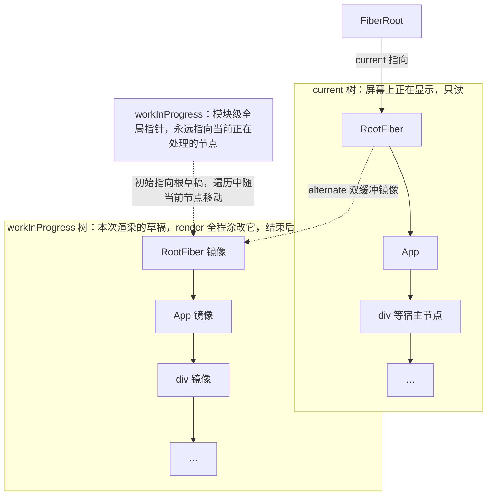
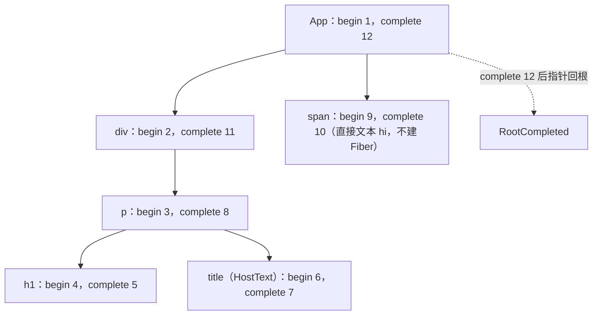
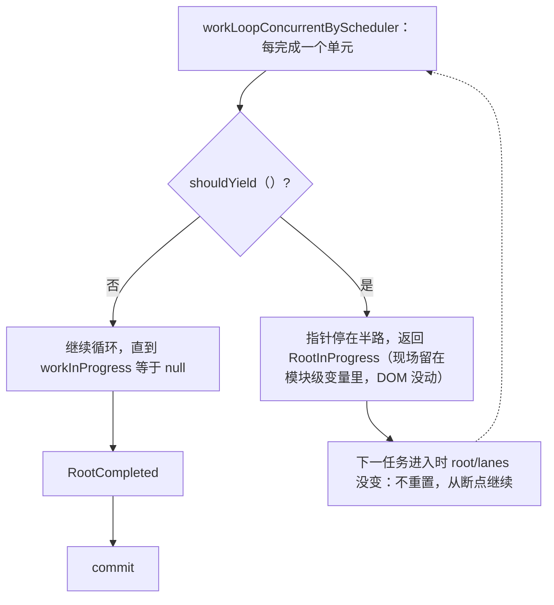
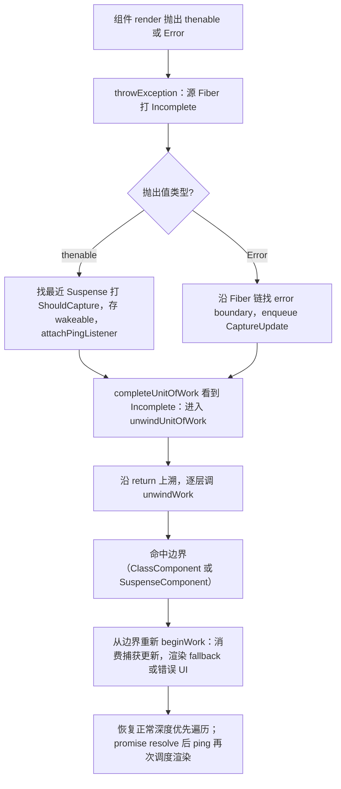
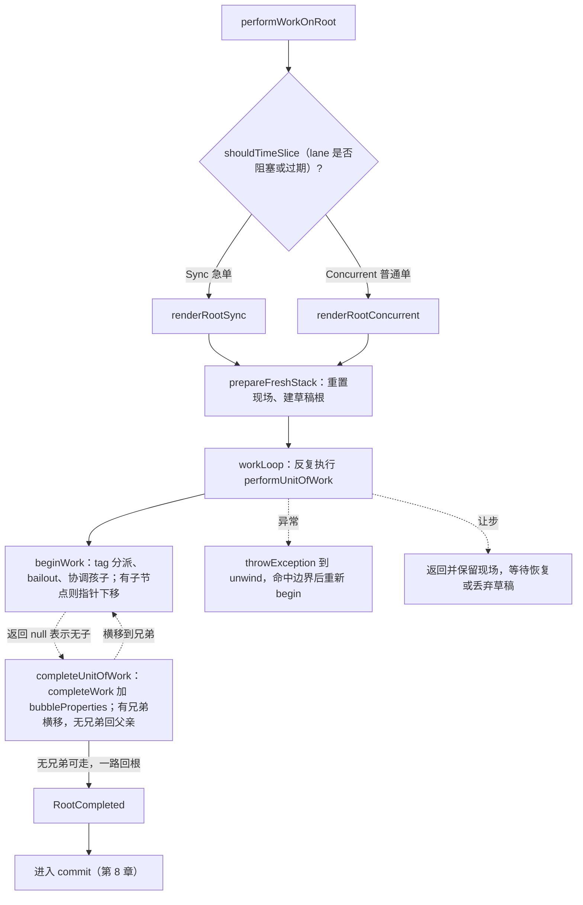

# 第 4 章 render 阶段——可中断的深度优先遍历

> 上一章：[第 3 章 Scheduler 调度器与 Lane 优先级模型](./03-scheduler-and-lanes.md) ｜ 下一章：[第 5 章 协调与 Diff 算法](./05-reconciliation-diff.md)

## 学习目标

- 理解 React 为什么把一次更新拆成「render（纯计算）」和「commit（改 DOM）」两个阶段。
- 能说清 `performWorkOnRoot` 如何根据优先级分派同步/并发两条工作循环。
- 掌握 `workInProgress` 指针驱动的深度优先遍历：begin 向下、complete 向上、兄弟横移。
- 读懂 `beginWork` 的分支分派与两层 bailout（跳过）机制。
- 读懂 `completeWork` 造 DOM 实例、`bubbleProperties` 冒泡 `subtreeFlags`，以及中断恢复与 unwind 异常路径。

## 4.1 引入：为什么「渲染」必须能被打断

想象你在一家非常火爆的餐厅后厨。

- 老式做法（React 15 的 Stack Reconciler）：服务员一次只接一桌的单，进厨房一口气把这桌所有菜做完，中途天塌下来也不停。如果这桌点了 10 万盘菜，后面所有客人都得干等——对应主线程被长时间占用，输入、动画全部卡死。
- 新式做法（Fiber Reconciler）：厨房把每道菜拆成一个个「工作单元」，每做完一道菜就抬头看一眼：有没有更急的外卖催单（高优先级更新）？到点该翻牛排了吗（浏览器要绘制一帧）？有就先停手去忙急的，回来再接着做。

关键前提是：**备菜阶段随便怎么停、怎么重来都行，反正菜还没端给客人**；但「上菜」这个动作一旦开始就必须一次性完成——你不能把一盘宫保鸡丁上半盘到客人桌上，撤回去加花生，再上剩下半盘。

React 把这两件事分成了：

| 阶段 | 厨房类比 | 做什么 | 能不能中断 | 能不能丢弃重来 | 碰不碰真实 DOM |
| --- | --- | --- | --- | --- | --- |
| render（渲染阶段） | 备菜 | 调用组件、Diff、在内存里造 Fiber 树 | 可以随时让出主线程 | 可以整体丢弃重算 | 不挂载到页面 |
| commit（提交阶段） | 上菜 | 同步执行 DOM 增删改、ref、生命周期/effect | 不可以，一口气做完 | 不可以 | 真正改 DOM |

render 阶段还有一个重要性质，源码注释里称之为 **async safe**：因为它不产生任何外部可见的副作用，中断了、丢掉了，用户都感知不到。commit 阶段的细节留给第 8 章，本章专注 render。

## 4.2 两阶段总览：两棵树与一条指针

render 阶段操作的不是第 3 章讲的当前 Fiber 树本身，而是它的一份「草稿副本」：



每个 Fiber 通过 `alternate` 字段指向自己在另一棵树里的镜像。这种「两棵树互为草稿」的结构叫 **双缓冲（Double Buffering）**。render 被中途丢弃时，扔掉的只是 workInProgress 草稿，current 树毫发无损。

整次 render 的节奏可以浓缩成一句话：**从根 Fiber 出发，对每个节点先做「begin（往下造孩子）」，孩子做完后做「complete（收尾、往上冒泡）」，走完一棵深度优先遍历的树**。下面进入源码看它怎么实现。

## 4.3 总入口：performWorkOnRoot 的分派

调度器（第 9 章详谈）决定「现在该干活了」之后，最终会调用 `performWorkOnRoot`。它的第一件事，是决定这顿饭是「急单」还是「普通单」：

出处：packages/react-reconciler/src/ReactFiberWorkLoop.js:1165-1181（React 19.3.0）
[ReactFiberWorkLoop.js](file:///Users/yangzhijie/Desktop/practice_projects/claude-code-test/react-vue-source-deep-dive/sources/react/packages/react-reconciler/src/ReactFiberWorkLoop.js#L1165-L1181)

```js
// 以下情况关闭时间切片：CPU 密集工作饿太久（过期，防止饿死）、
// 或处于「默认同步更新」模式
const shouldTimeSlice =
  (!forceSync &&
    !includesBlockingLane(lanes) &&
    !includesExpiredLane(root, lanes)) ||
  // 预渲染场景即使是同步 lane 也走并发循环，保证绝不阻塞主线程
  checkIfRootIsPrerendering(root, lanes);

let exitStatus: RootExitStatus = shouldTimeSlice
  ? renderRootConcurrent(root, lanes)   // 普通单：可中断
  : renderRootSync(root, lanes, true); // 急单：一口气做完
```

判断依据是 lanes（第 3 章）：这批工作里是否含阻塞 lane、是否已经过期。`renderRootSync` 与 `renderRootConcurrent` 开头几乎一样，都要先做一件事——准备草稿纸。

## 4.4 prepareFreshStack：每次（重新）渲染先重置现场

`renderRootSync` 里可以看到：只有当「根变了」或「本次渲染的 lanes 变了」时才重建草稿；否则说明这是让出后的恢复，要保留现场继续做：

出处：packages/react-reconciler/src/ReactFiberWorkLoop.js:2633-2654（React 19.3.0）
[ReactFiberWorkLoop.js](file:///Users/yangzhijie/Desktop/practice_projects/claude-code-test/react-vue-source-deep-dive/sources/react/packages/react-reconciler/src/ReactFiberWorkLoop.js#L2633-L2654)

```js
// If the root or lanes have changed, throw out the existing stack
// and prepare a fresh one. Otherwise we'll continue where we left off.
if (workInProgressRoot !== root || workInProgressRootRenderLanes !== lanes) {
  // …DevTools 相关簿记…
  workInProgressTransitions = getTransitionsForLanes(root, lanes);
  prepareFreshStack(root, lanes);
}
```

`prepareFreshStack` 前 200 行基本是性能分析埋点，真正的核心只有最后一小段：

出处：packages/react-reconciler/src/ReactFiberWorkLoop.js:2252-2273（React 19.3.0）
[ReactFiberWorkLoop.js](file:///Users/yangzhijie/Desktop/practice_projects/claude-code-test/react-vue-source-deep-dive/sources/react/packages/react-reconciler/src/ReactFiberWorkLoop.js#L2252-L2273)

```js
resetWorkInProgressStack();                 // 清掉上下文栈等模块级状态
workInProgressRoot = root;                 // 记住「正在渲染哪个根」
const rootWorkInProgress = createWorkInProgress(root.current, null);
workInProgress = rootWorkInProgress;       // 全局指针先指向根的草稿
workInProgressRootRenderLanes = lanes;     // 记住「本次处理哪些 lane」
workInProgressSuspendedReason = NotSuspended;
workInProgressThrownValue = null;
workInProgressRootExitStatus = RootInProgress;
// …其余一批 workInProgressXxx 模块变量全部归零…
```

这里出现了三个贯穿整个 render 阶段的**模块级全局变量**（[L439-443](file:///Users/yangzhijie/Desktop/practice_projects/claude-code-test/react-vue-source-deep-dive/sources/react/packages/react-reconciler/src/ReactFiberWorkLoop.js#L439-L443)）：`workInProgressRoot`（正在渲染哪个根）、`workInProgress`（正在处理哪个 Fiber，最重要）、`workInProgressRootRenderLanes`（本次处理哪些 lane）。它们就是「现场」本身。

`createWorkInProgress(root.current, null)` 会复用已有的 alternate 草稿或新建 Fiber 并双向接好。注意：此刻只克隆了**根节点**，子节点是遍历到时才按需克隆的——懒克隆。

## 4.5 两条工作循环：差别只有一个 shouldYield

现场准备好后进入工作循环。同步版本极其直白：

出处：packages/react-reconciler/src/ReactFiberWorkLoop.js:2770-2777（React 19.3.0）
[ReactFiberWorkLoop.js](file:///Users/yangzhijie/Desktop/practice_projects/claude-code-test/react-vue-source-deep-dive/sources/react/packages/react-reconciler/src/ReactFiberWorkLoop.js#L2770-L2777)

```js
// The work loop is an extremely hot path. Tell Closure not to inline it.
/** @noinline */
function workLoopSync() {
  // Perform work without checking if we need to yield between fiber.
  while (workInProgress !== null) {
    performUnitOfWork(workInProgress);
  }
}
```

并发版本在 19.3 里的名字叫 `workLoopConcurrentByScheduler`（📌 旧版叫 `workLoopConcurrent`），循环条件多了一个 `!shouldYield()`：

出处：packages/react-reconciler/src/ReactFiberWorkLoop.js:3072-3079（React 19.3.0）
[ReactFiberWorkLoop.js](file:///Users/yangzhijie/Desktop/practice_projects/claude-code-test/react-vue-source-deep-dive/sources/react/packages/react-reconciler/src/ReactFiberWorkLoop.js#L3072-L3079)

```js
/** @noinline */
function workLoopConcurrentByScheduler() {
  // Perform work until Scheduler asks us to yield
  while (workInProgress !== null && !shouldYield()) {
    performUnitOfWork(workInProgress);
  }
}
```

两者的全部区别就是：**每干完一个单元，并发模式抬头问一句「调度器，时间片用完了吗？」** 用完了就退出循环、把主线程还给浏览器。因为 `workInProgress` 是模块级变量，退出时它还指向没做完的那个节点，下一个调度任务重新进入时自然从这里继续。

一个单元内部做什么？`performUnitOfWork`：

出处：packages/react-reconciler/src/ReactFiberWorkLoop.js:3081-3123（React 19.3.0，节选）
[ReactFiberWorkLoop.js](file:///Users/yangzhijie/Desktop/practice_projects/claude-code-test/react-vue-source-deep-dive/sources/react/packages/react-reconciler/src/ReactFiberWorkLoop.js#L3081-L3123)

```js
function performUnitOfWork(unitOfWork: Fiber): void {
  // 该节点当前已上屏的版本就是它的 alternate
  const current = unitOfWork.alternate;

  let next;
  // …性能计时包裹…
  next = beginWork(current, unitOfWork, entangledRenderLanes);

  // pendingProps 此时「转正」为 memoizedProps
  unitOfWork.memoizedProps = unitOfWork.pendingProps;
  if (next === null) {
    // 这个节点没有产出子节点 → 它是叶子，开始「收尾」并向上走
    completeUnitOfWork(unitOfWork);
  } else {
    // 否则全局指针下移到它的第一个孩子
    workInProgress = next;
  }
}
```

- `beginWork` 返回孩子 Fiber：指针**向下**。
- 返回 `null`：没有孩子，进入 `completeUnitOfWork`。

## 4.6 深度优先遍历：指针走位全图

`completeUnitOfWork` 负责「向上/横移」：当前节点 complete 后，优先移到它的兄弟；没有兄弟才回到父亲并 complete 父亲。

出处：packages/react-reconciler/src/ReactFiberWorkLoop.js:3368-3431（React 19.3.0，节选）
[ReactFiberWorkLoop.js](file:///Users/yangzhijie/Desktop/practice_projects/claude-code-test/react-vue-source-deep-dive/sources/react/packages/react-reconciler/src/ReactFiberWorkLoop.js#L3368-L3431)

```js
function completeUnitOfWork(unitOfWork: Fiber): void {
  let completedWork: Fiber = unitOfWork;
  do {
    // …若带 Incomplete 标志，改走 unwindUnitOfWork…
    const current = completedWork.alternate;
    const returnFiber = completedWork.return;
    let next = completeWork(current, completedWork, entangledRenderLanes);
    if (next !== null) { workInProgress = next; return; }

    const siblingFiber = completedWork.sibling;
    if (siblingFiber !== null) {
      workInProgress = siblingFiber;  // 有兄弟：横移，对兄弟走 begin
      return;
    }
    completedWork = returnFiber;      // 没兄弟：回父亲，循环里 complete 它
    workInProgress = completedWork;
  } while (completedWork !== null);

  if (workInProgressRootExitStatus === RootInProgress) {
    workInProgressRootExitStatus = RootCompleted;  // 回到根：render 完成
  }
}
```

用一棵 5 个节点的小树演示完整走位：



记住这个 U 型轨迹：**沿左侧一路 begin 下探，触底后一边 complete 一边找兄弟，找到兄弟就下探**。`beginWork` 与 `completeWork` 的调用序恰好互为「先序 / 后序」遍历。

## 4.7 beginWork：按 tag 分派的大总管

`beginWork` 位于 ReactFiberBeginWork.js，是 render 阶段最重的函数。更新场景下它先做一道「预考题」：

出处：packages/react-reconciler/src/ReactFiberBeginWork.js:4250-4295（React 19.3.0，节选）
[ReactFiberBeginWork.js](file:///Users/yangzhijie/Desktop/practice_projects/claude-code-test/react-vue-source-deep-dive/sources/react/packages/react-reconciler/src/ReactFiberBeginWork.js#L4250-L4295)

```js
if (current !== null) {
  const oldProps = current.memoizedProps;
  const newProps = workInProgress.pendingProps;
  if (
    oldProps !== newProps ||           // props 引用变了
    hasLegacyContextChanged() ||
    (__DEV__ ? workInProgress.type !== current.type : false)
  ) {
    didReceiveUpdate = true;           // 第一层：必须干活
  } else {
    // props 没变，再查「待处理更新 / context 变化」
    const hasScheduledUpdateOrContext =
      checkScheduledUpdateOrContext(current, renderLanes);
    if (
      !hasScheduledUpdateOrContext &&
      (workInProgress.flags & DidCapture) === NoFlags
    ) {
      // 什么都没有：提前 bailout，连组件函数都不执行
      return attemptEarlyBailoutIfNoScheduledUpdate(
        current, workInProgress, renderLanes);
    }
    didReceiveUpdate = false;
  }
}
```

注意是**引用比较**（`!==`），不是深比较。所以父组件每次 render 都内联一个新对象传给子组件，子组件永远收不到 bailout——这是初学者最常见的性能坑。

预考之后是覆盖所有 Fiber 类型的巨型 `switch(workInProgress.tag)`（[BeginWork L4322-4506](file:///Users/yangzhijie/Desktop/practice_projects/claude-code-test/react-vue-source-deep-dive/sources/react/packages/react-reconciler/src/ReactFiberBeginWork.js#L4322-L4506)），常见分支一览：

| tag | 对应东西 | begin 阶段干什么 |
| --- | --- | --- |
| FunctionComponent / SimpleMemoComponent | 函数组件 / memo 内层 | renderWithHooks 执行函数，协调 children |
| ClassComponent | 类组件 | processUpdateQueue + render() |
| HostRoot | createRoot 容器根 | 处理根更新队列 |
| HostComponent | `<div>` 等 DOM 标签 | 取 children 并协调（DOM 实例在 complete 造） |
| HostText | 文本节点 | 几乎无事可做 |
| Fragment / Mode / Profiler | 无宿主节点 | 直接协调孩子 |
| ContextProvider / ContextConsumer | Context | 更新 value / 读 context |
| SuspenseComponent / OffscreenComponent / ActivityComponent | 挂起与隐藏 | 决定显示主树还是 fallback |
| HostHoistable / ViewTransitionComponent | 19 新增 | 资源提升 / 视图过渡 |
| Throw | 协调期抛错的虚拟节点 | 再次抛出交给异常流程 |

不用背，知道「**tag 决定这一个单元的 begin 怎么干**」即可。挑两个最常见的分支细看。

### 4.7.1 函数组件：renderWithHooks → reconcileChildren

出处：packages/react-reconciler/src/ReactFiberBeginWork.js:1518-1561（React 19.3.0，节选）
[ReactFiberBeginWork.js](file:///Users/yangzhijie/Desktop/practice_projects/claude-code-test/react-vue-source-deep-dive/sources/react/packages/react-reconciler/src/ReactFiberBeginWork.js#L1518-L1561)

```js
prepareToReadContext(workInProgress, renderLanes);
// 真正执行你的函数组件！Hook 状态在此期间被读写（第 7 章）
const nextChildren = renderWithHooks(
  current, workInProgress, Component, nextProps, context, renderLanes,
);
// 第二层 bailout：跑是跑了，但 state/props 都没产出变化
if (current !== null && !didReceiveUpdate) {
  bailoutHooks(current, workInProgress, renderLanes);
  return bailoutOnAlreadyFinishedWork(current, workInProgress, renderLanes);
}
workInProgress.flags |= PerformedWork;
// 把返回的 ReactElement Diff 成子 Fiber（第 5 章主题）
reconcileChildren(current, workInProgress, nextChildren, renderLanes);
return workInProgress.child;
```

### 4.7.2 两层 bailout 机制

这里能看出 bailout 有两层：

1. **入口早退**：props 引用没变、本 fiber 没有本次 lanes 的更新、context 也没变 → 连组件函数都不执行。
2. **执行后 bailout**：函数执行了（因为它自己挂了更新），但 reducer 算出来 state 没变 → 调 `bailoutOnAlreadyFinishedWork`。

第二层里还要决定「我自己不更新，子树要不要更新」：

出处：packages/react-reconciler/src/ReactFiberBeginWork.js:3843-3864（React 19.3.0，节选）
[ReactFiberBeginWork.js](file:///Users/yangzhijie/Desktop/practice_projects/claude-code-test/react-vue-source-deep-dive/sources/react/packages/react-reconciler/src/ReactFiberBeginWork.js#L3843-L3864)

```js
// 子树也没有本次 lane 的工作 → 连孩子都不克隆，整体跳过
if (!includesSomeLane(renderLanes, workInProgress.childLanes)) {
  if (current !== null) {
    lazilyPropagateParentContextChanges(current, workInProgress, renderLanes);
    if (!includesSomeLane(renderLanes, workInProgress.childLanes)) {
      return null;
    }
  } else {
    return null;
  }
}
// 自己没事但子树有事：克隆孩子，继续往下遍历
cloneChildFibers(current, workInProgress);
return workInProgress.child;
```

这解释了为什么「父组件 setState 但值没变」整棵子树都可能跳过——前提是更新的 lane 不在子树的 `childLanes` 里。而 **mount 时 `current === null`，没有旧 props 可比较，一切都是新的，天然不可能 bailout**，首次渲染必须老老实实走完全树。

### 4.7.3 HostComponent：只取 children 然后协调

出处：packages/react-reconciler/src/ReactFiberBeginWork.js:1977-2032（React 19.3.0，节选）
[ReactFiberBeginWork.js](file:///Users/yangzhijie/Desktop/practice_projects/claude-code-test/react-vue-source-deep-dive/sources/react/packages/react-reconciler/src/ReactFiberBeginWork.js#L1977-L2032)

```js
let nextChildren = nextProps.children;
const isDirectTextChild = shouldSetTextContent(type, nextProps);
if (isDirectTextChild) {
  // <div>纯文本</div> 不建 HostText Fiber，文本交给宿主环境设置
  nextChildren = null;
} else if (prevProps !== null && shouldSetTextContent(type, prevProps)) {
  // 从「直接文本」切换成普通孩子：commit 时要先清空文本
  workInProgress.flags |= ContentReset;
}
markRef(current, workInProgress);
reconcileChildren(current, workInProgress, nextChildren, renderLanes);
return workInProgress.child;
```

`reconcileChildren` 内部还有一次 mount/update 分流（[L345-369](file:///Users/yangzhijie/Desktop/practice_projects/claude-code-test/react-vue-source-deep-dive/sources/react/packages/react-reconciler/src/ReactFiberBeginWork.js#L345-L369)）：`current === null`（首次挂载）用 `mountChildFibers`，不打 Placement 标志；更新用 `reconcileChildFibers`，需要追踪增删移动。这正是第 5 章的入口。

## 4.8 completeWork：造 DOM 与冒泡 flags

begin 阶段只负责「算出孩子长什么样」；节点自己的收尾工作在 complete 阶段。函数组件这类「无宿主实例」的节点，收尾基本只有一句话——`bubbleProperties(workInProgress)`。

### 4.8.1 HostComponent 首次挂载：DOM 在这里诞生

一个反直觉的事实：**真实 DOM 节点其实在 render 阶段的 completeWork 里就创建好了**，只是还没挂进文档；挂载动作（Placement）在 commit 阶段执行。

出处：packages/react-reconciler/src/ReactFiberCompleteWork.js:1424-1452（React 19.3.0，节选）
[ReactFiberCompleteWork.js](file:///Users/yangzhijie/Desktop/practice_projects/claude-code-test/react-vue-source-deep-dive/sources/react/packages/react-reconciler/src/ReactFiberCompleteWork.js#L1424-L1452)

```js
const instance = createInstance(          // document.createElement(type)
  type, newProps, rootContainerInstance,
  currentHostContext, workInProgress,
);
markCloned(workInProgress);
// 把已经 complete 的孩子（游离 DOM）先挂到自己身上
appendAllChildren(instance, workInProgress, false, false);
workInProgress.stateNode = instance;     // Fiber ↔ DOM 互相记住
// 某些属性需要 commit 时补设（如 autoFocus）
if (finalizeInitialChildren(instance, type, newProps, currentHostContext)) {
  markUpdate(workInProgress);
}
```

为什么放在 complete（后序）而不是 begin（先序）？因为挂载时要先把所有孩子造出来，才能 `appendAllChildren` 组装成完整的游离 DOM 子树，commit 时一次插入即可。更新场景（`current !== null && stateNode != null`）则走 `updateHostComponent`，diff props 并打上 `Update` 标志。HostText 类似，首次挂载调 `createTextInstance`。

### 4.8.2 bubbleProperties：把副作用「冒泡」给祖先

每个 Fiber 有两类标志位：

| 字段 | 含义 |
| --- | --- |
| `flags` | 节点**自己**在 commit 阶段要做的事（Update / Placement / ChildDeletion / Passive…） |
| `subtreeFlags` | **子树里**存在哪些种类的副作用（聚合而来） |

后序遍历时，孩子的 flags 要向上冒泡合并：

出处：packages/react-reconciler/src/ReactFiberCompleteWork.js:836-856（React 19.3.0，节选）
[ReactFiberCompleteWork.js](file:///Users/yangzhijie/Desktop/practice_projects/claude-code-test/react-vue-source-deep-dive/sources/react/packages/react-reconciler/src/ReactFiberCompleteWork.js#L836-L856)

```js
let child = completedWork.child;
while (child !== null) {
  newChildLanes = mergeLanes(
    newChildLanes, mergeLanes(child.lanes, child.childLanes));
  subtreeFlags |= child.subtreeFlags;
  subtreeFlags |= child.flags;   // 孩子自己的 flags 也算进我的子树
  child.return = completedWork;
  child = child.sibling;
}
completedWork.subtreeFlags |= subtreeFlags;
```

📌 **effect list 已在 React 18 被移除**。老版本 complete 时会把有副作用的 Fiber 串成一条链表（firstEffect/lastEffect）供 commit 阶段顺序消费；19 中 commit 改为「拿着 masks 再走一遍树，靠 `subtreeFlags` 判断某个子树值不值得进去」。例如：

出处：packages/react-reconciler/src/ReactFiberCommitWork.js:448-452（React 19.3.0，节选）
[ReactFiberCommitWork.js](file:///Users/yangzhijie/Desktop/practice_projects/claude-code-test/react-vue-source-deep-dive/sources/react/packages/react-reconciler/src/ReactFiberCommitWork.js#L448-L452)

```js
const child = fiber.child;
if ((fiber.subtreeFlags & subtreeMask) !== NoFlags && child !== null) {
  child.return = fiber;
  nextEffect = child;   // 子树里确实有这类活，才深入
} else {
  // 整个子树无关，直接剪枝跳过
}
```

bailout 场景下冒泡要特殊处理（[L892-897](file:///Users/yangzhijie/Desktop/practice_projects/claude-code-test/react-vue-source-deep-dive/sources/react/packages/react-reconciler/src/ReactFiberCompleteWork.js#L892-L897)）：普通 flags 只活一次 render+commit，bailout 时不带上来；但「Static」类标志（如 hydration 相关）生命周期与 Fiber 相同，需要按 `subtreeFlags |= child.subtreeFlags & StaticMask` 过滤后保留。

## 4.9 中断、恢复与丢弃重渲染

把前面的零件拼起来，看并发渲染的三种结局：



还有第三种情况：**render 中途来了更高优先级的更新**。下次进入时 lanes 变了（第 6 章会看到新 lane 挂到 root），`prepareFreshStack` 被再次调用，旧草稿整体作废、从根重渲染。旧草稿里已 `createInstance` 出来的游离 DOM 无人引用，直接交给 GC——这就是「可丢弃」的代价，也是 render 阶段严禁做外部副作用的原因（不能指望 render 里发的请求不重跑）。

## 4.10 异常：throwException 与 unwind 恢复

组件 render 时抛东西，在 React 里分两类：抛出的是 thenable（Suspense 挂起）还是普通错误。入口是 ReactFiberThrow.js 的 `throwException`（[L364](file:///Users/yangzhijie/Desktop/practice_projects/claude-code-test/react-vue-source-deep-dive/sources/react/packages/react-reconciler/src/ReactFiberThrow.js#L364)），它先给源节点打上 `Incomplete`，然后：

- 值是 thenable（`typeof value.then === 'function'`）：通过 `getSuspenseHandler()` 找栈上最近的 Suspense/Activity 边界，打 `ShouldCapture`，把 wakeable 存进边界的 `updateQueue`（一个 `Set`）并 `attachPingListener`——promise resolve 后 ping 一次、触发重新渲染（[L381-485](file:///Users/yangzhijie/Desktop/practice_projects/claude-code-test/react-vue-source-deep-dive/sources/react/packages/react-reconciler/src/ReactFiberThrow.js#L381-L485)）。
- 普通错误：沿 Fiber 链找 class error boundary，给它入队一个 `CaptureUpdate`（携带 `getDerivedStateFromError` 的结果），同样打 `ShouldCapture`。

但「标记」只是第一步。当前 workInProgress 还停在抛错的深层节点，必须沿 `return` 一路**退回**到边界，这就是 `unwindUnitOfWork`：

出处：packages/react-reconciler/src/ReactFiberWorkLoop.js:3433-3457（React 19.3.0，节选）
[ReactFiberWorkLoop.js](file:///Users/yangzhijie/Desktop/practice_projects/claude-code-test/react-vue-source-deep-dive/sources/react/packages/react-reconciler/src/ReactFiberWorkLoop.js#L3433-L3457)

```js
function unwindUnitOfWork(unitOfWork: Fiber, skipSiblings: boolean): void {
  let incompleteWork: Fiber = unitOfWork;
  do {
    const current = incompleteWork.alternate;
    // 逐层询问：你是能处理这个异常的边界吗？
    const next = unwindWork(current, incompleteWork, entangledRenderLanes);
    if (next !== null) {
      next.flags &= HostEffectMask; // 找到：清非宿主标志，从边界重新 begin
      workInProgress = next;
      return;
    }
    // …没找到就继续向上退，沿途父亲打 Incomplete、清 subtreeFlags…
```

回退途中每个经过的父亲都被打上 `Incomplete`、清空 `subtreeFlags`。`unwindWork`（位于 ReactFiberUnwindWork.js）识别 ClassComponent（error boundary）与 SuspenseComponent；同步渲染下挂起会立刻 unwind 出 fallback，并发渲染下则可能先 yield 等微任务冲刷后再决定。完整恢复路径：



## 端到端流程串讲

1. **调度入口**：`performWorkOnRoot` 按 lanes 是否阻塞/过期算出 `shouldTimeSlice`，分派两条根渲染函数。
2. **准备草稿**：根或 lanes 变化时 `prepareFreshStack` 重置模块级现场，`createWorkInProgress(root.current)` 建立草稿根，`workInProgress` 指向它。
3. **工作循环**：Sync 版无让步；并发版每单元后 `shouldYield()`，反复调 `performUnitOfWork`。
4. **begin 下探**：`beginWork` 先做 props 浅比较/更新检查（第一层 bailout），再按 tag 分派；函数组件执行后无变化则第二层 bailout，否则协调孩子，指针移向长子。
5. **complete 回升**：无子节点进 `completeUnitOfWork`：`completeWork` 造/更新 DOM，`bubbleProperties` 聚合 `subtreeFlags`；有兄弟横移，无兄弟回父亲。
6. **中断/插队**：让步则带 RootInProgress 返回、现场保留待恢复；期间来了更高优先级更新则下次丢弃草稿重渲染。
7. **异常**：抛出交 `throwException` 标记最近边界，`unwindUnitOfWork` 沿 return 找到边界并重新 begin。
8. **完成**：指针回到根变 RootCompleted，清空现场并收尾，随后进入第 8 章的 commit 阶段。

总流程图：



## 版本勘误 📌

- **React 16/17**：并发循环叫 `workLoopConcurrent`；19.3 改名 `workLoopConcurrentByScheduler`（[L3073](file:///Users/yangzhijie/Desktop/practice_projects/claude-code-test/react-vue-source-deep-dive/sources/react/packages/react-reconciler/src/ReactFiberWorkLoop.js#L3073)），因 19 还并存另一套基于 25ms/5ms 时间切片的循环。
- **React 16/17**：complete 阶段会构建 `firstEffect → … → lastEffect` 的 **effect list 链表**；React 18 起删除，19 完全靠 `flags`/`subtreeFlags` + masks 在 commit 时递归剪枝。
- **React 17→18**：`beginWork` 的更新判断从 expirationTime 数字比较换成 lanes 位掩码（`checkScheduledUpdateOrContext`）。
- **React 19 新增**：HostHoistable、ActivityComponent、ViewTransitionComponent、GestureLane/预渲染等分支与挂起原因（SuspendedOnAction、SuspendedOnInstance 等），老教程里的 switch 表更短。
- **React 19**：completeWork 挂载路径增加 `markCloned`、`preloadInstanceAndSuspendIfNeeded`；HostComponent 可能因表单 action「升级」为带 Hook 的有状态 Fiber。Legacy 相关分支受 `disableLegacyMode` 开关控制，初读可忽略。

## 初学者易错点 ⚠️

1. **以为 render 阶段会操作页面 DOM**：DOM 在 completeWork 里只是游离实例，插入文档发生在 commit 的 Placement；render 抛错/中断/丢弃都不会产生页面半成品。
2. **以为「中断」是从头重跑**：根和 lanes 没变就不调 `prepareFreshStack`，靠模块级 `workInProgress` 从断点继续；只有 lanes 变了（被高优先级插队）才整体丢弃重来。
3. **在 render 函数体里写副作用**（发请求、改外部变量、`Math.random()` 进 state）：并发渲染会重放组件，副作用可能重复执行。副作用请放 effect/event handler。
4. **误以为内联对象 props 不影响性能**：bailout 第一层是 `oldProps !== newProps` 引用比较，`<Child style={{color:'red'}} />` 每次都是新引用，bailout 永远失效。
5. **以为 mount 也能 bailout**：`current === null` 时没有旧 props/旧子 Fiber，首次渲染必须走完全树，`React.memo` 只对更新有意义。
6. **把 Suspense 挂起和报错混为一谈**：thenable 走 Suspense fallback + ping 重试，普通错误走 error boundary 的 CaptureUpdate；无边界时，并发根下未捕获的挂起会无限等待。

## 本章小结

- render 是「可中断、可丢弃、不碰 DOM」的纯计算阶段，commit 是同步不可分割的 DOM 执行阶段，二者通过双缓冲 Fiber 树衔接。
- 模块级指针 `workInProgress` 是唯一的「进度条」：`performUnitOfWork` 调 beginWork 向下，`completeUnitOfWork` 调 completeWork 并横移兄弟/向上回退，构成完整深度优先遍历。
- 同步与并发循环只差一个 `shouldYield()`；现场全部存放在模块级变量里，天然支持恢复，lanes 一变则丢弃草稿重来。
- beginWork 按 tag 分派工作，靠 props 引用比较 + lane 检查实现两层 bailout；completeWork 创建 DOM 实例并用 bubbleProperties 聚合 subtreeFlags（effect list 的替代品）。
- 异常路径是 throwException 标记边界 + unwindUnitOfWork 沿 return 回退 + 边界重新 begin 的组合拳。

## 下一章导读

本章反复出现的 `reconcileChildren` 只露了个脸：函数组件返回的 ReactElement 树到底怎么变成子 Fiber 链？key 为什么能决定复用身份？`[A,B,C,D]` 变成 `[A,D,C,B]` 时 React 怎么判断谁该移动？第 5 章我们逐行精读 [ReactChildFiber.js](file:///Users/yangzhijie/Desktop/practice_projects/claude-code-test/react-vue-source-deep-dive/sources/react/packages/react-reconciler/src/ReactChildFiber.js)，拆解单节点与多节点两套 Diff 流程，以及 `lastPlacedIndex` 移动算法的完整数值推演。
