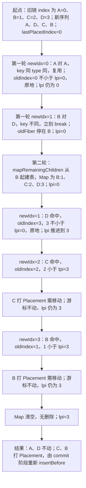
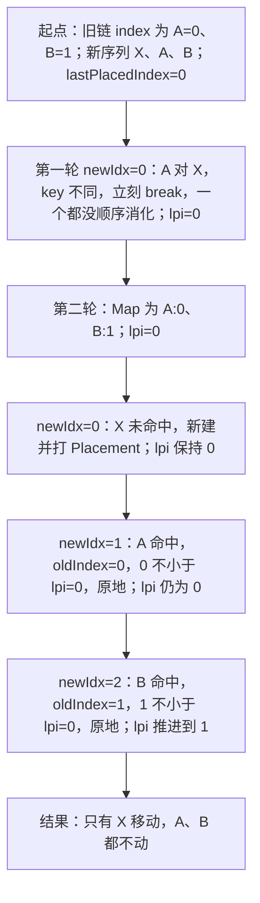
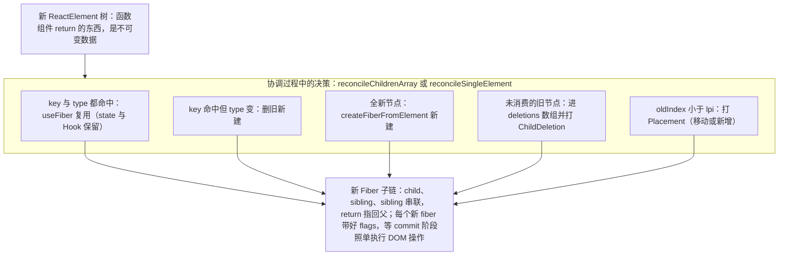
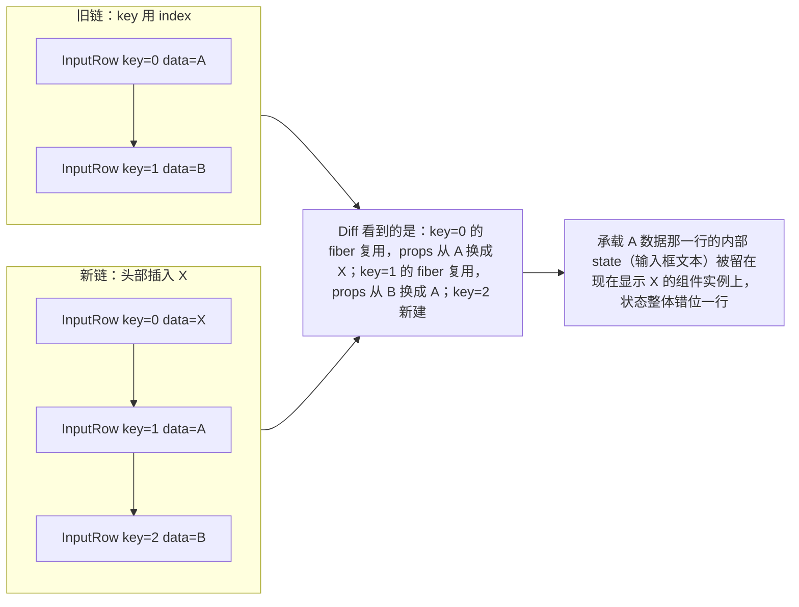
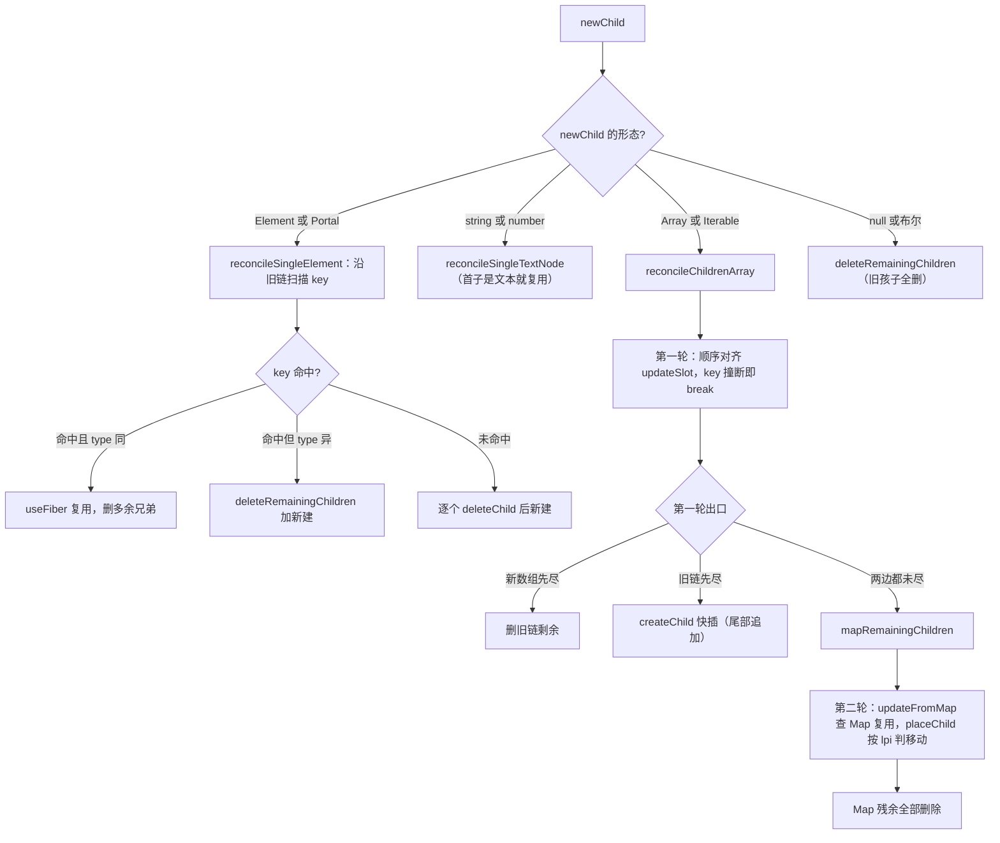

# 第 5 章 协调与 Diff 算法

> 上一章：[第 4 章 render 阶段——可中断的深度优先遍历](./04-render-phase.md) ｜ 下一章：[第 6 章 状态更新完整链路](./06-state-update-chain.md)

## 学习目标

- 理解 React Diff 的四条工程化假设，以及为什么它「不敢」做最优算法。
- 读懂 `createChildReconciler` 为什么要造出 mount/update 两个版本的协调器。
- 掌握顶层分派：单个 Element、文本、数组/可迭代对象分别走哪条路径。
- 能手推单节点 Diff（key + type 双重匹配）与多节点 Diff 的两轮策略。
- 彻底搞清 `placeChild` / `lastPlacedIndex` 的移动判定，并完成两个数值推演案例。
- 能用 Diff 机理解释「不要用数组 index 当 key」的真实原因。

## 5.1 引入：一次真实的 key 事故

先看一段每个 React 初学者几乎都写过的代码：

```jsx
{list.map((item, i) => <InputRow key={i} data={item} />)}
```

在列表**尾部**增删时一切正常；直到有一天你在列表**头部**插入了一条数据：输入框里还没提交的文字「串」到了另一条数据上。明明组件长得一模一样，为什么内部状态会错位？

再看第二个现象：

```jsx
{flag ? <Counter name="a" /> : <Counter name="b" />}
```

`Counter` 是同一个组件类型，切换 flag 时计数器居然**没有归零**；而把其中一个换成 `<span>`，它就老老实实卸载重建了。React 凭什么决定「复用」还是「重建」？

这两个问题的答案都在同一个文件里：[ReactChildFiber.js](file:///Users/yangzhijie/Desktop/practice_projects/claude-code-test/react-vue-source-deep-dive/sources/react/packages/react-reconciler/src/ReactChildFiber.js)（全文 2259 行）。上一章我们看到每个组件 begin 阶段最后会调 `reconcileChildren`，把「新 ReactElement」和「旧 Fiber 子链」做协调，产出新的 Fiber 子链。这个过程就是 **Reconciliation（协调）**，其核心算法俗称 **Diff**。

## 5.2 设计原则：四条「认命」的假设

两棵树做**精确**最小操作转换是经典难题，时间复杂度约 O(n³)。组件树轻松上万个节点，React 不可能这么干。于是官方文档明确给出三条策略（源码里处处体现），本章再加一条：

| 原则 | 源码体现 | 代价 |
| --- | --- | --- |
| 1. 只同层比较，不跨层 | Diff 永远只在「父 Fiber 的直接孩子」这一层做 | 跨层移动会被当成卸载+新建 |
| 2. 类型不同，直接卸载重建 | `elementType` 不匹配就删旧 fiber、新建 fiber | 同位置换类型无法复用 state |
| 3. 类型相同，保留实例、更新 props | `useFiber` 克隆旧 fiber，只换 pendingProps | —— |
| 4. key 决定列表中节点的身份 | 数组 Diff 全程先比 key 再比 type | key 不稳定 = 身份错乱 |

把 n³ 问题降成 n 问题的钥匙，就是「同层 + key」。React 选择的是**简单、快、可预测**，而不是操作次数最少——5.8 节会和 Vue 的双端/LIS 方案做个对比。

先建立一个贯穿全章的物理模型：**孩子不是数组，而是一条单链表**（Fiber 只有 `child` 指针和 `sibling` 指针，没有反向指针）。所有 Diff 都是沿 sibling 链从左向右走。

## 5.3 createChildReconciler：一个工厂，两个产品

协调器由一个闭包工厂生成，开关是 `shouldTrackSideEffects`：

出处：packages/react-reconciler/src/ReactChildFiber.js:431-446（React 19.3.0，节选）
[ReactChildFiber.js](file:///Users/yangzhijie/Desktop/practice_projects/claude-code-test/react-vue-source-deep-dive/sources/react/packages/react-reconciler/src/ReactChildFiber.js#L431-L446)

```js
function createChildReconciler(
  shouldTrackSideEffects: boolean,
): ChildReconciler {
  function deleteChild(returnFiber: Fiber, childToDelete: Fiber): void {
    if (!shouldTrackSideEffects) {
      // Noop.
      return;
    }
    const deletions = returnFiber.deletions;
    if (deletions === null) {
      returnFiber.deletions = [childToDelete];
      returnFiber.flags |= ChildDeletion;
    } else {
      deletions.push(childToDelete);
    }
  }
```

文件最底部导出了两个实例：

出处：packages/react-reconciler/src/ReactChildFiber.js:2110-2112（React 19.3.0）
[ReactChildFiber.js](file:///Users/yangzhijie/Desktop/practice_projects/claude-code-test/react-vue-source-deep-dive/sources/react/packages/react-reconciler/src/ReactChildFiber.js#L2110-L2112)

```js
export const reconcileChildFibers: ChildReconciler =
  createChildReconciler(true);   // 更新用：追踪增/删/移动
export const mountChildFibers: ChildReconciler = createChildReconciler(false); // 挂载用
```

| 协调器 | 开关 | 谁在用 | 行为差异 |
| --- | --- | --- | --- |
| `reconcileChildFibers` | true | 更新（current 非空） | 删除会挂 `deletions` + `ChildDeletion`；新增/移动打 `Placement` |
| `mountChildFibers` | false | 首次挂载、bailout 子树初次挂载 | 这些操作全部 noop |

为什么 mount 要「关静音」？因为首屏整棵子树最终都会被根节点的一次 Placement 整体插入，子节点没必要各自再打一遍 Placement（还会让 StrictMode 重复跑 effect）。`placeChild` 里也能看到，关闭追踪时只做 useId 需要的 `Forked` 标记。

## 5.4 顶层分派：newChild 是什么形状？

`reconcileChildFibers` 包了一层异常处理，真正分派在 `reconcileChildFibersImpl`：

出处：packages/react-reconciler/src/ReactChildFiber.js:1884-2032（React 19.3.0，节选）
[ReactChildFiber.js](file:///Users/yangzhijie/Desktop/practice_projects/claude-code-test/react-vue-source-deep-dive/sources/react/packages/react-reconciler/src/ReactChildFiber.js#L1884-L2032)

```js
if (typeof newChild === 'object' && newChild !== null) {
  switch (newChild.$$typeof) {
    case REACT_ELEMENT_TYPE:
      return placeSingleChild(reconcileSingleElement(
        returnFiber, currentFirstChild, newChild, lanes));
    case REACT_PORTAL_TYPE:
      return placeSingleChild(reconcileSinglePortal(/*…*/)); // 与 Element 同形
    case REACT_LAZY_TYPE: // 解开 lazy 后递归重分派
      return reconcileChildFibersImpl(
        returnFiber, currentFirstChild, resolveLazy(newChild), lanes);
  }
  if (isArray(newChild)) return reconcileChildrenArray(
    returnFiber, currentFirstChild, newChild, lanes);
  if (getIteratorFn(newChild))
    return reconcileChildrenIteratable(/*…*/);  // Map/Set 等可迭代对象
  if (typeof newChild.then === 'function') { /* Usable：解包 thenable */ }
  throwOnInvalidObjectType(returnFiber, newChild);  // 放对象当 children → 报错
}
// string(非空)/number/bigint → 单文本节点
if (typeof newChild === 'string' ? newChild !== '' :
    typeof newChild === 'number' || typeof newChild === 'bigint')
  return placeSingleChild(
    reconcileSingleTextNode(returnFiber, currentFirstChild, '' + newChild, lanes));
// 其余（null/undefined/false/true）都视为空：旧孩子全部删除
return deleteRemainingChildren(returnFiber, currentFirstChild);
```

分派表总结：

| newChild 的形态 | 处理函数 |
| --- | --- |
| 单个 ReactElement / Portal | `reconcileSingleElement` / `reconcileSinglePortal` |
| Lazy | resolveLazy 后递归重进分派 |
| 无 key 无 ref 的顶层 Fragment | 展开成它的 children 再分派 |
| string / number / bigint | `reconcileSingleTextNode` |
| 数组 / 可迭代 / 异步可迭代 | `reconcileChildrenArray` / Iteratable 版本 |
| null、布尔、undefined（空） | `deleteRemainingChildren`：旧孩子全删 |

## 5.5 单节点 Diff：key 与 type 双重匹配

`reconcileSingleElement` 沿旧 fiber 链从左到右找复用对象：

出处：packages/react-reconciler/src/ReactChildFiber.js:1703-1776（React 19.3.0，节选）
[ReactChildFiber.js](file:///Users/yangzhijie/Desktop/practice_projects/claude-code-test/react-vue-source-deep-dive/sources/react/packages/react-reconciler/src/ReactChildFiber.js#L1703-L1776)

```js
const key = element.key;
let child = currentFirstChild;
while (child !== null) {
  if (child.key === key /* 或 optimisticKey */) {
    const elementType = element.type;
    if (elementType === REACT_FRAGMENT_TYPE) {
      if (child.tag === Fragment) {
        deleteRemainingChildren(returnFiber, child.sibling); // 删它后面的兄弟
        return useFiber(child, element.props.children); // 复用
      }
    } else if (child.elementType === elementType /* lazy 解析后比较 */) {
      deleteRemainingChildren(returnFiber, child.sibling);
      return useFiber(child, element.props); // 复用！只换 props
    }
    // key 相同但 type 不同：它和后面的兄弟也不可能再匹配，全删
    deleteRemainingChildren(returnFiber, child);
    break;
  } else {
    deleteChild(returnFiber, child); // key 不同：只删这一个，继续看兄弟
  }
  child = child.sibling;
}
// 没找到：跳出循环后 createFiberFromElement 新建
```

注意两个删除粒度的区别，这是面试高频细节：

- **key 不同**：只 `deleteChild(child)`，继续往后找（单节点也可能是从多孩子变来的）。
- **key 相同但 type 不同**：`deleteRemainingChildren(child)`——key 在一条链里唯一，既然这个位置的它都不匹配，后面不可能再有同 key 节点，直接全删并 break。

`useFiber`（[L502-509](file:///Users/yangzhijie/Desktop/practice_projects/claude-code-test/react-vue-source-deep-dive/sources/react/packages/react-reconciler/src/ReactChildFiber.js#L502-L509)）就是 `createWorkInProgress(fiber, pendingProps)`：复用旧 Fiber 实例和它的 state/Hook，只把新 props 放上去。这解释了 5.1 的第二个现象——同位置同 type 的 `<Counter>` 被复用，state 自然保留。

**案例一：key 相同，type 不同。** 旧链 `[key="x" → <A>]`，新元素 `<B key="x">`。key 命中但 `elementType` 不等 → 旧 A（及其后所有兄弟）删除，新建 B，挂 Placement。state 全部丢失。

**案例二：type 相同，key 不同。** 旧链 `[<A key="a">]`，新元素 `<A key="b">`。key 不匹配 → 旧 A 删除，新建 A。哪怕它们真的是同一个组件，key 不一致也无法复用。

文本节点没有 key，策略更简单（[L1673-1701](file:///Users/yangzhijie/Desktop/practice_projects/claude-code-test/react-vue-source-deep-dive/sources/react/packages/react-reconciler/src/ReactChildFiber.js#L1673-L1701)）：第一个旧孩子恰好是 HostText 就复用、删掉其余兄弟；否则全删后新建。

## 5.6 多节点 Diff：两轮策略

数组场景复杂得多：可能同时有更新、新增、删除、移动。React 的策略是**先捡便宜的，再处理乱序的**。

### 5.6.1 第一轮：线性扫描，撞 key 即停

出处：packages/react-reconciler/src/ReactChildFiber.js:1207-1264（React 19.3.0，节选）
[ReactChildFiber.js](file:///Users/yangzhijie/Desktop/practice_projects/claude-code-test/react-vue-source-deep-dive/sources/react/packages/react-reconciler/src/ReactChildFiber.js#L1207-L1264)

```js
let oldFiber = currentFirstChild;
let lastPlacedIndex = 0;
let newIdx = 0;
let nextOldFiber = null;
for (; oldFiber !== null && newIdx < newChildren.length; newIdx++) {
  if (oldFiber.index > newIdx) {
    nextOldFiber = oldFiber;
    oldFiber = null;                    // 旧链这里有空洞（null 子节点）
  } else {
    nextOldFiber = oldFiber.sibling;
  }
  const newFiber = updateSlot(returnFiber, oldFiber, newChildren[newIdx], lanes);
  if (newFiber === null) {
    // key 对不上（或节点类型根本不兼容）：第一轮到此为止
    if (oldFiber === null) { oldFiber = nextOldFiber; }
    break;
  }
  if (shouldTrackSideEffects && oldFiber && newFiber.alternate === null) {
    deleteChild(returnFiber, oldFiber); // 槽位对上但没复用（type 变了）：删掉旧的
  }
  lastPlacedIndex = placeChild(newFiber, lastPlacedIndex, newIdx);
  /* 把 newFiber 挂到新子链尾部 */
  oldFiber = nextOldFiber;
}
```

`updateSlot`（[L842](file:///Users/yangzhijie/Desktop/practice_projects/claude-code-test/react-vue-source-deep-dive/sources/react/packages/react-reconciler/src/ReactChildFiber.js#L842)）只做「这个槽位 key 是否相等」的快速判断，key 不同立刻返回 null 中断第一轮。第一轮结束后有三种出口：

1. **新数组先走完**（`newIdx === newChildren.length`）：旧链剩余的全部删除（`deleteRemainingChildren`）。
2. **旧链先走完**（`oldFiber === null`）：剩余新元素全是插入，走 `createChild` 快速循环——**尾部追加是最快的路径，完全不用建 Map**。
3. **两边都没走完**（中途 break）：进入第二轮。

### 5.6.2 第二轮：剩余旧节点进 Map，按 key 查找复用

出处：packages/react-reconciler/src/ReactChildFiber.js:1308-1362（React 19.3.0，节选）
[ReactChildFiber.js](file:///Users/yangzhijie/Desktop/practice_projects/claude-code-test/react-vue-source-deep-dive/sources/react/packages/react-reconciler/src/ReactChildFiber.js#L1308-L1362)

```js
// 把剩余旧孩子一次性存进 Map：key → fiber（没 key 的用 index 当键）
const existingChildren = mapRemainingChildren(oldFiber);

for (; newIdx < newChildren.length; newIdx++) {
  const newFiber = updateFromMap(
    existingChildren, returnFiber, newIdx, newChildren[newIdx], lanes);
  if (newFiber !== null) {
    if (shouldTrackSideEffects) {
      const currentFiber = newFiber.alternate;
      if (currentFiber !== null) {
        // 复用成功：从 Map 删掉，最后剩下的就是要删除的
        existingChildren.delete(
          currentFiber.key === null ? newIdx : currentFiber.key);
      }
    }
    lastPlacedIndex = placeChild(newFiber, lastPlacedIndex, newIdx);
    /* 挂到新子链尾部 */
  }
}
if (shouldTrackSideEffects) {
  existingChildren.forEach(child => deleteChild(returnFiber, child));
}
```

`mapRemainingChildren` 的回退键规则值得记住（[L467-500](file:///Users/yangzhijie/Desktop/practice_projects/claude-code-test/react-vue-source-deep-dive/sources/react/packages/react-reconciler/src/ReactChildFiber.js#L467-L500)）：旧 fiber 有 key 用 key，没有 key 就用它的 `index` 入 Map；新元素也一样，`updateFromMap` 用 `newChild.key === null ? newIdx : newChild.key` 去查（[L1012-1019](file:///Users/yangzhijie/Desktop/practice_projects/claude-code-test/react-vue-source-deep-dive/sources/react/packages/react-reconciler/src/ReactChildFiber.js#L1012-L1019)）。

第二轮结束后，**Map 里没被取走的旧 fiber 全部进入 deletions**——它们就是被删除的节点。

## 5.7 placeChild：lastPlacedIndex 移动算法

新 fiber 即使复用成功，位置也可能变了。是否需要打 `Placement`（commit 时移动 DOM），由 `placeChild` 用一个单调不减的游标 `lastPlacedIndex` 判定：

出处：packages/react-reconciler/src/ReactChildFiber.js:511-541（React 19.3.0，节选）
[ReactChildFiber.js](file:///Users/yangzhijie/Desktop/practice_projects/claude-code-test/react-vue-source-deep-dive/sources/react/packages/react-reconciler/src/ReactChildFiber.js#L511-L541)

```js
function placeChild(newFiber, lastPlacedIndex, newIndex) {
  newFiber.index = newIndex;
  if (!shouldTrackSideEffects) {
    newFiber.flags |= Forked;
    return lastPlacedIndex;
  }
  const current = newFiber.alternate;
  if (current !== null) {
    const oldIndex = current.index;
    if (oldIndex < lastPlacedIndex) {
      // 它原来的位置比游标更靠左，却出现在更靠右的新位置 → 必须移动
      newFiber.flags |= Placement;
      return lastPlacedIndex;      // 游标不动！
    }
    // oldIndex >= lastPlacedIndex：相对顺序没变，原地保留
    return oldIndex;              // 游标推进到 oldIndex
  }
  // alternate 为 null：全新插入
  newFiber.flags |= Placement | PlacementDEV;
  return lastPlacedIndex;
}
```

比较方向请记牢：**`oldIndex < lastPlacedIndex` 才移动**。直觉解释：游标记录「到目前为止，新序列里已确认的节点在旧序列中到达的最右位置」；如果一个节点的旧位置比游标还靠左，说明它相对右侧的节点发生了「向前穿越」，必须移动。

### 5.7.1 推演一：[A,B,C,D] → [A,D,C,B]



注意 React **不会**得出「把 D 移到 B、C 前面」这种只移动一个节点的更优解——它的视角是从左向右，C 和 B 各自「穿越」了游标，所以都移动。操作数不是最少，但逻辑极简且 O(n)。

### 5.7.2 推演二：头部插入 [A,B] → [X,A,B]



头部插入的真正代价不在打标，而在**第一轮第 0 个槽位就 break，所有旧节点都要进 Map**：建表 O(n)。反观尾部追加 `[A,B]→[A,B,X]`，第一轮顺序消化 A、B 后旧链自然走空，直接走 `createChild` 快路径，完全不建 Map。**React 的算法天然偏爱「尾部变化」，头部任何一点不同都会把整段剩余列表拖入 O(n) 的 Map 慢路径。**

### 5.7.3 全流程产物示意



## 5.8 React 为什么不做双端比较 / 最长递增子序列

Vue 2 的双端比较从头尾四个指针夹击，Vue 3 的快速 Diff 还会求最长递增子序列（LIS），让「需要移动的节点数」接近最少。React 源码注释把选择说得很坦白：

出处：packages/react-reconciler/src/ReactChildFiber.js:1183-1194（React 19.3.0）
[ReactChildFiber.js](file:///Users/yangzhijie/Desktop/practice_projects/claude-code-test/react-vue-source-deep-dive/sources/react/packages/react-reconciler/src/ReactChildFiber.js#L1183-L1194)

```js
// This algorithm can't optimize by searching from both ends since we
// don't have backpointers on fibers. I'm trying to see how far we can get
// with that model. If it ends up not being worth the tradeoffs, we can
// add it later.
//
// Even with a two ended optimization, we'd want to optimize for the case
// where there are few changes and brute force the comparison instead of
// going for the Map. It'd like to explore hitting that path first in
// forward-only mode and only go for the Map once we notice that we need
// lots of look ahead.
```

原因有两层：Fiber 子链**没有反向指针**，做双端要先付出结构成本；更重要的是工程取舍——「少量变化」是绝大多数真实场景，单向扫描 + Map 已经足够快，收益/复杂度比更划算。另外这套算法还要直接服务 Iterator 等非数组输入，双端方案需要先整体拷贝。与 Vue 的完整风格对比留给后续专门章节。

### 5.8.1 反例：为什么不能用 index 当 key

回到开头的事故。头部插入 X 时，若用 index 作 key：



key 相同 + type 相同 = 复用，于是**承载 A 数据那一行的内部 state（输入框文本）被留在了现在显示 X 的组件实例上**，状态整体错位一行。稳定 key（如业务 id）下，key=A/B 的旧 fiber 全部被正确找到、仅位置移动，state 跟随身份走。规则一句话：**key 要标识「这条数据是谁」，而不是「它排在第几」**。

## 端到端流程串讲

1. 父组件 begin 阶段执行函数/类 render 得到新 children，调 `reconcileChildren`。
2. 按 current 是否为空选择 `mountChildFibers`（不打标）或 `reconcileChildFibers`（打标）。
3. `reconcileChildFibersImpl` 按 newChild 形状分派：单元素走单节点、数组走多节点、文本走文本、空则删光旧孩子。
4. **单节点**：沿旧链找 key 命中者；命中且 type 同 → `useFiber` 复用并删除其他兄弟；key 同 type 不同 → 删光重建；都没命中 → 新建。
5. **多节点第一轮**：新旧同时从左向右线性对齐，`updateSlot` 逐槽比 key，命中就复用并 `placeChild`；key 撞断立刻 break。
6. **多节点第二轮**：剩余旧 fiber 进 `Map(key|index → fiber)`，新元素逐个 `updateFromMap` 查找复用、`placeChild` 判定移动，命中即从 Map 删除。
7. 新数组先完则删旧链剩余；旧链先完则剩余新元素直接新建插入；第二轮结束后 Map 残余全部进 deletions。
8. 产出的新 Fiber 子链带回父节点 `workInProgress.child`，flags（Placement/ChildDeletion/Update）留待 commit 阶段翻译成真实 DOM 操作。

总流程图：



## 版本勘误 📌

- **React 16 之前**：协调器是带 `returnFiber.firstEffect/lastEffect` 副作用链表的老算法；18 起 effect list 被移除（与第 4 章一致），删除改为挂在父 Fiber 的 `deletions` 数组上。
- **React 17→18**：`placeChild` 曾对移动节点设置 `Placement` 即可；19 中新增了 `PlacementDEV` 标志（仅开发环境），移动的复用节点只打 `Placement`，只有真正新建才同时打 `Placement | PlacementDEV`，避免 StrictMode 把移动误当重挂载而重复执行 effect（[L527-539](file:///Users/yangzhijie/Desktop/practice_projects/claude-code-test/react-vue-source-deep-dive/sources/react/packages/react-reconciler/src/ReactChildFiber.js#L527-L539)）。
- **React 19 新增**：optimistic key（`enableOptimisticKey`，Map 中以 `-index-1` 为负键）、异步可迭代子节点（`reconcileChildrenAsyncIteratable`）、顶层 Usable/Context 解包、Fragment refs 相关分支；读 16/17 时代的 Diff 文章时这些分支都不存在。
- **bigint** 在 19 中与 string/number 一样可直接渲染为文本节点；老版本只认 string/number。
- `reconcileChildrenIterator` 在本版命名为 `reconcileChildrenIteratable`（注意源码拼写）。
- `shouldTrackSideEffects=false` 的 mount 路径在 19 中还会设置 `Forked` 标志以支持 useId 的树内编号，老版本无此逻辑。

## 初学者易错点 ⚠️

1. **以为 Diff 是整棵树到处找可复用节点**。它只在同一个父节点的直接孩子这一层比较，不会跨层、不会跨父查找。想保留状态就要让组件在树中的「位置」稳定。
2. **以为 key 只在数组里有用、type 不重要**。复用条件是 key **且** type 同时匹配；key 相同但元素类型变了照样全删重建。
3. **把移动判定方向记反**。是 `oldIndex < lastPlacedIndex` 才打 Placement，不是大于。游标只增不减，代表已确认的最右旧位置。
4. **以为头部插入会移动所有旧节点**。React 只给新节点 X 打 Placement，A/B 原地不动；但代价是提前 break 导致整段剩余列表都要建 Map（O(n) 慢路径）。
5. **用数组 index 当 key 还在头部做增删/排序/筛选**。身份按位置错配，受控输入等内部 state 会串位；纯尾部追加且不重排时 index key 恰好能用，但不建议养成习惯。
6. **在 key 上做随机值**（`key={Math.random()}`）。每次 render key 都不同，等于强制全部卸载重建，不仅丢状态，还造成无谓的性能开销。
7. **忘记协调器有两个版本**。在自定义挂载流程里用错 `reconcileChildFibers`，会给首屏节点打上多余的 Placement，引发 StrictMode 下 effect 重复执行等问题。

## 本章小结

- React 用「同层比较 + key 标识身份 + 类型决定复用」三条规则把树 Diff 从 O(n³) 降到 O(n)。
- `createChildReconciler` 用一个布尔开关产出 update/mount 两个协调器，差异全部体现在「要不要记录副作用标志」。
- 单节点 Diff 的核心是沿旧链找 key+type 双匹配；多节点 Diff 分两轮：顺序扫描捡便宜，撞 key 后建 Map 处理乱序，最后未消费的旧节点统一删除。
- `placeChild` 靠单调不减的 `lastPlacedIndex` 判定移动（旧位置落在游标左侧才移动），偏爱尾部变化、不追求最少移动次数；这是 Fiber 无反向指针下的刻意工程取舍。
- index 作 key 的危害本质是「把位置当成了身份」，头部变动时 state 随错误的 Fiber 实例错位。

## 下一章导读

Diff 解决的是「新元素树如何映射到 Fiber」，但还有一个上游问题没回答：`setState` 调用之后，那个「更新对象」经历了什么？它存在哪、按什么顺序被消费、为什么低优先级更新要被跳过重放？多个事件回调里的多次 `setState` 又为什么只渲染一次？第 6 章我们进入更新队列与调度链路，读 `ReactFiberClassUpdateQueue.js`、`ReactFiberHooks.js` 的队列部分、`ReactFiberConcurrentUpdates.js` 与 flushSync 的实现，把「一次 setState → 一次上屏」的完整链路串起来。
