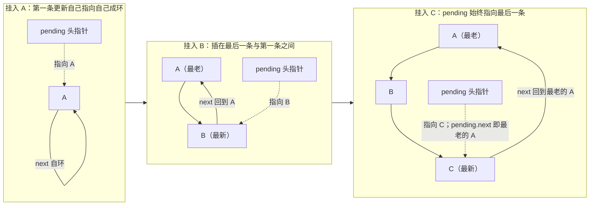
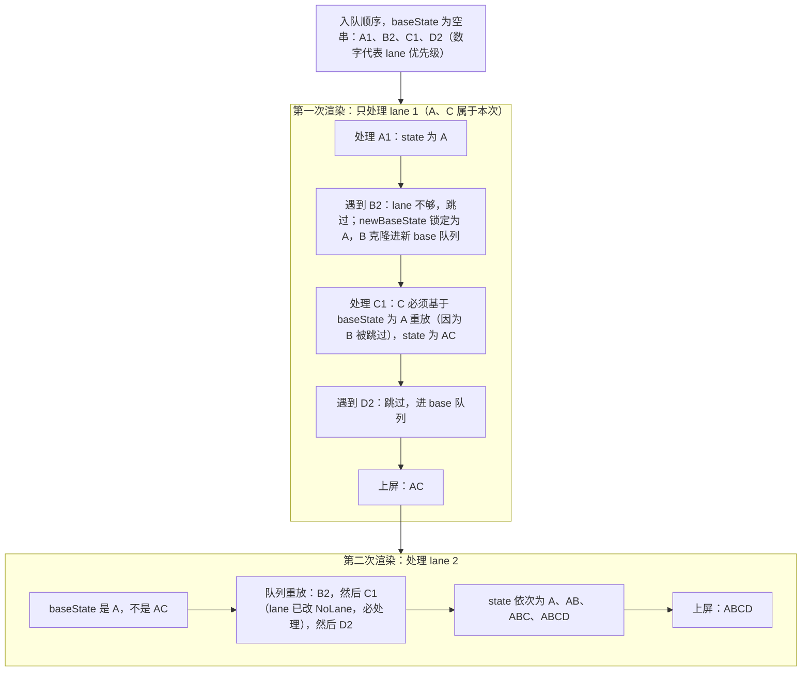
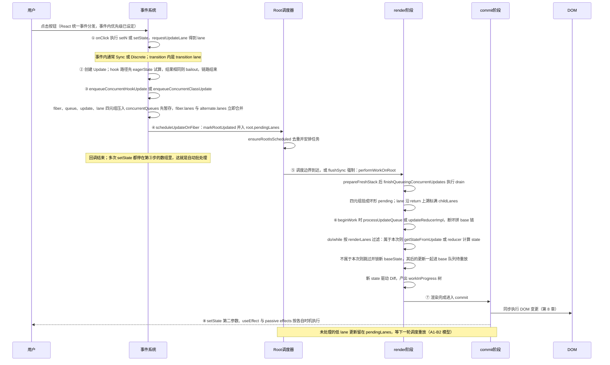

# 第 6 章 状态更新完整链路

> 上一章：[第 5 章 协调与 Diff 算法](./05-reconciliation-diff.md) ｜ 下一章：[第 7 章 Hooks 原理](./07-hooks.md)

## 学习目标

- 掌握 class 更新对象 `Update` 的字段、四种 tag 与环形单链表结构。
- 读懂 `processUpdateQueue` 如何按 lane 跳过更新、为什么跳过后后续高优先级更新要基于 baseState 重放。
- 看懂函数组件 `hook.queue` 的同款机制，以及 eagerState「提前算一遍」bailout。
- 理解 concurrentQueues「先暂存四元组、后统一 drain」的必要性与 lane 沿 return 上溯的过程。
- 串起 `setState → enqueue → markRootUpdated → ensureRootIsScheduled → render → commit` 的完整链路。
- 理解 React 19 的 Actions、自动批处理（batchedUpdates 为何是 noop）与 flushSync。

## 6.1 引入：你写下 setState 之后发生了什么

业务代码里最熟悉的一段：

```jsx
function App() {
  const [n, setN] = useState(0);
  return <button onClick={() => { setN(1); setN(x => x + 1); }}>{n}</button>;
}
```

初学者常有的疑问，几乎都指向同一个底层机制：

1. 同一个事件里调两次 `setState`，为什么只渲染一次？第二次为什么不是「覆盖」第一次？
2. 为什么 `setN(1)` 之后立刻 `console.log(n)` 还是旧值？更新到底存到哪去了？
3. `startTransition` / `useTransition` 里的更新凭什么「低优先级」，可以被高优先级打断还不出错？
4. `flushSync` 为什么能强制同步刷新？为什么官方警告别乱用？

这一章我们把「更新」当成一种**数据对象**来跟踪：它在哪里被创建、挂到哪条队列、以什么顺序被消费、消费时如何按优先级过滤、过滤后如何保证最终结果确定。读完你会发现，函数组件的 Hook 队列和 class 组件的更新队列是**同一套思想的两份实现**。

## 6.2 Update：一个挂在环形链表上的对象

先看 class 组件（HostRoot 也用同一份实现）的更新结构：

出处：packages/react-reconciler/src/ReactFiberClassUpdateQueue.js:131-158（React 19.3.0，节选）
[ReactFiberClassUpdateQueue.js](file:///Users/yangzhijie/Desktop/practice_projects/claude-code-test/react-vue-source-deep-dive/sources/react/packages/react-reconciler/src/ReactFiberClassUpdateQueue.js#L131-L158)

```js
export type Update<State> = {
  lane: Lane,              // 这条更新的优先级（一个二进制位）
  tag: 0 | 1 | 2 | 3,     // 更新方式，见下表
  payload: any,           // 新 state 对象 / updater 函数
  callback: (() => mixed) | null, // setState 第二参数
  next: Update<State> | null,    // 指向后一个更新
};

export type SharedQueue<State> = {
  pending: Update<State> | null, // 永远指向「最后一个 pending 更新」
  lanes: Lanes,
  hiddenCallbacks: Array<() => mixed> | null,
};

export type UpdateQueue<State> = {
  baseState: State,                       // 处理基准状态
  firstBaseUpdate: Update<State> | null, // 已拍平、等待处理的更新链头尾
  lastBaseUpdate: Update<State> | null,
  shared: SharedQueue<State>,            // 双缓冲共享的入队口
  callbacks: Array<() => mixed> | null,
};

export const UpdateState = 0, ReplaceState = 1, ForceUpdate = 2, CaptureUpdate = 3;
```

| tag | 值 | 含义 |
| --- | --- | --- |
| UpdateState | 0 | 普通 `setState`：对象就浅合并，函数就调用后合并 |
| ReplaceState | 1 | `replaceState`：整体替换，不合并 |
| ForceUpdate | 2 | 强制更新（`shouldComponentUpdate` 也拦不住） |
| CaptureUpdate | 3 | 错误边界捕获到错误后入队的更新（老资料里写 8，19.3 是 3） |

`createUpdate` 就是造一个 `tag: UpdateState` 的普通对象（[L210-221](file:///Users/yangzhijie/Desktop/practice_projects/claude-code-test/react-vue-source-deep-dive/sources/react/packages/react-reconciler/src/ReactFiberClassUpdateQueue.js#L210-L221)）。

### 6.2.1 环形单链表：为什么要绕一圈

新更新挂到 `shared.pending` 时，链表刻意被组织成环：

出处：packages/react-reconciler/src/ReactFiberClassUpdateQueue.js:253-264（React 19.3.0，render 阶段更新的直挂分支）
[ReactFiberClassUpdateQueue.js](file:///Users/yangzhijie/Desktop/practice_projects/claude-code-test/react-vue-source-deep-dive/sources/react/packages/react-reconciler/src/ReactFiberClassUpdateQueue.js#L253-L264)

```js
const pending = sharedQueue.pending;
if (pending === null) {
  // 第一条更新：自己指向自己，成环
  update.next = update;
} else {
  // 插在「最后一条」和「第一条」之间，pending 始终指向最后一条
  update.next = pending.next;
  pending.next = update;
}
sharedQueue.pending = update;
```

环形结构带来一个便利：**只保存一个尾指针，就能 O(1) 同时拿到「最后一条」（pending 本身）和「第一条」（pending.next）**。处理时把 `pending.next → … → pending` 这段摘下来、断开环，就得到一条按入队顺序排列的普通单链表。



### 6.2.2 双缓冲：current 与 workInProgress 各有一份队列

回忆第 4 章的双缓冲树：current 与 workInProgress 两棵 Fiber 树各自带一个 `UpdateQueue`，但两者的 `shared` 指向**同一个 SharedQueue**。新更新从 shared 入队；render 开始处理时，pending 被搬进 workInProgress 的 base 队列，同时（若存在）也追加到 current 的 base 队列——这是一种结构共享，保证渲染中断丢弃后，更新不会丢。

## 6.3 入队：class 的 setState 三步走

类组件的入队口非常薄（ReactFiberClassComponent.js）：

出处：packages/react-reconciler/src/ReactFiberClassComponent.js:167-184（React 19.3.0，节选）
[ReactFiberClassComponent.js](file:///Users/yangzhijie/Desktop/practice_projects/claude-code-test/react-vue-source-deep-dive/sources/react/packages/react-reconciler/src/ReactFiberClassComponent.js#L167-L184)

```js
enqueueSetState(inst, payload, callback) {
  const fiber = getInstance(inst);
  const lane = requestUpdateLane(fiber);       // ① 按当前上下文选 lane
  const update = createUpdate(lane);
  update.payload = payload;
  if (callback !== undefined && callback !== null) {
    update.callback = callback;
  }
  const root = enqueueUpdate(fiber, update, lane); // ② 进队列（暂存）
  if (root !== null) {
    scheduleUpdateOnFiber(root, fiber, lane);      // ③ 标记 root 并调度
    entangleTransitionUpdate(root, queue, lane);
  }
},
```

注意 6.2.1 的直接成环代码只用于「render 阶段不安全更新」这种特殊路径；正常情况下 `enqueueUpdate` 走的是 `enqueueConcurrentClassUpdate`——更新并不立刻挂进队列，而是先去一个「候车厅」（6.6 节）。

## 6.4 processUpdateQueue：按 lane 消费与重放

render 阶段更新到对应 Fiber 时（class/HostRoot 的 beginWork），`processUpdateQueue` 被调用。先把 pending 环摘下来接进 base 链：

出处：packages/react-reconciler/src/ReactFiberClassUpdateQueue.js:507-523（React 19.3.0，节选）
[ReactFiberClassUpdateQueue.js](file:///Users/yangzhijie/Desktop/practice_projects/claude-code-test/react-vue-source-deep-dive/sources/react/packages/react-reconciler/src/ReactFiberClassUpdateQueue.js#L507-L523)

```js
let pendingQueue = queue.shared.pending;
if (pendingQueue !== null) {
  queue.shared.pending = null;
  // pending 环：尾是 lastPending，头是 lastPending.next；断开成普通链
  const lastPendingUpdate = pendingQueue;
  const firstPendingUpdate = lastPendingUpdate.next;
  lastPendingUpdate.next = null;
  if (lastBaseUpdate === null) {
    firstBaseUpdate = firstPendingUpdate;
  } else {
    lastBaseUpdate.next = firstPendingUpdate;
  }
  lastBaseUpdate = lastPendingUpdate;
  // …同样追加到 current 的队列，利用结构共享…
}
```

接着是核心 do/while：逐条判断「这条更新的 lane 属不属于本次渲染」：

出处：packages/react-reconciler/src/ReactFiberClassUpdateQueue.js:558-631（React 19.3.0，节选）
[ReactFiberClassUpdateQueue.js](file:///Users/yangzhijie/Desktop/practice_projects/claude-code-test/react-vue-source-deep-dive/sources/react/packages/react-reconciler/src/ReactFiberClassUpdateQueue.js#L558-L631)

```js
let update = firstBaseUpdate;
do {
  // 关键：lane（去掉 OffscreenLane 后）不是 renderLanes 子集 → 跳过
  const updateLane = removeLanes(update.lane, OffscreenLane);
  if (!isSubsetOfLanes(renderLanes, updateLane)) {
    // 跳过：克隆进「新 base 队列」留给下次
    const clone = {lane: updateLane, tag: update.tag, payload: update.payload, callback: update.callback, next: null};
    if (newLastBaseUpdate === null) {
      newFirstBaseUpdate = newLastBaseUpdate = clone;
      newBaseState = newState;   // 第一次跳过：此刻状态成为新基准
    } else {
      newLastBaseUpdate = newLastBaseUpdate.next = clone;
    }
    newLanes = mergeLanes(newLanes, updateLane);
  } else {
    if (newLastBaseUpdate !== null) {
      // 前面跳过过低优更新：本条 lane 再高也要克隆进 base 队列，
      // lane 改 NoLane（0 属于任何 lanes 子集，下次必处理），callback 丢弃
      const clone = {lane: NoLane, tag: update.tag, payload: update.payload, callback: null, next: null};
      newLastBaseUpdate = newLastBaseUpdate.next = clone;
    }
    newState = getStateFromUpdate(/*…*/ update, newState, /*…*/);
  }
  update = update.next;
} while (/*…队列未空…*/);
```

四种 tag 如何作用于 state，在 `getStateFromUpdate` 里分派（[L386-461](file:///Users/yangzhijie/Desktop/practice_projects/claude-code-test/react-vue-source-deep-dive/sources/react/packages/react-reconciler/src/ReactFiberClassUpdateQueue.js#L386-L461)）：`ReplaceState` 整体替换；`UpdateState` 的函数 payload 调用 `payload(prevState, props)`，对象 payload 用 `assign({}, prevState, partialState)` 浅合并，`null/undefined` 视为 no-op；`ForceUpdate` 不改 state 但置全局 `hasForceUpdate`；`CaptureUpdate` 先翻转 `ShouldCapture/DidCapture` 标志再落入 UpdateState 逻辑。

### 6.4.1 为什么「跳过」之后还要重放：A1-B2-C1-D2

源码开头的注释直接给了经典例子（[L60-85](file:///Users/yangzhijie/Desktop/practice_projects/claude-code-test/react-vue-source-deep-dive/sources/react/packages/react-reconciler/src/ReactFiberClassUpdateQueue.js#L60-L85)）。数字代表优先级，字母代表更新内容：



这就是**公平性（fairness）**的关键设计：一旦中间有更新被跳过，它后面所有更新（哪怕 lane 很高）都要连同它一起「基于更早的 baseState 重放」，而不是建立在跳过它算出的中间结果上。这样无论渲染以什么优先级、中断重放多少次，**最终 state 一定等于「按入队顺序全部应用」的结果**，中间态可以随系统资源变化，最终态确定。这也回答了 6.1 的疑问 3：transition 更新被打断不会让高优更新「吃掉」低优更新。

## 6.5 函数组件：hook.queue 是同一套模型的精简版

Hook 的 Update/UpdateQueue 定义在 ReactFiberHooks.js：

出处：packages/react-reconciler/src/ReactFiberHooks.js:167-183（React 19.3.0，节选）
[ReactFiberHooks.js](file:///Users/yangzhijie/Desktop/practice_projects/claude-code-test/react-vue-source-deep-dive/sources/react/packages/react-reconciler/src/ReactFiberHooks.js#L167-L183)

```js
export type Update<S, A> = {
  lane: Lane,
  revertLane: Lane,          // 乐观更新回滚用（19 相关特性）
  action: A,                 // setState 的新值或 action 函数
  hasEagerState: boolean,
  eagerState: S | null,      // 提前计算好的结果
  next: Update<S, A>,
  gesture: null | ScheduledGesture,
};

export type UpdateQueue<S, A> = {
  pending: Update<S, A> | null,  // 同样是环形链表尾指针
  lanes: Lanes,
  dispatch: (A => mixed) | null, // 绑定好的 setState 函数
  lastRenderedReducer: ((S, A) => S) | null, // 上次的 reducer
  lastRenderedState: S | null,               // 上次的 state
};
```

每个 useState/useReducer 对应一个 Hook 对象，队列挂在 `hook.queue` 上，`hook.baseState` / `hook.baseQueue` 与 class 的 baseState/base 链一一对应。消费逻辑在 `updateReducerImpl`，先把 pending 环并入 baseQueue，然后同样 do/while + `isSubsetOfLanes(renderLanes, updateLane)` 过滤（[L1372-1436](file:///Users/yangzhijie/Desktop/practice_projects/claude-code-test/react-vue-source-deep-dive/sources/react/packages/react-reconciler/src/ReactFiberHooks.js#L1372-L1436)）：跳过的更新克隆进新 base 队列、锁定 newBaseState；其后的更新同样重放。两份实现的公平性机制完全同构。

### 6.5.1 eagerState：入队前先「试算」一次

函数组件多了一个 class 没有的省钱优化。`dispatchSetState` 时，如果这个 fiber 当前**没有任何待处理更新**（lanes 为空），说明队列是静的，可以先拿 `lastRenderedReducer` 提前把新 state 算出来：

出处：packages/react-reconciler/src/ReactFiberHooks.js:3676-3718（React 19.3.0，节选）
[ReactFiberHooks.js](file:///Users/yangzhijie/Desktop/practice_projects/claude-code-test/react-vue-source-deep-dive/sources/react/packages/react-reconciler/src/ReactFiberHooks.js#L3676-L3718)

```js
if (
  fiber.lanes === NoLanes &&
  (alternate === null || alternate.lanes === NoLanes)
) {
  const lastRenderedReducer = queue.lastRenderedReducer;
  if (lastRenderedReducer !== null) {
    const currentState = queue.lastRenderedState;
    const eagerState = lastRenderedReducer(currentState, action); // 试算
    update.hasEagerState = true;
    update.eagerState = eagerState;
    if (is(eagerState, currentState)) {
      // 结果和现在一样（Object.is）：不入队、不调度，直接 bailout
      enqueueConcurrentHookUpdateAndEagerlyBailout(fiber, queue, update);
      return false;
    }
  }
}
const root = enqueueConcurrentHookUpdate(fiber, queue, update, lane);
if (root !== null) {
  scheduleUpdateOnFiber(root, fiber, lane);
}
```

`setN(n => n)` 这种 action 返回旧值、或 `setN(0)` 而 n 已经是 0，fiber 会完全不发起渲染。注意优化只在「fiber 没有挂起更新」时安全：如果已有更新排队，最终 state 要以队列重放为准，提前试算可能算错。试算抛错会被吞掉，留到 render 阶段再抛一次。

## 6.6 concurrentQueues：为什么要「先暂存，后统一 drain」

正常路径下，更新并不直接挂进 fiber 的队列，而是先压进一个模块级扁平数组，每 4 个槽位一组：

出处：packages/react-reconciler/src/ReactFiberConcurrentUpdates.js:41-113（React 19.3.0，节选）
[ReactFiberConcurrentUpdates.js](file:///Users/yangzhijie/Desktop/practice_projects/claude-code-test/react-vue-source-deep-dive/sources/react/packages/react-reconciler/src/ReactFiberConcurrentUpdates.js#L41-L113)

```js
// 如果 render 进行中收到并发事件更新，先不挂到 fiber/hook 队列上，
// 等当前 render 结束（完成或中断）后再统一处理
const concurrentQueues: Array<any> = [];
let concurrentQueuesIndex = 0;

function enqueueUpdate(fiber, queue, update, lane) {
  concurrentQueues[concurrentQueuesIndex++] = fiber;
  concurrentQueues[concurrentQueuesIndex++] = queue;
  concurrentQueues[concurrentQueuesIndex++] = update;
  concurrentQueues[concurrentQueuesIndex++] = lane;
  concurrentlyUpdatedLanes = mergeLanes(concurrentlyUpdatedLanes, lane);
  // fiber.lanes 立即更新，供 eager bailout 等场景快速判断
  fiber.lanes = mergeLanes(fiber.lanes, lane);
  const alternate = fiber.alternate;
  if (alternate !== null) {
    alternate.lanes = mergeLanes(alternate.lanes, lane);
  }
}
```

为什么需要候车厅？想象 render 进行到一半：workInProgress 正在**遍历并可能复用、重放**某条队列，如果此时事件回调把更新直接插进那条环形队列，正在迭代的链表就会被「热修改」，顺序、去重、中断一致性全部失控。所以所有更新先攒着，在安全边界统一 drain：

出处：packages/react-reconciler/src/ReactFiberConcurrentUpdates.js:50-84（React 19.3.0，节选）
[ReactFiberConcurrentUpdates.js](file:///Users/yangzhijie/Desktop/practice_projects/claude-code-test/react-vue-source-deep-dive/sources/react/packages/react-reconciler/src/ReactFiberConcurrentUpdates.js#L50-L84)

```js
export function finishQueueingConcurrentUpdates(): void {
  const endIndex = concurrentQueuesIndex;
  concurrentQueuesIndex = 0;
  concurrentlyUpdatedLanes = NoLanes;
  let i = 0;
  while (i < endIndex) {
    const fiber = concurrentQueues[i]; concurrentQueues[i++] = null;
    const queue = concurrentQueues[i]; concurrentQueues[i++] = null;
    const update = concurrentQueues[i]; concurrentQueues[i++] = null;
    const lane = concurrentQueues[i]; concurrentQueues[i++] = null;

    if (queue !== null && update !== null) {
      // 此刻才真正挂成环形队列
      const pending = queue.pending;
      if (pending === null) { update.next = update; }
      else { update.next = pending.next; pending.next = update; }
      queue.pending = update;
    }
    if (lane !== NoLane) {
      markUpdateLaneFromFiberToRoot(fiber, update, lane);
    }
  }
}
```

drain 的调用点正是第 4 章见过的两处：`prepareFreshStack` 末尾（新一轮 render 前）与 renderRootSync/Concurrent 完成后（[WorkLoop L2284](file:///Users/yangzhijie/Desktop/practice_projects/claude-code-test/react-vue-source-deep-dive/sources/react/packages/react-reconciler/src/ReactFiberWorkLoop.js#L2284)、[L2764](file:///Users/yangzhijie/Desktop/practice_projects/claude-code-test/react-vue-source-deep-dive/sources/react/packages/react-reconciler/src/ReactFiberWorkLoop.js#L2764)）。`queue/update` 允许为 null——`enqueueConcurrentRenderForLane(fiber, lane)` 只借这个通道占一个 lane 位（如内部强制重渲染）。

### 6.6.1 lane 沿 return 上溯：childLanes 的由来

drain 每组四元组的最后一步是 `markUpdateLaneFromFiberToRoot`，沿 `return` 一路把 lane 标到所有祖先和 root：

出处：packages/react-reconciler/src/ReactFiberConcurrentUpdates.js:195-209（React 19.3.0，节选）
[ReactFiberConcurrentUpdates.js](file:///Users/yangzhijie/Desktop/practice_projects/claude-code-test/react-vue-source-deep-dive/sources/react/packages/react-reconciler/src/ReactFiberConcurrentUpdates.js#L195-L209)

```js
sourceFiber.lanes = mergeLanes(sourceFiber.lanes, lane);
let alternate = sourceFiber.alternate;
if (alternate !== null) {
  alternate.lanes = mergeLanes(alternate.lanes, lane);
}
// 沿父链向上：每个祖先的 childLanes 都合并这个 lane
let parent = sourceFiber.return;
while (parent !== null) {
  parent.childLanes = mergeLanes(parent.childLanes, lane);
  alternate = parent.alternate;
  if (alternate !== null) {
    alternate.childLanes = mergeLanes(alternate.childLanes, lane);
  }
  /* …隐藏的 Offscreen 子树特殊处理… */
  parent = parent.return;
}
```

第 4 章 bailout 判断的 `childLanes`、根上 `pendingLanes` 的来源都在这里——这保证 render 从根遍历时，每一层都知道「我子树里有没有这个 lane 的活」，从而决定继续深入还是整棵剪枝。

## 6.7 scheduleUpdateOnFiber：登记 root 并安排调度

入队函数返回 root 后，`scheduleUpdateOnFiber` 负责通知「这个根有活了」：

出处：packages/react-reconciler/src/ReactFiberWorkLoop.js:1026-1093（React 19.3.0，节选）
[ReactFiberWorkLoop.js](file:///Users/yangzhijie/Desktop/practice_projects/claude-code-test/react-vue-source-deep-dive/sources/react/packages/react-reconciler/src/ReactFiberWorkLoop.js#L1026-L1093)

```js
// Mark that the root has a pending update.
markRootUpdated(root, lane);

if (
  (executionContext & RenderContext) !== NoContext &&
  root === workInProgressRoot
) {
  // render 阶段产生的更新：只记账，不在这里调度
  workInProgressRootRenderPhaseUpdatedLanes = mergeLanes(
    workInProgressRootRenderPhaseUpdatedLanes, lane);
} else {
  // 正常的事件回调更新
  // …DevTools/transition tracing…
  ensureRootIsScheduled(root);   // 交给 RootScheduler：去重并安排任务
  // legacy 模式的同步特例（19 默认走不到）
}
```

`markRootUpdated` 把 lane 并入 `root.pendingLanes`（第 3 章的模型）；`ensureRootIsScheduled`（在 ReactFiberRootScheduler.js）做任务去重——同一个 root 上无论瞬间产生多少更新，通常只有一个调度任务。下一个任务里才会走到第 4 章的 `performWorkOnRoot`。

## 6.8 React 19 Actions：异步函数自动成为 transition

React 19 里 `<form action={asyncFn}>`、`useActionState`、传给 `startTransition` 的异步函数统称 **Action**。核心思想：异步函数发起的更新天然应该是「非紧急」的，React 自动把它纳入 transition lane 并跟踪那个 Promise。

Action 的 Promise 追踪在 ReactFiberAsyncAction.js。多个并发 Action 会被「纠缠（entangle）」进同一个作用域，共享一个 transition lane：

出处：packages/react-reconciler/src/ReactFiberAsyncAction.js:71-101（React 19.3.0，节选）
[ReactFiberAsyncAction.js](file:///Users/yangzhijie/Desktop/practice_projects/claude-code-test/react-vue-source-deep-dive/sources/react/packages/react-reconciler/src/ReactFiberAsyncAction.js#L71-L101)

```js
export function entangleAsyncAction(transition, thenable) {
  if (currentEntangledListeners === null) {
    const entangledListeners = (currentEntangledListeners = []);
    currentEntangledPendingCount = 0;
    currentEntangledLane = requestTransitionLane(transition); // 共享 lane
    const entangledThenable = {
      status: 'pending', value: undefined,
      then(resolve) { entangledListeners.push(resolve); },
    };
    currentEntangledActionThenable = entangledThenable;
  }
  currentEntangledPendingCount++;
  thenable.then(pingEngtangledActionScope, pingEngtangledActionScope);
  return thenable;
}
```

`startTransition` 的收尾回调发现回调返回的是 thenable（[ReactFiberTransition.js L82-98](file:///Users/yangzhijie/Desktop/practice_projects/claude-code-test/react-vue-source-deep-dive/sources/react/packages/react-reconciler/src/ReactFiberTransition.js#L82-L98)），就调 `entangleAsyncAction`：Action 内 `await` 之后发起的所有 setState 自动落在同一个 transition lane；全部 Promise 结算时计数归零、resolve 掉纠缠 thenable 并 ping 渲染。`useActionState` 还会用 `chainThenableValue` 造一个「Action 完成后 resolve 成 finishedState」的 thenable 直接 dispatch（[ReactFiberHooks.js L3192](file:///Users/yangzhijie/Desktop/practice_projects/claude-code-test/react-vue-source-deep-dive/sources/react/packages/react-reconciler/src/ReactFiberHooks.js#L3192)），因此 pending 状态与最终数据能自动串起来。API 用法留到第 10 章。

## 6.9 自动批处理：batchedUpdates 在 19 里是 noop

同一事件里多次 setState 只渲染一次，这个能力从 React 18 的 createRoot 起默认开启（Automatic Batching），到 19 里连包装函数都不需要了。直接看证据：

出处：packages/react-reconciler/src/ReactFiberWorkLoop.js:1854-1858（React 19.3.0）
[ReactFiberWorkLoop.js](file:///Users/yangzhijie/Desktop/practice_projects/claude-code-test/react-vue-source-deep-dive/sources/react/packages/react-reconciler/src/ReactFiberWorkLoop.js#L1854-L1858)

```js
export function batchedUpdates<A, R>(fn: A => R, a: A): R {
  if (disableLegacyMode) {
    // batchedUpdates is a no-op now, but there's still some internal
    // react-dom code calling it, that we can't remove until we remove
    // legacy mode.
    return fn(a);
  } else { /* legacy：靠 BatchedContext 阻止中途 flush */ }
}
```

现代构建下 `disableLegacyMode` 为真，函数体就是直接执行 `fn(a)`。批处理不再依赖一个「批处理上下文」开关，而是由**调度模型天然保证**：事件回调（React 套在一个统一的事件分发函数里）中每次 setState 都只是「入队 + ensureRootIsScheduled」，真正的 render 是 Scheduler 在微任务/宏任务边界安排的，回调同步执行期间不会 flush；回调结束后所有更新已在同一批 pending 中，一次 render 全部消费。Promise then、setTimeout 等异步回调在 18+ 同样享受这一行为。

## 6.10 flushSync：强制同步出队的逃生舱

`flushSync` 走的是 reconciler 暴露的 `flushSyncWork`，react-dom 侧实现很薄：

出处：packages/react-dom/src/shared/ReactDOMFlushSync.js:19-49（React 19.3.0，节选）
[ReactDOMFlushSync.js](file:///Users/yangzhijie/Desktop/practice_projects/claude-code-test/react-vue-source-deep-dive/sources/react/packages/react-dom/src/shared/ReactDOMFlushSync.js#L19-L49)

```js
function flushSyncImpl(fn) {
  const previousUpdatePriority = ReactDOMSharedInternals.p;
  try {
    // 把当前更新优先级强制为 Discrete → 对应 SyncLane
    ReactDOMSharedInternals.p = DiscreteEventPriority;
    if (fn) { return fn(); }
  } finally {
    ReactDOMSharedInternals.p = previousUpdatePriority;
    // 立刻调 reconciler 的 flushSyncWork
    const wasInRender = ReactDOMSharedInternals.d.f();
    if (__DEV__ && wasInRender) {
      console.error('flushSync was called from inside a lifecycle…');
    }
  }
}
```

reconciler 侧在 finally 里做两件事（[WorkLoop L1906-1944](file:///Users/yangzhijie/Desktop/practice_projects/claude-code-test/react-vue-source-deep-dive/sources/react/packages/react-reconciler/src/ReactFiberWorkLoop.js#L1906-L1944)）：先按需 flush 掉挂起的 passive effects，再在不在 render/commit 上下文时调 `flushSyncWorkOnAllRoots()`——以 SyncLane **同步**跑完工作循环并提交。于是 `fn` 里的 setState 等不到调度边界，在 `flushSync` 返回前就已上屏，紧接着还能从 DOM 读到结果。「内部 setState 会提前出队」的含义即在于此：它打破了 6.9 的天然批处理节奏，强制 drain + 同步 render + commit。代价是丧失并发特性、可能额外触发一次同步渲染，所以官方建议只在第三方 DOM 库等必须同步读结果时使用。

## 端到端流程串讲



与开头四个疑问一一对应：①多次 setState 共享一个调度边界 → 一次渲染（6.9）；②更新先入队，render 时才计算，`console.log` 读到的是旧闭包（6.2-6.4）；③lane 过滤 + base 重放保证可中断而最终态确定（6.4）；④flushSync 强制 Discrete 优先级并立刻 drain 同步刷新（6.10）。

## 版本勘误 📌

- **UpdateState 等 tag 的数值**：老资料常写 `CaptureUpdate = 8`；React 19.3 中四个 tag 紧凑定义为 0/1/2/**3**（[L155-158](file:///Users/yangzhijie/Desktop/practice_projects/claude-code-test/react-vue-source-deep-dive/sources/react/packages/react-reconciler/src/ReactFiberClassUpdateQueue.js#L155-L158)），以源码为准。
- **React 16/17**：更新通过 expirationTime 数字大小表达优先级；18 起改为 lanes 位掩码，`processUpdateQueue` 用 `isSubsetOfLanes` 判断。16 的同步事件外更新不批处理，必须手动 `unstable_batchedUpdates`。
- **React 17→18**：createRoot 默认开启自动批处理（含 Promise/setTimeout）；`batchedUpdates` 退化为兼容 API，19 现代构建下直接 `return fn(a)`。
- **入队位置**：17 时代 setState 直接操作环形 `shared.pending`；18+ 新增 concurrentQueues 暂存层，统一在 `finishQueueingConcurrentUpdates` 里挂环并做 childLanes 上溯。
- **React 19 新增**：Actions（form action / useActionState）、异步 Action 纠缠（entangleAsyncAction）、Hook Update 的 `revertLane`、eagerState 字段下沉到 Update 对象、gesture transition 等；class 队列还增加了与 entangled async action 联动的 suspend 逻辑（`suspendIfUpdateReadFromEntangledAsyncAction`）。
- flushSync 在 19 中由 react-dom 的 [ReactDOMFlushSync.js](file:///Users/yangzhijie/Desktop/practice_projects/claude-code-test/react-vue-source-deep-dive/sources/react/packages/react-dom/src/shared/ReactDOMFlushSync.js) 设置共享优先级字段后委托 reconciler 执行，老版本直接定义在 reconciler/dom 包里。

## 初学者易错点 ⚠️

1. **以为 setState 是「立即改 state」**。它只是创建 Update 入队；state 在 render 阶段重算，事件回调里读到的永远是旧值，要读新值请用 useEffect 或函数式更新的组合逻辑。
2. **以为多次 setState 一定是「对象覆盖」**。函数式 updater（`setN(x => x + 1)`）和对象式更新进同一条队列按序应用；连续两次 `setN(x=>x+1)` 会累加两次。
3. **在 render 里直接调 setState 期望普通排队**。render 阶段更新走特殊直挂路径并会报警告（React 内部特性除外）；正确做法是渲染期派生用 useMemo/纯计算，真要循环更新走框架允许的特殊机制。
4. **以为被跳过的低优先级更新会丢**。它会被克隆进新的 base 队列，且其后的高优更新也要基于旧 baseState 重放；跳过只是「这次不显示」，不是删除。
5. **在高频事件里滥用 flushSync**：每次调用都强制一轮同步 render+commit，废掉时间切片，可能明显掉帧；多数场景靠自动批处理即可。
6. **reducer/updater 不纯净**（依赖外部可变变量）：eagerState 提前试算的结果可能与 render 时不一致，优化失效甚至产生难查 bug。
7. **以为 Action 只是语法糖 Promise**：关键是自动绑定 transition lane 与 thenable 纠缠追踪，await 后的更新仍可被打断且最终一致，手写 Promise + 普通 setState 没有这些调度语义。

## 本章小结

- 一次更新的本体是带 lane、tag、payload、next 的 Update 对象，多条更新组成 `shared.pending` 环形单链表；尾指针让头尾都能 O(1) 取得。
- `processUpdateQueue` 先断环拼 base 链，再 do/while 按 `isSubsetOfLanes(renderLanes, updateLane)` 过滤；跳过的更新及其后续更新进入新的 base 队列重放，保证任何优先级序列下最终 state 确定（A1-B2-C1-D2 模型）。
- 函数组件的 `hook.queue` 是同构实现，另有 eagerState 试算 bailout：fiber 无挂起更新且试算结果 `Object.is` 相同时，直接不调度渲染。
- 所有更新先以 `(fiber, queue, update, lane)` 四元组暂存于 concurrentQueues，在 render 前/后安全边界统一 drain：挂环 + 沿 return 上溯标 childLanes，最后 `scheduleUpdateOnFiber` 经 `markRootUpdated`/`ensureRootIsScheduled` 把根交给调度器。
- 19 中批处理由调度模型天然保证、`batchedUpdates` 是 noop；异步 Action 经 entangleAsyncAction 共享 transition lane；flushSync 通过强制 Discrete 优先级 + 立即 drain 同步刷新，是有代价的逃生舱。

## 下一章导读

本章多次提到 Hook：`hook.queue`、`renderWithHooks`、`lastRenderedReducer` 都只露了一角。useState/useEffect/useRef 这些 Hook 的状态到底存在 Fiber 的哪里？为什么「不能在条件语句里调 Hook」？函数组件每次执行，React 怎么把这次的 `useState` 调用和上一次的状态一一对应？第 7 章我们逐行拆解 ReactFiberHooks.js 的 Hook 链表、挂载/更新两套 dispatcher，以及 effect 的标记与调度。
