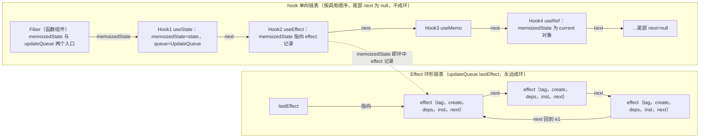
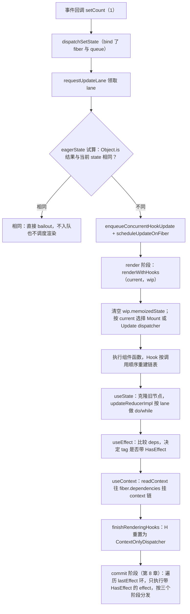

# 第 7 章 Hooks 系统原理

[上一章：状态更新链路](./06-state-update-chain.md) ｜ [下一章：commit 阶段与生命周期](./08-commit-and-lifecycle.md)

> 本章基于 React `19.3.0` 源码，核心文件是约 5265 行的 [ReactFiberHooks.js](file:///Users/yangzhijie/Desktop/practice_projects/claude-code-test/react-vue-source-deep-dive/sources/react/packages/react-reconciler/src/ReactFiberHooks.js)。所有行号均已逐一打开源码核对，建议边读边点开链接对照。

## 学习目标

读完本章，你应该能够：

1. 从「调用顺序」角度解释为什么 Hooks 不能写在 `if`、循环里，并指出状态挂在 fiber 的哪个字段上。
2. 说出四套 Dispatcher（Mount / Update / Rerender / ContextOnly）何时上场，以及「Invalid hook call」是谁抛出的。
3. 对照 hook 链表与 effect 环形链表两张图，讲清 `useState`、`useEffect`、`useMemo`、`useRef`、`useContext` 的实现差异。
4. 解释 `useEffect` 依赖不变时为什么不执行（`HasEffect` 位的秘密），以及三类 effect 的 tag 数值。
5. 讲清 React 19 中 `useTransition`、`useDeferredValue`、`useSyncExternalStore`、`useActionState`、`useOptimistic`、`use` 的底层机制。

## 7.1 引入：为什么 Hooks 依赖调用顺序

先看一段你一定被 lint 拦过的代码：

```jsx
function Counter({showName}) {
  if (showName) {
    const [name, setName] = useState('React'); // ❌ 条件里调用 Hook
  }
  const [count, setCount] = useState(0);
}
```

Class 组件的 `this.state` 是对象，靠 **key** 存取，顺序无所谓。而函数组件每次渲染只是一次普通函数调用，执行完栈帧就销毁了，React 没法在函数局部变量上挂状态。React 的解法极其朴素：**在 fiber 对象上维护一条按调用顺序排列的 hook 链表**——第一次 `useState` 对应链表第 1 个节点，第二次对应第 2 个节点，只认位置不认名字。你敢在条件里调用，下一次渲染时链表位置就全错位了。

这就是 Rules of Hooks 的全部本质：**不是语法规定，而是数据结构约束**。

## 7.2 两套 API 表面与四套 Dispatcher

### 7.2.1 `react` 包只是薄壳

你 `import {useState} from 'react'` 时拿到的并不是真正的实现，而是一个转发函数。

出处：packages/react/src/ReactHooks.js:24-42（React 19.3.0）
见 [ReactHooks.js](file:///Users/yangzhijie/Desktop/practice_projects/claude-code-test/react-vue-source-deep-dive/sources/react/packages/react/src/ReactHooks.js#L24-L42)

```js
function resolveDispatcher() {
  // H 是模块级槽位，由 reconciler 在渲染函数组件时填好
  const dispatcher = ReactSharedInternals.H;
  if (__DEV__) {
    if (dispatcher === null) {
      // 你在组件外（或渲染结束后）调用 Hook 时看到的报错
      console.error('Invalid hook call. Hooks can only be called ...');
    }
  }
  // 生产环境故意不自己抛错：返回 null 后访问其属性自然报错，热路径更短
  return dispatcher;
}
```

`useState` 本体只有「取 dispatcher + 调 `dispatcher.useState`」两件事。**`react` 包**只定义 API 表面，不知道 fiber；**`react-reconciler`** 在渲染期间把真正的实现塞进共享槽位 `ReactSharedInternals.H`。这种分离让同一个 `react` 包可以搭配 react-dom、React Native、Test Renderer。

### 7.2.2 四套 Dispatcher

定义见 [ReactFiberHooks.js:3926-4008](file:///Users/yangzhijie/Desktop/practice_projects/claude-code-test/react-vue-source-deep-dive/sources/react/packages/react-reconciler/src/ReactFiberHooks.js#L3926-L4008)：

| Dispatcher | 上场时机 | `useState` 指向 |
| --- | --- | --- |
| `HooksDispatcherOnMount` | 首次挂载（无历史 hook 链） | `mountState` |
| `HooksDispatcherOnUpdate` | 正常更新 | `updateState` → `updateReducer` |
| `HooksDispatcherOnRerender` | render 阶段重渲染、Suspense 重放 | `rerenderState` |
| `ContextOnlyDispatcher` | 不在任何组件渲染中 | `throwInvalidHookError` |

出处：packages/react-reconciler/src/ReactFiberHooks.js:3898-3924（React 19.3.0）
见 [ReactFiberHooks.js](file:///Users/yangzhijie/Desktop/practice_projects/claude-code-test/react-vue-source-deep-dive/sources/react/packages/react-reconciler/src/ReactFiberHooks.js#L3898-L3924)

```js
export const ContextOnlyDispatcher: Dispatcher = {
  readContext,
  use, // 注意：use 和 readContext 在这里也不抛错
  useCallback: throwInvalidHookError,
  useContext: throwInvalidHookError,
  useEffect: throwInvalidHookError,
  // ...其余所有 Hook 全部指向同一个抛错函数
  useActionState: throwInvalidHookError,
  useOptimistic: throwInvalidHookError,
};
```

`throwInvalidHookError`（[L445-454](file:///Users/yangzhijie/Desktop/practice_projects/claude-code-test/react-vue-source-deep-dive/sources/react/packages/react-reconciler/src/ReactFiberHooks.js#L445-L454)）抛出的就是那段经典三条原因（版本不匹配 / 违反 Rules of Hooks / 多份 React 副本）。

### 7.2.3 切换发生在 `renderWithHooks`

出处：packages/react-reconciler/src/ReactFiberHooks.js:513-531、562-567（React 19.3.0）
见 [ReactFiberHooks.js](file:///Users/yangzhijie/Desktop/practice_projects/claude-code-test/react-vue-source-deep-dive/sources/react/packages/react-reconciler/src/ReactFiberHooks.js#L513-L531)

```js
renderLanes = nextRenderLanes;
currentlyRenderingFiber = workInProgress; // 模块级「当前 fiber」指针
// 每次渲染都先清空 wip 链，下面边执行组件函数边重建
workInProgress.memoizedState = null;
workInProgress.updateQueue = null;
workInProgress.lanes = NoLanes;
```

出处：packages/react-reconciler/src/ReactFiberHooks.js:562-567（React 19.3.0）
见 [ReactFiberHooks.js](file:///Users/yangzhijie/Desktop/practice_projects/claude-code-test/react-vue-source-deep-dive/sources/react/packages/react-reconciler/src/ReactFiberHooks.js#L562-L567)

```js
// 生产环境的核心选择逻辑：
ReactSharedInternals.H =
  current === null || current.memoizedState === null
    ? HooksDispatcherOnMount   // 首次挂载
    : HooksDispatcherOnUpdate; // 否则按更新处理
```

组件函数执行完后，`H` 被重置回 `ContextOnlyDispatcher`，所以在事件回调里直接调 `useState()` 必炸。

## 7.3 Hook 的通用数据结构

### 7.3.1 hook 节点字段

出处：packages/react-reconciler/src/ReactFiberHooks.js:197-203（React 19.3.0）
见 [ReactFiberHooks.js](file:///Users/yangzhijie/Desktop/practice_projects/claude-code-test/react-vue-source-deep-dive/sources/react/packages/react-reconciler/src/ReactFiberHooks.js#L197-L203)

```js
export type Hook = {
  memoizedState: any,                  // 本 hook 的「状态」，含义随 hook 而变
  baseState: any,                      // 本轮计算的基础 state（跳过更新时用）
  baseQueue: Update<any, any> | null,  // 尚未处理完的更新环
  queue: any,                          // 更新队列（state 类 hook）等
  next: Hook | null,                   // 指向下一个 hook —— 链表！
};
```

不同 Hook 塞的东西完全不同：

| Hook | `memoizedState` | `queue` |
| --- | --- | --- |
| `useState` / `useReducer` | 当前 state | `UpdateQueue` 更新队列 |
| `useEffect` / `useLayoutEffect` | effect 记录 `Effect` | 一般为 null |
| `useMemo` | `[值, deps]` | null |
| `useCallback` | `[函数, deps]` | null |
| `useRef` | `{current: 值}` | null |
| `useTransition` | 两节点：boolean/thenable + start | 状态更新队列 |
| `useSyncExternalStore` | 快照值 | `StoreInstance` |

### 7.3.2 挂载：追加新节点

出处：packages/react-reconciler/src/ReactFiberHooks.js:983-1002（React 19.3.0）
见 [ReactFiberHooks.js](file:///Users/yangzhijie/Desktop/practice_projects/claude-code-test/react-vue-source-deep-dive/sources/react/packages/react-reconciler/src/ReactFiberHooks.js#L983-L1002)

```js
function mountWorkInProgressHook(): Hook {
  const hook: Hook = {
    memoizedState: null, baseState: null,
    baseQueue: null, queue: null, next: null,
  };
  if (workInProgressHook === null) {
    // 链表第一个节点：挂到 fiber.memoizedState
    currentlyRenderingFiber.memoizedState = workInProgressHook = hook;
  } else {
    // 后续节点：追加到尾部并移动游标
    workInProgressHook = workInProgressHook.next = hook;
  }
  return workInProgressHook;
}
```

### 7.3.3 更新：为什么要克隆而不是复用旧对象

render 阶段可能被打断、丢弃、重做。若直接改旧 hook 对象，半途而废的渲染就会污染屏幕上仍显示的 current 树。所以每个 wip hook 都从 `current.alternate` 的对应节点克隆：

出处：packages/react-reconciler/src/ReactFiberHooks.js:1052-1070（React 19.3.0）
见 [ReactFiberHooks.js](file:///Users/yangzhijie/Desktop/practice_projects/claude-code-test/react-vue-source-deep-dive/sources/react/packages/react-reconciler/src/ReactFiberHooks.js#L1052-L1070)

```js
currentHook = nextCurrentHook;
// 关键：从旧 hook 浅克隆一个新节点，而不是原地修改
const newHook: Hook = {
  memoizedState: currentHook.memoizedState,
  baseState: currentHook.baseState,
  baseQueue: currentHook.baseQueue,
  queue: currentHook.queue,
  next: null,
};
if (workInProgressHook === null) {
  currentlyRenderingFiber.memoizedState = workInProgressHook = newHook;
} else {
  workInProgressHook = workInProgressHook.next = newHook;
}
```

若这次渲染比上次多调了 Hook、走到链表尽头找不到对应节点，会直接抛出 `Rendered more hooks than during the previous render.`（[L1048](file:///Users/yangzhijie/Desktop/practice_projects/claude-code-test/react-vue-source-deep-dive/sources/react/packages/react-reconciler/src/ReactFiberHooks.js#L1048)）。

### 7.3.4 总图：hook 链 + effect 环

一个函数组件 fiber 同时挂着两条结构：



记住：**hook 链不成环（尾部为 null），effect 链必须成环**（方便从任意位置插入与遍历）。

## 7.4 useState 与 useReducer：同一个内核

### 7.4.1 useState 只是预置了 reducer 的 useReducer

出处：packages/react-reconciler/src/ReactFiberHooks.js:1265-1268、1962-1966（React 19.3.0）
见 [ReactFiberHooks.js](file:///Users/yangzhijie/Desktop/practice_projects/claude-code-test/react-vue-source-deep-dive/sources/react/packages/react-reconciler/src/ReactFiberHooks.js#L1265-L1268)

```js
// action 是函数就调用，否则直接当新 state
function basicStateReducer<S>(state: S, action: BasicStateAction<S>): S {
  return typeof action === 'function' ? action(state) : action;
}
function updateState<S>(initialState) {
  return updateReducer(basicStateReducer, initialState); // 完全复用
}
```

挂载时 `mountState`（[L1948-1960](file:///Users/yangzhijie/Desktop/practice_projects/claude-code-test/react-vue-source-deep-dive/sources/react/packages/react-reconciler/src/ReactFiberHooks.js#L1948-L1960)）建节点、初始化 `UpdateQueue`、把 `dispatchSetState.bind(null, fiber, queue)` 作为 setter 返回。setter 被 bind 死了 fiber 和 queue，所以你拿到的 `setCount` 永远知道该更新谁。

### 7.4.2 更新计算：按 lane 过滤的 do/while

`updateReducerImpl` 先把新到的 `pending` 环拼进 `baseQueue`，再逐条计算；**lane 不在本次渲染范围的更新被跳过并留在 baseQueue**，等高优先级渲染重放。

出处：packages/react-reconciler/src/ReactFiberHooks.js:1380-1392、1529-1544（React 19.3.0）
见 [ReactFiberHooks.js](file:///Users/yangzhijie/Desktop/practice_projects/claude-code-test/react-vue-source-deep-dive/sources/react/packages/react-reconciler/src/ReactFiberHooks.js#L1380-L1392)

```js
do {
  const updateLane = removeLanes(update.lane, OffscreenLane);
  // 本次 renderLanes 不包含此更新的 lane → 跳过（优先级不够）
  const shouldSkipUpdate =
    !isSubsetOfLanes(renderLanes, updateLane);
  // ...跳过的更新会被克隆进 newBaseQueue，稍后高优渲染再 rebase
  // 够优先级的更新：
  if (update.hasEagerState) {
    newState = update.eagerState;   // 用预计算结果
  } else {
    newState = reducer(newState, update.action);
  }
  update = update.next;
} while (update !== null && update !== first); // 环形队列走一圈
```

这与第 6 章 class 的 updateQueue 环形链表是同一套思想：lane 过滤保证紧急渲染先看到紧急结果。

### 7.4.3 eagerState：setState 时先算一遍，可能直接 bailout

若 fiber 当前没有待处理更新，React 在入队前就拿 reducer 试算一次；结果与当前 state 相同（`Object.is`）则直接 bailout，连调度都省了。

出处：packages/react-reconciler/src/ReactFiberHooks.js:3676-3707（React 19.3.0）
见 [ReactFiberHooks.js](file:///Users/yangzhijie/Desktop/practice_projects/claude-code-test/react-vue-source-deep-dive/sources/react/packages/react-reconciler/src/ReactFiberHooks.js#L3676-L3707)

```js
if (fiber.lanes === NoLanes &&
    (alternate === null || alternate.lanes === NoLanes)) {
  const currentState = queue.lastRenderedState;
  const eagerState = lastRenderedReducer(currentState, action); // 提前试算
  update.hasEagerState = true;
  update.eagerState = eagerState;
  if (is(eagerState, currentState)) {
    // 结果没变：入队但不调度渲染
    enqueueConcurrentHookUpdateAndEagerlyBailout(fiber, queue, update);
    return false;
  }
}
```

所以 `setCount(count)`（值相同）不触发渲染，本质是 eager bailout，而不是 setter 内部简单的 `if (x === state) return`。

## 7.5 useEffect 三兄弟：环形链表与 tag 位

### 7.5.1 四个二进制位

出处：packages/react-reconciler/src/ReactHookEffectTags.js:12-20（React 19.3.0）
见 [ReactHookEffectTags.js](file:///Users/yangzhijie/Desktop/practice_projects/claude-code-test/react-vue-source-deep-dive/sources/react/packages/react-reconciler/src/ReactHookEffectTags.js#L12-L20)

```js
export const NoFlags =   0b0000;
export const HasEffect = 0b0001; // 本次 commit 真的需要执行（开关位）
export const Insertion = 0b0010; // useInsertionEffect（类别位）
export const Layout =    0b0100; // useLayoutEffect
export const Passive =   0b1000; // useEffect
```

判断时用按位与 `(tag & HookPassive) !== 0`。`useEffect` 首次挂载的 tag 是 `0b1001`（`HasEffect | Passive`）。

### 7.5.2 Effect 记录（19.3 结构有变）

出处：packages/react-reconciler/src/ReactFiberHooks.js:219-229（React 19.3.0）
见 [ReactFiberHooks.js](file:///Users/yangzhijie/Desktop/practice_projects/claude-code-test/react-vue-source-deep-dive/sources/react/packages/react-reconciler/src/ReactFiberHooks.js#L219-L229)

```js
type EffectInstance = { destroy: void | (() => void) }; // 跨渲染共享
export type Effect = {
  tag: HookFlags,
  inst: EffectInstance,             // create 执行后 destroy 存入 inst.destroy
  create: () => (() => void) | void,
  deps: Array<mixed> | void | null,
  next: Effect,                     // 环形链表
};
```

`pushEffectImpl` 把 effect 挂进 `fiber.updateQueue.lastEffect` 环，第一个 effect 自环，之后标准环插：

出处：packages/react-reconciler/src/ReactFiberHooks.js:2612-2620（React 19.3.0）
见 [ReactFiberHooks.js](file:///Users/yangzhijie/Desktop/practice_projects/claude-code-test/react-vue-source-deep-dive/sources/react/packages/react-reconciler/src/ReactFiberHooks.js#L2612-L2620)

```js
const lastEffect = componentUpdateQueue.lastEffect;
if (lastEffect === null) {
  componentUpdateQueue.lastEffect = effect.next = effect; // 自环
} else {
  const firstEffect = lastEffect.next;
  lastEffect.next = effect;
  effect.next = firstEffect;
  componentUpdateQueue.lastEffect = effect;
}
```

### 7.5.3 挂载必带 HasEffect，更新看依赖

出处：packages/react-reconciler/src/ReactFiberHooks.js:2646-2654（React 19.3.0）
见 [ReactFiberHooks.js](file:///Users/yangzhijie/Desktop/practice_projects/claude-code-test/react-vue-source-deep-dive/sources/react/packages/react-reconciler/src/ReactFiberHooks.js#L2646-L2654)

```js
function mountEffectImpl(fiberFlags, hookFlags, create, deps) {
  const hook = mountWorkInProgressHook();
  currentlyRenderingFiber.flags |= fiberFlags;       // 给 fiber 打标记
  hook.memoizedState = pushSimpleEffect(
    HookHasEffect | hookFlags, createEffectInstance(),
    create, deps === undefined ? null : deps,       // 挂载：无条件带 HasEffect
  );
}
```

出处：packages/react-reconciler/src/ReactFiberHooks.js:2671-2694（React 19.3.0）
见 [ReactFiberHooks.js](file:///Users/yangzhijie/Desktop/practice_projects/claude-code-test/react-vue-source-deep-dive/sources/react/packages/react-reconciler/src/ReactFiberHooks.js#L2671-L2694)

```js
if (nextDeps !== null) {
  const prevEffect = currentHook.memoizedState;
  if (areHookInputsEqual(nextDeps, prevEffect.deps)) {
    // 依赖没变：推入环但 tag 只有类别位，没有 HasEffect！
    hook.memoizedState = pushSimpleEffect(hookFlags, inst, create, nextDeps);
    return; // fiber 不打 flags，commit 遍历时直接跳过
  }
}
currentlyRenderingFiber.flags |= fiberFlags;
hook.memoizedState = pushSimpleEffect(
  HookHasEffect | hookFlags, inst, create, nextDeps); // 依赖变了才执行
```

依赖比较 `areHookInputsEqual`（[L456-503](file:///Users/yangzhijie/Desktop/practice_projects/claude-code-test/react-vue-source-deep-dive/sources/react/packages/react-reconciler/src/ReactFiberHooks.js#L456-L503)）逐个用 `Object.is`。注意即使依赖没变，effect 记录仍会推入环（要持有新的 `create` 闭包和共享 `inst`），只是不带 `HasEffect`。

### 7.5.4 三种 effect 的区别只是传入的 flag 不同

出处：packages/react-reconciler/src/ReactFiberHooks.js:2782-2807（React 19.3.0）
见 [ReactFiberHooks.js](file:///Users/yangzhijie/Desktop/practice_projects/claude-code-test/react-vue-source-deep-dive/sources/react/packages/react-reconciler/src/ReactFiberHooks.js#L2782-L2807)

```js
function mountInsertionEffect(create, deps) {
  mountEffectImpl(UpdateEffect, HookInsertion, create, deps);
}
function mountLayoutEffect(create, deps) {
  const fiberFlags = UpdateEffect | LayoutStaticEffect;
  return mountEffectImpl(fiberFlags, HookLayout, create, deps);
}
// mountEffect 传 (PassiveEffect | PassiveStaticEffect, HookPassive)
```

| Hook | tag 类别 | fiber 标记 | commit 执行点（详见第 8 章） |
| --- | --- | --- | --- |
| `useInsertionEffect` | Insertion(2) | `Update` | mutation 阶段，DOM 变更期间，用于注入 `<style>` |
| `useLayoutEffect` | Layout(4) | `Update` + `LayoutStatic` | layout 阶段，DOM 已改但浏览器未绘制 |
| `useEffect` | Passive(8) | `Passive` | 绘制之后异步执行 |

## 7.6 useMemo / useCallback / useRef

三者更新逻辑都是「比 deps，相等就返回旧值」。

出处：packages/react-reconciler/src/ReactFiberHooks.js:2944-2961（React 19.3.0）
见 [ReactFiberHooks.js](file:///Users/yangzhijie/Desktop/practice_projects/claude-code-test/react-vue-source-deep-dive/sources/react/packages/react-reconciler/src/ReactFiberHooks.js#L2944-L2961)

```js
function mountMemo<T>(nextCreate: () => T, deps): T {
  const hook = mountWorkInProgressHook();
  const nextDeps = deps === undefined ? null : deps;
  const nextValue = nextCreate(); // 挂载时立即执行工厂
  hook.memoizedState = [nextValue, nextDeps]; // 数组同时存值和依赖
  return nextValue;
}
```

`updateMemo`（[L2963-2988](file:///Users/yangzhijie/Desktop/practice_projects/claude-code-test/react-vue-source-deep-dive/sources/react/packages/react-reconciler/src/ReactFiberHooks.js#L2963-L2988)）deps 相等就 `return prevState[0]`。`useCallback`（[L2923-2942](file:///Users/yangzhijie/Desktop/practice_projects/claude-code-test/react-vue-source-deep-dive/sources/react/packages/react-reconciler/src/ReactFiberHooks.js#L2923-L2942)）几乎一样，只是不调用函数、直接存函数本身——这就是「`useCallback(fn, deps)` ≈ `useMemo(() => fn, deps)`」的依据。

出处：packages/react-reconciler/src/ReactFiberHooks.js:2628-2638（React 19.3.0）
见 [ReactFiberHooks.js](file:///Users/yangzhijie/Desktop/practice_projects/claude-code-test/react-vue-source-deep-dive/sources/react/packages/react-reconciler/src/ReactFiberHooks.js#L2628-L2638)

```js
function mountRef<T>(initialValue: T): {current: T} {
  const hook = mountWorkInProgressHook();
  const ref = {current: initialValue}; // 可变容器，只创建一次
  hook.memoizedState = ref;
  return ref;
}
function updateRef<T>(initialValue: T): {current: T} {
  const hook = updateWorkInProgressHook();
  return hook.memoizedState; // 原样返回，连 initialValue 都忽略
}
```

正因如此 `useRef(xxx)` 的初始值只在首次生效；同一个 `{current}` 对象让 ref 可以当「不触发渲染的实例变量」用。

## 7.7 useContext：不进 hook 链的依赖收集

`useContext` 在 dispatcher 里直接映射为 `readContext`，它**不调用** `mountWorkInProgressHook`——context 依赖挂在 fiber 的另一个字段 `fiber.dependencies` 上。

出处：packages/react-reconciler/src/ReactFiberNewContext.js:589-619（React 19.3.0）
见 [ReactFiberNewContext.js](file:///Users/yangzhijie/Desktop/practice_projects/claude-code-test/react-vue-source-deep-dive/sources/react/packages/react-reconciler/src/ReactFiberNewContext.js#L589-L619)

```js
const value = isPrimaryRenderer
  ? context._currentValue     // 主渲染器
  : context._currentValue2;   // 多渲染器并存（如 SSR）
const contextItem = {context, memoizedValue: value, next: null};
if (lastContextDependency === null) {
  // 第一次读：在 fiber.dependencies 上建链表头
  consumer.dependencies = {lanes: NoLanes, firstContext: contextItem};
```

每次渲染开始时 `prepareToReadContext`（[L539-551](file:///Users/yangzhijie/Desktop/practice_projects/claude-code-test/react-vue-source-deep-dive/sources/react/packages/react-reconciler/src/ReactFiberNewContext.js#L539-L551)）把 `firstContext` 重置为 null，本次读了哪些 context 就重新收集。fiber 试图 bailout 时额外检查这条链：

出处：packages/react-reconciler/src/ReactFiberNewContext.js:523-536（React 19.3.0）
见 [ReactFiberNewContext.js](file:///Users/yangzhijie/Desktop/practice_projects/claude-code-test/react-vue-source-deep-dive/sources/react/packages/react-reconciler/src/ReactFiberNewContext.js#L523-L536)

```js
let dependency = currentDependencies.firstContext;
while (dependency !== null) {
  const newValue = isPrimaryRenderer
    ? dependency.context._currentValue
    : dependency.context._currentValue2;
  // 任一 context 新值与记忆值不相等 → 不能 bailout
  if (!is(newValue, dependency.memoizedValue)) return true;
  dependency = dependency.next;
}
```

所以即使 props/state 没变，context value 一变消费者仍会重渲染；内联对象 `<Provider value={{a:1}}>` 每次引用都是新的，会让所有消费者重渲染。

## 7.8 React 19 的新 Hook 与特殊 Hook

### 7.8.1 useTransition：isPending 也是一个 state

它占用**两个** hook 节点：一个 `useState`（存 `true/false` 或 thenable），一个存终身不变的 `start`。

出处：packages/react-reconciler/src/ReactFiberHooks.js:3425-3456（React 19.3.0）
见 [ReactFiberHooks.js](file:///Users/yangzhijie/Desktop/practice_projects/claude-code-test/react-vue-source-deep-dive/sources/react/packages/react-reconciler/src/ReactFiberHooks.js#L3425-L3456)

```js
function mountTransition() {
  const stateHook = mountStateImpl(false); // 节点 1：pending
  const start = startTransition.bind( // 挂载时 bind 好，终身不变
    null, currentlyRenderingFiber, stateHook.queue, true, false);
  const hook = mountWorkInProgressHook();  // 节点 2：存 start
  hook.memoizedState = start;
  return [false, start];
}
// 更新时：异步 action 未完成则 state 是 thenable，useThenable 会挂起
const isPending = typeof booleanOrThenable === 'boolean'
  ? booleanOrThenable : useThenable(booleanOrThenable);
```

内部 `startTransition`（[L3125-3162](file:///Users/yangzhijie/Desktop/practice_projects/claude-code-test/react-vue-source-deep-dive/sources/react/packages/react-reconciler/src/ReactFiberHooks.js#L3125-L3162)）把优先级提升到 `ContinuousEventPriority`，并在 `ReactSharedInternals.T` 放一个 transition 对象，再用 optimistic 更新置 pending=true。scope 里所有 `setState` 经 `requestUpdateLane` 发现处于 transition，便领取可被打断的 transition lane。独立 API 见 [ReactStartTransition.js:45-118](file:///Users/yangzhijie/Desktop/practice_projects/claude-code-test/react-vue-source-deep-dive/sources/react/packages/react/src/ReactStartTransition.js#L45-L118)。

### 7.8.2 useDeferredValue：先给旧值，再安排低优先级渲染

机制不是防抖（不基于时间），而是「这次返回旧值，另申请一个 DeferredLane 渲染，等空闲再提交新值」。

出处：packages/react-reconciler/src/ReactFiberHooks.js:3082-3098（React 19.3.0）
见 [ReactFiberHooks.js](file:///Users/yangzhijie/Desktop/practice_projects/claude-code-test/react-vue-source-deep-dive/sources/react/packages/react-reconciler/src/ReactFiberHooks.js#L3082-L3098)

```js
const shouldDeferValue =
  !includesOnlyNonUrgentLanes(renderLanes) && !isRenderingDeferredWork();
if (shouldDeferValue) {
  const deferredLane = requestDeferredLane(); // 申请 DeferredLane
  currentlyRenderingFiber.lanes =
    mergeLanes(currentlyRenderingFiber.lanes, deferredLane);
  markSkippedUpdateLanes(deferredLane);
  return prevValue; // 本次先返回旧值，新值留给低优先级渲染
}
```

`DeferredLane` 是 lane 位图最高位（[ReactFiberLane.js:110](file:///Users/yangzhijie/Desktop/practice_projects/claude-code-test/react-vue-source-deep-dive/sources/react/packages/react-reconciler/src/ReactFiberLane.js#L110)）。React 19 的第二参数 `initialValue` 支持首次挂载也先渲染初始值（[L3028-3054](file:///Users/yangzhijie/Desktop/practice_projects/claude-code-test/react-vue-source-deep-dive/sources/react/packages/react-reconciler/src/ReactFiberHooks.js#L3028-L3054)）。

### 7.8.3 useSyncExternalStore：防 tearing 的两道检查

外部 store（Redux、Zustand 等）在并发渲染下可能 tearing（被打断的渲染读到新旧两个值）。两道检查堵住它。

**第一道：render 中直接读最新快照，变了就标记本次结果作废。**

出处：packages/react-reconciler/src/ReactFiberHooks.js:1774-1779（React 19.3.0）
见 [ReactFiberHooks.js](file:///Users/yangzhijie/Desktop/practice_projects/claude-code-test/react-vue-source-deep-dive/sources/react/packages/react-reconciler/src/ReactFiberHooks.js#L1774-L1779)

```js
const prevSnapshot = (currentHook || hook).memoizedState;
const snapshotChanged = !is(prevSnapshot, nextSnapshot); // getSnapshot() 结果
if (snapshotChanged) {
  hook.memoizedState = nextSnapshot;
  markWorkInProgressReceivedUpdate(); // 渲染中途 store 变了：作废重来
}
```

非阻塞 lane 下还会 `pushStoreConsistencyCheck`（[L1835-1859](file:///Users/yangzhijie/Desktop/practice_projects/claude-code-test/react-vue-source-deep-dive/sources/react/packages/react-reconciler/src/ReactFiberHooks.js#L1835-L1859)），commit 前再全树比对一次。

**第二道：订阅回调与 passive effect 中再比对。**

出处：packages/react-reconciler/src/ReactFiberHooks.js:1889-1911（React 19.3.0）
见 [ReactFiberHooks.js](file:///Users/yangzhijie/Desktop/practice_projects/claude-code-test/react-vue-source-deep-dive/sources/react/packages/react-reconciler/src/ReactFiberHooks.js#L1889-L1911)

```js
const handleStoreChange = () => {
  if (checkIfSnapshotChanged(inst)) { // store 通知时快照真变了
    forceStoreRerender(fiber);      // 才以 SyncLane 强制重渲染
  }
};
return subscribe(handleStoreChange); // 返回 unsubscribe 作为 destroy
// ...
function checkIfSnapshotChanged(inst) {
  const nextValue = inst.getSnapshot();
  return !is(inst.value, nextValue);
}
```

`updateStoreInstance`（[L1861-1882](file:///Users/yangzhijie/Desktop/practice_projects/claude-code-test/react-vue-source-deep-dive/sources/react/packages/react-reconciler/src/ReactFiberHooks.js#L1861-L1882)）在 passive effect 里再查一次「render 到 commit 之间 store 是否又变了」。多道时机共同保证 UI 与 store 一致。

### 7.8.4 useActionState：接管异步 action 的三件套

React 19 新增（前身是实验期的 `useFormState`，dispatcher 里两者仍指向同一实现，[L3946-3947](file:///Users/yangzhijie/Desktop/practice_projects/claude-code-test/react-vue-source-deep-dive/sources/react/packages/react-reconciler/src/ReactFiberHooks.js#L3946-L3947)）。挂载时建三个节点：

出处：packages/react-reconciler/src/ReactFiberHooks.js:2423-2462（React 19.3.0）
见 [ReactFiberHooks.js](file:///Users/yangzhijie/Desktop/practice_projects/claude-code-test/react-vue-source-deep-dive/sources/react/packages/react-reconciler/src/ReactFiberHooks.js#L2423-L2462)

```js
const stateHook = mountWorkInProgressHook();         // 节点1：最终 state
const pendingStateHook = mountStateImpl(false);      // 节点2：isPending
const actionQueueHook = mountWorkInProgressHook();   // 节点3：串行 action 队列
const actionQueue = {state: initialState, dispatch: null,
                     action, pending: null};
return [initialState, dispatch, false]; // [state, action, isPending]
```

action 在事件中串行执行（`runActionStateAction`，[L2172](file:///Users/yangzhijie/Desktop/practice_projects/claude-code-test/react-vue-source-deep-dive/sources/react/packages/react-reconciler/src/ReactFiberHooks.js#L2172)），pending 自动翻转，抛错被包成 rejected thenable 交给 ErrorBoundary。

### 7.8.5 useOptimistic：在 baseState 上叠加临时值

出处：packages/react-reconciler/src/ReactFiberHooks.js:2019-2031（React 19.3.0）
见 [ReactFiberHooks.js](file:///Users/yangzhijie/Desktop/practice_projects/claude-code-test/react-vue-source-deep-dive/sources/react/packages/react-reconciler/src/ReactFiberHooks.js#L2019-L2031)

```js
function updateOptimisticImpl(hook, current, passthrough, reducer) {
  // 每渲染都把 baseState 重置为外部「真实值」，乐观值临时叠加；
  // 关联的 transition 一结束（revertLane 到期），这些更新在
  // updateReducerImpl 中被跳过，状态自动回到真实值
  hook.baseState = passthrough;
  const resolvedReducer =
    typeof reducer === 'function' ? reducer : basicStateReducer;
  return updateReducerImpl(hook, currentHook, resolvedReducer);
}
```

dispatch 走专用的 `dispatchOptimisticSetState`（[L3728](file:///Users/yangzhijie/Desktop/practice_projects/claude-code-test/react-vue-source-deep-dive/sources/react/packages/react-reconciler/src/ReactFiberHooks.js#L3728)），更新带 `revertLane`。7.4.2 的 do/while 中：revertLane 已被渲染时乐观更新直接 `continue` 跳过——这就是「乐观值自动消失」的原理。

### 7.8.6 use：接 Promise 抛起，接 Context 直读

出处：packages/react-reconciler/src/ReactFiberHooks.js:1159-1179（React 19.3.0）
见 [ReactFiberHooks.js](file:///Users/yangzhijie/Desktop/practice_projects/claude-code-test/react-vue-source-deep-dive/sources/react/packages/react-reconciler/src/ReactFiberHooks.js#L1159-L1179)

```js
function use<T>(usable: Usable<T>): T {
  if (usable !== null && typeof usable === 'object') {
    if (typeof usable.then === 'function') {
      return useThenable(usable);       // ① Promise：thenable 挂起机制
    } else if (usable.$$typeof === REACT_CONTEXT_TYPE) {
      return readContext(context);      // ② Context：直接读
    }
  }
  throw new Error('An unsupported type was passed to use(): ' + ...);
}
```

- `use(promise)` 在 pending 时由 `useThenable`（[L1098-1157](file:///Users/yangzhijie/Desktop/practice_projects/claude-code-test/react-vue-source-deep-dive/sources/react/packages/react-reconciler/src/ReactFiberHooks.js#L1098-L1157)）抛出 thenable 被最近 Suspense 接住；resolve 后按索引取回同一个 thenable（`trackUsedThenable`，[ReactFiberThenable.js:125](file:///Users/yangzhijie/Desktop/practice_projects/claude-code-test/react-vue-source-deep-dive/sources/react/packages/react-reconciler/src/ReactFiberThenable.js#L125)）。
- `use(context)` 与 `useContext(context)` 都调 `readContext`，依赖同样进 `fiber.dependencies`。**但 `use` 可以写在条件/循环里**：它不向 hook 链表追加节点，promise 用的是渲染期独立的 thenableState 索引表（挂起重放时还会动态切换 dispatcher，[L1124-1155](file:///Users/yangzhijie/Desktop/practice_projects/claude-code-test/react-vue-source-deep-dive/sources/react/packages/react-reconciler/src/ReactFiberHooks.js#L1124-L1155)）。这是它与其他 Hook 最大的结构差异。

## 7.9 端到端流程串讲

一次「点击按钮 `setCount` 后重渲染」中 Hooks 子系统的工作：



两个常见现象都能在此找到答案：连续三次 `setState` 只渲染一次（同一 queue 排三个 update，一次 do/while 算完）；条件里写 Hook 会崩（克隆时第 N 个位置找不到 currentHook）。

## 版本勘误 📌

1. **Effect 结构变了**：老文章常写 effect 是 `{tag, create, destroy, deps, next}`。19.3 中 `destroy` 已移到独立的 `EffectInstance`（`inst`）：`{tag, inst, create, deps, next}`（[L223-229](file:///Users/yangzhijie/Desktop/practice_projects/claude-code-test/react-vue-source-deep-dive/sources/react/packages/react-reconciler/src/ReactFiberHooks.js#L223-L229)），方便隐藏/重现 Activity 树时保留同一份记录只重置 destroy。
2. **`useFormState` → `useActionState`**：19 正式名是 `useActionState`，`useFormState` 作为别名保留在同一实现上。
3. **DEV 下不止四套 dispatcher**：生产是 Mount/Update/Rerender/ContextOnly；DEV 还会换成 `HooksDispatcherOnMountInDEV`、`HooksDispatcherOnMountWithHookTypesInDEV`、`HooksDispatcherOnUpdateInDEV` 等带 hook 类型顺序校验的包装（[L549-561](file:///Users/yangzhijie/Desktop/practice_projects/claude-code-test/react-vue-source-deep-dive/sources/react/packages/react-reconciler/src/ReactFiberHooks.js#L549-L561)）。
4. **tag 是位标记不是枚举**：`HasEffect=1, Insertion=2, Layout=4, Passive=8`，判断必须按位与。

## 初学者易错点 ⚠️

1. **在条件/循环里调 Hook**。根因是链表按位置匹配。请把条件放进 Hook 内部（effect 回调里判断），不要把 Hook 放进条件。
2. **以为 `useEffect(fn)` 不传依赖只执行一次**。无依赖数组时每次更新都带 `HasEffect`，每次都执行；`[]` 才是只在挂载时执行。
3. **把 ref 当渲染数据**。ref 不触发重渲染，且并发渲染可能执行多次；它适合存命令式句柄（定时器 id、DOM 节点）。
4. **`getSnapshot` 每次返回新对象/数组**。`useSyncExternalStore` 用 `Object.is` 比快照，不稳定引用会导致无限重渲染（DEV 有专门警告，[L1678-1688](file:///Users/yangzhijie/Desktop/practice_projects/claude-code-test/react-vue-source-deep-dive/sources/react/packages/react-reconciler/src/ReactFiberHooks.js#L1678-L1688)）。
5. **把 `useMemo` 当语义保证**。它只是性能优化，React 编译器与未来版本可能丢弃缓存重算；不能用它「跳过副作用」。
6. **记反 `use` 的规则**。只有 `use` 允许条件调用；`useContext` 等其他 Hook 仍受 Rules of Hooks 约束。

## 本章小结

- Hooks 状态存放在 fiber 上：**hook 单向链表**（`memoizedState`）+ **effect 环形链表**（`updateQueue.lastEffect`），调用顺序就是一切。
- `react` 包是 API 薄壳，实现在 reconciler 注入的 `ReactSharedInternals.H`；四套 dispatcher 覆盖挂载、更新、重放、非法调用。
- `useState`/`useReducer` 共用 `updateReducerImpl`，环形 update 按 lane 过滤，支持 eagerState bailout。
- effect 用 `HasEffect` 开关位 + Insertion/Layout/Passive 类别位精确控制执行与否与阶段。
- 19 新 Hook 各有靠山：transition 靠 lane、deferredValue 靠 DeferredLane、useSyncExternalStore 靠多重快照比对、useActionState 靠串行队列、useOptimistic 靠 revertLane、`use` 靠 thenable 抛接与免链表 context 读取。

## 下一章导读

Hook 里声明的 effect 到底在什么时候、以什么顺序执行？`useEffect` 和 `useLayoutEffect` 的「绘制前/绘制后」之分由谁保证？第 8 章进入 Fiber 工作循环的下半场——commit 阶段，看真实 DOM 如何被插入、更新、删除，以及 class 生命周期与函数 effect 在三阶段时间轴上的精确位置。
