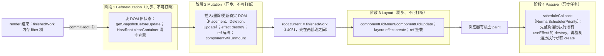
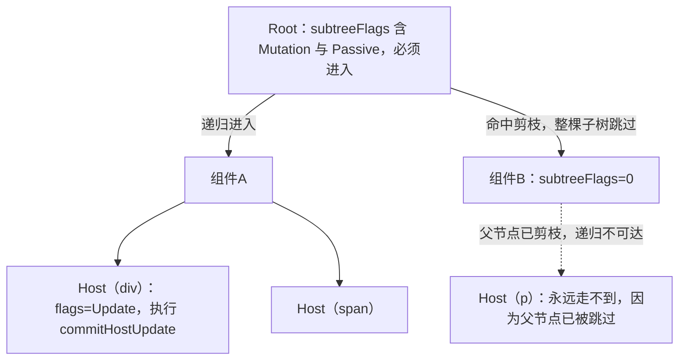

# 第 8 章 commit 阶段与生命周期

[上一章：Hooks 系统原理](./07-hooks.md) ｜ [下一章：渲染器与事件系统](./09-renderer-and-events.md)

> 本章基于 React `19.3.0` 源码，核心文件是 [ReactFiberWorkLoop.js](file:///Users/yangzhijie/Desktop/practice_projects/claude-code-test/react-vue-source-deep-dive/sources/react/packages/react-reconciler/src/ReactFiberWorkLoop.js)、[ReactFiberCommitWork.js](file:///Users/yangzhijie/Desktop/practice_projects/claude-code-test/react-vue-source-deep-dive/sources/react/packages/react-reconciler/src/ReactFiberCommitWork.js) 和 [ReactFiberCommitEffects.js](file:///Users/yangzhijie/Desktop/practice_projects/claude-code-test/react-vue-source-deep-dive/sources/react/packages/react-reconciler/src/ReactFiberCommitEffects.js)。所有行号均已逐一打开源码核对。

## 学习目标

读完本章，你应该能够：

1. 画出 commit 阶段的三阶段时间轴（BeforeMutation → Mutation → Layout → 浏览器绘制 → Passive），并说出 `root.current` 在哪一行被切换、为什么必须在那个点切换。
2. 解释 React 19 为什么不再使用 effect list，而是靠 `subtreeFlags` 位掩码做递归剪枝。
3. 对照类组件生命周期总表，说出每个方法在哪个阶段被调用，包括 `getSnapshotBeforeUpdate` 与错误边界两方法的特殊位置。
4. 讲清 `useInsertionEffect`、`useLayoutEffect`、`useEffect` 三类副作用的执行时机与销毁次序，以及「所有 destroy 先于所有 create」的代码依据。
5. 准确描述组件卸载时的执行顺序（ref 解绑、`componentWillUnmount`、effect destroy、DOM 移除的先后）。

## 8.1 引入：render 阶段结束后发生了什么

第 6 章讲过，render 阶段（beginWork / completeWork）只是在内存里构建一棵 `finishedWork` fiber 树，**一行真实 DOM 都不会改**。render 可以被打断、可以丢弃重来，所以它必须保持纯净。

但用户最终要看到界面。当整棵树 render 完成，调度器会调用 `commitRoot`，进入**同步、不可打断**的 commit 阶段。这里会做三类「脏」事情：

- 调用真实 DOM API 增删改节点（mutation）；
- 执行组件生命周期和 effect（layout / passive）；
- 挂载、解绑 ref。

为什么 commit 不能打断？因为一旦你开始往 DOM 里插入节点，半途而废就会留下半更新的界面。React 的选择是：**把「可以重来的计算」和「不可撤销的副作用」严格分到两个阶段**。

## 8.2 三阶段时间轴

`commitRoot` 把工作切成三个同步子阶段，外加一个延迟执行的 passive 阶段。注意 19.3 里函数名就叫 `commitRoot`（老资料里的 `commitRootImpl` 已不存在，见本章勘误）。

出处：packages/react-reconciler/src/ReactFiberWorkLoop.js:3848-3874（React 19.3.0）
见 [ReactFiberWorkLoop.js](file:///Users/yangzhijie/Desktop/practice_projects/claude-code-test/react-vue-source-deep-dive/sources/react/packages/react-reconciler/src/ReactFiberWorkLoop.js#L3848-L3874)

```js
// The commit phase is broken into several sub-phases. We do a separate pass
// of the effect list for each phase: all mutation effects come before all
// layout effects, and so on.
// ...
if (subtreeHasBeforeMutationEffects || rootHasBeforeMutationEffect) {
  // ...进入 CommitContext
  // The first phase a "before mutation" phase. We use this phase to read the
  // state of the host tree right before we mutate it. This is where
  // getSnapshotBeforeUpdate is called.
  commitBeforeMutationEffects(root, finishedWork, lanes);
}
```

紧接着是 mutation 与 layout 两个 flush。默认路径下它们同步连续执行；只有开启 View Transition 时才会被包进 `startViewTransition`。

出处：packages/react-reconciler/src/ReactFiberWorkLoop.js:3895-3921（React 19.3.0）
见 [ReactFiberWorkLoop.js](file:///Users/yangzhijie/Desktop/practice_projects/claude-code-test/react-vue-source-deep-dive/sources/react/packages/react-reconciler/src/ReactFiberWorkLoop.js#L3895-L3921)

```js
if (enableViewTransition && shouldStartViewTransition) {
  // 实验路径：交给 View Transition API 分段驱动
  pendingViewTransition = startViewTransition(/* ...flushMutationEffects... */);
} else {
  // Flush synchronously.
  flushMutationEffects(); // 阶段二：改 DOM
  flushLayoutEffects();   // 阶段三：DOM 已就位，执行 layout 副作用
  // Skip flushAfterMutationEffects
  flushSpawnedWork();
}
```

时间轴全景：



记住这个顺序，你就能解释几乎所有「为什么我的 effect 里拿到的是新 DOM / 旧 DOM」的问题。

## 8.3 递归剪枝：subtreeFlags 位掩码

React 18 之前，commit 阶段遍历的是 render 阶段收集的一条 **effect list**（链表）。React 19 里它已被删除，改为直接递归 fiber 树，用 `subtreeFlags` 跳过没有副作用的子树。

出处：packages/react-reconciler/src/ReactFiberCommitWork.js:2046-2068（React 19.3.0）
见 [ReactFiberCommitWork.js](file:///Users/yangzhijie/Desktop/practice_projects/claude-code-test/react-vue-source-deep-dive/sources/react/packages/react-reconciler/src/ReactFiberCommitWork.js#L2046-L2068)

```js
function recursivelyTraverseMutationEffects(root, parentFiber, lanes) {
  // 删除必须先于子节点的其他效果
  const deletions = parentFiber.deletions;
  if (deletions !== null) {
    for (let i = 0; i < deletions.length; i++) {
      commitDeletionEffects(root, parentFiber, deletions[i]);
    }
  }
  // 关键剪枝：子树位掩码里没有 mutation 标记，整棵子树跳过
  if (parentFiber.subtreeFlags & (MutationMask | Cloned)) {
    let child = parentFiber.child;
    while (child !== null) {
      commitMutationEffectsOnFiber(child, root, lanes);
      child = child.sibling;
    }
  }
}
```

剪枝示意（`F` 表示该 fiber 的 `flags` 有标记，数字表示 `subtreeFlags`）：



每个 fiber 有两层标记：`flags` 描述**自己**要做什么，`subtreeFlags` 是 completeWork 时把子节点标记按位或上来的「后代有没有活」摘要。三个阶段各有自己的 Mask（`BeforeMutationMask`、`MutationMask`、`LayoutMask`、`PassiveMask`），互不干扰。

## 8.4 阶段一 BeforeMutation：趁 DOM 还是旧的

这个阶段唯一的正经用途是：**在 DOM 被改动之前读取旧状态**。入口先调 `prepareForCommit`（DOM 渲染器用它记录当前聚焦元素等）。

出处：packages/react-reconciler/src/ReactFiberCommitWork.js:352-365（React 19.3.0）
见 [ReactFiberCommitWork.js](file:///Users/yangzhijie/Desktop/practice_projects/claude-code-test/react-vue-source-deep-dive/sources/react/packages/react-reconciler/src/ReactFiberCommitWork.js#L352-L365)

```js
export function commitBeforeMutationEffects(root, firstChild, committedLanes) {
  focusedInstanceHandle = prepareForCommit(root.containerInfo);
  shouldFireAfterActiveInstanceBlur = false;
  nextEffect = firstChild;
  commitBeforeMutationEffects_begin(isViewTransitionEligible); // 手动栈递归
  focusedInstanceHandle = null;
  resetAppearingViewTransitions();
}
```

对单个 fiber，只有两种组件有事可做：

出处：packages/react-reconciler/src/ReactFiberCommitWork.js:524-541（React 19.3.0）
见 [ReactFiberCommitWork.js](file:///Users/yangzhijie/Desktop/practice_projects/claude-code-test/react-vue-source-deep-dive/sources/react/packages/react-reconciler/src/ReactFiberCommitWork.js#L524-L541)

```js
case ClassComponent: {
  if ((flags & Snapshot) !== NoFlags) {
    if (current !== null) {
      commitClassSnapshot(finishedWork, current); // getSnapshotBeforeUpdate
    }
  }
  break;
}
case HostRoot: {
  if ((flags & Snapshot) !== NoFlags) {
    if (supportsMutation) {
      clearContainer(root.containerInfo); // 根容器更新前清空旧内容
    }
  }
  break;
}
```

`commitClassSnapshot` 调用 `getSnapshotBeforeUpdate(prevProps, prevState)`，把返回值存到实例的 `__reactInternalSnapshotBeforeUpdate` 字段，稍后原样传给 `componentDidUpdate` 的第三个参数。

出处：packages/react-reconciler/src/ReactFiberCommitEffects.js:697-703（React 19.3.0）
见 [ReactFiberCommitEffects.js](file:///Users/yangzhijie/Desktop/practice_projects/claude-code-test/react-vue-source-deep-dive/sources/react/packages/react-reconciler/src/ReactFiberCommitEffects.js#L697-L703)

```js
} else {
  snapshot = callGetSnapshotBeforeUpdates(instance, resolvedPrevProps, prevState);
}
// 存到实例上，layout 阶段 componentDidUpdate 第三参数取它
instance.__reactInternalSnapshotBeforeUpdate = snapshot;
```

这正是「滚动位置保持」等场景的基石：snapshot 在 DOM 改动**前**读取，却在 DOM 改动**后**的 `componentDidUpdate` 里消费。

## 8.5 阶段二 Mutation：真正动手改 DOM

### 8.5.1 HostComponent：更新属性、重置文本

对 DOM 元素，mutation 阶段会根据 `flags` 做文本重置与属性更新（19.3 中属性 diff 是此时现算的，详见第 9 章勘误）。

出处：packages/react-reconciler/src/ReactFiberCommitWork.js:2298-2314（React 19.3.0）
见 [ReactFiberCommitWork.js](file:///Users/yangzhijie/Desktop/practice_projects/claude-code-test/react-vue-source-deep-dive/sources/react/packages/react-reconciler/src/ReactFiberCommitWork.js#L2298-L2314)

```js
if (finishedWork.flags & ContentReset) {
  commitHostResetTextContent(finishedWork); // 文本子节点被整体替换
}
if (flags & Update) {
  const instance = finishedWork.stateNode;
  if (instance != null) {
    const newProps = finishedWork.memoizedProps;
    const oldProps = current !== null ? current.memoizedProps : newProps;
    commitHostUpdate(finishedWork, newProps, oldProps); // → DOM diff 更新
  }
}
```

带 `Placement` 标记的新节点则在 `commitReconciliationEffects` 里通过 `commitPlacement` 插入到父容器，具体 DOM 操作（`appendChild` / `insertBefore`）由 react-dom 的 host config 提供，第 9 章细讲。

### 8.5.2 函数组件：先销毁旧 layout effect

函数组件在 mutation 阶段对 effect 做的是**更新场景下的销毁**，顺序为：insertion destroy → insertion create → layout destroy。

出处：packages/react-reconciler/src/ReactFiberCommitWork.js:2110-2126（React 19.3.0）
见 [ReactFiberCommitWork.js](file:///Users/yangzhijie/Desktop/practice_projects/claude-code-test/react-vue-source-deep-dive/sources/react/packages/react-reconciler/src/ReactFiberCommitWork.js#L2110-L2126)

```js
recursivelyTraverseMutationEffects(root, finishedWork, lanes); // 先递归子树
commitReconciliationEffects(finishedWork, lanes);              // 插入新节点
if (flags & Update) {
  commitHookEffectListUnmount(HookInsertion | HookHasEffect, finishedWork, ...);
  commitHookEffectListMount(HookInsertion | HookHasEffect, finishedWork);
  commitHookLayoutUnmountEffects(finishedWork, finishedWork.return,
    HookLayout | HookHasEffect);                               // useLayoutEffect 清理
}
```

注意 layout effect 的 **create 不在这里执行**——销毁在 mutation、创建在 layout，刻意拆到两个阶段。

### 8.5.3 卸载时的完整次序

删除整棵子树走 `commitDeletionEffectsOnFiber`，不同 fiber 类型次序不同，这是面试高频点。

类组件：**先解绑 ref，再调 `componentWillUnmount`，最后递归子树**（DOM 节点本身在递归回溯时由 host 层移除）。

出处：packages/react-reconciler/src/ReactFiberCommitWork.js:1730-1747（React 19.3.0）
见 [ReactFiberCommitWork.js](file:///Users/yangzhijie/Desktop/practice_projects/claude-code-test/react-vue-source-deep-dive/sources/react/packages/react-reconciler/src/ReactFiberCommitWork.js#L1730-L1747)

```js
case ClassComponent: {
  if (!offscreenSubtreeWasHidden) {
    safelyDetachRef(deletedFiber, nearestMountedAncestor); // ① ref 先置 null
    const instance = deletedFiber.stateNode;
    if (typeof instance.componentWillUnmount === 'function') {
      safelyCallComponentWillUnmount(deletedFiber, ...);  // ② 再调 CWU
    }
  }
  recursivelyTraverseDeletionEffects(finishedRoot, ...);  // ③ 递归子组件
  break;
}
```

函数组件：先跑 `useInsertionEffect` 清理，再跑 `useLayoutEffect` 清理，然后递归子树；`useEffect` 的清理则在 passive 阶段（见 8.7）。

出处：packages/react-reconciler/src/ReactFiberCommitWork.js:1706-1728（React 19.3.0）
见 [ReactFiberCommitWork.js](file:///Users/yangzhijie/Desktop/practice_projects/claude-code-test/react-vue-source-deep-dive/sources/react/packages/react-reconciler/src/ReactFiberCommitWork.js#L1706-L1728)

```js
case FunctionComponent: /* 以及 ForwardRef / MemoComponent */ {
  commitHookEffectListUnmount(HookInsertion, deletedFiber, ...);
  if (!offscreenSubtreeWasHidden) {
    commitHookLayoutUnmountEffects(deletedFiber, ..., HookLayout);
  }
  recursivelyTraverseDeletionEffects(finishedRoot, ...); // 再处理子树
  break;
}
```

父组件先于子组件执行卸载逻辑（自顶向下），这与挂载时 effect「子先父后」正好相反。

## 8.6 关键切换点：root.current = finishedWork

mutation 结束、layout 开始之前，发生了整个 commit 最关键的一行赋值。

出处：packages/react-reconciler/src/ReactFiberWorkLoop.js:4047-4053（React 19.3.0）
见 [ReactFiberWorkLoop.js](file:///Users/yangzhijie/Desktop/practice_projects/claude-code-test/react-vue-source-deep-dive/sources/react/packages/react-reconciler/src/ReactFiberWorkLoop.js#L4047-L4053)

```js
// The work-in-progress tree is now the current tree. This must come after
// the mutation phase, so that the previous tree is still current during
// componentWillUnmount, but before the layout phase, so that the finished
// work is current during componentDidMount/Update.
root.current = finishedWork;
pendingEffectsStatus = PENDING_LAYOUT_PHASE;
```

注释把原因讲得非常透：

- 必须在 mutation **之后**：`componentWillUnmount` 执行时旧树还得是 `current`，卸载逻辑读到的应是旧 props/state；
- 必须在 layout **之前**：`componentDidMount`/`componentDidUpdate` 执行时新树必须已经是 `current`，此时在生命周期里调用 `setState`、通过 ref 访问 DOM，面对的都是新界面。

## 8.7 阶段三 Layout：DOM 已就位的同步副作用

### 8.7.1 类组件：CDM / CUD / Callback / ref

出处：packages/react-reconciler/src/ReactFiberCommitWork.js:627-644（React 19.3.0）
见 [ReactFiberCommitWork.js](file:///Users/yangzhijie/Desktop/practice_projects/claude-code-test/react-vue-source-deep-dive/sources/react/packages/react-reconciler/src/ReactFiberCommitWork.js#L627-L644)

```js
case ClassComponent: {
  recursivelyTraverseLayoutEffects(finishedRoot, finishedWork, committedLanes);
  if (flags & Update) {
    commitClassLayoutLifecycles(finishedWork, current); // 挂载 CDM / 更新 CUD
  }
  if (flags & Callback) {
    commitClassCallbacks(finishedWork);   // setState 第二参数 / ReactDOM.render 回调
  }
  if (flags & Ref) {
    safelyAttachRef(finishedWork, finishedWork.return); // 挂载 ref
  }
  break;
}
```

注意 `recursivelyTraverseLayoutEffects` 在**前**：layout 阶段是「子先父后」，所以子组件的 `componentDidMount` 一定比父组件先执行。`commitClassLayoutLifecycles` 内部用 `current === null` 区分挂载与更新：

出处：packages/react-reconciler/src/ReactFiberCommitEffects.js:387-388、461-465（React 19.3.0）
见 [ReactFiberCommitEffects.js](file:///Users/yangzhijie/Desktop/practice_projects/claude-code-test/react-vue-source-deep-dive/sources/react/packages/react-reconciler/src/ReactFiberCommitEffects.js#L387-L388)

```js
if (current === null) {
  // ...挂载分支
  instance.componentDidMount();
} else {
  // ...更新分支，第三参数就是 BeforeMutation 阶段存下的快照
  instance.componentDidUpdate(prevProps, prevState,
    instance.__reactInternalSnapshotBeforeUpdate);
}
```

### 8.7.2 函数组件：useLayoutEffect 的 create

出处：packages/react-reconciler/src/ReactFiberCommitWork.js:614-625（React 19.3.0）
见 [ReactFiberCommitWork.js](file:///Users/yangzhijie/Desktop/practice_projects/claude-code-test/react-vue-source-deep-dive/sources/react/packages/react-reconciler/src/ReactFiberCommitWork.js#L614-L625)

```js
case FunctionComponent:
case ForwardRef:
case SimpleMemoComponent: {
  recursivelyTraverseLayoutEffects(finishedRoot, finishedWork, committedLanes);
  if (flags & Update) {
    commitHookLayoutEffects(finishedWork, HookLayout | HookHasEffect);
  }
  break;
}
```

为什么 layout destroy 要提前到 mutation 阶段？源码注释给出了权威解释：

出处：packages/react-reconciler/src/ReactFiberCommitEffects.js:119-123（React 19.3.0）
见 [ReactFiberCommitEffects.js](file:///Users/yangzhijie/Desktop/practice_projects/claude-code-test/react-vue-source-deep-dive/sources/react/packages/react-reconciler/src/ReactFiberCommitEffects.js#L119-L123)

```js
// Layout effects are destroyed during the mutation phase so that all
// destroy functions for all fibers are called before any create functions.
// This prevents sibling component effects from interfering with each other,
// e.g. a destroy function in one component should never override a ref set
// by a create function in another component during the same commit.
```

即：**同一次提交里，所有 fiber 的 layout destroy 必须全部跑完，才允许任何一个 layout create 跑**，防止兄弟组件间互相污染 ref。

effect create 的返回值被保存为下一次的销毁函数：

出处：packages/react-reconciler/src/ReactFiberCommitEffects.js:173-176（React 19.3.0）
见 [ReactFiberCommitEffects.js](file:///Users/yangzhijie/Desktop/practice_projects/claude-code-test/react-vue-source-deep-dive/sources/react/packages/react-reconciler/src/ReactFiberCommitEffects.js#L173-L176)

```js
const create = effect.create;
const inst = effect.inst;
destroy = create();      // 执行你传给 useLayoutEffect 的函数
inst.destroy = destroy;  // 返回的清理函数挂到 inst 上，下次销毁时调用
```

Layout 阶段全程同步，浏览器在它结束前不会绘制——这就是 `useLayoutEffect` 里改 DOM 不会闪一下的原因。

## 8.8 阶段四 Passive：useEffect 的延迟执行

`useEffect` 不参与上面三个同步阶段。`commitRoot` 只是**调度**一个普通优先级任务：

出处：packages/react-reconciler/src/ReactFiberWorkLoop.js:3803-3820（React 19.3.0）
见 [ReactFiberWorkLoop.js](file:///Users/yangzhijie/Desktop/practice_projects/claude-code-test/react-vue-source-deep-dive/sources/react/packages/react-reconciler/src/ReactFiberWorkLoop.js#L3803-L3820)

```js
} else {
  root.callbackNode = null;
  root.callbackPriority = NoLane;
  scheduleCallback(NormalSchedulerPriority, () => {
    // ...
    flushPassiveEffects(); // 浏览器绘制后、下一个调度任务里执行
    return null;
  });
}
```

真正执行时是**两次独立的整树遍历**，先卸载后挂载：

出处：packages/react-reconciler/src/ReactFiberWorkLoop.js:4785-4795（React 19.3.0）
见 [ReactFiberWorkLoop.js](file:///Users/yangzhijie/Desktop/practice_projects/claude-code-test/react-vue-source-deep-dive/sources/react/packages/react-reconciler/src/ReactFiberWorkLoop.js#L4785-L4795)

```js
const prevExecutionContext = executionContext;
executionContext |= CommitContext;

commitPassiveUnmountEffects(root.current); // 第一遍：所有 useEffect 清理
commitPassiveMountEffects(                // 第二遍：所有 useEffect 回调
  root, root.current, lanes, transitions, pendingEffectsRenderEndTime,
);
```

在单个 fiber 的挂载遍历里，函数组件只做一件事——跑 `HookPassive` 链：

出处：packages/react-reconciler/src/ReactFiberCommitWork.js:4545-4558（React 19.3.0）
见 [ReactFiberCommitWork.js](file:///Users/yangzhijie/Desktop/practice_projects/claude-code-test/react-vue-source-deep-dive/sources/react/packages/react-reconciler/src/ReactFiberCommitWork.js#L4545-L4558)

```js
case FunctionComponent:
case ForwardRef:
case SimpleMemoComponent: {
  recursivelyTraverseReconnectPassiveEffects(/* ... */);
  commitHookPassiveMountEffects(finishedWork, HookPassive);
  break;
}
```

两次遍历共同保证了和 layout 一样的语义：**同一次提交中，所有 `useEffect` 清理先于所有 `useEffect` 回调**。此外，passive effect 内部若触发更新，React 会在遍历结束后通过 `flushSyncWorkOnAllRoots()` 顺手刷新（L4818）。

## 8.9 类组件生命周期总表

| 生命周期 | 调用阶段 / 位置 | current 是否为新树 | 备注 |
| --- | --- | --- | --- |
| `constructor` | mount 时的 render 阶段（实例化 fiber） | 无 | 可初始化 state；不要发请求 |
| `static getDerivedStateFromProps` | render 阶段（挂载与更新都调） | — | 纯函数，返回对象合并进 state |
| `render` | render 阶段 | — | 必须纯净 |
| `shouldComponentUpdate` | render 阶段（beginWork） | 旧 | 返回 false 跳过本次渲染 |
| `UNSAFE_componentWillMount/ReceiveProps/WillUpdate` | render 阶段 | 旧 | 已废弃，并发模式下可能多次调用 |
| `getSnapshotBeforeUpdate` | **BeforeMutation**（[CommitWork L524-531](file:///Users/yangzhijie/Desktop/practice_projects/claude-code-test/react-vue-source-deep-dive/sources/react/packages/react-reconciler/src/ReactFiberCommitWork.js#L524-L531)） | 旧 DOM | 返回值传给 CUD 第三参 |
| `componentDidMount` | **Layout**（`current===null` 分支） | 新 | 可安全操作 DOM、发请求、加订阅 |
| `componentDidUpdate` | **Layout** | 新 | 第三参为 snapshot；注意避免无条件 setState |
| `componentWillUnmount` | **Mutation**（卸载子树，[L1734-1740](file:///Users/yangzhijie/Desktop/practice_projects/claude-code-test/react-vue-source-deep-dive/sources/react/packages/react-reconciler/src/ReactFiberCommitWork.js#L1734-L1740)） | 旧 | 清订阅、清定时器；禁止 setState |
| `static getDerivedStateFromError` | **render 阶段**（处理抛出的更新时） | — | 返回降级 state |
| `componentDidCatch` | **commit/layout 阶段** | 新 | 上报错误副作用放这里 |

错误边界两个方法故意分离：render 阶段的 `getDerivedStateFromError` 负责「算出降级 UI」（可在重放中重复执行，必须纯净）；commit 阶段的 `componentDidCatch` 负责「打日志、发请求」这类只允许发生一次的副作用。

## 8.10 函数组件三类副作用执行点对照

| Hook | tag 位 | create 时机 | destroy 时机（更新） | 阻塞绘制 |
| --- | --- | --- | --- | --- |
| `useInsertionEffect` | `Insertion=2` | Mutation（DOM 改动前的插入窗口，[L2120](file:///Users/yangzhijie/Desktop/practice_projects/claude-code-test/react-vue-source-deep-dive/sources/react/packages/react-reconciler/src/ReactFiberCommitWork.js#L2120)） | Mutation，先 destroy 再 create | 同步 |
| `useLayoutEffect` | `Layout=4` | **Layout**（DOM 已就位） | **Mutation**（所有 destroy 先于所有 create） | 同步，阻塞绘制 |
| `useEffect` | `Passive=8` | **Passive**（绘制后调度任务） | Passive，整树先统一 destroy | 异步，不阻塞 |

CSS-in-Js 库需要在所有 DOM mutation 之前插入 `<style>` 标签，这就是 `useInsertionEffect` 存在的唯一理由；业务代码几乎用不到它。

## 8.11 端到端流程串讲

以「点击按钮 → setState 改变列表 → 某组件卸载」为例：

1. render 阶段产出 `finishedWork`，每个变化节点被打上 `Update`/`Placement`/`ChildDeletion` 等 flag，父节点的 `subtreeFlags` 在 completeWork 中汇总；
2. `commitRoot` 先用 `scheduleCallback` 排好 passive 任务（尽早排队，见 L3771-3773 注释）；
3. **BeforeMutation**：`prepareForCommit` 记录焦点；有 `Snapshot` 标记的类组件执行 `getSnapshotBeforeUpdate`；根容器必要时 `clearContainer`；
4. **Mutation**：自顶向下处理 `deletions`（解绑 ref → CWU/effect destroy → 递归）；再处理更新（DOM 插入、属性更新、`useInsertionEffect` 重跑、`useLayoutEffect` destroy）；
5. `root.current = finishedWork`（L4051）；
6. **Layout**：自底向上（子先父后）执行 `componentDidMount/Update`、`useLayoutEffect` create、`setState(callback)`、挂载 ref；
7. 主线程交还给浏览器，**页面绘制**；
8. **Passive**：调度任务触发，第一遍整树执行所有 `useEffect` 清理，第二遍执行所有 `useEffect` 回调；其中产生的更新同步 flush；
9. 任一步骤抛错且冒泡到错误边界时，render 阶段用 `getDerivedStateFromError` 产出降级树，commit 阶段调 `componentDidCatch` 上报。

## 8.12 版本勘误 📌

1. **没有 `commitRootImpl` 了**。大量老文章（基于 16/17/18）写「`commitRootImpl` 内部执行三阶段」，在 19.3 中函数名就是 [`commitRoot`](file:///Users/yangzhijie/Desktop/practice_projects/claude-code-test/react-vue-source-deep-dive/sources/react/packages/react-reconciler/src/ReactFiberWorkLoop.js#L3725)，位于 ReactFiberWorkLoop.js，三阶段分别下沉为 `commitBeforeMutationEffects`、`flushMutationEffects`、`flushLayoutEffects`。
2. **effect list 已删除**。旧实现有 `firstEffect`/`nextEffect` 链表；19.3 改为递归 fiber 树 + `subtreeFlags & Mask` 剪枝（源码 L3852-3856 的 TODO 注释明确说相关检查是「left over from the effect list implementation」）。
3. **mutation/layout 被拆成可挂起的 flush 函数**。为配合 View Transition API，19.3 中 `flushMutationEffects` 与 `flushLayoutEffects` 可由 `startViewTransition` 分段驱动（L3895-3914）；但 `enableViewTransition` 以外的默认路径仍是 L3917-3918 的同步直调，行为与旧版一致。
4. **`enableYieldingBeforePassive` 默认关闭**（ReactFeatureFlags.js 中为 `false`），所以 passive effect 仍然通过独立的 `scheduleCallback(NormalSchedulerPriority, ...)` 任务执行，而不是在 commit 尾部让步内联执行。读新版源码看到该分支不要误以为 passive 已经不排队了。

## 8.13 初学者易错点 ⚠️

1. **以为 `useEffect` 里能拿到「绘制前」的状态**。Passive 在绘制之后才跑；要在绘制前测量/校正 DOM（如同步滚动条位置），必须用 `useLayoutEffect`，否则用户可能看到一帧跳动。
2. **以为 cleanup 与下一个 effect 成对紧邻执行**。实际上同一次提交里 React 先跑完**所有** fiber 的 destroy，再跑所有 create（layout 与 passive 都如此）。依赖「我的 cleanup 立刻接我的 create」写代码，在多组件场景下会踩 ref 时序坑。
3. **混淆挂载与更新时的生命周期次序**。挂载时 layout effect / `componentDidMount` 是**子先父后**（递归在前）；卸载时 CWU / effect destroy 是**父先子后**。记反了就会解释不了「为什么父级卸载时 ref 先没了」。
4. **在 `componentWillUnmount` / effect cleanup 里 `setState`**。组件已进入删除流程，更新没有任何意义；类组件里甚至会给出警告。清理函数只做反向操作：取消订阅、清除定时器、中止请求。
5. **以为 `getSnapshotBeforeUpdate` 和 CUD 在同一阶段**。前者在 BeforeMutation（DOM 还是旧的），后者在 Layout（DOM 已更新），中间隔着整棵树的 mutation 和 `root.current` 切换——这正是它能安全保存滚动位置的原因。
6. **忽视 ref 解绑时机**。类组件更新时旧 ref 在 mutation 阶段就 `safelyDetachRef` 了，layout 阶段才 `safelyAttachRef` 新值；卸载时 ref 解绑甚至早于 `componentWillUnmount`。在 CWU 里通过 props 回调把 ref 往外传会拿到 `null`。

## 本章小结

- commit 是 render 之后**同步、不可打断**的阶段，19.3 入口为 `commitRoot`，内部依次跑 BeforeMutation、Mutation、Layout，passive effect 另排异步任务。
- 三阶段遍历靠 `flags`（自身）+ `subtreeFlags`（后代摘要）位掩码剪枝，effect list 已退出历史。
- `root.current = finishedWork` 精确地夹在 mutation 与 layout 之间（L4051），保证卸载读旧树、挂载读新树。
- 类组件的 `getSnapshotBeforeUpdate`、`componentDidMount/Update`、`componentWillUnmount`、错误边界两方法各自归属不同阶段；函数组件三类副作用按 Insertion/Layout/Passive 三个 tag 位在三个时机执行。
- 「同一次提交所有 destroy 先于所有 create」「挂载子先父后、卸载父先子后」是两条必须背下来的次序规则。

## 下一章导读

第 9 章我们走出 reconciler，看看 React 与浏览器之间的适配层：`createRoot` 如何把容器接入调度、host config 怎样把「插入/更新 fiber」翻译成真实 DOM API，以及合成事件系统怎样把一个原生 click 沿 fiber `return` 链派发给你的 `onClick`。
