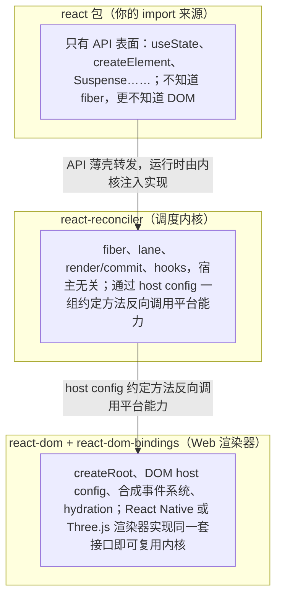
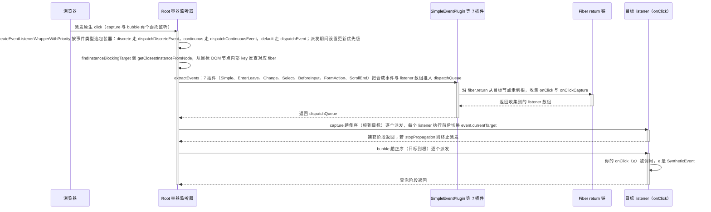

# 第 9 章 渲染器与事件系统

[上一章：commit 阶段与生命周期](./08-commit-and-lifecycle.md) ｜ [下一章：并发特性与 Suspense](./10-concurrent-and-suspense.md)

> 本章基于 React `19.3.0` 源码。`createRoot` 入口在 [ReactDOMRoot.js](file:///Users/yangzhijie/Desktop/practice_projects/claude-code-test/react-vue-source-deep-dive/sources/react/packages/react-dom/src/client/ReactDOMRoot.js)，而 host config 与事件系统在 19.3 中实际位于 **`packages/react-dom-bindings/src/`** 下（`client/` 与 `events/`），旧的 `react-dom/src/events/` 目录只剩测试，引用源码时注意路径变化。

## 学习目标

读完本章，你应该能够：

1. 说清 `react`、`react-reconciler`、`react-dom` 三层各管什么，以及 host config 接口在中间扮演什么角色。
2. 复述 `createRoot(container, options)` 内部的关键步骤，理解 `ConcurrentRoot` 标记和 `render` / `unmount` / `hydrateRoot` 的区别。
3. 对照 host config 方法表，说出 fiber 阶段与 commit 阶段分别调用哪些 DOM API，并指出 19.3 中属性 diff 实际发生的时机。
4. 画出合成事件的完整数据流：原生事件 → 容器委托监听 → 定位目标 fiber → 沿 `return` 链收集 listener → capture/bubble 两阶段派发。
5. 解释为什么 React 把事件委托在 root 容器而不是 document，以及 `e.persist()`、`e.currentTarget`、`onChange` 在 19.3 里的真实行为。

## 9.1 引入：三层架构与「宿主无关」的内核

前 8 章我们一直在讲 fiber、lane、hooks、commit，但这些代码**完全不知道 `div` 是什么**。React 把内核和平台拆成三层：



这种「内核 + 宿主配置」的结构，就是同一套并发渲染能力能同时跑在 DOM、Native、终端 Ink 上的原因。

## 9.2 createRoot：把一个 DOM 容器接入 React

### 9.2.1 创建：createContainer + 挂事件监听

出处：packages/react-dom/src/client/ReactDOMRoot.js:238-260（React 19.3.0）
见 [ReactDOMRoot.js](file:///Users/yangzhijie/Desktop/practice_projects/claude-code-test/react-vue-source-deep-dive/sources/react/packages/react-dom/src/client/ReactDOMRoot.js#L238-L260)

```js
const root = createContainer(
  container,
  ConcurrentRoot, // 关键：所有 createRoot 都是并发根（tag=1）
  null,
  isStrictMode,
  concurrentUpdatesByDefaultOverride,
  identifierPrefix,
  onUncaughtError,
  onCaughtError,
  onRecoverableError,
  onDefaultTransitionIndicator,
  transitionCallbacks,
);
markContainerAsRoot(root.current, container);      // DOM 节点上打内部标记
listenToAllSupportedEvents(rootContainerElement);  // 事件委托，本章后半重点
return new ReactDOMRoot(root);
```

三件大事：建 `FiberRoot`（模式恒为 `ConcurrentRoot=1`，旧的 `LegacyRoot=0` 只服务 `ReactDOM.render` 遗留路径）、在容器 DOM 节点上登记根信息、**一次性把所有支持的事件监听挂到容器上**。

`options` 在 19.3 中支持这些字段：`identifierPrefix`（多根时生成 ID 的前缀，L216-218）、React 19 新增的错误处理三件套 `onUncaughtError` / `onCaughtError` / `onRecoverableError`（L219-227）、`onDefaultTransitionIndicator`（L228-232，配合默认 Transition 指示器）。

### 9.2.2 render 与 unmount

出处：packages/react-dom/src/client/ReactDOMRoot.js:108-135（React 19.3.0）
见 [ReactDOMRoot.js](file:///Users/yangzhijie/Desktop/practice_projects/claude-code-test/react-vue-source-deep-dive/sources/react/packages/react-dom/src/client/ReactDOMRoot.js#L108-L135)

```js
function (children: ReactNodeList): void {
  const root = this._internalRoot;
  if (root === null) {
    throw new Error('Cannot update an unmounted root.');
  }
  // DEV：createRoot 的 render 不接受第二个回调参数
  updateContainer(children, root, null, null); // 一次普通优先级更新
}
```

`root.render` 没有任何特殊魔法，本质就是往根 fiber 上排一次更新。**卸载**则是更新成 `null` 并同步刷新：

出处：packages/react-dom/src/client/ReactDOMRoot.js:151-167（React 19.3.0）
见 [ReactDOMRoot.js](file:///Users/yangzhijie/Desktop/practice_projects/claude-code-test/react-vue-source-deep-dive/sources/react/packages/react-dom/src/client/ReactDOMRoot.js#L151-L167)

```js
const root = this._internalRoot;
if (root !== null) {
  this._internalRoot = null;
  const container = root.containerInfo;
  // ...
  updateContainerSync(null, root, null, null); // 同步提交一棵空树
  flushSyncWork();                            // 立刻跑完 commit
  unmarkContainerAsRoot(container);           // 摘除根标记
}
```

### 9.2.3 hydrateRoot：复用服务端 HTML

`hydrateRoot(container, initialChildren)` 走 `createHydrationContainer`，但模式参数**同样是 `ConcurrentRoot`**（L343）：SSR 注水在 19 中也是并发的。区别只在于 render 阶段不再 `createElement`，而是尝试复用已有 DOM；文本/属性不匹配时以客户端内容为准并在 DEV 警告。host config 中 `supportsHydration = true`（[ReactFiberConfigDOM.js:4080](file:///Users/yangzhijie/Desktop/practice_projects/claude-code-test/react-vue-source-deep-dive/sources/react/packages/react-dom-bindings/src/client/ReactFiberConfigDOM.js#L4080)）就是内核判断「这个渲染器支持注水」的开关。

## 9.3 host config：fiber 到 DOM 的翻译字典

reconciler 在固定时机会调用一组约定方法，DOM 渲染器在 [ReactFiberConfigDOM.js](file:///Users/yangzhijie/Desktop/practice_projects/claude-code-test/react-vue-source-deep-dive/sources/react/packages/react-dom-bindings/src/client/ReactFiberConfigDOM.js) 里给出实现。常用方法如下：

| host config 方法 | 行号 | 何时被内核调用 | DOM 实现要点 |
| --- | --- | --- | --- |
| `createInstance` | [L534](file:///Users/yangzhijie/Desktop/practice_projects/claude-code-test/react-vue-source-deep-dive/sources/react/packages/react-dom-bindings/src/client/ReactFiberConfigDOM.js#L534) | completeWork（挂载） | `createElement` / SVG、MathML 用 `createElementNS` |
| `createTextInstance` | [L757](file:///Users/yangzhijie/Desktop/practice_projects/claude-code-test/react-vue-source-deep-dive/sources/react/packages/react-dom-bindings/src/client/ReactFiberConfigDOM.js#L757) | completeWork | `createTextNode` |
| `appendInitialChild` | [L695](file:///Users/yangzhijie/Desktop/practice_projects/claude-code-test/react-vue-source-deep-dive/sources/react/packages/react-dom-bindings/src/client/ReactFiberConfigDOM.js#L695) | completeWork 组装离屏子树 | 父节点还没挂进文档，先在内存里拼好 |
| `finalizeInitialChildren` | [L703](file:///Users/yangzhijie/Desktop/practice_projects/claude-code-test/react-vue-source-deep-dive/sources/react/packages/react-dom-bindings/src/client/ReactFiberConfigDOM.js#L703) | completeWork 收尾 | `setInitialProperties` 写初始属性；input 等返回是否需 autofocus |
| `appendChild` / `appendChildToContainer` | [L1032](file:///Users/yangzhijie/Desktop/practice_projects/claude-code-test/react-vue-source-deep-dive/sources/react/packages/react-dom-bindings/src/client/ReactFiberConfigDOM.js#L1032) / [L1082](file:///Users/yangzhijie/Desktop/practice_projects/claude-code-test/react-vue-source-deep-dive/sources/react/packages/react-dom-bindings/src/client/ReactFiberConfigDOM.js#L1082) | commit Placement | 真正插入节点 |
| `insertBefore` / `insertInContainerBefore` | L1135 / L1148 | commit Placement（有后续兄弟时） | 精确插入位置 |
| `removeChild` / `removeChildFromContainer` | L1213 / L1220 | commit 删除子树 | 卸载时移出 DOM |
| `commitUpdate` | [L999](file:///Users/yangzhijie/Desktop/practice_projects/claude-code-test/react-vue-source-deep-dive/sources/react/packages/react-dom-bindings/src/client/ReactFiberConfigDOM.js#L999) | commit Update | **此刻才做属性 diff** |
| `resetTextContent` | [L1014](file:///Users/yangzhijie/Desktop/practice_projects/claude-code-test/react-vue-source-deep-dive/sources/react/packages/react-dom-bindings/src/client/ReactFiberConfigDOM.js#L1014) | commit ContentReset | 清空文本 |
| `commitTextUpdate` | [L1018](file:///Users/yangzhijie/Desktop/practice_projects/claude-code-test/react-vue-source-deep-dive/sources/react/packages/react-dom-bindings/src/client/ReactFiberConfigDOM.js#L1018) | commit 文本更新 | 直接赋 `nodeValue` |
| `prepareForCommit` / `resetAfterCommit` | L424 / L457 | 第 8 章 BeforeMutation 前后 | 记录/恢复聚焦、selection 等 |
| `supportsMutation` | [L889](file:///Users/yangzhijie/Desktop/practice_projects/claude-code-test/react-vue-source-deep-dive/sources/react/packages/react-dom-bindings/src/client/ReactFiberConfigDOM.js#L889) | 内核编译期/运行期能力探测 | 恒为 `true`（DOM 支持可变） |

一个常被忽略的设计：completeWork 阶段整棵新子树是**在内存里用 `appendInitialChild` 拼好的**，直到 commit 才一次性 `appendChild` 进文档。这保证界面上不会出现「拼到一半」的中间态。

### 9.3.1 属性更新：diff 发生在 commit，不在 render

`commitUpdate` 的全部实现只有两行：

出处：packages/react-dom-bindings/src/client/ReactFiberConfigDOM.js:999-1012（React 19.3.0）
见 [ReactFiberConfigDOM.js](file:///Users/yangzhijie/Desktop/practice_projects/claude-code-test/react-vue-source-deep-dive/sources/react/packages/react-dom-bindings/src/client/ReactFiberConfigDOM.js#L999-L1012)

```js
export function commitUpdate(domElement, type, oldProps, newProps, internalInstanceHandle) {
  // Diff and update the properties.
  updateProperties(domElement, type, oldProps, newProps);
  // 同步 fiber 上缓存的 props，事件系统需要它拿到最新 handler
  updateFiberProps(domElement, newProps);
}
```

`updateProperties` 直接遍历新旧 props 对象，删掉旧的、设置新的：

出处：packages/react-dom-bindings/src/client/ReactDOMComponent.js:1518-1539（React 19.3.0）
见 [ReactDOMComponent.js](file:///Users/yangzhijie/Desktop/practice_projects/claude-code-test/react-vue-source-deep-dive/sources/react/packages/react-dom-bindings/src/client/ReactDOMComponent.js#L1518-L1539)

```js
export function updateProperties(domElement, tag, lastProps, nextProps) {
  if (__DEV__) {
    validatePropertiesInDevelopment(tag, nextProps);
  }
  switch (tag) {
    case 'div':
    case 'span':
    // ...最常见标签走快速通道
    case 'li': {
      break;
    }
    case 'input': {
      // input 有受控组件的特殊处理，见 9.4
    }
  }
}
```

注意：React 不做虚拟 DOM「树对树」的细粒度 diff 属性清单，属性比较就是这一层朴素的两次遍历；真正昂贵的协调（哪些 fiber 挂载/移动/删除）已经在 render 阶段完成了。

### 9.3.2 受控组件与 _valueTracker

受控 `<input>` 有个经典问题：用户输入后浏览器已经改了 DOM 的 `value`，React 重新渲染时若新 props 相同就不会再写 DOM——但此时 DOM 值已经「脱缰」。React 给每个可追踪节点挂一个 `_valueTracker`，记下「React 最后认可的值」：

出处：packages/react-dom-bindings/src/client/inputValueTracking.js:119-130、161-179（React 19.3.0）
见 [inputValueTracking.js](file:///Users/yangzhijie/Desktop/practice_projects/claude-code-test/react-vue-source-deep-dive/sources/react/packages/react-dom-bindings/src/client/inputValueTracking.js#L119-L130)

```js
export function track(node) {
  if (getTracker(node)) {
    return;
  }
  const valueField = isCheckable(node) ? 'checked' : 'value';
  const initialValue = '' + node[valueField]; // 记录初始值
  node._valueTracker = trackValueOnNode(node, valueField, initialValue);
}

export function updateValueIfChanged(node) {
  const tracker = getTracker(node);
  if (!tracker) return true;
  const lastValue = tracker.getValue();
  const nextValue = getValueFromNode(node); // 读当前真实 DOM 值
  if (nextValue !== lastValue) {
    tracker.setValue(nextValue);
    return true; // 值真的变了，ChangeEventPlugin 才派发 onChange
  }
  return false;
}
```

`onChange`（以及 `onInput` 链路）并不是浏览器原生事件，而是 ChangeEventPlugin 借助 tracker 判定「值是否真的变化」后合成出来的——这也是为什么 React 的 `onChange` 语义其实更接近原生 `oninput`。

## 9.4 事件系统全景

### 9.4.1 一条原生 click 的完整旅程



### 9.4.2 委托：每个事件挂两个监听

19.3 中监听挂在 **root 容器元素**上（`createRoot` 时的 `listenToAllSupportedEvents`），且每个事件类型默认注册 capture、bubble 两个：

出处：packages/react-dom-bindings/src/events/DOMPluginEventSystem.js:432-459（React 19.3.0）
见 [DOMPluginEventSystem.js](file:///Users/yangzhijie/Desktop/practice_projects/claude-code-test/react-vue-source-deep-dive/sources/react/packages/react-dom-bindings/src/events/DOMPluginEventSystem.js#L432-L459)

```js
export function listenToAllSupportedEvents(rootContainerElement) {
  if (!(rootContainerElement as any)[listeningMarker]) {
    (rootContainerElement as any)[listeningMarker] = true; // 去重，多根只挂一次
    allNativeEvents.forEach(domEventName => {
      if (domEventName !== 'selectionchange') {
        if (!nonDelegatedEvents.has(domEventName)) {
          listenToNativeEvent(domEventName, false, rootContainerElement); // bubble
        }
        listenToNativeEvent(domEventName, true, rootContainerElement);  // capture
      }
    });
    // selectionchange 不冒泡，只能挂 document
    // ...
    listenToNativeEvent('selectionchange', false, ownerDocument);
  }
}
```

为什么是容器而不是（旧版的）document？① 一个页面可以有**多个 React 根**（微前端、嵌入式组件），挂容器天然隔离；② 阻止事件冒泡到 document 的第三方代码不会干扰 React；③ 容器之外的 DOM 不属于本根，本来就不该响应。少数不冒泡/不便委托的事件（如 `selectionchange` 挂 document、`scroll` 不冒泡只收集 target）走例外清单。

### 9.4.3 从 DOM 节点反查 fiber

原生事件只认识 DOM 节点。React 在挂载时给 DOM 节点存了指向 fiber 的内部 key，`getClosestInstanceFromNode` 从目标节点向上找到第一个属于 React 的实例：

出处：packages/react-dom-bindings/src/events/ReactDOMEventListener.js:244-262（React 19.3.0）
见 [ReactDOMEventListener.js](file:///Users/yangzhijie/Desktop/practice_projects/claude-code-test/react-vue-source-deep-dive/sources/react/packages/react-dom-bindings/src/events/ReactDOMEventListener.js#L244-L262)

```js
export let return_targetInst: null | Fiber = null;

export function findInstanceBlockingTarget(targetNode) {
  return_targetInst = null;
  let targetInst = getClosestInstanceFromNode(targetNode); // DOM → fiber
  if (targetInst !== null) {
    const nearestMounted = getNearestMountedFiber(targetInst);
    if (nearestMounted === null) {
      targetInst = null; // 子树已卸载，按无目标派发
    } else {
      // 命中 Suspense/Activity 边界时可能需要先注水/重放事件
    }
  }
  // ...
}
```

### 9.4.4 插件：7 个 extractEvents

事件系统不把「哪些事件需要特殊处理」写死，而是依次问 7 个插件。`SimpleEventPlugin` 负责 click、keydown 等普通事件，其余是浏览器行为的「垫片」。

出处：packages/react-dom-bindings/src/events/DOMPluginEventSystem.js:117-191（React 19.3.0）
见 [DOMPluginEventSystem.js](file:///Users/yangzhijie/Desktop/practice_projects/claude-code-test/react-vue-source-deep-dive/sources/react/packages/react-dom-bindings/src/events/DOMPluginEventSystem.js#L117-L191)

```js
SimpleEventPlugin.extractEvents(dispatchQueue, /* ... */);
// capture 阶段不跑垫片插件（注释说明它们依赖 bubble 阶段的局部状态）
if (shouldProcessPolyfillPlugins) {
  EnterLeaveEventPlugin.extractEvents(/* ... */); // mouseenter/leave、focus/blur
  ChangeEventPlugin.extractEvents(/* ... */);    // 受控组件 onChange
  SelectEventPlugin.extractEvents(/* ... */);
  BeforeInputEventPlugin.extractEvents(/* ... */);
  FormActionEventPlugin.extractEvents(/* ... */); // form action / requestSubmit
}
if (enableScrollEndPolyfill) {
  ScrollEndEventPlugin.extractEvents(/* ... */);
}
```

比如 `onMouseEnter`/`onMouseLeave` 并不冒泡，浏览器也没有可直接委托的对应事件，EnterLeaveEventPlugin 就用 `mouseout`/`mouseover` 的 `relatedTarget` 自己算出「进出了哪个元素」。

### 9.4.5 沿 return 链收集 listener

普通事件的收集逻辑：从目标 fiber 开始，每遇到 HostComponent 就取它的 props 里的 `onXxx` / `onXxxCapture`，然后 `instance = instance.return` 继续向上，直到根。

出处：packages/react-dom-bindings/src/events/DOMPluginEventSystem.js:766-827（React 19.3.0）
见 [DOMPluginEventSystem.js](file:///Users/yangzhijie/Desktop/practice_projects/claude-code-test/react-vue-source-deep-dive/sources/react/packages/react-dom-bindings/src/events/DOMPluginEventSystem.js#L766-L827)

```js
// Standard React on* listeners, i.e. onClick or onClickCapture
if (reactEventName !== null) {
  const listener = getListener(instance, reactEventName); // props['onClick']
  if (listener != null) {
    listeners.push(createDispatchListener(instance, listener, lastHostComponent));
  }
}
// ...
if (accumulateTargetOnly) {
  break; // scroll/scrollend 只在目标节点收集，不向上冒泡
}
// ...
instance = instance.return; // 沿父链继续
```

注意收集时**不区分函数组件本身**——listener 只存在于 HostComponent 的 props 上，但中间穿过的 Provider、函数组件 fiber 靠 `return` 指针串起整条路径。`scroll`/`scrollend` 在这里被 `accumulateTargetOnly` 截断（SimpleEventPlugin L207-213），与现代浏览器「不冒泡」行为对齐。

### 9.4.6 派发次序与 SyntheticEvent

同一条收集到的数组，capture 与 bubble 用不同方向遍历：

出处：packages/react-dom-bindings/src/events/DOMPluginEventSystem.js:272-309（React 19.3.0）
见 [DOMPluginEventSystem.js](file:///Users/yangzhijie/Desktop/practice_projects/claude-code-test/react-vue-source-deep-dive/sources/react/packages/react-dom-bindings/src/events/DOMPluginEventSystem.js#L272-L309)

```js
if (inCapturePhase) {
  for (let i = dispatchListeners.length - 1; i >= 0; i--) {
    // 倒序：根 → 目标
    const {instance, currentTarget, listener} = dispatchListeners[i];
    if (instance !== previousInstance && event.isPropagationStopped()) return;
    executeDispatch(event, listener, currentTarget);
    previousInstance = instance;
  }
} else {
  for (let i = 0; i < dispatchListeners.length; i++) {
    // 正序：目标 → 根
  }
}
```

`executeDispatch` 解释了「为什么异步访问 `e.currentTarget` 是 null」：

出处：packages/react-dom-bindings/src/events/DOMPluginEventSystem.js:252-264（React 19.3.0）
见 [DOMPluginEventSystem.js](file:///Users/yangzhijie/Desktop/practice_projects/claude-code-test/react-vue-source-deep-dive/sources/react/packages/react-dom-bindings/src/events/DOMPluginEventSystem.js#L252-L264)

```js
function executeDispatch(event, listener, currentTarget) {
  event.currentTarget = currentTarget; // 进入 handler 前设置
  try {
    listener(event);
  } catch (error) {
    reportGlobalError(error); // 单个 handler 抛错不中断整条派发链的收尾
  }
  event.currentTarget = null; // 离开后立刻清空
}
```

合成事件构造时 `currentTarget` 初始也是 `null`，事件字段从 nativeEvent 拷贝而来。

出处：packages/react-dom-bindings/src/events/SyntheticEvent.js:53-58（React 19.3.0）
见 [SyntheticEvent.js](file:///Users/yangzhijie/Desktop/practice_projects/claude-code-test/react-vue-source-deep-dive/sources/react/packages/react-dom-bindings/src/events/SyntheticEvent.js#L53-L58)

```js
this._reactName = reactEventType;
this._targetInst = targetInst;
this.type = reactEventType;
this.nativeEvent = nativeEvent;
this.target = nativeEventTarget;
this.currentTarget = null; // 派发前为空，只有 handler 执行中有效
```

`stopPropagation` 同时调用原生 `stopPropagation` 并把 `isPropagationStopped` 置为返回 true 的函数（L105-124），React 靠后者在上面的遍历循环里提前退出。

### 9.4.7 事件优先级：点击为什么是 SyncLane

容器监听器并非直接派发，而是按事件类型选择包装器：

出处：packages/react-dom-bindings/src/events/ReactDOMEventListener.js:94-119（React 19.3.0）
见 [ReactDOMEventListener.js](file:///Users/yangzhijie/Desktop/practice_projects/claude-code-test/react-vue-source-deep-dive/sources/react/packages/react-dom-bindings/src/events/ReactDOMEventListener.js#L94-L119)

```js
export function createEventListenerWrapperWithPriority(targetContainer, domEventName, flags) {
  const eventPriority = getEventPriority(domEventName);
  let listenerWrapper;
  switch (eventPriority) {
    case DiscreteEventPriority:
      listenerWrapper = dispatchDiscreteEvent;   // click、keydown……
      break;
    case ContinuousEventPriority:
      listenerWrapper = dispatchContinuousEvent; // mousemove、drag……
      break;
    default:
      listenerWrapper = dispatchEvent;
  }
  return listenerWrapper.bind(null, domEventName, flags, targetContainer);
}
```

离散事件在派发期间把「当前更新优先级」设为 `DiscreteEventPriority`：

出处：packages/react-dom-bindings/src/events/ReactDOMEventListener.js:121-137（React 19.3.0）
见 [ReactDOMEventListener.js](file:///Users/yangzhijie/Desktop/practice_projects/claude-code-test/react-vue-source-deep-dive/sources/react/packages/react-dom-bindings/src/events/ReactDOMEventListener.js#L121-L137)

```js
function dispatchDiscreteEvent(domEventName, eventSystemFlags, container, nativeEvent) {
  const previousPriority = getCurrentUpdatePriority();
  try {
    setCurrentUpdatePriority(DiscreteEventPriority); // 期间的 setState 走高优先级 lane
    dispatchEvent(domEventName, eventSystemFlags, container, nativeEvent);
  } finally {
    setCurrentUpdatePriority(previousPriority);
  }
}
```

`click`、`keydown`、`input`、`submit`、`touchstart` 等都在离散事件清单里（[getEventPriority L312-356](file:///Users/yangzhijie/Desktop/practice_projects/claude-code-test/react-vue-source-deep-dive/sources/react/packages/react-dom-bindings/src/events/ReactDOMEventListener.js#L312-L356)）。语义是：离散事件由用户明确触发、频次低，其中的更新应尽快提交（映射到同步 lane）；`mousemove` 这类连续事件允许合并与让步。这就是「点击触发的更新总是比 transition 更新先渲染」的根源。

## 9.5 端到端流程串讲

1. `createRoot(container)` 建 `FiberRoot`（`ConcurrentRoot`），并在容器上挂好全部事件的 capture/bubble 委托监听；
2. `root.render(<App/>)` 排更新 → scheduler 调度 render → completeWork 调 `createInstance` 等在内存拼好 DOM 子树 → commit 阶段 `appendChild` 进文档（第 8 章）；
3. 用户点击按钮，原生事件在容器的委托监听处被捕获；包装器按优先级设置更新优先级；
4. `getClosestInstanceFromNode` 由事件目标 DOM 反查 fiber；
5. 7 个插件依次 `extractEvents`，SimpleEventPlugin 沿 `return` 链收集所有 `onClick`/`onClickCapture` 并构造 SyntheticEvent；
6. capture 倒序、bubble 正序派发，`currentTarget` 随执行切换，`stopPropagation` 可截断；
7. 你的 handler 里 `setState`，更新带着离散事件的高优先级进入第 6 章的更新链路；
8. commit 属性更新时，`commitUpdate → updateProperties` 现算 diff 写回 DOM；若是受控 input，ChangeEventPlugin 用 `_valueTracker` 判断值变化并合成 `onChange`。

## 9.6 版本勘误 📌

1. **事件源码目录变了**。老文章给的路径 `react-dom/src/events/ReactDOMEventListener.js` 在 19.3 已不存在（该目录只剩 `__tests__` 和插件残壳），实际文件在 `packages/react-dom-bindings/src/events/`；host config 文件名为 `react-dom-bindings/src/client/ReactFiberConfigDOM.js`（老版本叫 `ReactDOMHostConfig.js`）。
2. **没有 `prepareUpdate`，属性 diff 不在 render 阶段**。部分基于旧版的资料称 completeWork 会调 `prepareUpdate` 生成 `updatePayload` 供 commit 使用；19.3 中该 host config 方法已不存在，commit 时 [`commitUpdate`](file:///Users/yangzhijie/Desktop/practice_projects/claude-code-test/react-vue-source-deep-dive/sources/react/packages/react-dom-bindings/src/client/ReactFiberConfigDOM.js#L999-L1012) 直接调用 `updateProperties(oldProps, newProps)` 现算 diff。
3. **`e.persist()` 是空函数**。[SyntheticEvent.js:131-133](file:///Users/yangzhijie/Desktop/practice_projects/claude-code-test/react-vue-source-deep-dive/sources/react/packages/react-dom-bindings/src/events/SyntheticEvent.js#L131-L133) 里函数体只有注释 `// Modern event system doesn't use pooling.`——事件池早在 React 17 就移除了，现在可以直接异步持有合成事件对象，`persist` 仅为兼容保留。但注意 **`currentTarget` 仍会在派发后被置空**，这不是池化，想异步用请先手动取 `const el = e.currentTarget`。
4. **监听默认挂在 root 容器而非 document**（React 17 起的行为，19.3 依旧），`selectionchange` 等极少数例外挂 document；`scroll`/`scrollend` 不向上收集 listener。
5. **插件清单与旧版不同**：19.3 的垫片插件为 EnterLeave、Change、Select、BeforeInput、FormAction、ScrollEnd（L145-196）；老资料里的 `TapEventPlugin`、`SelectEventPlugin`（老鼠标选择逻辑）等构成已变化。

## 9.7 初学者易错点 ⚠️

1. **在 `setTimeout` / Promise 里读 `e.currentTarget`**。派发一结束它就是 `null`；需要异步使用必须先存局部变量。`e.target` 没有这个问题。
2. **以为 `e.stopPropagation()` 能拦住「同一个元素上的其他 React 监听」**。它只阻止沿链继续传播；同一节点上同名的多个 handler 都会执行（可用 `e.stopImmediatePropagation` 的思路理解，但 React 合成事件没有直接暴露它）。另外它确实会调用原生 stopPropagation，所以 document 上的原生监听也收不到。
3. **把 React 的 `onChange` 当原生 change 理解**。对 input 而言它几乎每次值变化就触发（靠 `_valueTracker`），更接近原生 `input` 事件；受控组件还要保证 `value` 由 props 驱动，否则会收到「你提供了 value 却没有 onChange」警告。
4. **在渲染器之外手动 `addEventListener` 又依赖 React 事件时序**。React 委托监听在容器上，capture/bubble 顺序与你手动挂在具体节点上的监听会交错；混合使用时务必按「捕获从外到内、冒泡从内到外」的原生顺序推演，不要假设 React handler 一定先跑。
5. **以为 `createRoot` 之后事件挂在 document 上**。多根应用中每个容器独立委托；若你在容器外层手动拦截事件，行为与旧版 React 16 完全不同。
6. **误以为 host config diff 会产出「最小补丁数组」**。DOM 属性更新就是同步遍历新旧 props 的两次循环，别在性能分析时去找并不存在的 `updatePayload`。

## 本章小结

- React 内核宿主无关：`react-dom` 通过 host config 把 fiber 的挂载/更新/删除翻译成真实 DOM API，completeWork 在内存拼树、commit 一次性插入。
- 19.3 中属性 diff 在 commit 阶段由 `commitUpdate → updateProperties` 现算；受控 input 靠 `_valueTracker` 合成 `onChange`。
- 事件系统在容器上做 capture+bubble 委托：原生事件经优先级包装器 → DOM 反查 fiber → 7 插件抽取 → 沿 `return` 链收集 listener → 倒序/正序派发 SyntheticEvent。
- 离散事件（click 等）把更新优先级提升为 Discrete，决定了其中 setState 的 lane 与提交速度。

## 下一章导读

最后一章我们回到内核的「并发」主线：`startTransition` / `useTransition` 如何让渲染可中断、`Suspense` 为什么能用 `throw` 表达等待、`use()` 与 Suspense 怎样配合，以及 19.3 新稳定的 `Activity` 与实验性的 `ViewTransition`。最后还会给出「API → lane 类型 → 渲染时机 → 可否中断」的总对照表。
