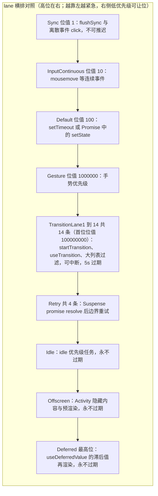
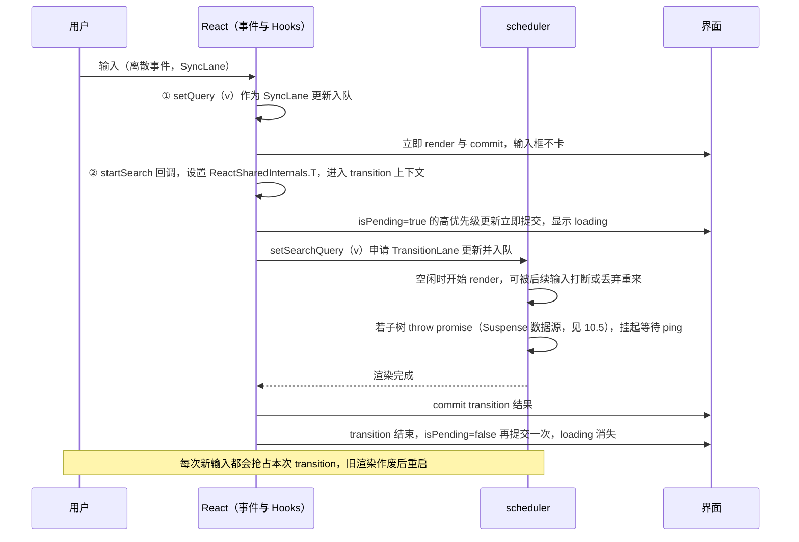
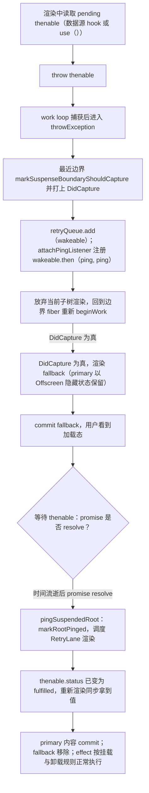
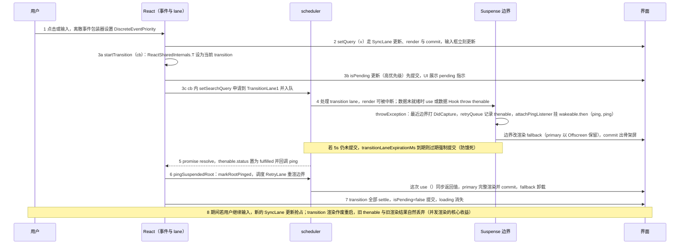

# 第 10 章 并发特性与 Suspense

[上一章：渲染器与事件系统](./09-renderer-and-events.md) ｜ [返回教程总目录](../../README.md)

> 本章基于 React `19.3.0` 源码，核心文件是 [ReactFiberLane.js](file:///Users/yangzhijie/Desktop/practice_projects/claude-code-test/react-vue-source-deep-dive/sources/react/packages/react-reconciler/src/ReactFiberLane.js)、[ReactFiberThrow.js](file:///Users/yangzhijie/Desktop/practice_projects/claude-code-test/react-vue-source-deep-dive/sources/react/packages/react-reconciler/src/ReactFiberThrow.js)、[ReactFiberThenable.js](file:///Users/yangzhijie/Desktop/practice_projects/claude-code-test/react-vue-source-deep-dive/sources/react/packages/react-reconciler/src/ReactFiberThenable.js) 和 [ReactFiberBeginWork.js](file:///Users/yangzhijie/Desktop/practice_projects/claude-code-test/react-vue-source-deep-dive/sources/react/packages/react-reconciler/src/ReactFiberBeginWork.js)。所有行号均已逐一打开源码核对。

## 学习目标

读完本章，你应该能够：

1. 建立「并发 = 可中断的 render + 按优先级排队的 lane」心智模型，区分 render 可中断与 commit 不可中断。
2. 说出 Transition、Deferred、Retry、Idle、Offscreen 等 lane 位的优先级关系，以及 React 如何用「过期时间」防止低优先级更新饿死。
3. 完整描述 `startTransition` / `useTransition` 触发一次异步更新的时序，包括 `isPending` 何时翻转。
4. 从源码层面讲清 Suspense：组件为什么能靠 `throw Promise` 挂起、边界如何切换 fallback、promise resolve 后如何被 ping 唤醒重试。
5. 分清 `useDeferredValue` 与防抖/节流的本质差异，并了解 19.3 中 `Activity`（tag=31）与 `ViewTransition`（tag=30）的定位与成熟度。

## 10.1 引入：并发到底「并发」在哪

React 19 仍然是单线程 JavaScript，没有任何真并行计算。所谓 Concurrent，指的是 **render 阶段可以被打断、丢弃、重来**：

- 一个大列表的低优先级渲染渲染到一半，用户点了按钮，React 可以先放下半成品去处理点击；
- 等紧急更新提交后，再从头（或利用已完成部分）重新渲染列表；
- 因为 commit 不可打断（第 8 章），被放弃的只是内存里的 fiber 计算，用户永远看不到半成品界面。

配套设施有两个：调度器（scheduler，按时间片让出主线程）与 lane 模型（给更新标优先级）。本章聚焦后者与建立在它之上的 Suspense、Transition 全家桶。

## 10.2 lane 优先级家族

lane 是一个 31 位二进制数，位越靠左（数越大）优先级越低。19.3 的布局（节选）：

出处：packages/react-reconciler/src/ReactFiberLane.js:58-109（React 19.3.0）
见 [ReactFiberLane.js](file:///Users/yangzhijie/Desktop/practice_projects/claude-code-test/react-vue-source-deep-dive/sources/react/packages/react-reconciler/src/ReactFiberLane.js#L58-L109)

```js
export const GestureLane: Lane = /*        */ 0b0000000000000000000000001000000;
const TransitionLanes: Lanes = /*          */ 0b0000000001111111111111100000000;
const TransitionLane1: Lane = /*           */ 0b0000000000000000000000100000000;
// ...TransitionLane2 ~ TransitionLane14，共 14 条独立 transition 通道
const RetryLanes: Lanes = /*               */ 0b0000011110000000000000000000000;
export const IdleLane: Lane = /*           */ 0b0010000000000000000000000000000;
export const OffscreenLane: Lane = /*      */ 0b0100000000000000000000000000000;
export const DeferredLane: Lane = /*       */ 0b1000000000000000000000000000000;
```

示意（高位在右；越靠左越紧急）：



| lane | 典型来源 | 被什么抢占 |
| --- | --- | --- |
| SyncLane | `flushSync`、离散事件（click 等，第 9 章） | 不可被推迟，但过期最快 |
| InputContinuousLane | mousemove 等连续事件 | Sync |
| DefaultLane | 普通 setTimeout/Promise 里的 setState | 以上两类 |
| TransitionLane1-14 | `startTransition`、`useTransition`、Suspense 刷新、导航 | 所有交互类更新 |
| RetryLane1-4 | Suspense promise resolve 后边界重试 | transition 及以上 |
| OffscreenLane | Activity 隐藏内容、预渲染 | 几乎不参与紧急渲染 |
| DeferredLane | `useDeferredValue` 的滞后值再渲染 | 永不过期（见下） |
| IdleLane | `idle` 优先级任务 | 一切 |

14 条 Transition lane 的意义：多个 transition 并发进行时互不堵塞——筛选 transition 不会饿死排序 transition，它们各自占一个位、按提交顺序推进。

### 10.2.1 过期时间：让步不等于饿死

低优先级可以让位，但不能永远等下去。每次让出主线程时 React 调用 `markStarvedLanesAsExpired`，给挂起的 lane 算一个截止时间；一旦超时，该 lane 被标记为 expired，下次以同步方式强制跑完。

出处：packages/react-reconciler/src/ReactFiberLane.js:493-530、581-584（React 19.3.0）
见 [ReactFiberLane.js](file:///Users/yangzhijie/Desktop/practice_projects/claude-code-test/react-vue-source-deep-dive/sources/react/packages/react-reconciler/src/ReactFiberLane.js#L493-L511)

```js
case SyncLane:
case InputContinuousLane:
// ...
  return currentTime + syncLaneExpirationMs;       // 交互：250ms
case TransitionLane1:
// ...TransitionLane14:
  return currentTime + transitionLaneExpirationMs; // transition：5000ms
case IdleLane:
case OffscreenLane:
case DeferredLane:
  // Anything idle priority or lower should never expire.
  return NoTimestamp; // deferred/idle 永不过期，甘愿一直滞后
```

```js
} else if (expirationTime <= currentTime) {
  // This lane expired
  root.expiredLanes |= lane; // 超时：升级为过期 lane，强制同步完成
}
```

两个常量在 feature flags 中：`syncLaneExpirationMs = 250`、`transitionLaneExpirationMs = 5000`（[ReactFeatureFlags.js:148-149](file:///Users/yangzhijie/Desktop/practice_projects/claude-code-test/react-vue-source-deep-dive/sources/react/packages/shared/ReactFeatureFlags.js#L148-L149)）。含义：交互更新卡 250ms、transition 卡 5s 就不再让步，保证页面最终一定会收敛。而 `DeferredLane` / `IdleLane` 返回 `NoTimestamp`，永不过期——它们的语义本来就是「有空闲再说」。

## 10.3 transition：把更新标记为「非紧急」

### 10.3.1 requestUpdateLane 如何识别 transition

每次更新入队前要申请一个 lane。函数先问「当前是否处于 transition 上下文」：

出处：packages/react-reconciler/src/ReactFiberWorkLoop.js:833-867（React 19.3.0）
见 [ReactFiberWorkLoop.js](file:///Users/yangzhijie/Desktop/practice_projects/claude-code-test/react-vue-source-deep-dive/sources/react/packages/react-reconciler/src/ReactFiberWorkLoop.js#L833-L867)

```js
const transition = requestCurrentTransition();
if (transition !== null) {
  // ...DEV 统计
  return requestTransitionLane(transition); // 分到 14 条 transition lane 之一
}

const priority = resolveUpdatePriority();    // 否则按当前事件优先级
return eventPriorityToLane(priority);
```

`startTransition(cb)` 做的事就是：生成一个带 `S=Symbol(transition)` 标记的对象，在 `cb` 同步执行期间把它放进 `ReactSharedInternals.T`（第 9 章离散事件包装器还会把 `T` 临时置 null，所以事件顶层的 setState 不会被误判成 transition）。`cb` 内触发的所有更新因此都申请到 transition lane。`useTransition` 的机制（mountTransition/updateTransition）在第 7 章已讲：它额外管理一个 `isPending` 状态，开始时置 true、异步任务结束提交后翻转回 false。

### 10.3.2 一次 useTransition 的完整时序

```jsx
function App() {
  const [query, setQuery] = useState('');
  const [isPending, startSearch] = useTransition();
  function onChange(e) {
    const v = e.target.value;
    setQuery(v);                                   // ① 紧急：输入框立即响应
    startSearch(() => setSearchQuery(v));          // ② 非紧急：大结果列表走 transition
  }
  // ...
}
```



关键直觉：**transition 不改变数据什么时候「到达」，只改变渲染工作什么时候「被允许提交」**。`isPending` 是从 React 内部状态推导的，即使 `cb` 是同步的也会经历一次 true→false 的提交。

独立的 `startTransition`（不带 isPending）实现在 `react/src/ReactStartTransition.js`，适合路由库、数据框架在组件外使用。

## 10.4 useDeferredValue：滞后一个值，而不是滞后一次调用

`useDeferredValue(value)` 返回一个「尽可能新、但允许旧一会儿」的值：紧急更新先用旧值快速提交，React 另外在后台用新值渲染，完成后替换。第 7 章讲过它通过 `DeferredLane` 申请一次后台再渲染（ReactFiberHooks.js 的 `updateDeferredValueImpl`）。

与常见方案的区别：

| 方案 | 触发方式 | 卡顿期间表现 | 机制本质 |
| --- | --- | --- | --- |
| 防抖 debounce | 定时器，停止输入 N ms 后才更新 | 结果延迟出现，输入流畅 | 时间维度过滤 |
| 节流 throttle | 定时器，固定频率更新 | 结果按节奏出现 | 时间维度限频 |
| `useDeferredValue` | React 调度器按优先级决定 | **立即用旧值渲染保证交互，主线程一空就尽快渲染新值** | lane 优先级让位 |

防抖是「晚一点做」，deferred 是「先让紧急的做完，空闲马上做」。防抖的等待时长是你拍脑袋定的，deferred 的滞后完全由设备性能与当前负载决定——快的机器上几乎同步，慢的机器上自动多滞后几帧。另外 deferred 的后台渲染可以被新更新打断并复用，不会出现防抖期间堆积的定时器。

## 10.5 Suspense：用 throw 表达「还没准备好」

### 10.5.1 thenable 约定与状态机

Suspense 的数据源统一为 **thenable**（带 `then` 方法的对象，Promise 是它的子集）。React 会给没有状态的 thenable 打上 `status` 标记：`pending` / `fulfilled` / `rejected`，从而下次渲染时能**同步**取回结果，不必反复 await。

出处：packages/react-reconciler/src/ReactFiberThenable.js:206-219（React 19.3.0）
见 [ReactFiberThenable.js](file:///Users/yangzhijie/Desktop/practice_projects/claude-code-test/react-vue-source-deep-dive/sources/react/packages/react-reconciler/src/ReactFiberThenable.js#L206-L219)

```js
// We use an expando to track the status and result of a thenable so that we
// can synchronously unwrap the value. ...
// If the thenable doesn't have a status, set it to "pending" and attach
// a listener that will update its status and result when it resolves.
switch (thenable.status) {
  case 'fulfilled': {
    const fulfilledValue: T = thenable.value; // 同步拿到结果，不再挂起
    return fulfilledValue;
  }
  case 'rejected': {
    throw thenable.reason; // 失败：抛出错误，交给错误边界
  }
  default: { /* pending 或未标记：挂起（后续代码 throw thenable） */ }
}
```

组件（或 `use`）渲染时遇到 pending thenable，会把它**抛出**。注意这不是错误处理的滥用——React 的 work loop 在 render 阶段本来就有 try/catch，`throw` 在这里是「跨越多层 fiber 直接通知内核」的信号通道。

### 10.5.2 throwException：找到边界并安排 fallback

render 期间捕获到抛出物后，内核判断它是不是 thenable；若是，沿 Suspense handler 栈找到最近的边界（Suspense / Activity / SuspenseList），把它标记为「应当捕获」，并把 thenable 存入边界的 retryQueue。

出处：packages/react-reconciler/src/ReactFiberThrow.js:381-402、438-483（React 19.3.0）
见 [ReactFiberThrow.js](file:///Users/yangzhijie/Desktop/practice_projects/claude-code-test/react-vue-source-deep-dive/sources/react/packages/react-reconciler/src/ReactFiberThrow.js#L381-L402)

```js
if (value !== null && typeof value === 'object') {
  if (typeof value.then === 'function') {
    // This is a wakeable. The component suspended.
    const wakeable: Wakeable = value as any;
    resetSuspendedComponent(sourceFiber, rootRenderLanes);
    // 找最近的 Suspense 边界以切换到 fallback
    const suspenseBoundary = getSuspenseHandler();
    if (suspenseBoundary !== null) {
      switch (suspenseBoundary.tag) {
        case ActivityComponent:
        case SuspenseComponent:
        case SuspenseListComponent: {
```

出处：packages/react-reconciler/src/ReactFiberThrow.js:470-483（React 19.3.0）
见 [ReactFiberThrow.js](file:///Users/yangzhijie/Desktop/practice_projects/claude-code-test/react-vue-source-deep-dive/sources/react/packages/react-reconciler/src/ReactFiberThrow.js#L470-L483)

```js
if (retryQueue === null) {
  suspenseBoundary.updateQueue = new Set([wakeable]); // 记录所有挂起的 thenable
} else {
  retryQueue.add(wakeable);
}
// 仅在并发模式下挂 ping 监听；legacy Suspense 总是同步提交 fallback
if (disableLegacyMode || suspenseBoundary.mode & ConcurrentMode) {
  attachPingListener(root, wakeable, rootRenderLanes);
}
```

### 10.5.3 ping：resolve 后唤醒边界

`attachPingListener` 在 thenable 上注册成功/失败回调，并用 `pingCache` 按 lane 去重，避免重复监听：

出处：packages/react-reconciler/src/ReactFiberWorkLoop.js:5000-5013（React 19.3.0）
见 [ReactFiberWorkLoop.js](file:///Users/yangzhijie/Desktop/practice_projects/claude-code-test/react-vue-source-deep-dive/sources/react/packages/react-reconciler/src/ReactFiberWorkLoop.js#L5000-L5013)

```js
if (!threadIDs.has(lanes)) {
  workInProgressRootDidAttachPingListener = true;
  // Memoize using the thread ID to prevent redundant listeners.
  threadIDs.add(lanes);
  const ping = pingSuspendedRoot.bind(null, root, wakeable, lanes);
  wakeable.then(ping, ping); // resolve 或 reject 都尝试重试（reject 会走错误边界）
}
```

ping 触发时标记根「被唤醒」并重新调度渲染：

出处：packages/react-reconciler/src/ReactFiberWorkLoop.js:5016-5028（React 19.3.0）
见 [ReactFiberWorkLoop.js](file:///Users/yangzhijie/Desktop/practice_projects/claude-code-test/react-vue-source-deep-dive/sources/react/packages/react-reconciler/src/ReactFiberWorkLoop.js#L5016-L5028)

```js
function pingSuspendedRoot(root, wakeable, pingedLanes) {
  const pingCache = root.pingCache;
  if (pingCache !== null) {
    // The wakeable resolved, so we no longer need to memoize ...
    pingCache.delete(wakeable);
  }
  markRootPinged(root, pingedLanes); // 根上标记该 lane 已就绪
  // ...随后 ensureRootIsScheduled 会安排一次 RetryLane 渲染
}
```

### 10.5.4 边界 fiber：DidCapture 决定渲染哪棵子树

Suspense fiber 的 beginWork 检查 `DidCapture` 标记：被捕获过就渲染 fallback，否则尝试渲染 primary children。

出处：packages/react-reconciler/src/ReactFiberBeginWork.js:2397-2407（React 19.3.0）
见 [ReactFiberBeginWork.js](file:///Users/yangzhijie/Desktop/practice_projects/claude-code-test/react-vue-source-deep-dive/sources/react/packages/react-reconciler/src/ReactFiberBeginWork.js#L2397-L2407)

```js
let showFallback = false;
const didSuspend = (workInProgress.flags & DidCapture) !== NoFlags;
if (
  didSuspend ||
  shouldRemainOnFallback(current, workInProgress, renderLanes)
) {
  // Something in this boundary's subtree already suspended. Switch to
  // rendering the fallback children.
  showFallback = true;
  workInProgress.flags &= ~DidCapture;
}
```

结构上 Suspense fiber 下挂两棵子树：primary（正常内容）与 fallback（占位），fallback 内部是一个 **Offscreen 类型**的 fiber——挂起时 primary 被标记隐藏（Offscreen 机制负责保留其状态与 DOM），fallback 显示；重试成功后再切回。`SuspenseComponent=13`、`OffscreenComponent=22`、`SuspenseListComponent=19` 的 tag 值见 [ReactWorkTags.js:56-64](file:///Users/yangzhijie/Desktop/practice_projects/claude-code-test/react-vue-source-deep-dive/sources/react/packages/react-reconciler/src/ReactWorkTags.js#L56-L64)。

完整挂起-恢复链路：



补充两点：① 若挂起发生在「应用外壳」（边界之上没有已提交内容），React 会尽量**延迟提交**等待数据（`renderDidSuspendDelayIfPossible`），避免首屏闪烁；② rejected thenable 重新渲染时 `throw reason`，由错误边界（第 8 章的 `getDerivedStateFromError` / `componentDidCatch`）接管。

## 10.6 use()：在渲染中读取 Promise 与 Context

`use(promise)` 是唯一允许在「条件/循环」里调用的 Hook（第 7 章已述）：它内部复用 thenable 状态机——fulfilled 返回值、rejected 抛错、pending 抛出 thenable 触发最近的 Suspense 边界。它与 Suspense 的组合关系是：

```jsx
<Suspense fallback={<Spinner />}>
  <Profile id={id} />          {/* 内部 use(fetchProfile(id))，或数据框架预取 */}
</Suspense>
```

- 普通 Hook（如 `useEffect` 里 fetch + setState）需要你手写 `loading` 布尔值；
- Suspense + `use` 把「等待」编码成控制流：pending 由边界统一渲染 fallback，组件本身只写「数据就绪后」的 happy path；
- `use(Context)` 则是 `useContext` 的可条件调用版本，读取机制同为第 7 章讲的 context 依赖收集。

注意 `use` 不会帮你发请求——promise 必须在别处（缓存层、框架、事件回调里 `startTransition` 中）创建；渲染中裸建 promise 会得到 DEV 警告 `suspended by an uncached promise`（ReactFiberThenable.js L164-168），因为可中断渲染会多次重放，每次新 promise 会造成无限挂起。

## 10.7 Activity 与 ViewTransition：边界能力的延伸

### 10.7.1 Activity（tag=31，19.3 已从 react 包直接导出）

`Activity`（长期实验名 `Offscreen` / `unstable_Activity`）让你把一棵子树显式隐藏或预渲染：`<Activity mode="hidden">`。隐藏时 React 用 `OffscreenLane` 保留其状态与 DOM，切回可见时不丢失内部 state、滚动位置等。

出处：packages/react-reconciler/src/ReactFiberBeginWork.js:1149-1170（React 19.3.0）
见 [ReactFiberBeginWork.js](file:///Users/yangzhijie/Desktop/practice_projects/claude-code-test/react-vue-source-deep-dive/sources/react/packages/react-reconciler/src/ReactFiberBeginWork.js#L1149-L1170)

```js
const nextProps: ActivityProps = workInProgress.pendingProps;
const didSuspend = (workInProgress.flags & DidCapture) !== NoFlags;
workInProgress.flags &= ~DidCapture;
if (current === null) {
  if (getIsHydrating()) {
    if (nextProps.mode === 'hidden') {
      // SSR 不输出 hidden Activity；改在客户端以 offscreen lane 延迟渲染
      const primaryChildFragment = mountActivityChildren(/* ... */);
      workInProgress.lanes = laneToLanes(OffscreenLane);
```

tag 定义：`ViewTransitionComponent = 30`、`ActivityComponent = 31`（[ReactWorkTags.js:72-73](file:///Users/yangzhijie/Desktop/practice_projects/claude-code-test/react-vue-source-deep-dive/sources/react/packages/react-reconciler/src/ReactWorkTags.js#L72-L73)）。`Activity` 在 [react/index.js:50](file:///Users/yangzhijie/Desktop/practice_projects/claude-code-test/react-vue-source-deep-dive/sources/react/packages/react/index.js#L50) 已作为**正式导出名**存在（不再带 `unstable_` 前缀），但它是 React 19 周期刚稳定的能力，属性与隐藏语义仍可能微调，生产使用请锁定版本并关注 release notes。

典型用途：tab 切换时保留各面板状态、路由的预挂载/keep-alive、离屏内容预渲染（配合 OffscreenLane 的低优先级）。

### 10.7.2 ViewTransition（tag=30，默认开启但仍属新特性）

`<ViewTransition>` 包装会参与 transition lane 的提交，并对接浏览器 [View Transitions API](file:///Users/yangzhijie/Desktop/practice_projects/claude-code-test/react-vue-source-deep-dive/sources/react/packages/react-reconciler/src/ReactFiberWorkLoop.js#L3895-L3914)：commit 的 mutation/layout 两个 flush 可以被 `startViewTransition` 分段驱动，从而给 DOM 变化自动加上跨淡、位移动画。beginWork 中它由 flag 守门：

出处：packages/react-reconciler/src/ReactFiberBeginWork.js:4495-4500（React 19.3.0）
见 [ReactFiberBeginWork.js](file:///Users/yangzhijie/Desktop/practice_projects/claude-code-test/react-vue-source-deep-dive/sources/react/packages/react-reconciler/src/ReactFiberBeginWork.js#L4495-L4500)

```js
case ViewTransitionComponent: {
  if (enableViewTransition) {
    return updateViewTransition(current, workInProgress, renderLanes);
  }
  break;
}
```

`enableViewTransition` 在 19.3 的 feature flags 中为 `true`（[ReactFeatureFlags.js:89](file:///Users/yangzhijie/Desktop/practice_projects/claude-code-test/react-vue-source-deep-dive/sources/react/packages/shared/ReactFeatureFlags.js#L89)），`ViewTransition` 也已从 [react/index.js:54](file:///Users/yangzhijie/Desktop/practice_projects/claude-code-test/react-vue-source-deep-dive/sources/react/packages/react/index.js#L54) 直接导出；但它依赖浏览器原生 API 且行为较新，旧浏览器下会退化为无动画的普通提交，学习时按「可用的新特性」而非「稳定已久的基础能力」对待。另外同文件中 `SuspenseList` 仍以 `unstable_SuspenseList` 导出（index.js L52），用于协调多个边界的揭示顺序。

## 10.8 端到端串讲：点击搜索 → transition + Suspense 全流程



## 10.9 版本勘误 📌

1. **`Activity` 不再只是实验品**。许多 2024 年的文章只提 `unstable_Activity` / Offscreen；19.3 中 [react/index.js:50](file:///Users/yangzhijie/Desktop/practice_projects/claude-code-test/react-vue-source-deep-dive/sources/react/packages/react/index.js#L50) 已直接导出 `Activity`，fiber tag 为 `ActivityComponent=31`，隐藏仍通过 `mode="hidden"` + `OffscreenLane` 实现。表述上建议说「刚稳定、行为仍可能演进」，而非「纯实验 API」。
2. **`ViewTransition` 已直接导出且 flag 默认开启**。index.js L54 的导出名没有 `unstable_` 前缀，`enableViewTransition=true`；这是 19.3 相对早期 19.x 的明显变化（旧版连 commit 分段都不存在）。但浏览器兼容与语义仍新，不等于无兼容风险。
3. **thenable 状态是 React 打的 expando 标记**。文档常说「Promise 有 pending/fulfilled 状态」，原生 Promise 并没有可同步读取的 `status` 字段——这是 React（或 Relay/Next 等兼容库）按约定写到 thenable 上的，见 ReactFiberThenable.js L206-211 注释。
4. **`enableYieldingBeforePassive=false`**（[ReactFeatureFlags.js:72](file:///Users/yangzhijie/Desktop/practice_projects/claude-code-test/react-vue-source-deep-dive/sources/react/packages/shared/ReactFeatureFlags.js#L72)）。passive effect 仍走第 8 章说的独立 `scheduleCallback` 任务；源码里「passive 前先向浏览器事件循环让步」的新分支默认不启用，别被分支代码误导。
5. **transition 过期时间是 5000ms、交互是 250ms**（feature flags L148-149），且 retry lane 默认**不**启用过期（`enableRetryLaneExpiration=false`，L146）；Deferred/Idle/Offscreen lane 永不过期。不同小版本常量可能调整，引用时以你读到的 flags 文件为准。

## 10.10 初学者易错点 ⚠️

1. **在 transition 的回调里放副作用**。`startTransition` 的回调应只做「触发更新」（setState / 路由跳转），它会被同步调用且可能因重渲染而语义变化；发请求、埋点等副作用放到事件处理函数外层或数据层。
2. **把 `isPending` 当普通 loading 乱传**。它反映的是「这次 transition 的渲染是否未提交」；对已有内容做刷新时（Suspense 边界已展示过数据），配合 Suspense 的 `useDeferredValue` 风格，React 默认会继续显示旧内容而非 fallback，别期待每次 pending 都看到骨架屏。
3. **在渲染中新建 promise 再 `use`**。重渲染/重放会产生新的 pending promise，导致无限挂起；promise 必须缓存（数据框架、`useMemo` 配合缓存层、Suspense Cache）。看到 `uncached promise` 警告就是这个原因。
4. **用 `useDeferredValue` 替代防抖做网络请求限频**。deferred 只延迟渲染，不延迟请求；事件仍会每次触发。要限频请求，依旧使用防抖/节流，再配合 transition 标记渲染。
5. **以为 Suspense 能捕获一切异步错误**。它处理的是 pending（等待）；rejected 要靠错误边界。数据 Hook 抛错和 thenable reject 的归宿完全不同。
6. **以为并发渲染会自动让代码变快**。可中断只减少「用户感知的卡顿」（紧急更新不被大渲染堵住），总渲染量并不减少，甚至因重放略有增加；性能热点仍需配合虚拟化、memo 等手段（项目硬约束里的「存 1000 渲染 60」窗口化正是为此）。

## 10.11 总对照表：API → lane → 渲染时机 → 可否中断

| API / 场景 | 申请的 lane | 渲染时机 | render 可否中断/重放 |
| --- | --- | --- | --- |
| `flushSync` | SyncLane | 立即同步 | 否 |
| click/keydown 等离散事件中的 setState | Sync 系 | 立即 | 否（同步提交） |
| mousemove 等连续事件 | InputContinuousLane | 尽快 | 可短暂让步 |
| 普通 Promise/setTimeout 中 setState | DefaultLane | 调度器下一个任务 | 可被更高优先级抢占 |
| `startTransition` / `useTransition` | TransitionLane1-14 | 空闲时，5s 未完成则过期强制 | **可中断、可丢弃重渲染** |
| Suspense resolve 后重试 | RetryLane1-4 | ping 后调度 | 可中断 |
| `useDeferredValue` 的滞后值 | DeferredLane | 紧急提交之后的空闲 | 可中断，永不过期 |
| `<Activity mode="hidden">` / 预渲染 | OffscreenLane | 极低优先级后台进行 | 可中断，永不过期 |
| `scheduler.postTask({priority:'idle'})` 类 | IdleLane | 仅空闲 | 可中断，永不过期 |

## 本章小结

- 并发 = render 可中断 + lane 优先级 + scheduler 时间片；commit 永远同步不可中断。
- lane 是 31 位优先级通道，transition 独占 14 条；过期机制（交互 250ms / transition 5s）保证低优先级更新最终收敛，Deferred/Idle/Offscreen 永不过期。
- `startTransition` 通过 `ReactSharedInternals.T` 让回调内的更新申请 transition lane；`useTransition` 额外驱动 `isPending`；`useDeferredValue` 用 DeferredLane 实现「值滞后」，与防抖本质不同。
- Suspense 靠 thenable 的 `throw` 信号工作：`throwException` 标记边界、存 retryQueue、挂 ping；fallback 提交；resolve 后 ping 唤醒 RetryLane 重渲。`use()` 复用同一套 thenable 状态机并允许条件调用。
- 19.3 中 `Activity`（31）已正式导出、`ViewTransition`（30）默认开启，是边界能力与浏览器原生转场 API 的结合，但都属新能力，需关注版本差异。

## 下一章导读

React 内核十章到此告一段落，但真实业务除了框架本身，还离不开路由与状态管理。下一章进入 **React 生态库** 三件套的第一件：[第 11 章 · React Router 路由](./11-react-router.md)，剖析 v7 的 createBrowserRouter、路径匹配算法、loader/action 数据流与嵌套路由。读完后再接 [第 12 章 · Redux](./12-redux.md) 与 [第 13 章 · Zustand](./13-zustand.md)，对照两种状态管理的设计哲学。
