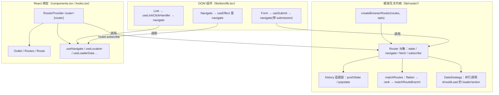
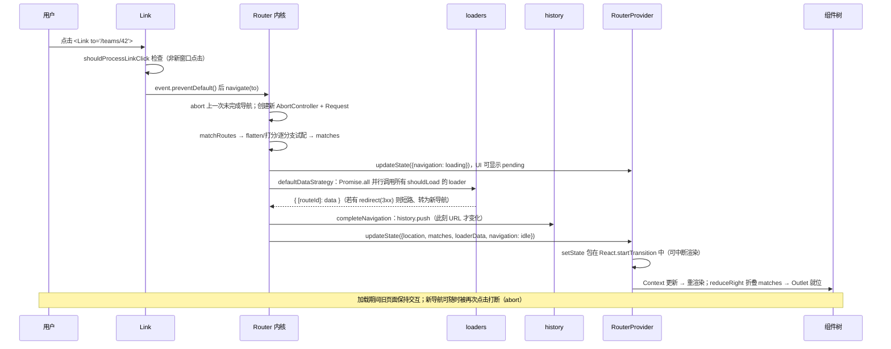

# 第 11 章 React Router：声明式路由背后的数据流

> 上一章：[第 10 章 · 并发特性与 Suspense](./10-concurrent-and-suspense.md) ｜ 下一章：[第 12 章 · Redux 状态管理](./12-redux.md)

> 本章基于 React Router `7.5.3` 源码，聚焦 **library mode**（即 `createBrowserRouter` + `<RouterProvider>` 的经典 SPA 用法，非 framework/Remix mode）。核心文件是 `packages/react-router/lib/router/router.ts`（约 6600 行的框架无关内核）、`packages/react-router/lib/router/utils.ts`（路径匹配）、`packages/react-router/lib/dom/lib.tsx`（Link/Form 等 DOM 组件）与 `packages/react-router/lib/hooks.tsx`。行号均对照 v7.5.3 仓库源码（`remix-run/react-router`，tag `react-router@7.5.3`）。

## 学习目标

读完本章，你应该能够：

1. 说出 `createBrowserRouter` 返回的 Router 对象的核心字段（`state`、`history`、`navigate`、`subscribe`），以及它为什么不依赖 React。
2. 手算任意一组路由的匹配优先级：解释 `/teams/new` 为什么稳赢 `/teams/:id`，`computeScore` 的静态段 10 分、动态段 3 分、通配 -2 分是怎么来的。
3. 完整描述一次 `<Link>` 点击到画面更新的时序：preventDefault → `router.navigate` → `matchRoutes` → 并行 loader → `updateState` → `RouterProvider` 重渲染。
4. 讲清 loader/action 的执行时机、`shouldRevalidate` 的默认策略，以及 `redirect()` 返回的 Response 如何被内核识别成一次新导航。
5. 从 `_renderMatches` 的 `reduceRight` 出发解释嵌套路由与 `<Outlet>` 的关系，以及 errorElement 的错误冒泡规则。
6. 指出 v5 → v6 → v7 的关键 API 变迁，并能识别旧教程里 `Switch`、`useHistory`、`component` prop 等过时写法。

## 11.1 引入：SPA 的「领位员」与「备菜间」

想象一家餐厅。传统多页应用（MPA）里，你每点一道菜（点击链接）都要走出店门、换一家新门店（浏览器整页刷新、重新下载 HTML/CSS/JS）。而单页应用（SPA）是一家大餐厅：你只进一次门，之后的一切都由一位**领位员**（Router）接待——你报上桌号（URL），他直接带你到店里的对应区域（组件树），全程不用出门。这位领位员要做三件事：

- **记住座位图**：URL 路径与组件树的映射（路由表 + 匹配算法）；
- **换桌不换店**：操作 `history.pushState` 修改地址栏，却不让浏览器真的发请求刷新；
- **上菜前先备料**：v6.4 之后，路由不仅是「地图」，还是**数据加载的编排者**——新区域的食材（loader 数据）要在落座（渲染）之前并行备好，中途还能根据订单（`<Form>` 提交）走后厨流程（action）。

React Router v7 正是这位领位员的成熟形态：它脱胎于 Remix，把「路由即数据流」的哲学带回了纯客户端 SPA。本章我们就拆开它的后厨，看每一道工序。

## 11.2 核心概念地图

先建立全景。v7 library mode 的 API 分三层：**框架无关内核**（`router.ts`，不知道 React 存在）、**React 绑定**（组件与 hooks）、**DOM 适配**（history、Link、Form）。



记住一条主线：**所有导航最终都收敛到 `router.navigate(to, opts)`**，组件和 hooks 只是它的各种触发器；**所有渲染都由 `RouterProvider` 订阅 `router.state` 驱动**，组件本身从不直接监听 URL。

## 11.3 RouterProvider 与 createBrowserRouter

### 11.3.1 createBrowserRouter 是一行「组装」

`createBrowserRouter` 本身几乎没逻辑，它把各零件拼起来传给 `createRouter`，然后立刻 `initialize()`：

出处：packages/react-router/lib/dom/lib.tsx:175-198（React Router 7.5.3）

```ts
export function createBrowserRouter(
  routes: RouteObject[], opts?: DOMRouterOpts
): DataRouter {
  return createRouter({
    basename: opts?.basename,
    future: opts?.future,
    history: createBrowserHistory({ window: opts?.window }),
    hydrationData: opts?.hydrationData || parseHydrationData(),
    routes, mapRouteProperties, hydrationRouteProperties,
    dataStrategy: opts?.dataStrategy,
    patchRoutesOnNavigation: opts?.patchRoutesOnNavigation,
    window: opts?.window,
  }).initialize();
}
```

`initialize()`（router.ts:1043 起）做两件大事：挂上 history 的 popstate 监听；执行首次 `matchRoutes` 并跑完首屏所需的全部 loader。若首屏没匹配到任何路由，内核会**短路生成一条假 match** 并把 404 错误挂到根路由错误边界（router.ts:874-883），保证应用总能渲染出点什么。

### 11.3.2 Router 对象：一个不依赖 React 的状态机

`createRouter` 返回的 Router 是普通对象，没有任何 React 依赖——这就是 v7 内核「框架无关」的含义。它的接口（router.ts:69-200）节选：

出处：packages/react-router/lib/router/router.ts:92-187（React Router 7.5.3）

```ts
export interface Router {
  get state(): RouterState;                    // 只读状态快照
  initialize(): Router;                        // 挂监听 + 首屏数据加载
  subscribe(fn: RouterSubscriber): () => void; // 订阅状态变化
  navigate(to: number): Promise<void>;
  navigate(to: To | null, opts?: RouterNavigateOptions): Promise<void>;
  fetch(key, routeId, href, opts?): Promise<void>;  // fetcher 数据加载
  revalidate(): Promise<void>;                 // 手动触发全量 revalidation
  // ...
}
```

真正的数据全在 `RouterState` 里（router.ts:286-357），这就是你通过各种 hooks 读到的所有东西的源头：

出处：packages/react-router/lib/router/router.ts:286-356（React Router 7.5.3）

```ts
export interface RouterState {
  historyAction: NavigationType;      // Push / Replace / Pop
  location: Location;                 // 当前 location
  matches: AgnosticDataRouteMatch[];  // 当前匹配链（嵌套路由全在这）
  initialized: boolean;
  navigation: Navigation;             // idle / loading / submitting
  revalidation: RevalidationState;    // "idle" | "loading"
  loaderData: RouteData;              // { [routeId]: loader 返回值 }
  actionData: RouteData | null;
  errors: RouteData | null;           // { [routeId]: 错误 }
  fetchers: Map<string, Fetcher>;
  blockers: Map<string, Blocker>;
}
```

注意三个设计的呼应：`loaderData`/`actionData`/`errors` 都按 **routeId 键控**（`useLoaderData()` 就是拿当前路由 id 查表）；`navigation.state` 三态驱动全局 pending UI（`useNavigation()` 读它）；`matches` 是**整条匹配链**，嵌套渲染与错误冒泡都靠它的顺序。

创建时内核还会把用户的路由配置转成「数据路由」：递归遍历、给每条没写 `id` 的路由按树路径生成 `"0-2-1"` 这样的 id（`convertRoutesToDataRoutes`，utils.ts:657-705），同时登记进 `manifest` 备查。

### 11.3.3 history 适配层：对 pushState 的薄封装

`createBrowserHistory`（history.ts:359-386）返回的对象最终由 `getUrlBasedHistory`（history.ts:604 起）实现。以 `push` 为例，它维护一个存进 `history.state` 的 `idx` 用于推算前进/后退的 delta：

出处：packages/react-router/lib/router/history.ts:639-667（React Router 7.5.3）

```ts
function push(to: To, state?: any) {
  action = Action.Push;
  let location = createLocation(history.location, to, state);
  index = getIndex() + 1;                      // 栈指针 +1
  let historyState = getHistoryState(location, index);
  let url = history.createHref(location);
  try {
    globalHistory.pushState(historyState, "", url);  // 只改 URL，不发请求
  } catch (error) {
    // pushState 失败（如 iOS 100 次限制）则整页跳转兜底
    window.location.assign(url);
  }
}
```

关键点：**`pushState` 只是改地址栏和会话历史，不会触发任何导航逻辑**。真正让 React Router 动起来的是两条路——组件层主动调用 `router.navigate()`（走完整 data 流程后再回头调 `history.push`），或浏览器前进/后退触发 `popstate`（history.ts:629-637 的 `handlePop`，进而走 `startNavigation`）。还要留意：**导航完成时才写 history**——`completeNavigation` 里按 `pendingAction` 决定 `push`/`replace`（router.ts:1280-1288），loader 没跑完前地址栏是旧的，加载中按停止不会留下半截历史记录。

### 11.3.4 RouterProvider：把状态机接进 React

`RouterProvider` 是内核与 React 世界的唯一桥梁，做的事非常「React 化」：

出处：packages/react-router/lib/components.tsx:247-301、369（React Router 7.5.3）

```tsx
let [state, setStateImpl] = React.useState(router.state);
// ...
let setState = React.useCallback<RouterSubscriber>(
  (newState: RouterState, { flushSync, viewTransitionOpts }) => {
    // ...
    if (reactDomFlushSyncImpl && flushSync) {
      reactDomFlushSyncImpl(() => setStateImpl(newState));
    } else {
      React.startTransition(() => setStateImpl(newState));  // 默认走 transition！
    }
  });
// 用 layout effect 保证尽早订阅，不漏掉渲染期的 <Navigate> 跳转
React.useLayoutEffect(() => router.subscribe(setState), [router, setState]);
```

逐行讲：

1. 整个应用的路由状态就是**一个 `useState`**——`router.state` 的每次更新通过 `subscribe` 回调 `setStateImpl`；
2. 默认用 `React.startTransition` 包裹状态提交——这正是第 10 章讲的 lane 机制：导航渲染是可中断的 transition，加载大页面时输入框不会卡死；
3. 渲染出口是层层 Provider（components.tsx:464-489）：`DataRouterContext`（存 router 实例）→ `DataRouterStateContext`（存 state）→ `Router`（提供 `NavigationContext`/`LocationContext`）→ `MemoizedDataRoutes`，后者调 `useRoutesImpl(routes, undefined, state, future)` 把 `state.matches` 渲染成组件树。

所以你写的每个路由 hooks 本质都是 `useContext` 查表：`useLoaderData()`（hooks.tsx:1097-1101）= 读 `DataRouterStateContext` 的 `loaderData[当前 routeId]`；`useLocation()`（hooks.tsx:133-142）= 读 `LocationContext`。

## 11.4 路径匹配算法

### 11.4.1 总流程：拍平 → 打分 → 逐分支试配

`matchRoutes` 的入口 `matchRoutesImpl` 只有三步：

出处：packages/react-router/lib/router/utils.ts:722-759（React Router 7.5.3）

```ts
let pathname = stripBasename(location.pathname || "/", basename);
if (pathname == null) return null;      // basename 之外的路径直接不匹配
let branches = flattenRoutes(routes);   // ① 把嵌套树拍平成「分支」数组
rankRouteBranches(branches);            // ② 按分数排序
let matches = null;
for (let i = 0; matches == null && i < branches.length; ++i) {
  let decoded = decodePath(pathname);
  matches = matchRouteBranch(branches[i], decoded, allowPartial);  // ③ 逐个试
}
return matches;
```

`flattenRoutes`（utils.ts:805-878）做深度优先遍历，把每条**能独立匹配的叶子路径**（含完整父子链）展开成一个 `RouteBranch { path, score, routesMeta }`。子路由先递归、父路由后入列；无 `path` 且非 `index` 的「布局路由」不单独成分支，只作为子分支 `routesMeta` 的一环。

### 11.4.2 打分：为什么 /teams/new 永远赢 /teams/:id

这是 v6 重写匹配器时最著名的设计——**不再依赖路由书写顺序，而是给每条分支算分**：

出处：packages/react-router/lib/router/utils.ts:950-981（React Router 7.5.3）

```ts
const paramRe = /^:[\w-]+$/;
const dynamicSegmentValue = 3;
const indexRouteValue = 2;
const emptySegmentValue = 1;
const staticSegmentValue = 10;
const splatPenalty = -2;
const isSplat = (s: string) => s === "*";

function computeScore(path: string, index: boolean | undefined): number {
  let segments = path.split("/");
  let initialScore = segments.length;
  if (segments.some(isSplat)) initialScore += splatPenalty;
  if (index) initialScore += indexRouteValue;
  return segments.filter((s) => !isSplat(s)).reduce(
    (score, segment) =>
      score +
      (paramRe.test(segment) ? dynamicSegmentValue
        : segment === "" ? emptySegmentValue
        : staticSegmentValue),
    initialScore
  );
}
```

逐行讲：以「段数」打底，静态段 +10、动态段（`:id`）+3、空段 +1，含 `*` 通配罚 -2，`index` 路由 +2。排序时（`rankRouteBranches`，utils.ts:939-948）先比总分，同分再用 `compareIndexes` 比「兄弟索引」——即**书写位置靠前者优先**（utils.ts:983-997）。

拿经典案例算一遍（段数打底含开头的空段）：

| 分支 | 计算 | 得分 |
| --- | --- | --- |
| `/teams/new` | 3 段 + 10×2 | 23 |
| `/teams/:id` | 3 段 + 10 + 3 | 16 |
| `/teams/*` | 3 段 + 10 − 2 | 11 |

所以 `/teams/new` 永远先被试中，无论你把 `:id` 写在多前面——v5 时代「顺序敏感」的心智模型在这里彻底作废。可选段（`:lang?`）会先由 `explodeOptionalSegments`（utils.ts:894-937）展开成多个分支再分别打分。

### 11.4.3 compilePath：把 path 模板编译成正则

单段匹配靠 `compilePath`（utils.ts:1231-1284），它把 path 字符串拼成正则：

出处：packages/react-router/lib/router/utils.ts:1244-1281（React Router 7.5.3）

```ts
let params: CompiledPathParam[] = [];
let regexpSource = "^" + path
    .replace(/\/*\*?$/, "")            // 尾部的 / 和 /* 单独处理
    .replace(/^\/*/, "/")              // 保证有前导 /
    .replace(/[\\.*+^${}|()[\]]/g, "\\$&")  // 转义正则特殊字符
    .replace(/\/:([\w-]+)(\?)?/g, (_: string, paramName: string, isOptional) => {
      params.push({ paramName, isOptional: isOptional != null });
      return isOptional ? "/?([^\\/]+)?" : "/([^\\/]+)";   // 动态段 → 捕获组
    });

if (path.endsWith("*")) {
  params.push({ paramName: "*" });
  regexpSource += path === "*" || path === "/*" ? "(.*)$" : "(?:\\/(.+)|\\/*)$";
} else if (end) {
  regexpSource += "\\/*$";             // end=true：允许尾部斜杠后必须结束
} else if (path !== "" && path !== "/") {
  regexpSource += "(?:(?=\\/|$))";     // end=false：前缀匹配
}
let matcher = new RegExp(regexpSource, caseSensitive ? undefined : "i");
return [matcher, params];
```

注意：**React Router v6 起就自带这个迷你编译器，不再依赖 `path-to-regexp` 包**（v5 用的是它）。动态段编译成 `([^\/]+)` 捕获组、记录参数名；`end` 标志决定是精确匹配还是前缀匹配——父路由段用 `end: false`、叶子段用 `end: true`。

### 11.4.4 matchRouteBranch：逐段消费 pathname

`matchRouteBranch`（utils.ts:998-1063）沿 `routesMeta` 从父到子逐段调用 `matchPath`，每配中一段就把 `pathnameBase` 往后推，剩余部分交给下一段：

出处：packages/react-router/lib/router/utils.ts:1011-1059（React Router 7.5.3）

```ts
for (let i = 0; i < routesMeta.length; ++i) {
  let meta = routesMeta[i];
  let end = i === routesMeta.length - 1;
  let remainingPathname =
    matchedPathname === "/"
      ? pathname
      : pathname.slice(matchedPathname.length) || "/";
  let match = matchPath(
    { path: meta.relativePath, caseSensitive: meta.caseSensitive, end },
    remainingPathname);
  if (!match) return null;             // 任何一段配不上，整条分支出局
  Object.assign(matchedParams, match.params);   // 参数沿链累积
  matches.push({
    params: matchedParams as Params<ParamKey>,
    pathname: joinPaths([matchedPathname, match.pathname]),
    pathnameBase: normalizePathname(joinPaths([matchedPathname, match.pathnameBase])),
    route,
  });
  if (match.pathnameBase !== "/") {
    matchedPathname = joinPaths([matchedPathname, match.pathnameBase]);
  }
}
```

产出的 `matches` 数组里每项是 `{ route, params, pathname, pathnameBase }`——**父在前子在后，params 逐级累积**（所以子组件 `useParams()` 能拿到父级 `:teamId`）。`matchPath` 本体（utils.ts:1176-1227）则负责执行正则、把捕获组按 `params` 名字装回对象，并对 `%2F` 做特殊还原。

## 11.5 Data APIs：loader 与 action

### 11.5.1 startNavigation：一次导航的总指挥

所有导航（Link、navigate、Form、popstate、redirect）都汇入 `startNavigation`（router.ts:1521 起）。删掉次要分支后的骨架：

出处：packages/react-router/lib/router/router.ts:1541-1563、1607-1614、1688-1723（React Router 7.5.3）

```ts
// ① 新导航到来，先打断上一次还没完成的导航
pendingNavigationController && pendingNavigationController.abort();
pendingNavigationController = null;
pendingAction = historyAction;
let matches = matchRoutes(routesToUse, location, basename);  // ② 匹配
if (!matches) { /* 404 短路：completeNavigation 带 errors 返回 */ }
// ③ 本次导航一个 AbortController + 一个 Request（Web Fetch API 对象！）
pendingNavigationController = new AbortController();
let request = createClientSideRequest(
  init.history, location, pendingNavigationController.signal, opts && opts.submission);
if (opts && opts.submission && isMutationMethod(opts.submission.formMethod)) {
  // ④ mutation（post/put/patch/delete）：先跑 action
  let actionResult = await handleAction(request, location, opts.submission, matches, ...);
  if (actionResult.shortCircuited) return;   // action 里 redirect 了
  // action 成功后，loader 用新的 GET request 重新取数
  request = createClientSideRequest(init.history, request.url, request.signal);
}
// ⑤ 跑所有该跑的 loader
let { shortCircuited, matches: updatedMatches, loaderData, errors } =
  await handleLoaders(request, location, matches, ...);
if (shortCircuited) return;
pendingNavigationController = null;
// ⑥ 提交：写 history + 广播新 state
completeNavigation(location, {
  matches: updatedMatches || matches,
  ...getActionDataForCommit(pendingActionResult),
  loaderData, errors,
});
```

逐行讲：

- **① 可中断性**：每次导航创建 `AbortController`，新导航一来就 abort 旧的——你在 loader 里收到的 `request.signal` 就挂着它，fetch 会自动取消；旧导航迟到的结果也会被各处的 `request.signal.aborted` 检查丢弃；
- **③ Request 对象**：loader/action 的入参是标准 Web `Request`，`request.formData()`、`new URL(request.url)` 都可用——这是 Remix 血统的直接体现；
- **④ 先 action 后 loader**：mutation 提交先跑目标路由的 action，成功后**重新执行当前所有 loader**（数据已变，页面要刷新），这就是「action 之后自动 revalidation」；
- **⑥ 提交即广播**：`completeNavigation` 写 history、`updateState` 通知所有 subscriber。**URL 变化发生在数据就绪之后**——这就是「先备料再上菜」。

### 11.5.2 并行执行：defaultDataStrategy

loader 不是串行的。默认策略把该跑的全部 `Promise.all`：

出处：packages/react-router/lib/router/router.ts:5247-5258（React Router 7.5.3）

```ts
async function defaultDataStrategy(
  args: DataStrategyFunctionArgs<unknown>
): ReturnType<DataStrategyFunction<unknown>> {
  let matchesToLoad = args.matches.filter((m) => m.shouldLoad);
  let keyedResults: Record<string, DataStrategyResult> = {};
  let results = await Promise.all(matchesToLoad.map((m) => m.resolve()));
  results.forEach((result, i) => { keyedResults[matchesToLoad[i].route.id] = result; });
  return keyedResults;
}
```

`/teams/1/members/2` 匹配三层路由时，三个 loader **同时**发出——这解决了 v6.4 之前「父组件 render 后才发子请求」的瀑布问题。代价是：子 loader 不能依赖父 loader 的返回值（它们同时开跑），需要串行数据时要么合并到一个 loader，要么用 v7 的 middleware（`dataStrategy` 自定义）。

### 11.5.3 revalidation 与 shouldRevalidate：哪些 loader 需要重跑

`getMatchesToLoad`（router.ts:4548 起）为每个 match 决定 `shouldLoad`。先看硬规则，再看软规则：

出处：packages/react-router/lib/router/router.ts:4618-4690（节选，React Router 7.5.3）

```ts
if (maxIdx != null && index > maxIdx) {
  forceShouldLoad = false;             // 错误边界之下的 loader 不跑
} else if (route.lazy) {
  forceShouldLoad = true;              // 还没加载的路由模块
} else if (route.loader == null) {
  forceShouldLoad = false;             // 压根没有 loader
} else if (isNewLoader(state.loaderData, state.matches[index], match)) {
  forceShouldLoad = true;              // 新出现的路由实例必跑
}
// ...
let defaultShouldRevalidate = shouldSkipRevalidation
  ? false
  : isRevalidationRequired ||                     // action 提交后强制
    currentUrl.pathname + currentUrl.search ===
      nextUrl.pathname + nextUrl.search ||        // 同 URL 的提交要刷新
    currentUrl.search !== nextUrl.search ||       // search 变化影响所有 loader
    isNewRouteInstance(state.matches[index], match);
let shouldLoad = shouldRevalidateLoader(match, { ...baseShouldRevalidateArgs, defaultShouldRevalidate });
```

软规则就是你写的 `shouldRevalidate` 函数（router.ts:4877-4890）：路由提供了就以你的返回值为准，否则用 `defaultShouldRevalidate`。理解默认策略三句话：**pathname 段没变且不是提交后的强制刷新 → 不重跑**（所以 `/teams/1` 跳 `/teams/2` 时，不变的父级 `teams` loader 会复用旧数据）；**search 一变全部重跑**（query 被视为所有 loader 的输入）；**action 提交后全量重跑**。

### 11.5.4 redirect：一个 Response 如何变成导航

`redirect()` 没有任何魔法——它造一个带 `Location` 头的标准 `Response`：

出处：packages/react-router/lib/router/utils.ts:1589-1601（React Router 7.5.3）

```ts
export const redirect: RedirectFunction = (url, init = 302) => {
  let responseInit = init;
  if (typeof responseInit === "number") {
    responseInit = { status: responseInit };
  } else if (typeof responseInit.status === "undefined") {
    responseInit.status = 302;
  }
  let headers = new Headers(responseInit.headers);
  headers.set("Location", url);
  return new Response(null, { ...responseInit, headers });
};
```

内核在 action/loader 返回后检查状态码是不是 301/302/303/307/308 之一（`isRedirectStatusCode`，router.ts:6365）。以 action 为例（router.ts:1831-1850）：

出处：packages/react-router/lib/router/router.ts:1831-1850（节选，React Router 7.5.3）

```ts
if (isRedirectResult(result)) {
  let replace: boolean;
  if (opts && opts.replace != null) {
    replace = opts.replace;
  } else {
    // 重定向回当前 URL 时用 replace，避免双击后退键
    let location = normalizeRedirectLocation(
      result.response.headers.get("Location")!, new URL(request.url), basename);
    replace = location === state.location.pathname + state.location.search;
  }
  await startRedirectNavigation(request, result, true, { submission, replace });
  return { shortCircuited: true };    // 本次导航作废，转为新导航
}
```

`startRedirectNavigation`（router.ts:2708 起）读出 `Location` 头、判断要不要整页刷新（跨域绝对 URL、或带 `X-Remix-Reload-Document` 头的 `redirectDocument()` 会走 `window.location.assign`），否则**递归调用 `startNavigation`** 重新走一遍匹配-加载流程。所以 `throw redirect("/login")` 的链路是：内核识别 3xx → 当前导航短路 → 以 `/login` 为目标重新导航。推荐 `throw` 而非 `return`：能从深层工具函数直接终止调用栈，也不污染 loader 的返回值类型。

### 11.5.5 Fetchers：不引起导航的数据操作

`useFetcher()` 与 `<fetcher.Form>` 走 `router.fetch()`（router.ts:2166 起）——**独立调用某条路由的 loader/action，但不改 URL、不动 matches**。每个 fetcher 有独立 key，状态机（`idle/loading/submitting`）存在 `state.fetchers` 里。action 类 fetcher 完成后同样触发 `isRevalidationRequired = true`（router.ts:2935），让页面 loader 重跑拿新数据。典型场景：列表里点「赞」——不希望 URL 变化、只希望局部数据刷新。

## 11.6 导航与跳转

### 11.6.1 Link：一个会 preventDefault 的 `<a>`

`<Link>` 渲染的就是真 `<a href>`（可右键新窗口打开、SEO 友好），秘密全在 onClick（lib/dom/lib.tsx:605-709）。它把点击委托给 `useLinkClickHandler`：

出处：packages/react-router/lib/dom/lib.tsx:1347-1367（React Router 7.5.3）

```ts
return React.useCallback(
  (event: React.MouseEvent<E, MouseEvent>) => {
    if (shouldProcessLinkClick(event, target)) {
      event.preventDefault();   // 拦下浏览器默认跳转
      // 目标 URL 与当前相同 → 模拟 <a> 的 replace 行为
      let replace = replaceProp !== undefined
        ? replaceProp
        : createPath(location) === createPath(path);
      navigate(to, { replace, state, preventScrollReset, relative, viewTransition });
    }
  },
  [location, navigate, path, replaceProp, state, target, to,
   preventScrollReset, relative, viewTransition]
);
```

`shouldProcessLinkClick` 会放行「新窗口点击」：`target="_blank"`、按住 ⌘/Ctrl/Shift/Meta、非左键——这些交给浏览器原生行为，SPA 不插手。拦截后调 `navigate()`，进入 11.5.1 的总流程。

### 11.6.2 useNavigate：读上下文里的「导航器」

`useNavigate`（hooks.tsx:226-302）本身是个 dispatcher：数据路由下返回稳定版（直接转调 `router.navigate`），普通 `<BrowserRouter>` 下走 history 的 push/replace。不稳定版的骨架：

出处：packages/react-router/lib/hooks.tsx:253-291（React Router 7.5.3）

```tsx
let navigate: NavigateFunction = React.useCallback(
  (to: To | number, options: NavigateOptions = {}) => {
    warning(activeRef.current, navigateEffectWarning);
    if (!activeRef.current) return;        // 首渲染期调用直接忽略
    if (typeof to === "number") return navigator.go(to);   // navigate(-1) 后退
    let path = resolveTo(to, JSON.parse(routePathnamesJson),
      locationPathname, options.relative === "path");  // 相对路径解析（"../x"）
    // 处理 basename 拼接...
    (!!options.replace ? navigator.replace : navigator.push)(
      path, options.state, options);
  },
  [basename, navigator, routePathnamesJson, locationPathname, dataRouterContext]
);
```

注意 `activeRef` 的保护：**渲染期间调用 `navigate()` 会被 DEV 警告并忽略**——因为渲染是可中断的（第 10 章），副作用不该发生在 render 里。想在渲染期跳转，用 `<Navigate>` 组件（components.tsx:580-621），它把 navigate 放进 `useEffect` 里执行。

### 11.6.3 Form 与 useSubmit：action 的接管

`<Form>` 渲染真 `<form>`，但 onSubmit 拦下默认提交、改写由 `useSubmit()` 处理（lib/dom/lib.tsx:1123-1145）：

出处：packages/react-router/lib/dom/lib.tsx:1123-1145（React Router 7.5.3）

```tsx
let submitHandler: React.FormEventHandler<HTMLFormElement> = (event) => {
  onSubmit && onSubmit(event);
  if (event.defaultPrevented) return;
  event.preventDefault();                  // 阻止浏览器表单提交
  let submitter = (event as unknown as HTMLSubmitEvent).nativeEvent
    .submitter as HTMLFormSubmitter | null;
  let submitMethod =
    (submitter?.getAttribute("formmethod") as HTMLFormMethod | undefined) || method;
  submit(submitter || event.currentTarget, {
    fetcherKey, method: submitMethod, navigate, replace, state,
    relative, preventScrollReset, viewTransition });
};
```

`useSubmit` 返回的函数（lib/dom/lib.tsx:1597-1636）把 DOM 表单元素转成 `{ formData, formMethod, formAction }`，然后按 `navigate !== false` 分流——`false` 走 `router.fetch()`（fetcher 路线，不导航），否则走 `router.navigate(action, { formData, formMethod, ... })`，以「带 submission 的导航」进入 11.5.1 的 ④ 步，由目标路由的 `action` 处理 `await request.formData()`。`method="get"` 则退化为普通导航（表单值进 search params）。

### 11.6.4 四个读数据的 hooks 全是 Context 查表

出处与实现一览（React Router 7.5.3）：

```tsx
// hooks.tsx:141 —— 读 LocationContext
export function useLocation(): Location {
  return React.useContext(LocationContext).location;
}
// hooks.tsx:352-354 —— 读 RouteContext 的最后一个 match（父级 params 已并入）
export function useParams() {
  let { matches } = React.useContext(RouteContext);
  let routeMatch = matches[matches.length - 1];
  return routeMatch ? (routeMatch.params as any) : {};
}
// hooks.tsx:1098-1100 —— 读 DataRouterStateContext + 当前 routeId
export function useLoaderData<T = any>(): SerializeFrom<T> {
  let state = useDataRouterState(DataRouterStateHook.UseLoaderData);
  let routeId = useCurrentRouteId(DataRouterStateHook.UseLoaderData);
  return state.loaderData[routeId] as SerializeFrom<T>;
}
```

`useSearchParams`（lib/dom/lib.tsx:1397-1437）稍复杂一点：`location.search` 经 `useMemo` 包成 `URLSearchParams`；`setSearchParams(next)` 只是 `navigate("?" + newSearchParams)` 的语法糖——**改 query 就是一次导航**，会触发 11.5.3 的全量 loader 重跑（除非你用 `shouldRevalidate` 拦下）。

## 11.7 错误边界与 errorElement

loader/action/渲染三处抛出的错误，归宿都是「最近的错误边界」。数据侧由 `findNearestBoundary` 选择（router.ts:6187-6198）：从出错路由沿 matches 链**向上**找第一个 `hasErrorBoundary === true` 的路由（提供了 `errorElement`/`ErrorBoundary` 即被标记），找不到就退到根路由。错误以 `{ [routeId]: error }` 存进 `state.errors`，边界之下的 loader 不再执行（11.5.3 的 `maxIdx` 逻辑）。

渲染侧由 `_renderMatches`（hooks.tsx:779-940）落地，两步。第一步把 matches 裁剪到出错层：

出处：packages/react-router/lib/hooks.tsx:813-829（React Router 7.5.3）

```tsx
let errors = dataRouterState?.errors;
if (errors != null) {
  let errorIndex = renderedMatches.findIndex(
    (m) => m.route.id && errors?.[m.route.id] !== undefined);
  invariant(errorIndex >= 0, `Could not find a matching route for errors ...`);
  renderedMatches = renderedMatches.slice(0, Math.min(renderedMatches.length, errorIndex + 1));
}
```

子路由全部不渲染。第二步在逐层包裹时（hooks.tsx:865-939）：有错误的位置渲染 `errorElement` 替代原 element，并包上 `<RenderErrorBoundary>`（一个 class 组件，捕获渲染期错误并写入 `RouteErrorContext`）。边界组件里用 `useRouteError()`（hooks.tsx:1182 起）取错误。

冒泡规则一句话：**loader/action 错误在数据侧就定位到最近边界；渲染错误靠 React class 错误边界向上抛，被最近的 `RenderErrorBoundary` 接住**。两者最终渲染的都是该边界的 `errorElement`。区分错误类型用 `isRouteErrorResponse()`——`throw new Response("Not Found", { status: 404 })` 与 `throw new Error(...)` 走不同 UI 分支是常见模式。

## 11.8 嵌套路由与 Outlet

嵌套路由没有「布局组件」的特殊概念——**就是一条 matches 链的从右往左折叠**。核心在 `_renderMatches` 的收尾：

出处：packages/react-router/lib/hooks.tsx:865-921（节选，React Router 7.5.3）

```tsx
return renderedMatches.reduceRight((outlet, match, index) => {
  let error: any;
  let errorElement: React.ReactNode | null = null;
  if (dataRouterState) {
    error = errors && match.route.id ? errors[match.route.id] : undefined;
    errorElement = match.route.errorElement || defaultErrorElement;
  }
  let matches = parentMatches.concat(renderedMatches.slice(0, index + 1));
  let getChildren = () => {
    let children: React.ReactNode;
    if (error) {
      children = errorElement;                  // 这层出错：渲染错误元素
    } else if (match.route.Component) {
      children = <match.route.Component />;
    } else if (match.route.element) {
      children = match.route.element;
    } else {
      children = outlet;                        // 无 element 的路由：直接透传
    }
    return (
      <RenderedRoute match={match} children={children}
        routeContext={{ outlet, matches, isDataRoute: dataRouterState != null }} />
    );
  };
  // 有 ErrorBoundary/errorElement 或是根层：包一层错误边界
  return dataRouterState &&
    (match.route.ErrorBoundary || match.route.errorElement || index === 0)
    ? <RenderErrorBoundary /* ... */ children={getChildren()} />
    : getChildren();
}, null as React.ReactElement | null);
```

`reduceRight` 从最深层（叶子）开始，初始 `outlet = null`：叶子的 element 渲染时 `outlet` 为 null；向上折叠一层，**本层的 element 成为父层的 `outlet`**。每层通过 `RenderedRoute` 把 `{ outlet, matches }` 塞进 `RouteContext`。父组件里的 `<Outlet />`（components.tsx:657-659）只是 `useOutlet()` 的薄壳：

出处：packages/react-router/lib/hooks.tsx:321-329（React Router 7.5.3）

```tsx
export function useOutlet(context?: unknown): React.ReactElement | null {
  let outlet = React.useContext(RouteContext).outlet;
  if (outlet) {
    return <OutletContext.Provider value={context}>{outlet}</OutletContext.Provider>;
  }
  return outlet;
}
```

所以 `<Outlet />` 渲染的不是模板插槽，而是**上一层 reduceRight 已构造好的子树 element**，连同 `<Outlet context={...}>` 的值（子路由用 `useOutletContext()` 读取）一起返回。这也解释了「不写 element 的中间层路由」为何是合法的布局技巧——`getChildren` 直接透传 outlet，零成本包一层。

## 端到端流程串讲

一次「点击 `<Link to="/teams/42">`」的完整时序：



对照第 10 章的知识收尾：`RouterProvider` 默认把路由状态更新包进 `startTransition`，所以导航渲染走 Transition lane；输入、点击等紧急更新可以插队打断大页面的加载渲染——React Router v7 与 React 19 的并发模型是严丝合缝的。

## 版本勘误 📌

1. **v5 的 `<Switch>` 已删除**（v6 起）。v5 按书写顺序取第一个匹配，`/teams/:id` 写前面会吃掉 `/teams/new`；v6/v7 用 ranking 算法（11.4.2），顺序无关，「精确路由放前面」的建议已过时。
2. **`useHistory` → `useNavigate`**（v6 起）。`history.push("/x")` 写成 `navigate("/x")`，`history.replace` 写成 `navigate("/x", { replace: true })`；没有 `history.location`，改用 `useLocation()`。
3. **`component` / `render` prop → `element`**（v6 起）。`<Route component={Home}>` 必须写成 `<Route element={<Home />}>`。v7 的 `Component` prop 每次渲染新建 element（官方注明是去优化路径，hooks.tsx:898-905 注释），常规仍用 `element`。
4. **v6.4 引入 Data APIs 与「双轨制」**：`createBrowserRouter + RouterProvider`（数据路由）与老式 `<BrowserRouter>`（仅匹配渲染）并存，loader/action/`Form`/`errorElement` 只在数据路由下可用——所以有的 hooks 源码里有 `isDataRoute` 分支（hooks.tsx:226-231）。v7 沿同一架构。
5. **v7 合并 react-router-dom**：所有 API 从 `react-router` 包导出，`react-router-dom` 只剩 re-export 兼容壳（packages/react-router-dom/index.ts 全文仅 `export * from "react-router"` 加两个具名导出）。新代码请 `import { Link } from "react-router"`。
6. **v7 = Remix v3 的 library 形态**：Remix 合并回 React Router 后，loader/action/Form/redirect 语义原样保留，`X-Remix-*` 响应头（如 `X-Remix-Reload-Document`，router.ts:2742）就是这段血统的活化石。framework mode（`@react-router/dev`）才是「Remix 的继承者」，本章的 library mode 是它去掉构建约定后的内核。

## 初学者易错点 ⚠️

1. **用 `<BrowserRouter>` 包裹却写了 loader，疑惑为什么不执行**。loader/action/`Form`/`useLoaderData` 只在 `createBrowserRouter + RouterProvider` 下工作；`<BrowserRouter>` 只是纯渲染匹配器。要么升级数据路由，要么自己 useEffect 取数。
2. **在 loader 里读 React state 或 hooks**。loader 在渲染**之外**执行（导航时、渲染前），拿不到组件状态。token 等全局值从 localStorage/模块单例读；需要组件状态参与取数，说明它不该放 loader。
3. **以为 `navigate()` 立刻改 URL**。数据路由下 URL 在 loader 就绪、导航提交时才更新（completeNavigation 里才 `history.push`）。「点了 Link 地址栏没变」不是 bug，是 loader 还在跑——用 `useNavigation().state` 做全局 loading。
4. **loader 返回不可序列化的值**。`useLoaderData()` 拿到的就是返回值；`Date`、class 实例、Map 等在 SSR/水合时会丢类型，只返回 plain object。v7 起裸对象不再需要包 `json()`（直接 `return { user }`）。
5. **`shouldRevalidate` 返回值理解反了**。你的返回值是**最终裁决**：`false` 时即使 search 变了也不重跑，`true` 时即使 pathname 没变也重跑。想在默认策略上追加条件，用参数里的 `defaultShouldRevalidate`：`return defaultShouldRevalidate || myCondition`。
6. **给 `<Form>` 按钮写 `onClick={() => navigate(...)}` 绕过 action**。既丢 `request.formData()`，也不触发 action 后的自动 revalidation。让 Form 自然提交、逻辑写进 action；提交后跳转就在 action 里 `return redirect("/done")`。
7. **动态段参数当数字用**。`useParams()` 返回的永远是字符串（正则捕获组原值），`/teams/42` 的 `id` 是 `"42"`，比较前记得 `Number(id)`。

## 本章小结

- v7 = **框架无关的状态机内核**（router.ts）+ **薄 React 绑定**：`createBrowserRouter` 组装 history 与路由表，`RouterProvider` 用 `router.subscribe` + `useState` 接入组件树，所有 hooks 都是 Context 查表。
- 匹配器三步：嵌套路由拍平成分支、`computeScore` 打分（静态 10 / 动态 3 / 通配 −2）、逐分支正则试配——**与书写顺序无关**，`/teams/new` 永远赢 `/teams/:id`。
- 一切导航汇入 `startNavigation`：abort 旧导航 → match →（有提交先跑 action）→ **并行**跑所有 shouldLoad 的 loader → 提交时才 `history.push`——**URL 变化发生在数据就绪之后**。
- `shouldRevalidate` 默认策略：pathname 未变的段复用、search 变化全量重跑、action 提交后全量重跑；`redirect()` 只是一个 3xx Response，被内核识别后短路当前导航、转为新导航。
- 嵌套路由是 `_renderMatches` 的 `reduceRight` 折叠：子树 element 作为 `outlet` 经 `RouteContext` 传给父层，`<Outlet />` 读它渲染；错误沿 matches 向上冒泡到最近 `errorElement`，边界之下的子树整体裁掉。
- `RouterProvider` 默认用 `React.startTransition` 提交导航状态，与第 10 章的并发渲染无缝协作：加载大页面时交互不被阻塞。

## 下一章导读

路由解决了「URL → 组件树 + 数据」的映射，但应用里还有另一类状态：跨页面共享的购物车、登录态、全局偏好——它们不属于任何 URL，放 loader 里会随路由切换反复加载，放 Context 里又面临重渲染与组织难题。下一章进入 [第 12 章 · Redux 状态管理](./12-redux.md)，看 Redux 如何用单一 store + dispatch/reducer 管理这类「全局但非路由」的状态，以及 React-Redux 如何借助 `useSyncExternalStore`（第 7 章的防 tearing 机制）把 store 安全接入并发渲染。读完你会能回答一个经典架构问题：**什么状态该进 URL（路由管），什么状态该进 store（Redux 管）**。
