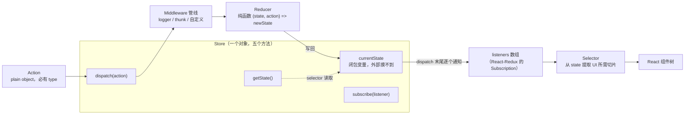
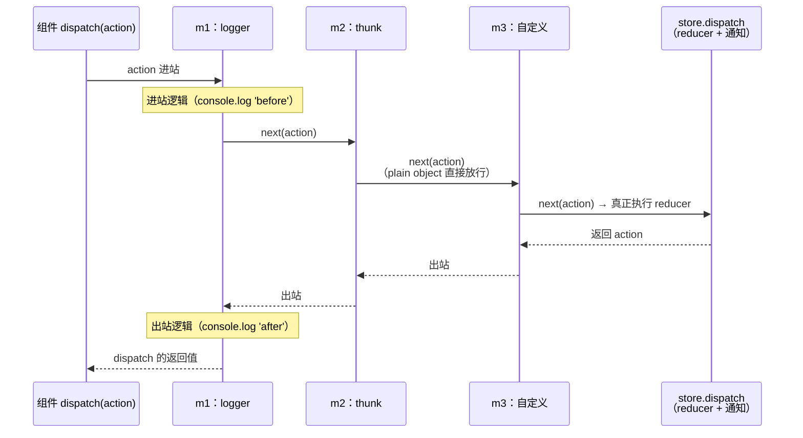

# 第 12 章 Redux：可预测状态容器与中间件管线

> 上一章：[第 11 章 · React Router 路由](./11-react-router.md) ｜ 下一章：[第 13 章 · Zustand 状态管理](./13-zustand.md)

> 本章基于 redux `5.x`、@reduxjs/toolkit `2.x`、react-redux `9.x`、reselect `5.x` 源码，行号对应各仓库的 v5/v2/v9 tag。Redux 核心极小——`createStore` 主逻辑不足 300 行，`compose` 只有十几行——是所有状态管理库中最值得通读的一个。

## 学习目标

读完本章，你应该能够：

1. 不看资料写出 `createStore` 极简版（`getState` / `dispatch` / `subscribe` 三件套），并解释 `currentListeners` / `nextListeners` 双数组拷贝的作用。
2. 画出中间件洋葱模型，讲清 `compose` 用 `reduce` 嵌套柯里化函数的顺序，以及为什么 `middlewareAPI.dispatch` 要用闭包延迟绑定。
3. 默写 thunk 中间件的核心 14 行源码，说明「函数 action」为什么能拿到 `dispatch` 与 `getState`。
4. 解释 `combineReducers` 如何用 `hasChanged` 引用比较决定返回新 state 还是旧 state，以及开发环境 unexpected key 警告从哪来。
5. 从 `useSyncExternalStoreWithSelector` 的角度说清 `useSelector` 的订阅与重渲染触发条件，以及 v9 的 `stabilityCheck` / `identityFunctionCheck` 两道 dev 检查。
6. 描述 `createSlice` 如何用 Immer 的 `produce` 包装 case reducer、`createAsyncThunk` 的三个生命周期 action 类型如何拼出、reselect 的 `weakMapMemoize` 按什么键缓存。

## 12.1 引入：一个账本，为什么要设三道关卡

先放下代码，想象一家社区银行。全行只有**一本总账**（state），任何人都能隔着玻璃看（`getState`），但谁都不能直接动笔改。想改账，你必须填一张**业务单据**（action，写明「业务类型 type + 附件 payload」），递进**窗口**（`dispatch`）。窗口后面坐着**柜员**（reducer），柜员有一个铁律：只凭单据和当前账本按固定规则誊写一本**新账**，绝不临场打电话、绝不看心情——这就是「纯函数」。单据在到达柜员之前，还要经过一排**中转分拣站**（middleware）：有的负责复印留档（logger），有的专门接「代办委托书」（thunk 处理函数形态的 action），你自己也可以加装新的站点。账一换，窗口立刻摇铃，所有登记过的**储户**（subscriber，比如 React-Redux）都会来刷新自己关心的那一栏（selector）。

`useState` / `useReducer` 为什么不够？三个硬伤：

1. **跨组件共享**：状态存在 fiber 的 hook 链上（第 7 章），想给远房组件用就得 `useContext` 层层包 Provider，且 context value 一变所有消费者全部重渲染。
2. **可观测性**：`useReducer` 的 dispatch 过程是个黑盒，没有「单据留档」，做不到 action 日志、时间旅行回放。
3. **中间件生态**：异步、日志、崩溃上报、持久化……这些横切关注点需要一个统一的「分拣站」机制，而不是散落在每个组件的事件回调里。

Redux 的全部设计就是上面这个类比的形式化：**单一数据源 + 只读 state + 纯函数 reducer + 可插拔中间件管线**。本章把这套机制拆开看——你会惊讶于它有多小。

## 12.2 核心概念地图



一句话记住每个角色：**Action 是单据，Reducer 是柜员，Store 是窗口 + 账本 + 铃铛，Middleware 是分拣站，Selector 是储户只看的那个栏目**。数据永远单向流动：UI 只能 `dispatch(action)`，改 state 的唯一通道是 reducer，UI 通过订阅 + selector 被动接收新值。

## 12.3 createStore 三件套

`createStore` 的返回值就是一个普通对象，五个方法里有四个是「皮」：`getState`、`dispatch`、`subscribe`、`replaceReducer`、`[$$observable]`。真正值得逐行读的是前三个。

出处：packages/redux/src/createStore.ts:70-296（Redux 5.0，节选）

```ts
export function createStore(reducer, preloadedState, enhancer) {
  // enhancer 存在时：createStore 自己被 enhancer 接管（applyMiddleware 就是这么进来的）
  if (typeof enhancer === 'function') {
    return enhancer(createStore)(reducer, preloadedState)
  }

  let currentReducer = reducer
  let currentState = preloadedState
  let currentListeners: (() => void)[] | null = []
  let nextListeners = currentListeners
  let isDispatching = false

  function ensureCanMutateNextListeners() {
    if (nextListeners === currentListeners) {
      nextListeners = currentListeners.slice() // 拷贝后才允许增删
    }
  }

  function getState() {
    if (isDispatching) {
      throw new Error('You may not call store.getState() while the reducer is executing...')
    }
    return currentState
  }

  function subscribe(listener) {
    if (isDispatching) throw new Error('You may not call store.subscribe() while the reducer is executing...')
    let isSubscribed = true
    ensureCanMutateNextListeners()
    nextListeners.push(listener)
    return function unsubscribe() {
      if (!isSubscribed) return
      isSubscribed = false
      ensureCanMutateNextListeners()
      const index = nextListeners.indexOf(listener)
      nextListeners.splice(index, 1)
      currentListeners = null
    }
  }

  function dispatch(action) {
    if (!isPlainObject(action)) throw new Error('Actions must be plain objects...')
    if (typeof action.type === 'undefined') throw new Error('Actions may not have an undefined "type" property...')
    if (isDispatching) throw new Error('Reducers may not dispatch actions...')

    try {
      isDispatching = true
      currentState = currentReducer(currentState, action)
    } finally {
      isDispatching = false
    }

    const listeners = (currentListeners = nextListeners) // 快照本次要通知的数组
    for (let i = 0; i < listeners.length; i++) {
      const listener = listeners[i]
      listener()
    }
    return action
  }

  // 建店先记一笔 INIT，让每个 slice reducer 用 default 参数填上初始 state
  dispatch({ type: ActionTypes.INIT })

  return { dispatch, subscribe, getState, replaceReducer, [$$observable]: observable }
}
```

**逐行讲**：

- **闭包即私有**：`currentState` 是模块内局部变量，外部只能通过 `getState` 读、通过 `dispatch` 触发改写——「单一数据源」不是靠约定，是靠作用域物理隔绝。
- **`isDispatching` 锁**：reducer 执行期间禁止 `dispatch` / `getState` / `subscribe`，从结构上掐死「柜员记账时有人递新单子」导致的重入与脏读。这也是为什么 **reducer 里写副作用必炸**——你在 reducer 里 `store.dispatch` 或 `store.getState` 会直接吃到这个 throw。
- **`nextListeners` / `currentListeners` 双数组**：`dispatch` 通知前先把 `nextListeners` 快照进 `currentListeners` 再遍历。这样某个 listener 在回调里 `subscribe` / `unsubscribe` 时，改的是拷贝后的 `nextListeners`，**当前这轮通知不会被插队或跳号**——与发布订阅库常见的「遍历时增删」陷阱对上了药方。
- **`return action`**：dispatch 把原 action 透传出去，中间件链和调用方都能拿到它（thunk 靠它返回 Promise）。
- **`ActionTypes.INIT`**：`@@redux/INIT` 带一段随机后缀，创建 store 时立刻 dispatch 一次，让所有 reducer 用 `state = initialState` 默认值产出初始树。

剥掉类型与报错，核心不到 60 行：

```ts
function createStore(reducer, preloadedState, enhancer) {
  if (typeof enhancer === 'function') return enhancer(createStore)(reducer, preloadedState)
  let currentState = preloadedState
  let currentReducer = reducer
  let currentListeners = []
  let nextListeners = currentListeners
  let isDispatching = false
  const ensureCanMutateNextListeners = () => {
    if (nextListeners === currentListeners) nextListeners = currentListeners.slice()
  }
  const getState = () => currentState
  const subscribe = (listener) => {
    ensureCanMutateNextListeners()
    nextListeners.push(listener)
    return () => {
      ensureCanMutateNextListeners()
      nextListeners.splice(nextListeners.indexOf(listener), 1)
    }
  }
  const dispatch = (action) => {
    if (isDispatching) throw new Error('no re-entrant dispatch')
    try {
      isDispatching = true
      currentState = currentReducer(currentState, action)
    } finally {
      isDispatching = false
    }
    const listeners = (currentListeners = nextListeners)
    listeners.forEach((l) => l())
    return action
  }
  dispatch({ type: '@@redux/INIT' })
  return { getState, dispatch, subscribe }
}
```

这就是整个 Redux「可预测」的地基：**state 只活在闭包里，改它的唯一动作是一次同步的 reducer 调用**。

## 12.4 combineReducers 与 state 形状

应用一大，一个 reducer 管不过来。`combineReducers` 把 state 树按 key 分治：每个 slice reducer 只看到自己那一栏账。

出处：packages/redux/src/combineReducers.ts:80-199（Redux 5.0，节选）

```ts
export default function combineReducers(reducers) {
  const reducerKeys = Object.keys(reducers)
  const finalReducers = {}
  for (const key of reducerKeys) {
    if (typeof reducers[key] === 'function') {
      finalReducers[key] = reducers[key] // 非函数的 key 被静默丢弃
    }
  }
  const finalReducerKeys = Object.keys(finalReducers)

  let unexpectedKeyCache
  if (process.env.NODE_ENV !== 'production') {
    unexpectedKeyCache = {} // 同一批陌生 key 只警告一次
  }

  return function combination(state = {}, action) {
    // 开发环境：state 里出现了没有对应 reducer 的 key → 警告（常见于拼写错误 / 热更新后残留）
    if (process.env.NODE_ENV !== 'production') {
      const warningMessage = getUnexpectedStateShapeWarningMessage(
        state, finalReducers, action, unexpectedKeyCache)
      if (warningMessage) console.error(warningMessage)
    }

    let hasChanged = false
    const nextState = {}
    for (const key of finalReducerKeys) {
      const reducer = finalReducers[key]
      const previousStateForKey = state[key]
      const nextStateForKey = reducer(previousStateForKey, action)
      if (typeof nextStateForKey === 'undefined') {
        throw new Error(`...the slice reducer for key "${key}" returned undefined...`)
      }
      nextState[key] = nextStateForKey
      hasChanged = hasChanged || nextStateForKey !== previousStateForKey
    }
    hasChanged = hasChanged || finalReducerKeys.length !== Object.keys(state).length
    return hasChanged ? nextState : state // 全部 slice 引用未变 → 直接返回旧 state
  }
}
```

**逐行讲**：

- **每个 action 都会过所有 slice reducer**：没有「这个 action 只归谁管」的路由表，靠 reducer 内的 `switch` / `default return state` 自然忽略。分而不隔，任意 slice 都能响应任意 action（比如 `logout` 同时清空 user 和 cart）。
- **引用比较决定新旧**：`hasChanged` 用的是 `!==`。任一 slice 返回了新引用，整棵树换根；全都没变，**原样返回旧 state 对象**。React-Redux 那边正是靠根引用不变来短路掉大部分订阅者的重算。
- **`undefined` 是红线**：reducer 返回 `undefined` 直接 throw。原因：state 树上某个 key 变成 `undefined` 几乎必是 bug（忘了 default 分支 / 忘了初始值），静默放行会让下游 selector 读出一堆 `undefined` 还找不到源头。
- **创建时的 shape 校验**：`combineReducers` 一进来就用 `INIT` 和一个随机 type「试探」每个 reducer（`assertReducerShape`），初始值缺失会在启动第一秒就报错，而不是等用户操作。
- **unexpected key 警告**：只在开发环境，且只提示「state 里多出没有 reducer 接管的 key」——典型场景是你删了 reducer 却忘了删 preloadedState，或者 action 里手抖把数据塞到了顶层。

记住一个推论：**reducer 必须同步、必须纯**。`combination` 是一个 for 循环里同步调用所有 slice，任何一步异步（返回 Promise）都会把 `nextStateForKey` 变成一个 thenable 写进 state 树，整个模型当场崩盘。

## 12.5 applyMiddleware 与中间件管线

中间件是「分拣站」机制的实现。先看拼装用的 `compose`：

出处：packages/redux/src/compose.ts:32-53（Redux 5.0）

```ts
export default function compose(...funcs) {
  if (funcs.length === 0) {
    return <T>(arg: T) => arg
  }
  if (funcs.length === 1) {
    return funcs[0]
  }
  return funcs.reduce(
    (a, b) =>
      (...args: any) =>
        a(b(...args)) // 从右往左：b 的输出是 a 的输入
  )
}
```

`compose(f, g, h)(x) === f(g(h(x)))`——数组里**靠左的函数包住靠右的**。再看中间件如何接到 store 上：

出处：packages/redux/src/applyMiddleware.ts:27-57（Redux 5.0）

```ts
export default function applyMiddleware(...middlewares) {
  return (createStore) => (reducer, preloadedState) => {
    const store = createStore(reducer, preloadedState)
    let dispatch: Dispatch = () => {
      throw new Error(
        'Dispatching while constructing your middleware is not allowed...')
    }
    const middlewareAPI: MiddlewareAPI = {
      getState: store.getState,
      dispatch: (action, ...args) => dispatch(action, ...args) // 闭包延迟绑定！
    }
    const chain = middlewares.map((middleware) => middleware(middlewareAPI))
    dispatch = compose<typeof dispatch>(...chain)(store.dispatch)

    return { ...store, dispatch } // 原 store 的 dispatch 被管线版覆盖
  }
}
```

**逐行讲**：

- **enhancer 形态**：`applyMiddleware` 返回的不是 store，而是一个 `createStore` 的包装器。回到 12.3 第一行——`createStore` 检测到 enhancer 时直接 `return enhancer(createStore)(reducer, preloadedState)`，所以中间件是在「建店」这一步植入的。
- **三层柯里化**：每个中间件签名是 `store => next => action => { ... }`。第一刀 `middleware(middlewareAPI)` 注入 `getState` 和一个**还没组装好的 dispatch**；`compose(...chain)(store.dispatch)` 这刀把 `next` 一层层喂进去：`compose(m1, m2, m3)(store.dispatch)` = `m1(m2(m3(store.dispatch)))`，最里面的 `m3` 的 `next` 才是真正的 `store.dispatch`。
- **`next` vs `dispatch` 是两条路**：中间件里 `next(action)` 只走到下一站；`middlewareAPI.dispatch(action)` 则**重新从管线最外层进入**（因为闭包里的 `dispatch` 变量此刻已指向组装完成的版本）。thunk 异步完成后要再次过 logger，靠的就是后者。
- **构造期保护**：组装完成前 `dispatch` 变量指向那个抛错的占位函数——谁敢在中间件初始化阶段 dispatch（比如在模块顶层），立刻报错，避免拿到半成品管线。
- **洋葱模型**：`m1` 最先看到 action，最后看到结果。`next(action)` 之前是「进站」，之后是「出站」，日志中间件的「前后各打一行」就是这么写的。



## 12.6 Redux Thunk 与异步 Action

Redux 本身不认识异步，「异步 action」的全部魔法就是下面这个中间件——它是「函数形态的单据，分拣站帮你代办」的实现：

出处：packages/redux-thunk/src/index.ts:5-27（redux-thunk 3.1，RTK 2 内置同款）

```ts
function createThunkMiddleware(extraArgument?: unknown) {
  const middleware: ThunkMiddleware =
    ({ dispatch, getState }) =>
    (next) =>
    (action) => {
      if (typeof action === 'function') {
        // 函数 action：不进 reducer，当场执行，注入 dispatch / getState
        return action(dispatch, getState, extraArgument)
      }
      return next(action) // plain object 才放行给下一站
    }
  return middleware
}

export const thunk = createThunkMiddleware()
export const withExtraArgument = createThunkMiddleware
```

去掉类型标注，核心恰好 14 行。**逐行讲**：

- `typeof action === 'function'`：单据不是「业务指令」而是「代办委托书」，分拣站（thunk）直接代办，不向后传递——reducer 永远看不到函数。
- `return action(dispatch, getState, extraArgument)`：执行这个函数，并把「重新走整条管线的 dispatch」和「随时看最新账本的 getState」塞给它。函数的返回值（通常是个 Promise）原样成为 `store.dispatch(fn)` 的返回值，所以业务代码可以 `await dispatch(fetchTodos())`。
- `next(action)`：普通对象照常放行，链上的 logger、crashReporter 一个不少。
- `extraArgument`：注入自定义依赖（API client 等），便于测试时替换——RTK 的 `configureStore` 用 `thunk: { extraArgument }` 透传它。

所谓「异步 action」，本质就是**一个闭包里先后 dispatch 多个同步 action**：`pending →（网络往返）→ fulfilled / rejected`。Redux 的数据流从未被打断，只是「代办人」拿着窗口钥匙多跑了几趟。

## 12.7 React-Redux v9：Provider 与 useSelector

store 造好了，React 怎么知道它变了？v9 的答案是把订阅模型整个押在 React 18 的 `useSyncExternalStore` 上（见第 7 章 7.8.3），`connect` 沦为兼容层，hooks 是一等公民。

`Provider` 负责把 store 和一个**订阅代理**放进 context：

出处：packages/react-redux/src/components/Provider.tsx:45-90（React-Redux 9.x，节选）

```tsx
function Provider({ store, context, children, serverState, stabilityCheck = 'once', identityFunctionCheck = 'once' }) {
  const contextValue = useMemo(() => {
    const subscription = createSubscription(store)
    return {
      store,
      subscription,
      getServerState: serverState ? () => serverState : undefined,
      stabilityCheck,
      identityFunctionCheck,
    }
  }, [store, serverState, stabilityCheck, identityFunctionCheck])

  const previousState = useMemo(() => store.getState(), [store])

  useIsomorphicLayoutEffect(() => {
    const { subscription } = contextValue
    subscription.onStateChange = subscription.notifyNestedSubs
    subscription.trySubscribe() // 此刻才真正 store.subscribe(...)
    if (previousState !== store.getState()) {
      // render 到 commit 之间 store 变了（如 StrictMode 下）：补一轮通知，防 tearing
      subscription.notifyNestedSubs()
    }
    return () => {
      subscription.tryUnsubscribe()
      subscription.onStateChange = undefined
    }
  }, [contextValue, previousState])

  const Context = context || ReactReduxContext
  return <Context.Provider value={contextValue}>{children}</Context.Provider>
}
```

`createSubscription` 维护一个手写链表（`packages/react-redux/src/utils/Subscription.ts:20-62` 的 `createListenerCollection`）：`subscribe` 尾插、`notify` 从头遍历回调。每个 `useSelector` 不直接 `store.subscribe`，而是挂到这条链上——`Provider` 是 store 唯一的订阅者（`store.subscribe(handleChangeWrapper)`），store 一变由它统一 `notifyNestedSubs` 广播。

`useSelector` 本体：

出处：packages/react-redux/src/hooks/useSelector.ts:36-104（React-Redux 9.x，节选）

```ts
return function useSelector(selector, equalityFnOrOptions = {}) {
  const { equalityFn = refEquality } =
    typeof equalityFnOrOptions === 'function'
      ? { equalityFn: equalityFnOrOptions }
      : equalityFnOrOptions

  const { store, subscription, getServerState, stabilityCheck, identityFunctionCheck } =
    useReduxContext()

  const firstRun = React.useRef(true)

  const wrappedSelector = React.useCallback({
    [selector.name](state) {
      const selected = selector(state)
      if (process.env.NODE_ENV !== 'production') {
        // 检查① stabilityCheck：同一 state 调两次 selector，结果引用必须一致
        if (stabilityCheck === 'always' || (stabilityCheck === 'once' && firstRun.current)) {
          const first = selector(state)
          const second = selector(state)
          if (!equalityFn(first, second)) {
            console.warn('Selector ... returned a different result when passed same state.')
          }
        }
        // 检查② identityFunctionCheck：selector 不得原样返回整棵 state 树
        if (identityFunctionCheck === 'always' || (identityFunctionCheck === 'once' && firstRun.current)) {
          if (selected === state) {
            console.warn('Selector ... returned the root state when called.')
          }
        }
        firstRun.current = false
      }
      return selected
    }
  }[selector.name], [selector])

  const selectedState = useSyncExternalStoreWithSelector(
    subscription.addNestedSub,   // subscribe
    store.getState,              // getSnapshot
    getServerState || store.getState,
    wrappedSelector,
    equalityFn
  )
  return selectedState
}
```

**逐行讲**：

- **`refEquality` 默认即 `===`**：`useSelector` 默认按引用比对新旧选中值，`Object.is` 不等才重渲染。这就是为什么「selector 每次 new 一个对象」是重渲染灾难的源头。
- **两道 dev 检查**：`stabilityCheck` 用同一个 state 把 selector **连调两次**，引用不一致就警告（专治 `state => ({...})` 这类不稳定 selector）；`identityFunctionCheck` 专杀 `state => state`（整树订阅 = 任何变动全组件重渲染）。`'once'` 是默认值，所以你在开发模式看到的「双重调用 selector」不是 bug，是体检。
- **`useSyncExternalStoreWithSelector`**：来自 `use-sync-external-store/with-selector`。它在 `getSnapshot` 外面套了一层记忆化：快照引用没变直接返回旧选中值；变了就重跑 selector，再用 `equalityFn` 比对——**相等则返回旧引用**。由于 `useSyncExternalStore` 用 `Object.is` 比快照（第 7 章），返回旧引用意味着这次 store 变化对该组件「视而不见」，连重渲染都不触发。

这套组合把「批量更新」也顺手解决了：store 通知是同步广播，但每个组件是否真的渲染由各自 selector 的比对结果决定，React 18 的自动批处理再把同一事件里的多次渲染合并——store 连变三次，列表只重绘一次。

## 12.8 Redux Toolkit：createSlice 与 Immer

手写「action type 常量 + action creator + switch reducer」三件套是旧 Redux 最大的劝退点。`createSlice` 用一个对象同时生成三者：

出处：packages/toolkit/src/createSlice.ts:73-108、295-330（RTK 2.x，节选）

```ts
export function createSlice(options) {
  const { name } = options
  if (!name) throw new Error('`name` is a required option for createSlice')

  const reducers = options.reducers || {}
  const reducerNames = Object.keys(reducers)
  const context = {
    sliceCaseReducersByName: {},
    sliceCaseReducersByType: {},
    actionCreators: {},
    sliceMatchers: [],
  }
  const contextMethods = {
    addCase(typeOrActionCreator, reducer) { /* type -> caseReducer 登记 */ },
    addMatcher(matcher, reducer) { /* 后置 matcher 链登记 */ },
    exposeAction(name, actionCreator) { /* 挂到返回值的 actions 上 */ },
  }

  reducerNames.forEach((reducerName) => {
    const caseReducer = reducers[reducerName]
    const type = getType(name, reducerName) // `${name}/${reducerName}` 拼出 action type
    // 支持 { reducer, prepare } 形态：prepare 负责加工 payload
    contextMethods.addCase(type, caseReducer.reducer ?? caseReducer)
    contextMethods.exposeAction(
      reducerName,
      caseReducer.prepare ? createAction(type, caseReducer.prepare) : createAction(type)
    )
  })

  let _reducer
  return {
    name,
    reducer(state, action) {
      if (!_reducer) _reducer = buildReducer() // 惰性构建：循环 import 时推迟解析
      return _reducer(state, action)
    },
    actions: context.actionCreators,
    caseReducers: context.sliceCaseReducersByName,
    getInitialState() { /* ... */ },
  }
}
```

你写的 `counterSlice.actions.increment(5)` 就是那个自动生成的 action creator，产出 `{ type: 'counter/increment', payload: 5 }`。**「可变语法」的魔法**发生在底层 `createReducer` 包装 case reducer 时：

出处：packages/toolkit/src/createReducer.ts:126-172（RTK 2.x，节选）

```ts
return function reducer(state = getInitialState(), action) {
  let caseReducers = [
    actionsMap[action.type],
    ...finalActionMatchers.filter(({ matcher }) => matcher(action)).map(({ reducer }) => reducer),
  ]
  return caseReducers.reduce((previousState, caseReducer) => {
    if (caseReducer) {
      if (isDraft(previousState)) {
        // 已经在另一个 produce 里（嵌套 slice）：直接对 draft 动手
        const result = caseReducer(previousState, action)
        return result === undefined ? previousState : result
      } else if (!isDraftable(previousState)) {
        // 原始值（数字、字符串等）：没法代理，直接调用
        const result = caseReducer(previousState, action)
        if (result === undefined) {
          throw Error('A case reducer on a non-draftable value must not return undefined')
        }
        return result
      } else {
        // 常规路径：交给 Immer
        return produce(previousState, (draft) => caseReducer(draft, action))
      }
    }
    return previousState
  }, state)
}
```

**逐行讲**：

- **三分支**：state 已是 draft（嵌套在别的 `produce` 里）→ 直接改；state 不可代理（primitive）→ 直接调用并强制要求返回新值；其余 → `produce(state, draft => caseReducer(draft, action))`。
- **Immer 的 Proxy**：`produce` 内部用 `Proxy` 包住 base 对象，你对 `draft.count++` 的每次读写都被记录到「修改日志」；recipe 返回后进入 **finalization**：沿修改路径逐层浅拷贝生成新对象，**没碰过的分支保持原引用**（structural sharing）。这就是「写着可变，产出不不可变」的全部原理——可变只是草稿纸上的笔迹，账本永远重誊。
- **return 与 mutate 二选一**：case reducer 返回了新值，Immer 用新值替换；什么都没返回（`undefined`），Immer 采用 draft 上的修改。**又改 draft 又 return 新值**会直接抛 `An immer producer returned a new value *and* modified its draft`——Immer 无法判断哪个才是你的意图。
- 所以手写展开运算符 `{ ...state, list: [...state.list, x] }` 的时代结束了：RTK 里 `state.list.push(x)` 即可，引用的不可变性由 Immer 兜底，`combineReducers` 的 `hasChanged` 引用比较照常工作。

## 12.9 createAsyncThunk 与 RTK Query 简介

`createAsyncThunk` 把「pending → fulfilled/rejected」的样板固化成工厂：

出处：packages/toolkit/src/createAsyncThunk.ts:445-540（RTK 2.x，节选）

```ts
function createAsyncThunk(typePrefix, payloadCreator, options) {
  const fulfilled = createAction(typePrefix + '/fulfilled', (payload, requestId, arg, meta) => ({ ... }))
  const pending   = createAction(typePrefix + '/pending',   (requestId, arg) => ({ ... }))
  const rejected  = createAction(typePrefix + '/rejected',  (error, requestId, arg, payload, meta) => ({ ... }))

  function actionCreator(arg) {
    return (dispatch, getState, extra) => { // 看：这就是一个 thunk 函数 action！
      const requestId = options?.idGenerator ? options.idGenerator(arg) : nanoid()
      const abortController = new AbortController()

      const promise = (async function () {
        dispatch(pending(requestId, arg, ...)) // ① 出发先挂「处理中」
        try {
          const finalAction = await Promise.race([
            abortedPromise,
            Promise.resolve(payloadCreator(arg, { dispatch, getState, extra, requestId, signal, rejectWithValue, fulfillWithValue }))
              .then((result) => fulfilled(result, requestId, arg)),
          ])
          return dispatch(finalAction) // ② 成功
        } catch (err) {
          return dispatch(rejected(err, requestId, arg, ...)) // ③ 失败/取消
        }
      })()
      return Object.assign(promise, { abort, requestId, arg, unwrap() { ... } })
    }
  }
  return Object.assign(actionCreator, { pending, rejected, fulfilled, settled, typePrefix })
}
```

**逐行讲**：

- **类型拼接规则**：你给的 `'todos/fetch'` 是 `typePrefix`，三个生命周期 action 类型就是 `todos/fetch/pending`、`todos/fetch/fulfilled`、`todos/fetch/rejected`——字符串拼接，没有魔法。`extraReducers` 里 `builder.addCase(fetchTodos.fulfilled, ...)` 接的就是它。
- **本体是 thunk**：`actionCreator(arg)` 返回的正是一个 `(dispatch, getState, extra) => ...` 函数，丢进 12.6 的中间件自然执行——createAsyncThunk 没有引入任何新的调度机制。
- **`requestId` + `AbortController`**：每次调用一个 id，`signal` 传给 payloadCreator 供 fetch 取消；`abort()` 让 `abortedPromise` 在 race 中胜出，走 `rejected` 且 `meta.aborted = true`。
- **返回的是加了料的 Promise**：`dispatch(thunkAction)` 拿到它，可 `.unwrap()` 直接拿 payload（失败则 throw），也可读 `.requestId` 做竞态判断。

**RTK Query 是什么定位**：它是建在 `createAsyncThunk` + `createSlice` + 一个自制中间件之上的**数据获取与缓存层**——`createApi` 声明 endpoints，自动生成 hooks（`useGetTodosQuery`）、缓存 key、轮询与失效逻辑。它解决的是「服务端状态」这类特定问题（缓存、去重、失效），而不是通用状态管理的新范式；内部 action 流与手写的 thunk 完全一致。本章不展开，只需记住：**RTK Query 不是 createSlice 的替代品，而是长在它上面的一个领域方案**。

## 12.10 createSelector 记忆化

selector 写在组件里，每次 store 变化都会被 `useSelector` 重跑。如果 selector 里有昂贵计算（过滤、排序、笛卡尔积），就需要 reselect 的记忆化。v5 的核心：

出处：packages/reselect/src/createSelectorCreator.ts:118-212（reselect 5.x，节选）

```ts
export function createSelectorCreator(memoizeOrOptions, ...memoizeOptionsFromArgs) {
  const createSelector = (...createSelectorArgs) => {
    let recomputations = 0
    const { memoize, argsMemoize = weakMapMemoize, devModeChecks = {} } = options
    const resultFunc = createSelectorArgs.pop()        // 最后一个参数：合并函数
    const dependencies = flatten(createSelectorArgs)   // 其余全是输入 selector

    const memoizedResultFunc = memoize(function recomputationWrapper(...args) {
      recomputations++
      return resultFunc(...args)
    })

    const selector = argsMemoize(function dependenciesChecker(...params) {
      // 先跑所有输入 selector
      const inputSelectorResults = dependencies.map((dep) => dep(...params))
      // 输入引用全等 → memoizedResultFunc 直接命中缓存，不重算 resultFunc
      return memoizedResultFunc(...inputSelectorResults)
    })
    return Object.assign(selector, { resultFunc, memoizedResultFunc, dependencies, recomputations: () => recomputations, ... })
  }
  return createSelector
}
export const createSelector = createSelectorCreator(weakMapMemoize)
```

**逐行讲**：

- **两段缓存**：外层 `argsMemoize` 按「调用参数（state, props…）」缓存，内层 `memoize` 按「输入 selector 的结果」缓存。state 引用没变 → 外层直接命中；state 变了但输入切片引用没变 → 内层命中，`resultFunc` 不执行。`resultFunc` 是唯一的重活，两层缓存都为了保住它。
- **`weakMapMemoize`**：v5 的默认记忆化器，用嵌套 `WeakMap` 以**每次调用的实参为键**建缓存树——不同的 state 对象、不同的 props 各有独立缓存项，且键是弱引用，state 被 GC 后缓存自动回收。这修掉了 v4 `defaultMemoize`「只记最后一组参数」的老毛病：v4 里两个组件用同一个 selector 传不同 props 会互相把对方挤出缓存，每次都重算。
- **检测维度**：「参数变化检测」本质是逐参数 `Object.is`（可通过 `inputEqualityCheck` 换成浅比较）。输入 selector 返回原始值时永远稳；返回对象时，上游必须保证引用稳定——这又绕回了 12.8 的 structural sharing：Immer 保住未变分支的引用，reselect 才能保住缓存。整条链是闭环设计的。

## 端到端流程串讲

一次 `dispatch(fetchTodos())` 从点击到界面刷新的完整链路：

```mermaid
flowchart TD
  click["组件事件：dispatch(fetchTodos())"]
  thunk["thunk 中间件：typeof action === 'function'<br/>执行 action(dispatch, getState)"]
  async["fetch 完成后 dispatch(fetchTodos.fulfilled(payload))"]
  pipeline["中间件管线：m1 → m2 → m3 逐站放行 next(action)"]
  lock{"isDispatching 锁<br/>（防重入）"}
  reducer["currentState = currentReducer(currentState, action)"]
  combine["combination：逐 key 调 slice reducer<br/>hasChanged 引用比较决定新旧根"]
  immer["slice 内：produce 包 case reducer<br/>draft 修改 → finalize 结构共享"]
  notify["listeners 快照遍历：notifyNestedSubs()"]
  wrapper["每个 useSelector：getSnapshot → memoizedSelector"]
  eq{"equalityFn(prev, next) 引用/浅相等？"}
  skip["返回旧引用 → Object.is 通过 → 不重渲染"]
  render["返回新值 → useSyncExternalStore 触发重渲染"]
  click --> thunk --> async --> pipeline --> lock --> reducer --> combine
  reducer -.->|"RTK 场景"| immer
  combine --> notify --> wrapper --> eq
  eq -->|"是"| skip
  eq -->|"否"| render
```

三个「没想到吧」都能在这条链上找到答案：`dispatch` 之后立刻 `store.getState()` 是新值（全程同步，唯一异步的是 thunk 里那次 fetch）；在 reducer 里 `dispatch` 必炸（`isDispatching` 锁）；state 树某个分支没动，订阅它的组件纹丝不动（`hasChanged` + selector 引用比对两级短路）。

## 版本勘误 📌

1. **「Redux 源码是 JS」已经过时**：v5（2023 年底）整个仓库用 TypeScript 重写，`AnyAction` 被标记 deprecated，新代码用 `UnknownAction`（`type` 是 `string` 而非 `any`）；网上大量 v4 时代的类型体操教程请勿照搬。
2. **`createStore` 被标记 `@deprecated`**：不是删除，而是官方立场「新项目请用 RTK 的 `configureStore`」——它自动装好 thunk、串联 DevTools、合并 enhancer。裸写 `createStore + applyMiddleware + composeWithDevTools` 的配置模板（2018 年风格）全部可以删掉。
3. **action.type 校验收紧**：v5 明确拒绝 `undefined` type 且推荐 string；旧代码里靠「对象上没有 type 字段也算 action」的野路子会直接抛错。`ActionTypes.INIT` 仍带随机后缀，不要在业务里 match 它。
4. **RTK v1 → v2（2023 年底）**：随 redux v5 / reselect v5 / immer v10 一起升级；`createSlice` 新增 `selectors` 字段（slice 内部声明 selector，配合 `getSelectors` 自动注入 root state）；`createAsyncThunk.withTypes()` 取代 v1 里手写泛型参数的黑科技；`extraReducers` 的对象写法（`{ [action.type]: reducer }`）被官方降级推荐，builder 回调写法成为主流（后者有完整类型推导）。
5. **React-Redux v7 → v8 → v9**：v8 把订阅内核换成 React 18 的 `useSyncExternalStore`，修掉了并发渲染下的 tearing；v9 要求 React 18+，清理了 v7 时代的遗留 API，`connect` 仅作为兼容层保留——**新代码一律 `useSelector` / `useDispatch`**。旧教程里的 `mapStateToProps` / `mapDispatchToProps` / `connect()(App)` 模板不是错，但已不是官方推荐姿势；v9 还把 dev 检查做成 `Provider` 的 `stabilityCheck` / `identityFunctionCheck` 选项（默认 `'once'`），老文没有这一段。
6. **手写三件套 vs 现代 RTK**：手写 action type 常量、`switch (action.type)` reducer、展开运算符不可变更新——这套「古典 Redux」写法 today 只存在于面试题和老项目里。现代标准姿势是 `configureStore + createSlice + createAsyncThunk`，样板代码量约为古典写法的三分之一。

## 初学者易错点 ⚠️

1. **在 reducer 里直接修改 state（裸 Redux 场景）**：`state.list.push(x); return state` 返回的是同一引用 → `combineReducers` 的 `hasChanged` 为 false → 根引用没变 → `useSelector` 的 `Object.is` 短路 → **UI 完全不更新**，还查不到报错。要么手写不可变更新，要么用 RTK 让 Immer 接管。
2. **RTK 里又改 draft 又 return**：`state.count++; return { count: 99 }` 直接抛 `An immer producer returned a new value *and* modified its draft`。改 draft 就别 return，return 就别改。
3. **selector 返回新引用导致重渲染风暴**：`useSelector(s => ({ a: s.a, b: s.b }))` 每次执行都 new 一个对象 → 默认 `===` 比对永远失败 → **store 任何变动该组件都重渲染**。三种解法：拆成两个 `useSelector`；传 `shallowEqual`；用 `createSelector` 记忆化。同理，`useSelector(s => s.list.filter(...))` 也是每次新数组。
4. **在 reducer 里写副作用或非确定性逻辑**：`fetch`、`Date.now()`、`Math.random()` 出现在 reducer 里，会破坏「同一 (state, action) 必得同一 newState」的契约——时间旅行回放结果错乱、测试无法复现；在 reducer 里 `store.dispatch` 更是直接被 `isDispatching` 锁抛错。副作用一律去 thunk / 中间件。
5. **以为 `dispatch` 是异步的**：`dispatch` 从 reducer 到 listener 通知全程同步，`dispatch(a); store.getState()` 一定是新值。你感觉它「异步」，是因为异步逻辑在 thunk 函数体内，不在 dispatch 本身。
6. **中间件里混用 `next` 与 `dispatch`**：想用 `dispatch` 重发一个 action 却写成 `next(action)`，后续中间件全被跳过；反之在循环场景里误用 `dispatch` 重发同类 action，会造成管线无限递归。记住：`next` 向前走一站，`dispatch` 回到管线入口。
7. **在组件 render 函数体里 `dispatch`**：dispatch 会同步触发订阅组件的状态更新（`forceStoreRerender`），等于 render 中 setState，React 直接报 `Cannot update a component while rendering`。dispatch 只能发生在事件回调、effect、或 thunk 里。
8. **`rejectWithValue` 忘记 return**：`createAsyncThunk` 里 `if (!ok) rejectWithValue(err)` 没写 `return`，函数继续走下去反而 dispatch 了 `fulfilled`，`rejected` 分支永远进不去——一个低概率但极难排查的坑。

## 本章小结

- Redux 的本质是一个**闭包**：`currentState` 锁在 `createStore` 内部，改它的唯一通道是 `dispatch` 里那一次同步的 `reducer(state, action)`。
- `subscribe` 用 `currentListeners` / `nextListeners` 双数组快照，保证通知过程中增删订阅不会扰乱当轮遍历。
- `combineReducers` 按 key 分治 state 树，用 `hasChanged` 引用比较决定返回新旧根；reducer 返回 `undefined` 是红线。
- 中间件是 `store => next => action => {}` 的三层柯里化，`compose(...chain)(store.dispatch)` 从右往左串成洋葱；`next` 前进一站，`middlewareAPI.dispatch` 重进整条管线。
- thunk 全部源码约 14 行：函数 action 被中间件拦截执行，「异步 action」就是一个函数里多次同步 dispatch。
- React-Redux v9 = `Provider` 单点订阅 store + `useSelector` 走 `useSyncExternalStoreWithSelector`；selector 引用比对（默认 `===`）决定组件是否重渲染，dev 下 `stabilityCheck` 会故意双调 selector 体检。
- `createSlice` 自动生成 `name/reducerName` 形式的 action type 与 creator，case reducer 经 `produce` 包装——「可变写法、不可变产出」来自 Immer 的 Proxy draft 与 finalization 结构共享。
- `createAsyncThunk` 拼出 `prefix/pending|fulfilled|rejected` 三个 action type，本体仍是 thunk 函数；reselect v5 用 `weakMapMemoize` 按实参建弱引用缓存树，输入 selector 引用全等就跳过重算。

## 下一章导读

Redux 用「单一 store + 不可变更新 + 中间件管线 + selector 订阅」换来了可预测性，代价是模板代码与心智负担：action type、reducer、slice、thunk、provider 一样不能少。如果把这些「关卡」全部拆掉，只保留「一个可订阅的 state 容器」会怎样？第 13 章看 Zustand——它的全部源码只有几百行，没有 action、没有 reducer、没有 Provider，`setState` 直接合入 store，组件照样精确订阅。我们将对照本章的 dispatch 管线，看看 Zustand 如何用 `Object.assign` 级别的朴素实现达到 80% 的效果，以及它在中间件（immer / persist / devtools）设计上的取舍。
