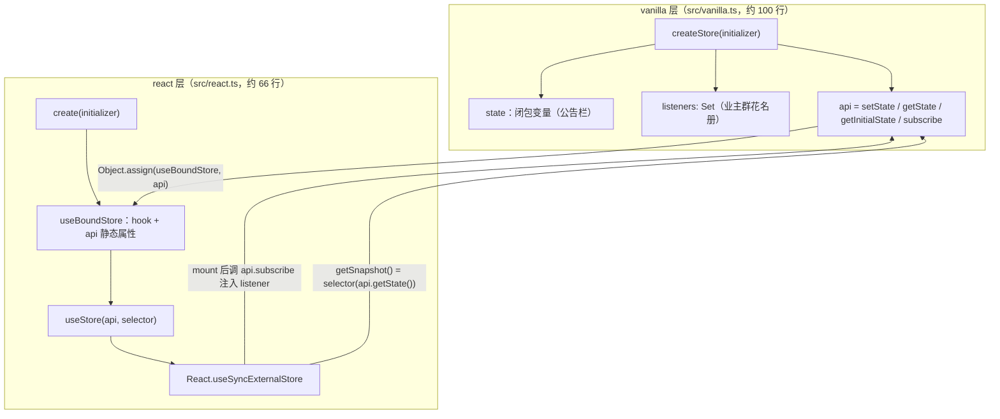
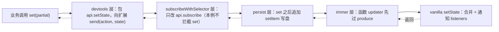
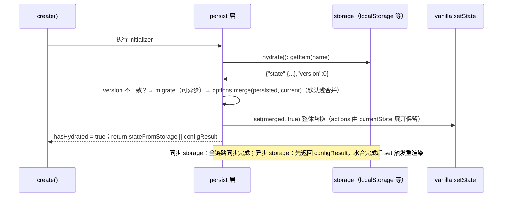
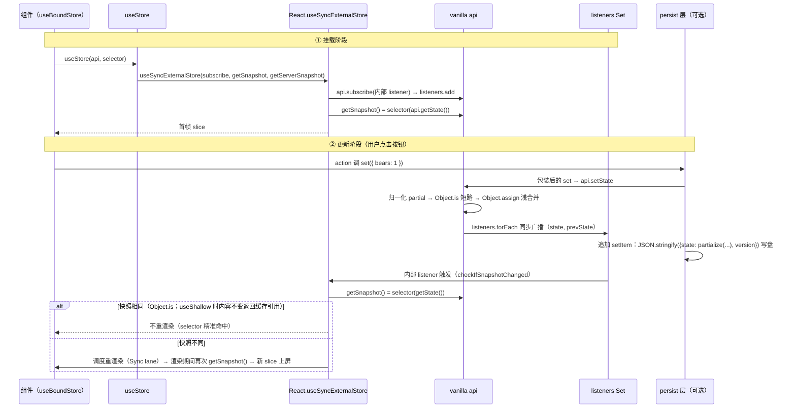

# 第 13 章 Zustand：200 行源码实现的轻量状态管理

> 上一章：[第 12 章 · Redux 状态管理](./12-redux.md) ｜ 下一章：[返回教程总目录](/)

> 本章基于 zustand `v5.0.8` 源码（pmndrs/zustand 仓库），核心文件只有两个：约 100 行的 `src/vanilla.ts` 与约 66 行的 `src/react.ts`——去掉类型声明，实现代码不到 200 行，这就是本章标题的由来。中间件位于 `src/middleware/` 下。

## 学习目标

读完本章，你应该能够：

1. 默写 `createStore` 的 vanilla 核心（state 闭包、`listeners: Set`、`setState` 合并/替换分支、`subscribe` 返回退订函数），并画出 `create → useBoundStore → useStore → React.useSyncExternalStore` 的桥接链路，指出 selector 在哪一步、以什么频率执行。
2. 解释「selector 每次返回新对象为什么会无限重渲染」，并基于 `useShallow` 与 `shallow` 的源码说明修复原理。
3. 说清中间件「洋葱模型」如何逐层包装 `set/get/api`，并能按拦截顺序排列 `devtools / persist / immer / subscribeWithSelector`。
4. 复述 persist 的 hydrate 时序（同步与异步 storage 的差异），以及 `partialize` / `merge` / `skipHydration` 的默认行为。
5. 读懂 `StateCreator<T, Mis, Mos, U>` 的柯里化与 `declare module` 类型增强，理解中间件类型如何一层层叠加到 store 上。

## 13.1 引入：Redux 的「重」与 Zustand 的「轻」

先用一个生活化类比定调，全章都会用到它：

- **Redux 像公司 OA 审批系统**。任何状态变更都要填申请单（action）、走审批流程（reducer）、抄送相关部门（middleware）、最后归档（store）。流程严谨、处处留痕，但改个计数器也要走完全套。
- **Zustand 像小区门口的公告栏 + 业主群**。公告栏（state）立在小区大门口，谁路过都能看；物业（`setState`）换完公告，在业主群（`listeners`）里 @所有人；每家每户（组件）只关心公告栏里跟自己有关的那一栏（selector），其它栏目换了与自己无关。

「不写 Provider 也能用」的秘密就藏在类比里：**公告栏装在小区大门口（模块级单例对象），而不是挨家挨户送信（React Context 逐层传递）**。`create()` 在模块作用域执行一次，产出一个普通 JS 对象；组件里的 hook 通过闭包直接引用它，根本不需要 Context 这根「传送带」。

对照同一个计数器在两边的样板代码量。Redux（即便用 RTK 精简过）：定义 slice（action + reducer）→ `configureStore` → 根部包 `<Provider>` → 组件里 `useSelector` + `useDispatch` 四步缺一不可。Zustand 则只有两步：

```tsx
export const useCounterStore = create<CounterState>((set) => ({
  value: 0,
  increment: () => set((s) => ({ value: s.value + 1 })),
}));
// 组件里直接用，没有 Provider，没有 dispatch，没有 action type
const value = useCounterStore((s) => s.value);
const increment = useCounterStore((s) => s.increment);
```

生态位一句话总结：Redux 强在**审计能力**（每个 action 可追踪、可回放）与**超大型团队的流程约束**；Zustand 强在**低心智成本**（会 `set` 就会用）、**组件外读写自由**与**极小的包体积**（核心 gzip 后 1KB 量级）。两者不互斥——13.6 会讲到 Zustand 的 devtools 中间件甚至直接桥接 Redux DevTools。

## 13.2 核心概念地图

Zustand 的源码在物理上只分两层：**vanilla 层**（框架无关，可以在 Node、Vue、Svelte 项目里用）与 **react 层**（把 vanilla store 桥接成 hook）。



先把名词对齐，后面不再重复：

- **`createStore(initializer)`**：vanilla 工厂，返回 `StoreApi`——`setState / getState / getInitialState / subscribe` 四个方法就是全部运行时 API；`state` 与 `listeners` 藏在闭包里，外界摸不到。
- **`create(initializer)`**：react 工厂。内部调 `createStore`，再造一个绑定了该 api 的 hook（`useBoundStore`，业务代码 import 的 `useXxxStore` 就是它），最后 `Object.assign` 把四个静态方法挂到 hook 上——所以它既是 hook 又是 store 本体（`useXxxStore.getState()` 合法）。
- **`useStore(api, selector)`**：真正的桥接函数，内部只有一步——调 React 18 内置的 `useSyncExternalStore`。
- **selector**：从完整 state 里「切一片」的函数，在 getSnapshot 里执行，决定组件对哪些变化敏感。

## 13.3 createStore：vanilla 层的 60 行实现

整个 vanilla 运行时浓缩在一个函数里。先完整贴出（去掉类型标注），再逐段拆解：

出处：src/vanilla.ts:60-98（zustand v5.0.8，createStoreImpl 全文）

```ts
const createStoreImpl: CreateStoreImpl = (createState) => {
  type TState = ReturnType<typeof createState>
  type Listener = (state: TState, prevState: TState) => void
  let state: TState
  const listeners: Set<Listener> = new Set()

  const setState: StoreApi<TState>['setState'] = (partial, replace) => {
    const nextState =
      typeof partial === 'function'
        ? (partial as (state: TState) => TState)(state)
        : partial
    if (!Object.is(nextState, state)) {
      const previousState = state
      state =
        (replace ?? (typeof nextState !== 'object' || nextState === null))
          ? (nextState as TState)
          : Object.assign({}, state, nextState)
      listeners.forEach((listener) => listener(state, previousState))
    }
  }

  const getState: StoreApi<TState>['getState'] = () => state

  const getInitialState: StoreApi<TState>['getInitialState'] = () =>
    initialState

  const subscribe: StoreApi<TState>['subscribe'] = (listener) => {
    listeners.add(listener)
    // Unsubscribe
    return () => listeners.delete(listener)
  }

  const api = { setState, getState, getInitialState, subscribe }
  const initialState = (state = createState(setState, getState, api))
  return api as any
}
```

读完的第一反应应该是：**就这？** 没有 event bus 库、没有 reducer 约定、没有不可变数据结构——一个闭包变量加一个 `Set`，就是状态管理的全部地基。下面逐段看。

### 13.3.1 state 闭包与 listeners Set

`let state`（src/vanilla.ts:63）是普通 `let` 闭包变量——不是 ref、不是 class 字段、不是 Proxy。公告栏本体就是一张普通的纸。`listeners`（src/vanilla.ts:64）用 `Set` 而不是数组，图两个性质：`add` / `delete` 都是 O(1)，且同一个 listener 引用天然去重。

### 13.3.2 setState：合并还是替换

src/vanilla.ts:66-82 这 17 行是全章核心，三步每一步都有讲究：

1. **归一化 partial + `Object.is` 短路**。`set({ bears: 1 })` 与 `set((s) => ({ bears: s.bears + 1 }))` 都合法——函数先求值；没有 action type、没有 switch 分派，updater 就是 reducer 的「极简版」。求值结果与当前 `state` 是同一引用（比如 `set(s => s)`）就直接返回，不更新也不通知，这是第一层廉价的 bailout。
2. **合并 or 替换的三元判断**——最值得背下来的一行：`replace ?? (typeof nextState !== 'object' || nextState === null)`。显式传 `replace = true` → 整体替换；没传 `replace` 且 `nextState` 是原始值或 `null` → 也整体替换（原始值没法 `Object.assign`）；其余情况 → `Object.assign({}, state, nextState)` **浅合并**一层。注意是浅合并：嵌套对象必须自己展开（`set(s => ({ user: { ...s.user, name: 'x' } }))`），或者交给 immer 中间件（13.6.5）。类比：默认是「只换公告栏上被涂改的那几栏」，`replace: true` 是「整块板子拆下来换新的」。
3. **同步广播**。`listeners.forEach` 逐个同步调用，新旧两份 state 都传过去。注意 `forEach` 没有容错：某个 listener 抛异常会中断后面的通知（易错点第 2 条呼应）。也没有「批处理」概念——通知是即时、同步的，渲染层的合并交给 React 调度器去做（第 6 章的自动批处理在这里依然生效）。

### 13.3.3 getState / getInitialState / subscribe

`getState` 就是 `() => state`（src/vanilla.ts:84）。`subscribe`（src/vanilla.ts:89-93）把 listener 加进 Set 并**返回一个退订函数**——这个签名不是随便定的，它精确匹配 `useEffect` 清理函数与 `useSyncExternalStore` 第一个参数的语义（13.4 会看到，React 拿到它后 mount 时调用、卸载时调返回值）。`getInitialState` 返回创建时的初始状态，是 SSR 场景的关键（13.4.2、13.7）。

### 13.3.4 一行两用：initialState 的诞生

`const initialState = (state = createState(setState, getState, api))`（src/vanilla.ts:96）是整个文件最「省墨水」的地方：调用 initializer（你的 `(set, get, api) => ({...})`），把返回值**同时**赋给 `state` 和 `initialState`。initializer 收到三件套，所以 actions 里才能 `set(...)`、`get().bears`，甚至 `api.subscribe(...)`。`return api as any` 里的 `as any` 也很诚实：运行时就这四个方法，中间件那些「类型上多出来的能力」全靠 TS 层面的 `Mutate` 变换（13.8），runtime 一无所知。

`createStore` 的导出（src/vanilla.ts:100-101）支持柯里化写法 `createStore<T>()(initializer)`，原因与 `create` 相同，见 13.8.4。

## 13.4 create 与 useStore：接入 React 的关键一步

### 13.4.1 create：给 store 装上 hook

出处：src/react.ts:55-63（zustand v5.0.8，createImpl 全文）

```ts
const createImpl = <T>(createState: StateCreator<T, [], []>) => {
  const api = createStore(createState)

  const useBoundStore: any = (selector?: any) => useStore(api, selector)

  Object.assign(useBoundStore, api)

  return useBoundStore
}
```

四行，每行都是设计决策：

1. `createStore(createState)` + 闭包：vanilla 层原样复用，`useBoundStore = (selector) => useStore(api, selector)` 把 `api` 焊死在 hook 里——业务代码不需要把 store 传来传去。
2. `Object.assign(useBoundStore, api)`：**全章最重要的一行 `Object.assign`**。函数在 JS 里是对象，四个静态方法直接挂上去，于是 `useCounterStore.getState()`、`setState(...)`、`subscribe(...)` 可以在事件回调、axios 拦截器、别的 store、测试代码里随意调用，完全脱离 React 渲染上下文。Redux 要做到这点得 `import { store }` 再 `store.dispatch(...)`，Zustand 把它变成了同一个入口。
3. `create` 导出（src/react.ts:65-66）支持 `create<T>()(initializer)` 双调用，纯类型原因，13.8.4 揭晓。

### 13.4.2 useStore：三行桥接

出处：src/react.ts:27-39（zustand v5.0.8，useStore 实现全文）

```ts
export function useStore<TState, StateSlice>(
  api: ReadonlyStoreApi<TState>,
  selector: (state: TState) => StateSlice = identity as any,
) {
  const slice = React.useSyncExternalStore(
    api.subscribe,
    React.useCallback(() => selector(api.getState()), [api, selector]),
    React.useCallback(() => selector(api.getInitialState()), [api, selector]),
  )
  React.useDebugValue(slice)
  return slice
}
```

还记得第 7 章讲的 `useSyncExternalStore(subscribe, getSnapshot, getServerSnapshot)` 契约吗？Zustand 把三个参数一个一个对上：

1. **`api.subscribe`**——订阅入口。mount 后 React 调用它，把内部 listener 塞进 `listeners` Set；卸载时调用返回值退订。
2. **`() => selector(api.getState())`**——getSnapshot。**selector 在这里、且只在这里执行**。每次 React 需要快照（首次渲染、store 通知后、组件自身重渲染时）都会调一次。v5.0.7 起用 `useCallback` 包了一层，13.5.5 讲为什么。
3. **`() => selector(api.getInitialState())`**——getServerSnapshot。SSR 与客户端 hydration 的首帧快照，刻意用「未水合」的初始状态，保证两端一致。末尾的 `React.useDebugValue(slice)` 只是让你在 React DevTools 里直接看到该组件订阅的 slice。

`useStore` 上面的两个重载（src/react.ts:18-25）只是类型把戏：不传 selector 时 `selector` 默认为 `identity`，返回完整 state——代价是任何字段变化都会重渲染（易错点第 6 条）。

### 13.4.3 v4 的桥法：useSyncExternalStoreWithSelector

如果你读过 v4 时代的源码解析文章，会看到另一个函数。v4.5.x 的 `useStore` 核心是这样的：

```ts
// v4.5.x src/react.ts（已不在 v5 主入口中）
// useSyncExternalStoreWithSelector 来自 'use-sync-external-store/shim/with-selector'
const slice = useSyncExternalStoreWithSelector(
  api.subscribe,
  api.getState,
  api.getServerState || api.getInitialState,
  selector,
  equalityFn,
)
```

`useSyncExternalStoreWithSelector`（来自 Meta 官方的 use-sync-external-store 兼容包）在原生 hook 之上多包了一层「**selector 结果记忆 + equalityFn 比较**」：缓存上次的 state 快照与 selector 结果，state 没变就复用旧 slice，变了还能用 `equalityFn` 决定是否沿用旧引用——v4 的 `useStore(api, selector, equalityFn)` 第三参数就是这么来的。v5 主入口把这层**拿掉了**：直接用 React 18 内置的 `useSyncExternalStore`，参数只剩 selector；想要 equalityFn 请走独立入口 `zustand/traditional`（src/traditional.ts:28-41），它仍然 import 那个 shim，签名与 v4 一致——**shim 没有消失，只是从主入口降级到了 traditional 子路径**。v5 敢这么做的底气有两个：peerDependencies 要求 React ≥ 18（内置 hook，不再需要 shim 兼容 16/17）；「结果记忆」的职责被下放给了用户侧的 `useShallow`——这正是下一节的主题。

### 13.4.4 为什么不需要 Provider

再收一次尾：store 是 `create()` 在模块作用域产出的普通对象，`useBoundStore` 通过闭包引用它；组件在树的任何位置 `import` 的都是同一份。React Context 只在「**一个页面要多个独立 store 实例**」（比如每个表单实例一份草稿）时才有意义。v4 提供的 `zustand/context` 辅助包在 v5 已移除，官方建议自己 `createContext` 存 api、再 `useStore(apiFromContext, selector)`——可见 Context 对 Zustand 只是可选的组织手段，不是数据通道。

## 13.5 selector 与浅比较

### 13.5.1 问题：每次返回新对象的 selector

Zustand 新手第一大坑：

```ts
// ❌ 危险写法
const { a, b } = useCounterStore((s) => ({ a: s.a, b: s.b }));
```

回忆 `useSyncExternalStore` 的核心不变量：**store 没变时，getSnapshot() 必须返回与上次 `Object.is` 相等的值**。上面的 selector 每次执行都构造一个新对象字面量，后果有两层：**优化失效**——store 里任何字段变化（哪怕与 a、b 无关）都让新旧快照 `Object.is` 为 false，selector 形同虚设，等于全量订阅；**可能死循环**——渲染期间 React 反复校验快照一致性，快照每次都不一样，开发环境警告 `The result of getSnapshot should be cached to avoid an infinite loop`，并发模式下可能陷入「渲染 → 快照不同 → 再渲染」的循环。

类比：业主关心「车位费」和「物业费」两栏，但他的抄法（selector）每次都产出一张**新纸**（新对象引用），而物业的比对工具（`Object.is`）只认纸张不认内容——哪怕一字不差，只要纸是新的就当「公告变了」。

### 13.5.2 三种正确姿势

```ts
// ① 选原始值：原始值的 Object.is 按值比较，天然安全
const count = useCounterStore((s) => s.count);
// ② 选 state 里已有的引用：引用本身稳定，只有被 set 换掉才变
const user = useCounterStore((s) => s.user);
// ③ 多字段：用 useShallow 包一层
import { useShallow } from 'zustand/shallow';
const { a, b } = useCounterStore(useShallow((s) => ({ a: s.a, b: s.b })));
```

v5 中 `shallow` 与 `useShallow` 都从 `'zustand/shallow'` 导出，`src/shallow.ts` 只做两件再导出（`export { shallow } from './vanilla/shallow.ts'` 与 `export { useShallow } from './react/shallow.ts'`）。

### 13.5.3 useShallow 源码：一个 ref 解决所有问题

出处：src/react/shallow.ts:4-12（zustand v5.0.8，全文）

```ts
export function useShallow<S, U>(selector: (state: S) => U): (state: S) => U {
  const prev = React.useRef<U>(undefined)
  return (state) => {
    const next = selector(state)
    return shallow(prev.current, next)
      ? (prev.current as U)
      : (prev.current = next)
  }
}
```

- `prev` 是跨渲染存活的 ref，缓存「上次返回给 React 的那个 slice」；每次 getSnapshot 触发，先执行包装 selector 算出 `next`。
- `shallow(prev.current, next)` 为 true（内容逐项相等）→ 返回**旧引用** `prev.current`，React 拿到的快照与上次 `Object.is` 相等 → 不重渲染，缓存契约满足。
- 内容真的变了 → 更新 ref 并返回 `next`。

类比：业主带了本笔记本（ref），每次抄完两栏先对照上一次的记录，一字不差就把旧纸条重新贴回去——楼上的人（React）一看还是那张纸，就不折腾了。

### 13.5.4 shallow：只比一层

出处：src/vanilla/shallow.ts:46-74（zustand v5.0.8，shallow 函数主体）

```ts
export function shallow<T>(valueA: T, valueB: T): boolean {
  if (Object.is(valueA, valueB)) return true
  if (typeof valueA !== 'object' || valueA === null ||
      typeof valueB !== 'object' || valueB === null) return false
  if (Object.getPrototypeOf(valueA) !== Object.getPrototypeOf(valueB)) return false
  if (isIterable(valueA) && isIterable(valueB)) {
    if (hasIterableEntries(valueA) && hasIterableEntries(valueB)) {
      return compareEntries(valueA, valueB)   // Map/Set：键都存在且值 Object.is
    }
    return compareIterables(valueA, valueB)   // 数组等：按序逐项 Object.is
  }
  // assume plain objects：用 Object.entries 包一层复用 compareEntries
  return compareEntries(
    { entries: () => Object.entries(valueA) },
    { entries: () => Object.entries(valueB) },
  )
}
```

比较流程五步走：`Object.is` 直接通过（同引用/相等原始值）→ 任一方非对象或 `null` 判 false → **原型不同**判 false（class 实例与字面量不混比）→ 两者可迭代时，有 `entries`（Map、Set）走 `compareEntries`（键都存在且值 `Object.is`），否则走 `compareIterables`（数组按序逐项 `Object.is`）→ 普通对象用 `Object.entries` 包一层复用 `compareEntries`。所谓「浅」就是只比第一层：`{ user: { name: 'x' } }` 里 `user` 的引用变了就判不同，不会递归进 `name`——所以深层嵌套的 state 要么靠 immer 保证引用逐层更新、要么把 selector 切得更细。

### 13.5.5 v5.0.7 的 useCallback 插曲

对比 v5.0.0–v5.0.6 与 v5.0.7+ 的 `useStore`，差异只有一处：getSnapshot / getServerSnapshot 从裸箭头函数变成了 `React.useCallback(..., [api, selector])`（见 13.4.2 引用的 src/react.ts:32-36），作用是**稳定快照函数的身份**，避免 `useSyncExternalStore` 内部因 getSnapshot 身份每次渲染都变化而多做无效的订阅级检查。但请注意一个常见误读：如果你传的是**内联 selector**（每次渲染都是新函数），`useCallback` 的依赖 `[api, selector]` 每次都变，getSnapshot 依然是新身份——这并没有问题。真正的硬约束从来不是「快照函数身份稳定」，而是 13.5.3 解决的「**快照值引用稳定**」：`useShallow` 返回的 selector 每次渲染也是新函数，但它返回的 slice 引用稳定，所以一切正常。

## 13.6 中间件系统

### 13.6.1 本质：包装 StateCreator 的洋葱

中间件的签名统一为 `(initializer, options) => (set, get, api) => state`。它是一个**高阶 StateCreator**：接收内层的 `set / get / api`，可以包 `setState`（拦截写）、包 `subscribe`（拦截订阅）、在 `api` 上挂新方法、修改 initializer 的返回值，然后把自己的返回值交给更外层。层层嵌套形成洋葱：



常见推荐写法 `devtools(subscribeWithSelector(persist(immer(config))))`。**顺序是有语义的**：`devtools` 放最外，才能记录到「业务视角」的 action 名与最终 state；`immer` 放最内，它改变了 updater 的形态（允许 mutate 草稿），必须先被内层接纳；`persist` 在 `immer` 之外，写盘拿到的是 immer 产出的不可变结果。顺序写反不一定报错，但会出现 action 名丢失、写盘内容不对之类的暗病。

### 13.6.2 combine：一行源码的组织术

出处：src/middleware/combine.ts:5-16（zustand v5.0.8，全文核心）

```ts
export function combine<T extends object, U extends object, Mps ..., Mcs ...>(
  initialState: T, create: StateCreator<T, Mps, Mcs, U>,
): StateCreator<Write<T, U>, Mps, Mcs> {
  return (...args) => Object.assign({}, initialState, (create as any)(...args))
}
```

实现只有 `return` 那一行：执行 initializer 得到 actions，再与 `initialState` 浅合并。它不动 `set/get/api`，价值在于**写法与类型推断**——数据与 actions 分开声明，`Write<T, U> = Omit<T, keyof U> & U` 自动合成完整 store 类型。

### 13.6.3 subscribeWithSelector：只改 subscribe

出处：src/middleware/subscribeWithSelector.ts:52-75（zustand v5.0.8，实现核心）

```ts
const origSubscribe = api.subscribe as (listener: Listener) => () => void
api.subscribe = ((selector: any, optListener: any, options: any) => {
  let listener: Listener = selector // if no selector
  if (optListener) {
    const equalityFn = options?.equalityFn || Object.is
    let currentSlice = selector(api.getState())
    listener = (state) => {
      const nextSlice = selector(state)
      if (!equalityFn(currentSlice, nextSlice)) {
        const previousSlice = currentSlice
        optListener((currentSlice = nextSlice), previousSlice)
      }
    }
    if (options?.fireImmediately) optListener(currentSlice, currentSlice)
  }
  return origSubscribe(listener)
}) as any
```

手法与 13.5 的 `useShallow` 一脉相承：**闭包缓存 `currentSlice`，每次通知时用 `equalityFn`（默认 `Object.is`）比较切片，变了才回调**。`fireImmediately: true` 在订阅当下立即触发一次。注意它完全没碰 `setState`——洋葱模型里每层只拦截自己关心的面；最后 `origSubscribe(listener)` 仍然复用 vanilla 的 Set 机制。典型用法是组件外监听特定字段，比如 token 变化时刷新 axios 请求头：`useUserStore.subscribe(s => s.token, (token) => {...}, { fireImmediately: true })`。

### 13.6.4 devtools：桥接 Redux DevTools Extension

出处：src/middleware/devtools.ts:205-240（zustand v5.0.8，api.setState 包装段，节选）

```ts
;(api.setState as any) = ((state, replace, nameOrAction: Action) => {
  const r = set(state, replace as any)
  if (!isRecording) return r
  const action: { type: string } =
    nameOrAction === undefined
      ? { type: anonymousActionType || findCallerName(new Error().stack) || 'anonymous' }
      : typeof nameOrAction === 'string' ? { type: nameOrAction } : nameOrAction
  // store 选项开启时按 `${store}/${action.type}` 前缀上报多 store 聚合状态；否则直接上报当前 state
  connection?.send(action, get())
  return r
}) as NamedSet<S>
```

拆解这层包装：

- **探测与连接**：`window.__REDUX_DEVTOOLS_EXTENSION__` 不存在（或 `enabled: false`）时直接 `return fn(set, get, api)`，零开销透传；存在则 `connect(options)` 建连接，`store` 选项支持多 store 共用一个连接（内部维护 `trackedConnections` Map）。
- **拦截每次 set 并命名 action**：先 `set(state, replace)` 完成真实更新，再按 `isRecording` 决定是否 `connection.send(action, get())` 上报——你在 Redux DevTools 里看到的每条 action 就是这里 send 的消息。命名：`set({ bears: 1 }, false, 'addBear')` 第三参显式指定；不传时 `findCallerName` 解析 `Error().stack` 找调用者函数名，兜底 `'anonymous'`。
- **时间旅行**：`connection.subscribe` 监听扩展回放的 `DISPATCH / RESET / ROLLBACK / JUMP_TO_STATE` 消息，用 `setStateFromDevtools` 回写状态——回写前把 `isRecording` 置 false，避免「回放的动作又被记录一次」形成回声。

### 13.6.5 immer：只包一层 setState

出处：src/middleware/immer.ts:77-90（zustand v5.0.8，实现核心）

```ts
const immerImpl: ImmerImpl = (initializer) => (set, get, store) => {
  store.setState = (updater, replace, ...args) => {
    const nextState =
      typeof updater === 'function' ? produce(updater as any) : updater
    return set(nextState, replace as any, ...args)
  }
  return initializer(store.setState, get, store)
}
```

比 devtools 更薄：函数形态的 updater 先过 immer 的 `produce`——把「在草稿上原地改」转成「返回新对象」的纯函数——再交给内层 `set`。initializer 拿到的是包装后的 `store.setState`，所以 actions 里可以放肆地写 `set((draft) => { draft.bears += 1 })`。类比：物业允许你直接在公告草稿上涂涂改改，誊抄成正式公告的活由 immer 代劳。

## 13.7 persist 中间件深潜

persist 是最常用的中间件，也是源码量最大的一个（含类型约 430 行）。它要回答三个问题：**存哪、怎么存、什么时候读回来**。

### 13.7.1 两层 storage 接口与 createJSONStorage

出处：src/middleware/persist.ts:6-21（zustand v5.0.8）

```ts
export interface StateStorage<R = unknown> {
  getItem: (name: string) => string | null | Promise<string | null>
  setItem: (name: string, value: string) => R
  removeItem: (name: string) => R
}
export type StorageValue<S> = { state: S; version?: number }
```

接口分两层：`StateStorage` 是原始字符串 KV（`localStorage`、`AsyncStorage` 都长这样）；`PersistStorage` 存的是带版本号的 `StorageValue`。`createJSONStorage`（src/middleware/persist.ts:30-66）负责把前者桥接成后者，两个细节：

1. **`getStorage()` 惰性调用且包在 try/catch 里**——SSR 环境访问 `localStorage` 会抛 `ReferenceError`，这里兜住并返回 `undefined`，persist 主流程据此降级（见下）。这就是为什么必须写 `createJSONStorage(() => localStorage)` 而不是直接传 `localStorage`（易错点第 4 条）。
2. **同步/异步通吃**：`getItem` 返回 Promise 就 `.then(parse)`，否则直接 `JSON.parse`——`AsyncStorage` 与 `localStorage` 同一套代码。序列化统一 `JSON.stringify / parse`，可注入 `replacer / reviver` 处理 Date 等特殊类型（函数、Map、Set 默认丢弃，易错点第 7 条）。

### 13.7.2 persistImpl 主流程

出处：src/middleware/persist.ts:212-388（zustand v5.0.8，persistImpl，节选合并）

```ts
const persistImpl: PersistImpl = (config, baseOptions) => (set, get, api) => {
  let options = { storage: createJSONStorage<S, void>(() => localStorage),
    partialize: (state: S) => state, version: 0,
    merge: (persistedState, currentState) => ({ ...currentState, ...persistedState }),
    ...baseOptions }
  let hasHydrated = false
  let storage = options.storage
  if (!storage) {
    // SSR 降级：包一个「打警告后照常 set」的 set，不做持久化
    return config((...args) => { console.warn(...); set(...args) }, get, api)
  }
  const setItem = () =>
    storage.setItem(options.name, { state: options.partialize({ ...get() }), version: options.version })
  const savedSetState = api.setState
  api.setState = (state, replace) => { savedSetState(state, replace as any); return setItem() }
  const configResult = config((...args) => { set(...args); return setItem() }, get, api)
  api.getInitialState = () => configResult
  if (!options.skipHydration) hydrate()   // hydrate 见下
  return stateFromStorage || configResult
}
```

按执行顺序拆解：

1. **默认 options**：默认存 `localStorage`；`partialize` 默认恒等（存整个 state）；`version` 默认 0；`merge` 默认**浅合并** `{...current, ...persisted}`——嵌套对象会被整个覆盖，深合并要自己传 `merge`。storage 缺失（SSR）时直接降级为「打警告的 set」，不持久化也不 hydrate。
2. **包装两处 set**：`api.setState` 与传给 config 的 `set` 都在更新后追加一次 `setItem()`——公告栏每换一次，物业顺手抄一份进档案柜。包两处是因为 actions 里拿到的 `set` 是后者，外部 `useStore.setState` 是前者。
3. **`api.getInitialState = () => configResult`**：把 SSR 首帧快照固定为「未水合」的初始态，否则 hydration 首帧与服务端 HTML 不一致，React 报 hydration mismatch。
4. **hydrate()**：下一小节单独看；`skipHydration: true` 时不自动执行，留给 SSR 场景手动 `api.persist.rehydrate()`。
5. **`return stateFromStorage || configResult`**：源码注释写明这是 workaround——同步 storage 下 `hydrate()` 同步执行完，水合态已通过 `set(..., true)` 写进闭包；但 vanilla 的 `state = createState(...)` 赋值发生在 initializer return 之时会覆盖它，所以水合态必须作为返回值「带出去」。

### 13.7.3 hydrate 的时序

出处：src/middleware/persist.ts:275-352（zustand v5.0.8，hydrate 函数，节选）

```ts
const hydrate = () => {
  if (!storage) return
  hasHydrated = false
  hydrationListeners.forEach((cb) => cb(get() ?? configResult))
  const postRehydrationCallback =
    options.onRehydrateStorage?.(get() ?? configResult) || undefined
  return toThenable(storage.getItem.bind(storage))(options.name)
    .then((deserializedStorageValue) => {
      // version 不一致：有 migrate 就迁移（支持 Promise），否则 console.error
      if (deserializedStorageValue) { /* ...版本比对与 migrate... */ }
      return [false, undefined] as const
    })
    .then(([migrated, migratedState]) => {
      stateFromStorage = options.merge(migratedState as S, get() ?? configResult)
      set(stateFromStorage as S, true)   // 整体替换写入
      if (migrated) return setItem()     // 迁移结果回写，版本升级落地
    })
    .then(() => {
      postRehydrationCallback?.(stateFromStorage, undefined)
      stateFromStorage = get()
      hasHydrated = true
      finishHydrationListeners.forEach((cb) => cb(stateFromStorage as S))
    })
    .catch((e: Error) => postRehydrationCallback?.(undefined, e))
}
```

`toThenable`（src/middleware/persist.ts:172-210）把「同步返回值」和「Promise」统一成 thenable 链——**同步 storage 下整条 `.then` 链是同步执行的**，这是 `localStorage` 首帧即水合态、无闪烁的原因；异步 storage（如 AsyncStorage）则先以初始态渲染，水合完成后 `set` 触发重渲染，会有可见跳变：



`api.persist` 上还挂着一组运行时方法（src/middleware/persist.ts:354-382）：`rehydrate()` 手动触发、`hasHydrated()` 查询、`onHydrate / onFinishHydration` 订阅水合开始/结束、`setOptions` 动态改配置、`clearStorage` 清盘。异步 storage 或 SSR 场景里，用 `hasHydrated` 门控首屏渲染是消除闪烁的常规手段。

### 13.7.4 partialize 白名单

`partialize` 默认 `(state) => state` 全量持久化；actions 是函数，`JSON.stringify` 天然丢弃，不用特殊处理。只想存少数字段就写 `partialize: (s) => ({ token: s.token })`。注意白名单**同时影响水合**：读回来的对象只有白名单字段，经默认 `merge` 浅合并到 currentState 上，其余字段保持代码里的初始值。`version` + `migrate` 用于 schema 演进：版本号不匹配时调用 `migrate(persistedState, oldVersion)`，迁移结果会回写 storage 落地。

## 13.8 TypeScript 类型流

Zustand 的 runtime 不到 200 行，但类型占了大半篇幅——「用了 persist 之后 `useStore.persist.rehydrate()` 自动有类型」这件事，全靠类型层的机关。

### 13.8.1 StateCreator 的四个类型参数

出处：src/vanilla.ts:28-37（zustand v5.0.8）

```ts
export type StateCreator<
  T,
  Mis extends [StoreMutatorIdentifier, unknown][] = [],
  Mos extends [StoreMutatorIdentifier, unknown][] = [],
  U = T,
> = ((
  setState: Get<Mutate<StoreApi<T>, Mis>, 'setState', never>,
  getState: Get<Mutate<StoreApi<T>, Mis>, 'getState', never>,
  store: Mutate<StoreApi<T>, Mis>,
) => U) & { $$storeMutators?: Mos }
```

- `T`：store 的完整状态类型；`U`：返回值类型（`combine` 用它实现数据/actions 分离推断）。
- `Mis`（mutators in）：传到这一层时**已经应用**的中间件列表，决定 `set/get/api` 当前的类型形态；`Mos`（mutators out）：这一层 initializer **向外声明**「我依赖哪些中间件能力」。
- `& { $$storeMutators?: Mos }`：**幻影字段**，runtime 不存在，只为把 `Mos` 挂在函数类型上，供外层中间件提取。

### 13.8.2 Mutate 递归查表

出处：src/vanilla.ts:20-26（zustand v5.0.8）

```ts
export type Mutate<S, Ms> = number extends Ms['length' & keyof Ms]
  ? S
  : Ms extends []
    ? S
    : Ms extends [[infer Mi, infer Ma], ...infer Mrs]
      ? Mutate<StoreMutators<S, Ma>[Mi & StoreMutatorIdentifier], Mrs>
      : never
```

把 mutator 元组逐层剥开：取出头元素 `[Mi, Ma]`，去 `StoreMutators<S, Ma>` 这张**全局表**里查 key `Mi` 对应的类型变换，递归处理剩余部分。`[['zustand/persist', A], ['zustand/devtools', B]]` 就这样一层层叠到 `StoreApi` 上。

### 13.8.3 模块声明增强（module augmentation）的「注册表」魔法

这张 `StoreMutators` 表出生时是个空接口（src/vanilla.ts:39-40，代码为 `export interface StoreMutators<S, A> {}`），每个中间件用 `declare module` 往表里注册自己。persist 的注册（src/middleware/persist.ts:400-404）：

```ts
declare module '../vanilla' {
  interface StoreMutators<S, A> {
    'zustand/persist': WithPersist<S, A>
  }
}
```

devtools 注册 `'zustand/devtools'`、immer 注册 `'zustand/immer'`、subscribeWithSelector 注册 `'zustand/subscribeWithSelector'`，手法完全相同。TS 的接口合并让这张表**随 import 自动生长**——你只 import 了 persist，类型表里就只有 persist；这正是 `StoreMutatorIdentifier = keyof StoreMutators<unknown, unknown>` 能约束合法中间件名的原理。

### 13.8.4 为什么必须写 `create<T>()(...)`

最后回答用法层面的疑问：为什么带中间件时要写成 `create<BearState>()(persist(...))` 这种柯里化形式？因为 TS 无法在**同一次调用**里「一部分类型参数显式指定、另一部分从实参推断」。`create<T>()` 先固定 `T`，第二个调用再从 initializer 反推 `Mos`——这就是 `Create` 类型里双调用签名的全部理由（runtime 侧的实现同样朴素：`createState ? createImpl(createState) : createImpl`，见 src/react.ts:65-66）。效果立竿见影：有 persist，`useStore.persist.rehydrate()`、`hasHydrated()` 类型齐全；把 persist 删掉，`persist` 属性立刻从类型上消失，编译器逼着你清理残留调用。

## 端到端流程串讲



把开头的问题逐一回收：

1. **「不写 Provider 也能用」**：store 是模块级单例，hook 闭包直连（13.1、13.4.4）。
2. **selector 在哪执行、执行几次**：在 getSnapshot 里；首次渲染、每次 store 通知、组件自身重渲染时都会执行（13.4.2）。
3. **为什么新对象 selector 会死循环**：getSnapshot 返回值引用不稳定，违反 useSyncExternalStore 的缓存契约（13.5.1）；`useShallow` 用 ref 缓存 + shallow 比较根治（13.5.3）。
4. **中间件做了什么**：洋葱式包装 `set/get/api`，各层只拦截自己关心的面（13.6）；persist 额外接管了初始化时序（13.7）。

## 版本勘误 📌

网上大量「Zustand 源码解析」停留在 v4 甚至 v3，与 v5 的实际实现对不上。以下以官方迁移指南与 v4.5.x → v5.0.8 源码对比为准：

- **v4 → v5 移除 default export 与两个 deprecated 用法**：`import create from 'zustand'` 彻底删除，只剩 `import { create } from 'zustand'`；`create(vanillaStore)` 直接传 store 的写法移除（改用 `createStore` + `useStore`）；`zustand/context` 子包移除（多实例改为自建 React Context）。
- **v4 → v5 移除 `useStore` / `create` 的第三参数 `equalityFn`**：v4.5.x 源码里调用即 `console.warn`（指向 discussions/1937）；v5 主入口只剩 `Object.is` 语义，需要 equalityFn 请改用 `zustand/traditional` 的 `useStoreWithEqualityFn` / `createWithEqualityFn`。
- **桥接实现换代**：v4 主入口用 `use-sync-external-store/shim/with-selector` 的 `useSyncExternalStoreWithSelector`（可兼容 React 16.8/17），SSR 快照是 `api.getServerState || api.getInitialState`；v5 主入口直接用 React 18 内置 `React.useSyncExternalStore`（peerDependencies 要求 ≥18，旧 React 请停留 v4 或用 traditional 入口），SSR 快照统一为 `getInitialState()`（persist 会覆写它保证 hydration 一致，13.7.2 第 3 步），shim 只保留在 `zustand/traditional`。所以「Zustand 靠 useSyncExternalStoreWithSelector 做 selector 比较」这句话对 v5 主入口已经不成立——比较只剩 `Object.is`，「记忆化」由 `useShallow` 在用户侧完成。
- **类型体系重构**：v5 的 `StateCreator` 带 `$$storeMutators` 幻影字段、`Mutate` 递归查 `StoreMutators` 表；v3 及更早的中间件类型写法（手写交叉类型）已不适用。
- **v5.0.7 行为微调**：`useStore` 的 getSnapshot / getServerSnapshot 改用 `React.useCallback(..., [api, selector])` 稳定函数身份（13.5.5），此前版本每次渲染都是新箭头函数。

## 初学者易错点 ⚠️

1. **selector 每次返回新对象/数组**。`useStore(s => ({ a: s.a, b: s.b }))` 使 getSnapshot 引用永不稳定：轻则 selector 优化全废（任何变化都重渲染），重则触发 `The result of getSnapshot should be cached to avoid an infinite loop`。正解：选原始值、选已有引用，或 `useShallow`（13.5）。
2. **在 render 期间或 subscribe 回调里同步 set**。渲染中调 `set(...)` 触发 listeners 同步广播，React 报 `Cannot update a component while rendering a different component`；listener 是 `forEach` 同步逐个调用的，回调里再 `set` 会立刻开始新一轮广播，形成级联甚至死循环，某个 listener 抛异常还会中断后续 listener。状态写入永远放事件回调或 effect 里，回调里要异步化（`queueMicrotask` / `setTimeout`）。
3. **persist 的 hydration 跳变/闪烁**。异步 storage（AsyncStorage）或 SSR 场景下，首帧是初始态、水合后突然跳变；`localStorage` 纯 CSR 无此问题（hydrate 同步完成）。解法：`hasHydrated()` 门控首屏、`onFinishHydration` 回调，或 `skipHydration` + 手动 `rehydrate()`（13.7.3）。
4. **SSR 下直接传 storage**。写 `storage: localStorage` 在 Node 环境模块加载时就 `ReferenceError`；必须 `createJSONStorage(() => localStorage)` 惰性获取——源码的 try/catch 只兜得住「函数调用」，兜不住「实参求值」（13.7.1）。
5. **以为 set 是深合并**。默认只 `Object.assign` 浅合并一层，嵌套对象要自己展开或用 immer；`set(newState, true)` 整体替换更会把 state 里的 actions 一起覆盖掉——persist 的 hydrate 用 `set(x, true)` 之所以安全，是因为默认 `merge` 把 currentState（含 actions）展开在前面（13.3.2、13.7.2）。
6. **全量订阅**。`useStore()` 不传 selector（等价于 `useStore(s => s)`）会让组件对任何变化重渲染；应按需切片。组件外纯读数据用 `useStore.getState()`，不要为它订阅。
7. **persist 存不可序列化的值**。函数、`Map`/`Set`、循环引用经 `JSON.stringify` 会丢失或直接抛错；需要自定义 storage 或配合 superjson 一类的序列化方案（13.7.1 的 replacer/reviver 是官方留的口子）。

## 本章小结

- Zustand 的全部运行时地基是 vanilla 层的一个闭包变量 `state` 加一个 `listeners: Set`；`setState` 负责归一化 partial、`Object.is` 短路、按 `replace ?? (typeof nextState !== 'object' || nextState === null)` 决定替换或浅合并，然后同步广播（src/vanilla.ts:60-98）。
- react 层只做两件事：`createImpl` 里 `Object.assign(useBoundStore, api)` 让 hook 同时拥有四个静态方法；`useStore` 把 `api.subscribe`、`() => selector(api.getState())`、`() => selector(api.getInitialState())` 对到 `React.useSyncExternalStore` 的三个参数上（src/react.ts:27-66）。
- v5 主入口的 selector 比较只有 `Object.is`；「selector 结果记忆」由 `useShallow`（ref 缓存 + `shallow` 浅比较）在用户侧完成——这是 v4 的 `useSyncExternalStoreWithSelector` 下放后的新分工。
- 中间件是包装 `StateCreator` 的洋葱：devtools 包 `setState` 上报 Redux DevTools、persist 包 `setState` 写盘并接管初始化水合、immer 把函数 updater 过 `produce`、subscribeWithSelector 只改 `subscribe`、combine 只合并返回值。
- persist 的同步/异步双模靠 `toThenable` 统一：同步 storage 首帧即水合态，异步 storage 需要 `hasHydrated` 门控；`partialize` 白名单、`version` + `migrate` 演进是常规武器。类型层的魔法是「空接口 + `declare module` 增强」：`StoreMutators` 注册表随 import 生长，`Mutate` 递归查表叠加能力，`create<T>()(...)` 柯里化绕开 TS 的推断限制。

## 与 Redux 对照速查表

| 维度 | Redux（RTK） | Zustand v5 |
| --- | --- | --- |
| 核心代码量 | RTK + react-redux 数千行 | vanilla + react ≈ 170 行实现 |
| 更新范式 | `dispatch(action)` → reducer 纯函数（immer 内置） | `set(partial)` 直接浅合并 / 替换（immer 可选） |
| React 绑定 | 必须 `<Provider>` + `useSelector` | 无需 Provider，hook 闭包直连模块级 store |
| 组件外读写 | `store.dispatch` / `store.getState`（需 import store） | `useXxxStore.setState / getState` 同一入口 |
| 中间件模型 | 串联包装 `dispatch`；DevTools 原生 | 洋葱式包装 `StateCreator`（set/get/api）；`devtools` 中间件桥接同一扩展 |
| 持久化 | 外挂 redux-persist | `persist` 中间件自带（含 migrate/partialize） |
| 渲染优化 | `useSelector` + 默认 `Object.is` / `shallowEqual` | selector + `Object.is`，多字段用 `useShallow` |
| 何时选它 | 大型团队、强审计/时间旅行、复杂异步编排（saga）、跨端统一协议 | 中小项目、追求低心智成本、组件外交互多、包体积敏感 |

## 返回总目录

[返回教程总目录](/)

React 篇到此结束。从第 1 章的架构总览到本章的 Zustand，我们沿着「触发更新 → 调度 → 协调 → 提交」的主线走完了 React 19 的内核，最后用两个状态管理库收束——Redux 的「申请单 + 审批流」与 Zustand 的「公告栏 + 业主群」都只是第 6 章那条更新链路的两种上层封装。接下来进入 **Vue 篇**：第 14 章从 Vue 3.5 的响应式系统讲起（`ref` / `reactive` 的依赖收集与触发）。带着本章的类比去读会很有意思：Vue 把「订阅关系」藏进 Proxy 的 get/set 拦截里，做到全自动、近乎无形；Zustand 则把订阅关系摆在明处，selector 写什么就订阅什么——两种哲学，刚好互为镜像。
