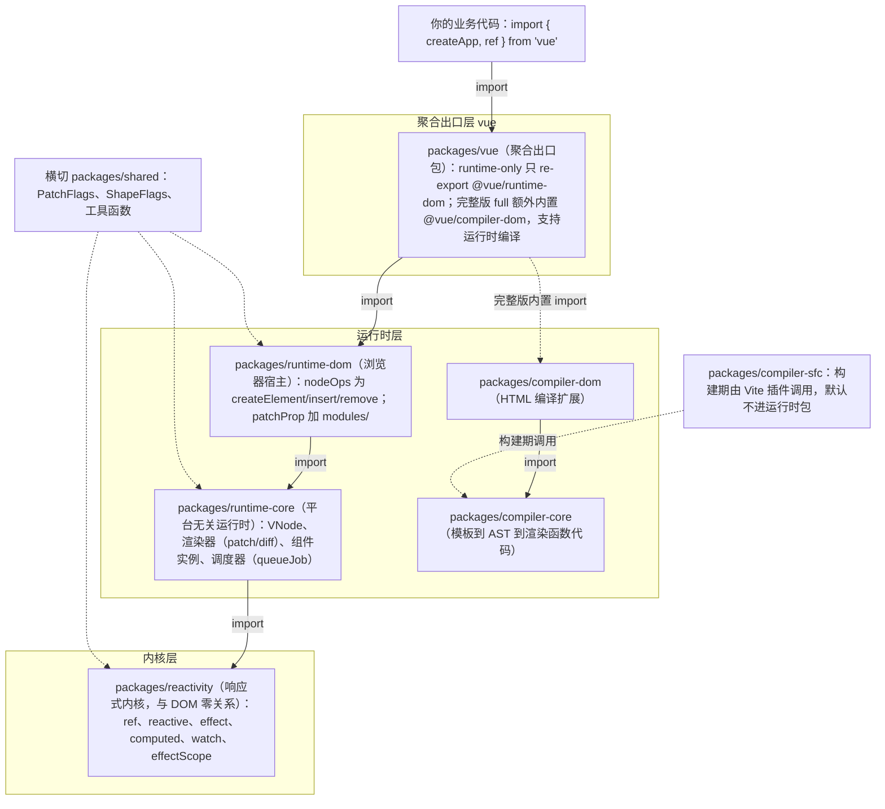
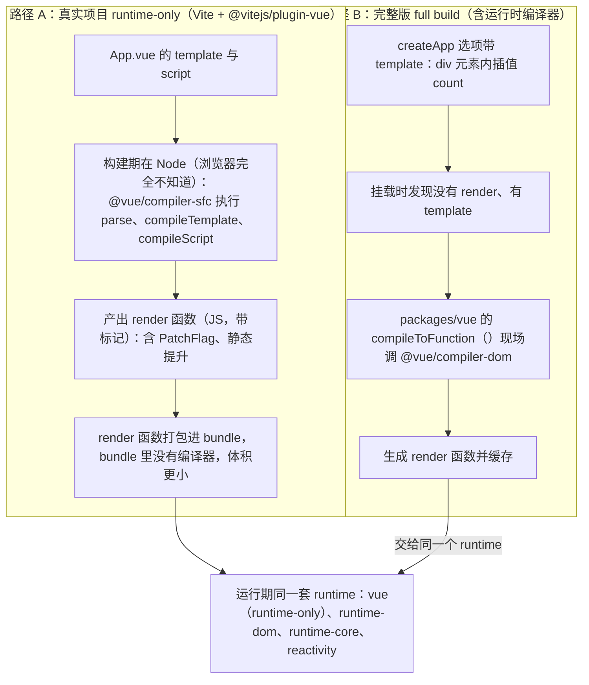
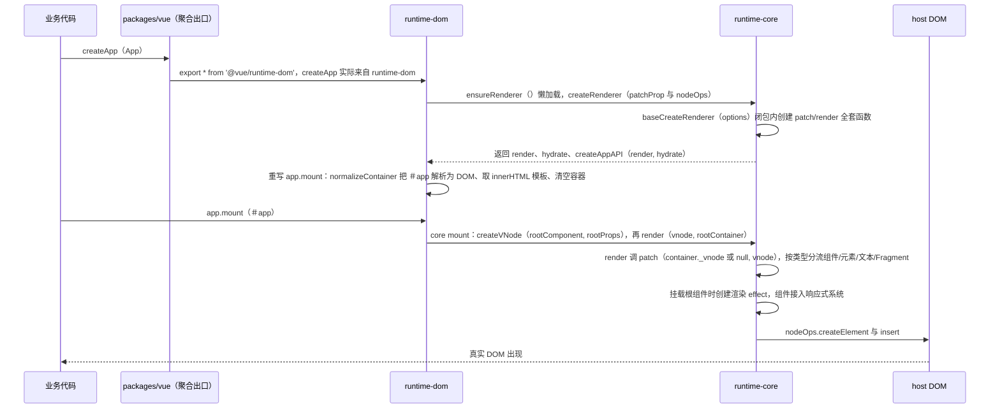

# 第 1 章 架构总览：站在一万米高空看 Vue 3.5

> 导航：[教程总目录](../../README.md) ｜ 上一章：无（本章是第 1 章）｜ [下一章：响应式系统（Vue 3.5 重头戏）](./02-reactivity.md)

## 学习目标

读完本章，你应该能够：

1. 说出 Vue 3.5 源码 `packages/` 下每个核心包的职责与依赖方向；
2. 区分「构建期编译」和「运行时编译」，明白真实项目为什么用 runtime-only 构建；
3. 理解「编译器与运行时协同设计」，知道 `PatchFlag` 是干什么的；
4. 默写出 `createApp(App).mount('#app')` 跨 4 个包的完整调用链；
5. 拿到一张 Vue 3.5 相比旧版本的整体差异地图。

---

## 1.1 先别急着读源码：你是不是也有这些困惑

你可能用 Vue 写了一年业务：`ref`、`reactive`、`watch`、`<template>` 很熟，但一想到读源码就发怵。常见三个恐惧：**文件太多**（十几个包不知道从哪下手）；**概念太绕**（运行时/编译器/完整版/runtime-only，Vite 里跑的和 CDN 的 `vue.global.js` 是同一个东西吗）；**怕读旧知识**（很多文章基于 3.0～3.2，而响应式内核在 3.5 被**整体重构**过）。

本章只做一件事：**给你一张地图**。阅读版本在仓库 `package.json` 中标注为 `3.5.43`：

出处：package.json:3（Vue 3.5.43）—— [package.json](file:///Users/yangzhijie/Desktop/practice_projects/claude-code-test/react-vue-source-deep-dive/sources/vue/package.json#L3-L3)

```json
{ "version": "3.5.43" }
```

贯穿全书的类比：把 Vue 想象成一家**餐厅**。`compiler` 是「中央厨房」，开店前（构建期）把食材洗好切好、贴好标签（PatchFlag）；`runtime` 是「前厅 + 厨师」，按标签快速出菜（更新 DOM）；`reactivity` 是「传菜铃系统」——哪个菜状态变了自动通知相关的人，不需要厨师每隔一秒去厨房问一遍（push 与 pull 的区别，章末再提）。

---

## 1.2 monorepo 包地图：Vue 不是一个包，是一支军队

Vue 3 用 pnpm workspace 管理成 monorepo。以下包清单均经实际 LS / Glob 核对。

### 1.2.1 核心包职责表

| 包名（目录） | npm 包名 | 一句话职责 | 依赖 DOM |
| --- | --- | --- | --- |
| `reactivity` | `@vue/reactivity` | 响应式内核：`ref`/`reactive`/`effect`/`computed`/`watch`，3.5 用 Link 双向链表重写 | 否 |
| `runtime-core` | `@vue/runtime-core` | 平台无关运行时：VNode、渲染器、组件实例、调度器、生命周期、依赖注入 | 否 |
| `runtime-dom` | `@vue/runtime-dom` | 浏览器宿主：节点操作 `nodeOps`、属性更新 `patchProp`、内置组件/指令 | 是 |
| `compiler-core` | `@vue/compiler-core` | 平台无关编译器：模板→AST→转换→生成渲染函数代码 | 否 |
| `compiler-dom` | `@vue/compiler-dom` | HTML 编译扩展：`v-model`/`v-show`、HTML 实体、SVG 等 | 弱相关 |
| `compiler-sfc` | `@vue/compiler-sfc` | 编译 `.vue` 单文件组件，构建期由 Vite 插件调用 | 否 |
| `compiler-ssr` | `@vue/compiler-ssr` | 把模板编译成 SSR 字符串渲染函数 | 否 |
| `server-renderer` | `@vue/server-renderer` | 服务端渲染运行时：VNode → HTML 字符串、流式渲染 | 否 |
| `vue` | `vue` | 聚合出口包：re-export 运行时，完整版还内置编译器 | 视构建 |
| `shared` | `@vue/shared` | 内部公共工具：类型判断、`PatchFlags`、`ShapeFlags` 等 | 否 |
| `runtime-test` | `@vue/runtime-test` | 测试宿主：用 JS 对象模拟节点树，供 Vue 自身单测断言 | 否 |
| `vue-compat` | `@vue/compat` | Vue 2 → 3 迁移构建，帮助老项目渐进升级 | 是 |

最该记住前四个 + `vue`：**reactivity、runtime-core、runtime-dom、compiler-core**，它们构成主干。

### 1.2.2 分层依赖图（Mermaid 图 1）

依赖方向严格遵循「下层不知道上层存在」，箭头表示 import：



关键事实：**`reactivity` 可脱离 Vue 单独使用**，里面没有一行 `document.xxx`。这也是第 2 章能完全脱离组件和 DOM、纯粹讲响应式的原因。

### 1.2.3 runtime-dom 给 runtime-core「注入」了什么

runtime-core 的渲染器只操作抽象「宿主节点」，不知道浏览器要调 `document.createElement`、SSR 是字符串拼接、测试里是普通对象。差异通过 `RendererOptions` 注入，浏览器端注入 `nodeOps` + `patchProp`（[runtime-dom/src/index.ts:72](file:///Users/yangzhijie/Desktop/practice_projects/claude-code-test/react-vue-source-deep-dive/sources/vue/packages/runtime-dom/src/index.ts#L72-L72)）：

```ts
const rendererOptions = /*@__PURE__*/ extend({ patchProp }, nodeOps)
```

`nodeOps` 是原生 DOM API 的薄封装（insert/remove/createElement/createText/setText/parentNode/nextSibling…）；`patchProp` 负责属性更新，按 class / style / 事件 / 属性分流到 `modules/` 下五个模块（class.ts、style.ts、events.ts、attrs.ts、props.ts）：

出处：packages/runtime-dom/src/nodeOps.ts:44-54（Vue 3.5.43）—— [nodeOps.ts](file:///Users/yangzhijie/Desktop/practice_projects/claude-code-test/react-vue-source-deep-dive/sources/vue/packages/runtime-dom/src/nodeOps.ts#L44-L54)

```ts
export const nodeOps: Omit<RendererOptions<Node, Element>, 'patchProp'> = {
  insert: (child, parent, anchor) => {
    parent.insertBefore(child, anchor || null) // 插入真实 DOM
  },
  remove: child => {
    const parent = child.parentNode
    if (parent) parent.removeChild(child)
  },
  // createElement / createText / setText / parentNode / nextSibling …
}
```

> `runtime-test` 正是注入了一套用普通对象模拟节点的 `nodeOps`，让 Vue 能在 Node 单测中断言「渲染出了什么」。这就是「平台无关核心 + 宿主能力注入」的经典设计。

---

## 1.3 编译器与运行时：两条进入路径

模板什么时候编译？取决于你用哪种构建。

### 1.3.1 两条路径全景图（Mermaid 图 2）



证据在 `packages/vue` 入口注释——完整版同时包含运行时和编译器，runtime-only 构建没有这段：

出处：packages/vue/src/index.ts:1-8、104-107（Vue 3.5.43）—— [index.ts](file:///Users/yangzhijie/Desktop/practice_projects/claude-code-test/react-vue-source-deep-dive/sources/vue/packages/vue/src/index.ts#L1-L107)

```ts
// This entry is the "full-build" that includes both the runtime
// and the compiler, and supports on-the-fly compilation of the template option.
import { type CompilerOptions, compile } from '@vue/compiler-dom' // 内置编译器
// ……
registerRuntimeCompiler(compileToFunction) // 运行时发现 template 时调用它
export { compileToFunction as compile }
export * from '@vue/runtime-dom'           // 其余 API 全部来自运行时
```

### 1.3.2 编译器内部三阶段：parse → transform → generate

无论哪条路径，核心流程都在 `compiler-core` 的 `baseCompile`；`.vue` 单文件则由 `compiler-sfc` 的四个顶层 API 负责，构建期被 `@vitejs/plugin-vue` 调用：

出处：packages/compiler-core/src/compile.ts:95-121（Vue 3.5.43）—— [compile.ts](file:///Users/yangzhijie/Desktop/practice_projects/claude-code-test/react-vue-source-deep-dive/sources/vue/packages/compiler-core/src/compile.ts#L95-L121)

```ts
const ast = isString(source) ? baseParse(source, resolvedOptions) : source
// ① parse：模板字符串 → AST
const [nodeTransforms, directiveTransforms] =
  getBaseTransformPreset(prefixIdentifiers)
transform(ast, extend({}, resolvedOptions, {
  nodeTransforms: [...nodeTransforms, ...(options.nodeTransforms || [])],
  directiveTransforms: extend({}, directiveTransforms,
    options.directiveTransforms || {}),
}))
// ② transform：v-if/v-for/插槽等转换，并【打优化标记】
return generate(ast, resolvedOptions)
// ③ generate：AST → render 函数字符串
```

出处：packages/compiler-sfc/src/index.ts:4-8（Vue 3.5.43）—— [index.ts](file:///Users/yangzhijie/Desktop/practice_projects/claude-code-test/react-vue-source-deep-dive/sources/vue/packages/compiler-sfc/src/index.ts#L4-L8)

```ts
export { parse } from './parse'                  // 拆出 template/script/style
export { compileTemplate } from './compileTemplate'
export { compileStyle, compileStyleAsync } from './compileStyle'
export { compileScript } from './compileScript'  // <script setup> 在这里转换
```

> 用 Vite 时 `.vue` 在构建期已变成 JS，浏览器拿到纯运行时 + 渲染函数，生产环境**不需要**完整版；CDN 的 `vue.global.js` 才是完整版，方便直接写 `template` 字符串，代价是体积更大。

---

## 1.4 设计哲学：Vue 为什么长成这样

### 1.4.1 渐进式，模板优先，渲染函数是逃生舱

**渐进式（Progressive）**：不要求一次性接受全部——可以 CDN 增强一个静态页，也可以逐步加入组件化、路由、状态管理、SSR。架构支撑就是分层可独立使用，`@vue/reactivity` 甚至能被非 Vue 项目引用。

**模板优先**：99% 场景写 `<template>`，声明式、可读性好，且编译器能看懂它、做静态提升和 PatchFlag 优化；少数需要完全编程能力的场景用 `h()` 逃生。两者最终产出同一个东西——VNode 渲染函数。

### 1.4.2 编译器与运行时协同设计（核心差异化）

模板在编译期就知道「哪里可能变」。`<div class="logo">{{ name }}</div>` 中 class 永远不变，只有文本会变，编译器就给 VNode 打 `PatchFlag = TEXT`，运行时更新时**只比对文本**。标记是一个位枚举，定义在共享包：

出处：packages/shared/src/patchFlags.ts:19-50（Vue 3.5.43）—— [patchFlags.ts](file:///Users/yangzhijie/Desktop/practice_projects/claude-code-test/react-vue-source-deep-dive/sources/vue/packages/shared/src/patchFlags.ts#L19-L50)

```ts
export enum PatchFlags {
  TEXT = 1,                // 动态文本：只 patch 文本
  CLASS = 1 << 1,          // 动态 class
  STYLE = 1 << 2,          // 动态 style
  PROPS = 1 << 3,          // 动态 props，配合 dynamicProps 快速 diff
  FULL_PROPS = 1 << 4,     // key 动态，必须全量 diff props
  NEED_HYDRATION = 1 << 5, // 事件/带修饰符绑定，水合时需要处理
  STABLE_FRAGMENT = 1 << 6,// 子节点顺序不变的 Fragment
  // ……KEYED/UNKEYED_FRAGMENT、NEED_PATCH、DYNAMIC_SLOTS、CACHED、BAIL
}
```

运行时 `patch` 入口读取该标记决定是否走优化路径，`BAIL` 表示放弃优化、退回全量 diff（[renderer.ts:401-404](file:///Users/yangzhijie/Desktop/practice_projects/claude-code-test/react-vue-source-deep-dive/sources/vue/packages/runtime-core/src/renderer.ts#L401-L404)）：

```ts
if (n2.patchFlag === PatchFlags.BAIL) {
  optimized = false
  n2.dynamicChildren = null
}
```

与 React 的对照（先埋点，后续有专门对比章）：**React 是「纯运行时」路线**，JSX 只是 `React.createElement(...)` 的语法糖，编译器基本不掌握「哪里会变」，更新主要靠运行时协调（reconciliation）全面比对；**Vue 是「编译器喂信息给运行时」路线**，编译期标注变化范围，运行时做更窄的工作。没有绝对优劣，是一组工程权衡。

### 1.4.3 可变数据 + 自动追踪（push）vs 不可变 + 重渲染（pull）

留下一个贯穿全书的问题，本章不给答案：Vue 里你直接 `state.count++`（**可变数据**），框架自动知道谁依赖了 `count`，**主动把通知推过去**（push）；React 里你调 `setState({...state, count: 1})`（强调**不可变**新引用），框架通过重新执行组件「拉取」出新 UI（pull）。「Vue 怎么自动知道谁依赖了谁？」正是第 2 章要回答的问题。

---

## 1.5 createApp 挂载全景：一行代码跨四个包

记住这行：`createApp(App).mount('#app')`。它依次穿过 `vue → runtime-dom → runtime-core → apiCreateApp → renderer`。

### 1.5.1 完整调用链（Mermaid 图 3）



### 1.5.2 runtime-dom：懒加载渲染器 + 改写 mount

`ensureRenderer` 是**惰性单例**：只在真正用到渲染器时才创建，使得「只 import 响应式 API」的用户能把渲染逻辑 tree-shake 掉：

出处：packages/runtime-dom/src/index.ts:74-85、104-114（Vue 3.5.43）—— [index.ts](file:///Users/yangzhijie/Desktop/practice_projects/claude-code-test/react-vue-source-deep-dive/sources/vue/packages/runtime-dom/src/index.ts#L74-L114)

```ts
let renderer: Renderer<Element | ShadowRoot> | HydrationRenderer
function ensureRenderer() {
  return (renderer ||
    (renderer = createRenderer<Node, Element | ShadowRoot>(rendererOptions)))
}
// ……
export const createApp = ((...args) => {
  const app = ensureRenderer().createApp(...args) // ← 来自 runtime-core
  // ……dev 环境注入原生标签检查
  const { mount } = app // 缓存 core 版 mount，下面包一层浏览器逻辑
  app.mount = (containerOrSelector: Element | ShadowRoot | string): any => {
    const container = normalizeContainer(containerOrSelector) // '#app'→元素
    if (!container) return
```

`normalizeContainer`（同文件 234-257 行）就是 `document.querySelector` 的封装加开发环境警告。改写后的 mount 还负责：组件没有 `render/template` 时取容器 `innerHTML` 作为模板、清空容器、挂载后设置 `data-v-app` 属性。

### 1.5.3 runtime-core：用宿主选项「造」渲染器

`createRenderer` 是 `baseCreateRenderer` 的薄包装。巨型工厂从 `options` 解构出所有宿主方法（core 内部统一以 `hostXxx` 调用），在同一闭包内定义 `patch`、`render` 等上百个函数，最后返回三件套——`render`、`hydrate`（SSR 水合，可选）、`createApp`：

出处：packages/runtime-core/src/renderer.ts:318-323、362-368、2498-2502（Vue 3.5.43）—— [renderer.ts](file:///Users/yangzhijie/Desktop/practice_projects/claude-code-test/react-vue-source-deep-dive/sources/vue/packages/runtime-core/src/renderer.ts#L318-L2502)

```ts
export function createRenderer<HostNode = RendererNode,
  HostElement = RendererElement>(
  options: RendererOptions<HostNode, HostElement>): Renderer<HostElement> {
  return baseCreateRenderer<HostNode, HostElement>(options)
}
// ……baseCreateRenderer 内部：
const { insert: hostInsert, remove: hostRemove, patchProp: hostPatchProp,
  createElement: hostCreateElement /* createText/setText/parentNode… */ } = options
// ……
return { render, hydrate, createApp: createAppAPI(render, hydrate) }
```

### 1.5.4 apiCreateApp：真正的 `app.mount` 三步

`createAppAPI` 是高阶函数：**传入平台无关的 `render`，返回平台无关的 `createApp`**，内部创建 app 对象和上下文（全局组件、指令、config、provides）：

出处：packages/runtime-core/src/apiCreateApp.ts:253-257、363-399（Vue 3.5.43）—— [apiCreateApp.ts](file:///Users/yangzhijie/Desktop/practice_projects/claude-code-test/react-vue-source-deep-dive/sources/vue/packages/runtime-core/src/apiCreateApp.ts#L253-L399)

```ts
export function createAppAPI<HostElement>(
  render: RootRenderFunction<HostElement>,
  hydrate?: RootHydrateFunction,
): CreateAppFunction<HostElement> {
  return function createApp(rootComponent, rootProps = null) {
```

```ts
if (!isMounted) {
  const vnode = app._ceVNode || createVNode(rootComponent, rootProps)
  vnode.appContext = context // appContext 随根 VNode 传给根组件实例
  if (isHydrate && hydrate) {
    hydrate(vnode as VNode<Node, Element>, rootContainer as any)
  } else {
    render(vnode, rootContainer, namespace) // ← 最关键的一行
  }
  isMounted = true
  app._container = rootContainer
  ;(rootContainer as any).__vue_app__ = app
} // isMounted 守卫保证 app 只挂载一次，重复调用 dev 环境会警告
```

### 1.5.5 render → patch：虚拟 DOM 开始干活

`render` 很薄：新 VNode 来了就 `patch`，传 `null` 则卸载；旧 VNode 存在容器的 `_vnode` 上，作为下次更新的 diff 基准：

出处：packages/runtime-core/src/renderer.ts:2450-2468、379-399（Vue 3.5.43）—— [renderer.ts](file:///Users/yangzhijie/Desktop/practice_projects/claude-code-test/react-vue-source-deep-dive/sources/vue/packages/runtime-core/src/renderer.ts#L2450-L2468)

```ts
const render: RootRenderFunction = (vnode, container, namespace) => {
  if (vnode == null) {
    if (container._vnode) unmount(container._vnode, null, null, true)
  } else {
    patch(container._vnode || null, vnode, container, // 首次挂载旧树为 null
      null, null, null, namespace)
  }
  container._vnode = vnode // 存起来，作为下次更新时的「旧树」
} // 随后 flushPreFlushCbs / flushPostFlushCbs
```

`patch` 是虚拟 DOM 的「总调度台」：同一 VNode 直接返回；新旧类型不同先卸载旧树；然后按 `type` 分流到文本、注释、静态节点、Fragment、元素、组件等处理函数：

```ts
const patch: PatchFn = (n1, n2, container, /* anchor, parentComponent, … */) => {
  if (n1 === n2) return // 同一个 VNode，无需处理
  if (n1 && !isSameVNodeType(n1, n2)) {
    anchor = getNextHostNode(n1)
    unmount(n1, parentComponent, parentSuspense, true) // 类型变了，旧树卸载
    n1 = null
  }
  // ……BAIL 检查后按 n2.type switch 分流（Text/Comment/Fragment/组件/元素）
}
```

### 1.5.6 挂载组件：响应式系统正式接入

根组件 `App` 走 `mountComponent`（执行 setup）→ `setupRenderEffect`。后者为组件创建 `ReactiveEffect`，调度器接到任务队列：

出处：packages/runtime-core/src/renderer.ts:1612-1625（Vue 3.5.43）—— [renderer.ts](file:///Users/yangzhijie/Desktop/practice_projects/claude-code-test/react-vue-source-deep-dive/sources/vue/packages/runtime-core/src/renderer.ts#L1612-L1625)

```ts
// create reactive effect for rendering
instance.scope.on()
const effect = (instance.effect = new ReactiveEffect(componentUpdateFn))
instance.scope.off()
const update = (instance.update = effect.run.bind(effect))
const job: SchedulerJob = (instance.job = effect.runIfDirty.bind(effect))
job.i = instance
job.id = instance.uid
effect.scheduler = () => queueJob(job) // 数据变化 → 入队 → 微任务统一刷新
```

`ReactiveEffect`、`runIfDirty`、`scheduler`、`queueJob` 会在第 2 章反复出现。组件更新本质是一个特殊 effect：首次 `update()` 执行渲染函数并收集依赖；之后数据一变，调度器把 job 推进队列，微任务中重渲染。挂载这一刻，「编译器产物（render）→ VNode → 响应式 effect」三者闭环。

---

## 1.6 Vue 3.5 版本地图

3.5（代号 Tennen）是「内核优化 + API 补全」版本。以下 API 均已在 3.5.43 导出列表中核对存在：

1. **响应式内核大重构（第 2 章主题）**：用 `Link` 双向链表取代 3.0～3.4 的 `WeakMap→Map→Set` 深层结构，降低常驻内存与动态依赖场景的 GC 压力；computed 版本号传播、脏检查全部重写。
2. **`useTemplateRef()`**：官方模板引用 API，替代手写 `ref(null)` 且名字必须匹配的写法。
3. **`onWatcherCleanup()`**：在 watch 中注册清理函数（如中止上次请求），由 `@vue/reactivity` 直接导出。
4. **`useId()`**：生成 SSR 友好、服务端与客户端稳定一致的唯一 ID，常用于 `aria-*` 和 label 关联。
5. **watch 下沉**：基础逻辑从 `runtime-core` 移到 `@vue/reactivity` 的 `watch.ts`，runtime-core 只保留 pre/post/sync 调度封装。
6. **SSR 水合调度优化（Defer 相关）**：偏编译/SSR 方向，本书 SSR 章节再展开。

这些导出在 runtime-core 出口处可核对（`onWatcherCleanup` 直接来自 `@vue/reactivity`）：

出处：packages/runtime-core/src/index.ts:28-39、67-68（Vue 3.5.43）—— [index.ts](file:///Users/yangzhijie/Desktop/practice_projects/claude-code-test/react-vue-source-deep-dive/sources/vue/packages/runtime-core/src/index.ts#L28-L68)

```ts
  effect, stop, getCurrentWatcher,
  onWatcherCleanup,   // ← 3.5 新增，来自 @vue/reactivity
  ReactiveEffect,
  effectScope, EffectScope, getCurrentScope, onScopeDispose,
} from '@vue/reactivity'
// ……
export { useTemplateRef, type TemplateRef } from './helpers/useTemplateRef'
export { useId } from './helpers/useId'
```

另外，`queueJob` 基于一个 resolved Promise，所有更新在微任务中批量刷新，`nextTick` 挂在同一个 Promise 上（第 5 章细讲，见 [scheduler.ts:49-121](file:///Users/yangzhijie/Desktop/practice_projects/claude-code-test/react-vue-source-deep-dive/sources/vue/packages/runtime-core/src/scheduler.ts#L49-L121)）。

---

## 端到端流程串讲

回答「从打开页面到 DOM 出现发生了什么」：

1. **构建期**：Vite 插件调 `@vue/compiler-sfc`，模板经 `parse → transform（打 PatchFlag、静态提升）→ generate` 变成带优化标记的 render 函数；`<script setup>` 变成 setup 函数。产物里没有编译器。
2. **浏览器加载**：`main.ts` 从 runtime-only 的 `vue` 导入 `createApp`，它实际由 runtime-dom 导出。
3. **`createApp(App)`**：`ensureRenderer()` 首次执行，用 `{ nodeOps, patchProp }` 调 runtime-core 的 `createRenderer`；`baseCreateRenderer` 闭包组装 `patch/render`，再由 `createAppAPI(render)` 造出平台无关 app；runtime-dom 改写 mount 增加浏览器行为。
4. **`.mount('#app')`**：`normalizeContainer` 把选择器解析为 DOM 并清空；core mount 用 `createVNode(App)` 造根 VNode，调 `render(vnode, container)`。
5. **render → patch**：旧树为 `null`，patch 识别为组件，走 `mountComponent`：执行 setup（你的 `ref/reactive` 此时初始化）→ 创建渲染 `ReactiveEffect` → 渲染函数产出 VNode 树 → 递归 patch 子树，最终经 `nodeOps.createElement/insert` 生成真实 DOM。
6. **此后更新**：改响应式数据 → 依赖追踪与 trigger（第 2 章）→ 组件 effect 的 scheduler 调 `queueJob` → 微任务批量 `flushJobs` → 渲染函数产出新 VNode → `patch(旧树, 新树)`，借助 PatchFlag 只更新变化部分。

一条线：**编译器（构建期标注）→ runtime-dom（浏览器能力）→ runtime-core（渲染与调度）→ reactivity（自动追踪）**。

---

## 版本勘误 📌

阅读 3.0～3.2 旧资料时，以 3.5.43 源码为准：

| 旧资料说法（≤3.4） | 3.5.43 实际情况 |
| --- | --- |
| 依赖存在 `WeakMap<target, Map<key, Set<effect>>>` 三层结构，每个 key 常驻一个 Set | targetMap 仍在（[dep.ts:240](file:///Users/yangzhijie/Desktop/practice_projects/claude-code-test/react-vue-source-deep-dive/sources/vue/packages/reactivity/src/dep.ts#L240-L240)），但 Set 被 **Link 双向链表**取代，无订阅者的 dep 会从 Map 删除 |
| 当前运行的 effect 是模块级 `activeEffect` | 改名 **`activeSub`**（[effect.ts:39](file:///Users/yangzhijie/Desktop/practice_projects/claude-code-test/react-vue-source-deep-dive/sources/vue/packages/reactivity/src/effect.ts#L39-L39)），因为 computed 和 effect 都是 Subscriber |
| 核心函数叫 `trackEffect` / `triggerEffects` | 3.5 是 **`dep.track()`** 与 **`dep.notify()`**（Dep 的方法），旧函数名已不存在 |
| `watch` 源码在 `runtime-core/src/apiWatch.ts` | 基础逻辑已下沉到 `reactivity/src/watch.ts`；[apiWatch.ts](file:///Users/yangzhijie/Desktop/practice_projects/claude-code-test/react-vue-source-deep-dive/sources/vue/packages/runtime-core/src/apiWatch.ts) 只封装 flush 时机与错误处理 |
| computed 内部包了一个 ReactiveEffect，访问 `computed.effect` | `ComputedRefImpl` 自身实现 Subscriber，`effect` 属性仅为兼容保留，指向 `this` |
| 组件更新 job 直接 `effect.run()` | job 是 **`effect.runIfDirty.bind(effect)`**（[renderer.ts:1618](file:///Users/yangzhijie/Desktop/practice_projects/claude-code-test/react-vue-source-deep-dive/sources/vue/packages/runtime-core/src/renderer.ts#L1618-L1618)），多一道脏检查短路 |
| `app.config.compilerOptions` 任何构建都生效 | 仅完整版生效；runtime-only 下访问会触发 `isRuntimeOnly()` 警告 |

---

## 初学者易错点 ⚠️

1. **混淆完整版与 runtime-only。** 判断标准不是「import 的包名是不是 vue」，而是构建入口。Vite 生产 bundle 不含编译器，CDN 的 `vue.global.js` 才是完整版。
2. **以为模板在浏览器里才编译。** 真实项目编译发生在 Node 构建期；只有写 `template` 选项字符串才触发运行时编译。
3. **以为 `createApp` 是 `packages/vue` 实现的。** runtime-only 形态它只 re-export；真正的 createApp 在 runtime-dom，app 对象与 mount 核心在 runtime-core 的 `apiCreateApp.ts`。
4. **以为 mount 可以反复调用重挂载。** `isMounted` 守卫决定只挂载一次；重挂载要新建 app 实例。
5. **把 VNode 当真实 DOM。** `createVNode` 只产出普通 JS 对象；真实 DOM 是 patch 中通过注入的 `nodeOps.createElement` 创建的，SSR 时同一套 VNode 产出字符串。
6. **照旧文章找 `activeEffect` / Set 依赖表。** 3.5 响应式已重写，对不上号不是你找错文件，而是版本变了——第 2 章给你正确心智模型。

---

## 本章小结

- Vue 3 是严格分层的 monorepo：**reactivity → runtime-core → runtime-dom → vue**，compiler 系列在构建期或完整版中工作，`shared` 提供公共标志。
- 平台差异通过 `RendererOptions`（`nodeOps` + `patchProp`）注入，同一套 runtime-core 可驱动浏览器、测试环境与 SSR。
- 编译器的价值不止「模板转 JS」，更在于**把变化信息（PatchFlag）喂给运行时**，这是 Vue 与纯运行时路线框架的关键分野。
- `createApp(App).mount('#app')` 调用链：runtime-dom 懒建 renderer → runtime-core `createAppAPI(render)` → mount 中 `createVNode` + `render` → `patch(null, vnode)` → `mountComponent` 创建渲染 effect，响应式在此接入。
- 3.5 两大主线：**响应式内核（Link 链表）重构**与 **watch 下沉等架构调整**。

---

## 下一章导读

地图到手，接下来进入全书技术密度最高的一章：[第 2 章 响应式系统（Vue 3.5 重头戏）](./02-reactivity.md)。

我们将回答 1.4.3 的悬念：为什么 `state.count++` 之后，Vue 能精确通知用到它的组件和 watcher？你会看到 3.5 全新的 Link 双向链表、track/trigger 完整路径、computed 的四层缓存短路、批处理如何做到「同步改 100 次只更新一轮」，以及为什么 3.5 比 3.4 更省内存。读的时候建议手边打开 `packages/reactivity/src/dep.ts`——整个新内核的心脏。
