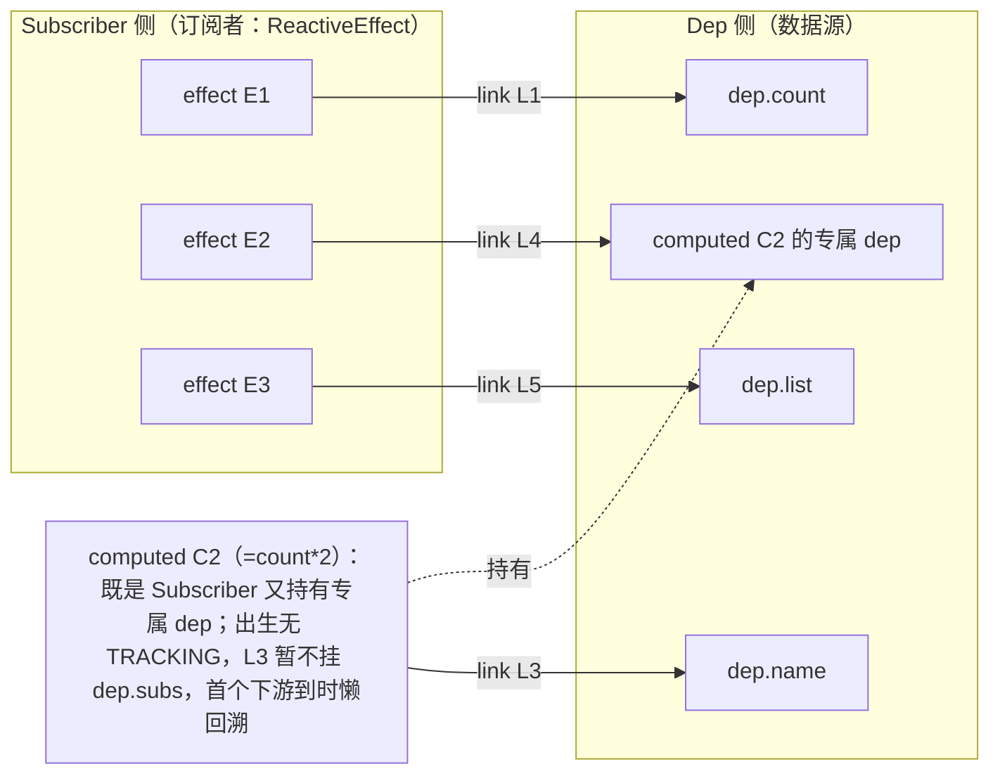
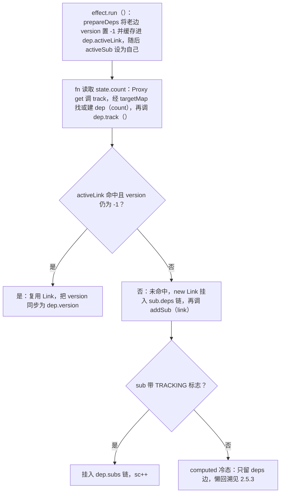
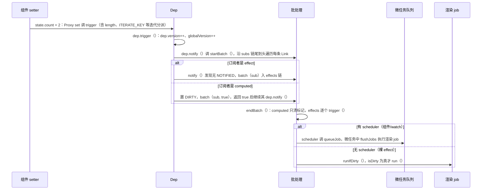

# 第 2 章 响应式系统：Vue 3.5 的 Link 链表心脏

> 导航：[教程总目录](../../README.md) ｜ [上一章：架构总览](./01-architecture.md) ｜ 下一章：VNode 与渲染器（./03-vnode-and-renderer.md）

## 学习目标

1. 说清 Vue 2 `Object.defineProperty` 的局限，以及 Vue 3.0～3.4 `WeakMap→Map→Set` 方案的两个性能痛点；
2. 画出 3.5 的 `Link` 双向链表网络，解释一个 Link 为什么能同时挂在两条链上；
3. 脱稿讲出 `track`（收集依赖）与 `trigger`（派发更新）的完整路径，包括 computed 的懒订阅回溯；
4. 解释「同步代码连改 100 次响应式数据，为什么只触发一轮组件更新」；
5. 讲清 computed 多层缓存短路、ref 与 reactive 的关系、watch 三时机与清理函数；
6. 拿到 3.4 vs 3.5 实现对比表，能甄别旧资料中的过时说法。本章代码均出自 `packages/reactivity/src/`（3.5 起 watch 也在这里），建议并排打开 [dep.ts](file:///Users/yangzhijie/Desktop/practice_projects/claude-code-test/react-vue-source-deep-dive/sources/vue/packages/reactivity/src/dep.ts)。

## 2.1 旧世界与它的问题

### 2.1.1 Vue 2：Object.defineProperty 的四堵墙

Vue 2 用 `Object.defineProperty(obj, key, { get, set })` 拦截属性，有四个绕不开的局限：

1. **数组索引与 length 不可靠。** `arr[0] = x`、`arr.length = 0` 拦不住，只能包装 `push/pop/shift/unshift/splice/sort/reverse` 七个方法；
2. **新增/删除属性检测不到。** 只能用 `Vue.set / Vue.delete`，因为 defineProperty 只能拦截定义时已存在的 key；
3. **不支持 Map / Set**（非普通属性访问）；**全量 Observe 成本高**——初始化就递归遍历整个对象逐个 defineReactive，没被用到的深层属性也付出代价。

### 2.1.2 Vue 3.0～3.4：targetMap 方案的两个痛点

Vue 3 改用 Proxy 解决了上述问题，但 3.0～3.4 的依赖存储一直是 `WeakMap<target, Map<key, Set<effect>>>`（targetMap → depsMap → effects Set）。它有两个工程痛点：

- **常驻内存大。** 每个被访问过的 key 都常驻内层 Map 和 Set 容器，哪怕只有一个订阅者、甚至已无人订阅，容器本身仍占内存。
- **cleanup 重建的 GC 压力。** effect 依赖随分支变化（`v-if`、短路表达式）。3.4 每次重跑前把 effect 从所有 Set 删除（cleanup），跑完再加回，Set 反复增删。

3.5 的重构（reactivity memory improvements）正对着这两点：**用 Link 节点 + 双向链表取代 Set 容器，用「version 标记 + 摘除未用节点」取代「全量清空重建」**。注意 targetMap 没删，它仍是「对象 → key → Dep」的索引（[dep.ts:240](file:///Users/yangzhijie/Desktop/practice_projects/claude-code-test/react-vue-source-deep-dive/sources/vue/packages/reactivity/src/dep.ts#L240-L240)）；变的是 Dep **内部**装订阅者的方式。

## 2.2 核心数据结构：Dep 与 Link

### 2.2.1 概念：一条边，两条链

响应式系统本质是一张**二分图**：左边是 **Dep**（数据源：一个响应式属性或一个 ref/computed），右边是 **Subscriber**（订阅者：ReactiveEffect 或 ComputedRefImpl）。谁订阅谁就有一条边，3.5 中每条边是一个 **Link**。精妙之处：**同一个 Link 同时挂在两条双向链表上**——沿 `prevDep/nextDep` 属于某 subscriber 的 deps 链（我依赖了谁），沿 `prevSub/nextSub` 属于某 dep 的 subs 链（我被谁订阅）。一条边只分配一个对象，两个方向都能遍历，不需要任何 Set。

### 2.2.2 Link：字段表与源码

出处：packages/reactivity/src/dep.ts:32-62（Vue 3.5.43）—— [dep.ts](file:///Users/yangzhijie/Desktop/practice_projects/claude-code-test/react-vue-source-deep-dive/sources/vue/packages/reactivity/src/dep.ts#L32-L62)

| 字段 | 含义 |
| --- | --- |
| `dep` / `sub` | 边指向的数据源 / 归属的订阅者（构造器参数） |
| `version` | 上次确认时 dep 版本号快照；**-1 表示本轮运行没被用到、待清理** |
| `prevDep` / `nextDep` | subscriber 的 deps 链前后指针 |
| `prevSub` / `nextSub` | dep 的 subs 链前后指针 |
| `prevActiveLink` | 运行前缓存 dep 原 activeLink，运行后恢复（嵌套上下文） |

```ts
export class Link {
  version: number // 运行前老 link 重置为 -1；访问到则同步 dep.version；仍 -1 的被清理
  nextDep?: Link; prevDep?: Link   // 挂 sub.deps 链
  nextSub?: Link; prevSub?: Link   // 挂 dep.subs 链
  prevActiveLink?: Link
  constructor(public sub: Subscriber, public dep: Dep) { this.version = dep.version } // 拍快照
}
```

`Link.version === -1` 的复用协议是 3.5 增量 cleanup 的核心：**不删老边，只做标记；没用到才摘，用到就原地复用**（实现见 2.3.3、2.4.2）。

### 2.2.3 Dep：字段表与源码

出处：packages/reactivity/src/dep.ts:67-106（Vue 3.5.43）—— [dep.ts](file:///Users/yangzhijie/Desktop/practice_projects/claude-code-test/react-vue-source-deep-dive/sources/vue/packages/reactivity/src/dep.ts#L67-L106)

| 字段 | 含义 |
| --- | --- |
| `version` | 数据源版本号，每次 trigger 自增；订阅者比对快照判断是否变化 |
| `subs` / `subsHead` | subs 链**尾指针**（通知从尾向头遍历）；subsHead 仅 DEV 用于钩子顺序 |
| `activeLink` | 缓存「当前 activeSub 与本 dep 的边」，命中即免去 new Link |
| `map` / `key` | 反向记录自己挂在哪个 depsMap 的哪个 key，订阅者归零时自我清理 |
| `sc` | subscriber counter，订阅计数，归零且有 map 时从 Map 删除本 dep |
| `computed` | 构造器参数：本 Dep 属于哪个 computed（支持懒订阅） |

```ts
export class Dep {
  version = 0
  activeLink?: Link = undefined
  subs?: Link = undefined        // 订阅者链尾指针（通知从尾向头遍历）；subsHead 仅 DEV
  map?: KeyToDepMap = undefined; key?: unknown = undefined // 反向归属，sc 归零据此 delete
  sc: number = 0
  constructor(public computed?: ComputedRefImpl | undefined) {}
}
```

### 2.2.4 Link 网络结构图（Mermaid 图 1）：3 个 effect × 4 个 dep



## 2.3 Subscriber 与 ReactiveEffect

### 2.3.1 Subscriber 接口与 EffectFlags 位标志

Dep 不认识「组件」或「watch」，它只认识 Subscriber 接口——任何持有 deps 链、能被通知的对象。出处：packages/reactivity/src/effect.ts:58-83（Vue 3.5.43）—— [effect.ts](file:///Users/yangzhijie/Desktop/practice_projects/claude-code-test/react-vue-source-deep-dive/sources/vue/packages/reactivity/src/effect.ts#L58-L83)

```ts
export interface Subscriber extends DebuggerOptions {
  deps?: Link; depsTail?: Link  // deps 链头/链尾
  flags: EffectFlags
  next?: Subscriber             // 批处理队列指针（复用字段）
  notify(): true | void         // true=我是 computed，请继续通知我的 dep
}
```

`flags` 是位标志（`|` 叠加、`&` 判断，[effect.ts:41-53](file:///Users/yangzhijie/Desktop/practice_projects/claude-code-test/react-vue-source-deep-dive/sources/vue/packages/reactivity/src/effect.ts#L41-L53)）：

| 标志 | 位值 | 含义 |
| --- | --- | --- |
| `ACTIVE` / `RUNNING` / `ALLOW_RECURSE` | `1<<0/1/5` | effect 未被 stop / 正在执行（防自触发）/ 允许自己触发自己 |
| `TRACKING` | `1<<2` | 是否挂进 dep.subs（computed 初始为关） |
| `NOTIFIED` | `1<<3` | 本轮已入队（**批处理去重关键**） |
| `DIRTY` | `1<<4` | 数据已脏需重算（computed 脏标记） |
| `PAUSED` | `1<<6` | watch 暂停中（3.5 pause/resume） |
| `EVALUATED` | `1<<7` | computed 至少算出过一次值 |

### 2.3.2 ReactiveEffect 与 activeSub

核心字段：`fn`（执行函数）、`scheduler`（触发时调度器，组件/watch 靠它换走默认行为）、`deps/depsTail`、`flags`（初始 `ACTIVE | TRACKING`）、`cleanup`、`next`。📌 当前订阅者在 3.5 叫 **`activeSub`**（[effect.ts:39](file:///Users/yangzhijie/Desktop/practice_projects/claude-code-test/react-vue-source-deep-dive/sources/vue/packages/reactivity/src/effect.ts#L39-L39)），不再叫 activeEffect——因为正在收集依赖的既可能是 effect，也可能是 computed。构造器（[effect.ts:116-131](file:///Users/yangzhijie/Desktop/practice_projects/claude-code-test/react-vue-source-deep-dive/sources/vue/packages/reactivity/src/effect.ts#L116-L131)）会把自己自动登记进当前 effectScope：scope 活跃则 push 进 `scope.effects`；scope 已 stop（Suspense 边界）则清掉 ACTIVE 位。

### 2.3.3 run()：一次运行的生命周期

出处：packages/reactivity/src/effect.ts:162-192（Vue 3.5.43）—— [effect.ts](file:///Users/yangzhijie/Desktop/practice_projects/claude-code-test/react-vue-source-deep-dive/sources/vue/packages/reactivity/src/effect.ts#L162-L192)

```ts
run(): T {
  if (!(this.flags & EffectFlags.ACTIVE)) return this.fn() // 已 stop：裸跑
  this.flags |= EffectFlags.RUNNING
  cleanupEffect(this)   // 执行 onEffectCleanup
  prepareDeps(this)     // ① 老边 version=-1，并缓存进 dep.activeLink
  const prevSub = activeSub, prevTrack = shouldTrack
  activeSub = this; shouldTrack = true // ② 自己成为当前订阅者
  try { return this.fn() }             // ③ get 拦截在此期间建立/复用边
  finally {
    cleanupDeps(this)   // ④ 摘除 version 仍为 -1 的边
    activeSub = prevSub; shouldTrack = prevTrack; this.flags &= ~EffectFlags.RUNNING
  }
}
```

①的 `prepareDeps` 只做标记不删节点（[effect.ts:312-322](file:///Users/yangzhijie/Desktop/practice_projects/claude-code-test/react-vue-source-deep-dive/sources/vue/packages/reactivity/src/effect.ts#L312-L322)）：遍历 deps 链 `link.version = -1` 且 `link.dep.activeLink = link`；④的 `cleanupDeps` 把仍是 -1 的边从两条链上摘除（[effect.ts:324-351](file:///Users/yangzhijie/Desktop/practice_projects/claude-code-test/react-vue-source-deep-dive/sources/vue/packages/reactivity/src/effect.ts#L324-L351)）。

### 2.3.4 notify / trigger / runIfDirty：脏检查短路

出处：packages/reactivity/src/effect.ts:150-160、206-227、353-370（Vue 3.5.43）—— [effect.ts](file:///Users/yangzhijie/Desktop/practice_projects/claude-code-test/react-vue-source-deep-dive/sources/vue/packages/reactivity/src/effect.ts#L150-L227)

```ts
notify(): void {
  if (this.flags & EffectFlags.RUNNING && !(this.flags & EffectFlags.ALLOW_RECURSE)) return
  if (!(this.flags & EffectFlags.NOTIFIED)) batch(this)  // 没入过队才入
}
trigger(): void {
  if (this.flags & EffectFlags.PAUSED) pausedQueueEffects.add(this)
  else if (this.scheduler) this.scheduler() // 组件/watch 走调度器
  else this.runIfDirty()                     // 裸 effect：脏才跑
}
runIfDirty(): void { if (isDirty(this)) this.run() } // 📌 3.5 新增短路
// isDirty（effect.ts:353-370）沿 deps 链比对 link.version 与 dep.version，
// 遇上游 computed 先递归 refreshComputed，任一不等才返回 true
```

**组件更新 job 绑定的正是 runIfDirty**（第 1 章 1.5.6）：批量改动后轮到某组件时，若它依赖的值最终没变（isDirty 为 false），整次渲染直接跳过。

## 2.4 track：依赖是怎么被收集的

### 2.4.1 入口：Proxy get → track → dep.track

`reactive(obj).a` 触发 get 拦截器（2.8 节细讲），非只读时调 `track(target, GET, key)`。它从 targetMap 找/建 Dep 再委托 `dep.track()`。Dep 是**惰性创建**的，从没被 effect 读过的属性没有 Dep：

出处：packages/reactivity/src/dep.ts:262-284（Vue 3.5.43）—— [dep.ts](file:///Users/yangzhijie/Desktop/practice_projects/claude-code-test/react-vue-source-deep-dive/sources/vue/packages/reactivity/src/dep.ts#L262-L284)

```ts
export function track(target: object, type: TrackOpTypes, key: unknown): void {
  if (shouldTrack && activeSub) {
    let depsMap = targetMap.get(target)
    if (!depsMap) targetMap.set(target, (depsMap = new Map())) // 惰性建 Map
    let dep = depsMap.get(key)
    if (!dep) { // Dep 惰性创建；记住归属 map/key，订阅者归零时自我删除
      depsMap.set(key, (dep = new Dep())); dep.map = depsMap; dep.key = key
    }
    __DEV__ ? dep.track({ target, type, key }) : dep.track()
  }
}
```

### 2.4.2 dep.track()：按需 new Link，建立双向边

出处：packages/reactivity/src/dep.ts:108-151（Vue 3.5.43）—— [dep.ts](file:///Users/yangzhijie/Desktop/practice_projects/claude-code-test/react-vue-source-deep-dive/sources/vue/packages/reactivity/src/dep.ts#L108-L151)

```ts
track(debugInfo?): Link | undefined {
  if (!activeSub || !shouldTrack || activeSub === this.computed) return
  let link = this.activeLink
  if (link === undefined || link.sub !== activeSub) {
    link = this.activeLink = new Link(activeSub, this) // 新边，挂 sub.deps 链尾
    if (!activeSub.deps) activeSub.deps = activeSub.depsTail = link
    else { link.prevDep = activeSub.depsTail
      activeSub.depsTail!.nextDep = link; activeSub.depsTail = link } // 尾插
    addSub(link) // 再挂入 dep.subs（仅 TRACKING 时，见 2.5.3）
  } else if (link.version === -1) {
    link.version = this.version // 老边本轮复用（不在链尾则挪到链尾），无需重建
  }
  return link
}
```

### 2.4.3 track 数据流图（Mermaid 图 2）



## 2.5 trigger：变更如何沿依赖图传播

### 2.5.1 set 拦截器与特殊 key 分派

set 拦截器区分 ADD（新 key）/ SET（已有 key）后调模块函数 `trigger`。除精确触发具体 key 的 Dep，还按操作类型触发「迭代依赖」：ADD/DELETE 触发 `ITERATE_KEY`，Map 再触发 `MAP_KEY_ITERATE_KEY`；数组索引变化触发 `ARRAY_ITERATE_KEY`，新增索引还触发 `'length'`；缩短 length 时触发被删掉的索引 dep。三个特殊 key 定义在 [dep.ts:242-250](file:///Users/yangzhijie/Desktop/practice_projects/claude-code-test/react-vue-source-deep-dive/sources/vue/packages/reactivity/src/dep.ts#L242-L250)：

出处：packages/reactivity/src/dep.ts:347-385（Vue 3.5.43）—— [dep.ts](file:///Users/yangzhijie/Desktop/practice_projects/claude-code-test/react-vue-source-deep-dive/sources/vue/packages/reactivity/src/dep.ts#L347-L385)

```ts
if (key !== void 0 || depsMap.has(void 0)) run(depsMap.get(key)) // 具体 key
if (isArrayIndex) run(depsMap.get(ARRAY_ITERATE_KEY)) // 数组迭代独立于索引
switch (type) {
  case TriggerOpTypes.ADD:
    if (!targetIsArray) {
      run(depsMap.get(ITERATE_KEY))            // 新增键影响枚举
      if (isMap(target)) run(depsMap.get(MAP_KEY_ITERATE_KEY))
    } else if (isArrayIndex) run(depsMap.get('length')) // 数组新索引→length
    break
  case TriggerOpTypes.DELETE: /* 同 ADD */ break
  case TriggerOpTypes.SET:
    if (isMap(target)) run(depsMap.get(ITERATE_KEY)) // Map.set 影响迭代
}
// 缩短 length 还会触发被删索引的 dep；DELETE 触发同 ADD 的迭代依赖
```

这解释了「新增从没见过的 key，`v-for` 也能更新」——它订阅的是特殊 ITERATE_KEY dep。

### 2.5.2 dep.trigger/notify：版本自增 + 沿 subs 通知

出处：packages/reactivity/src/dep.ts:167-204（Vue 3.5.43）—— [dep.ts](file:///Users/yangzhijie/Desktop/practice_projects/claude-code-test/react-vue-source-deep-dive/sources/vue/packages/reactivity/src/dep.ts#L167-L204)

```ts
trigger(debugInfo?): void {
  this.version++   // 数据源版本 +1，所有快照立即过期
  globalVersion++  // 全局版本 +1（computed 第 2 层短路用）
  this.notify(debugInfo)
}
notify(debugInfo?): void {
  startBatch() // 📌 通知包在批处理里
  try { for (let link = this.subs; link; link = link.prevSub) { // 尾→头遍历
      if (link.sub.notify()) // 返回 true=computed：在此继续 notify 其 dep
        ;(link.sub as ComputedRefImpl).dep.notify()         // 压低调用栈
    }
  } finally { endBatch() }
}
```

普通 effect 的 notify 把自己扔进批处理队列；computed 的 notify 只打 DIRTY 标记、入 computed 批处理链并返回 true（2.7 节），外层于是继续通知它的下游 dep——**脏标记沿依赖图向上传播，此刻没有任何 getter 执行**（push 标记，pull 求值）。

### 2.5.3 computed 懒订阅回溯（addSub）

computed 创建时 flags = DIRTY、**无 TRACKING**：首次求值时 getter 读到的 dep 虽会建立 Link（挂 computed.deps 链），但 addSub 发现 sub 不 TRACKING，就**不**挂进 dep.subs。即：没人用的 computed 对上游零订阅。直到第一个 effect/组件订阅它，addSub 才打开 TRACKING 并沿 deps 链回溯补订阅：

出处：packages/reactivity/src/dep.ts:207-232（Vue 3.5.43）—— [dep.ts](file:///Users/yangzhijie/Desktop/practice_projects/claude-code-test/react-vue-source-deep-dive/sources/vue/packages/reactivity/src/dep.ts#L207-L232)

```ts
function addSub(link: Link) {
  link.dep.sc++
  if (link.sub.flags & EffectFlags.TRACKING) {
    const computed = link.dep.computed
    if (computed && !link.dep.subs) { // computed 首个订阅者：打开追踪
      computed.flags |= EffectFlags.TRACKING | EffectFlags.DIRTY
      for (let l = computed.deps; l; l = l.nextDep) addSub(l) // 懒回溯
    }
    const tail = link.dep.subs // 尾插维护 subs 链
    if (tail !== link) { link.prevSub = tail; if (tail) tail.nextSub = link }
    if (__DEV__ && !link.dep.subsHead) link.dep.subsHead = link
    link.dep.subs = link
  }
}
```

对称地，最后一个订阅者离开时 removeSub 会关闭 computed 的 TRACKING 并从所有上游「软取消订阅」，computed 与 Link 网络可被整体 GC（[effect.ts:432-470](file:///Users/yangzhijie/Desktop/practice_projects/claude-code-test/react-vue-source-deep-dive/sources/vue/packages/reactivity/src/effect.ts#L432-L470)，sc 归零 map.delete 在 463-469 行）。

### 2.5.4 trigger 数据流图（Mermaid 图 3）



## 2.6 批处理：连改 100 次为什么只更新一轮

### 2.6.1 batchDepth 计数与两条单链表

3.5 不用数组，而是复用 Subscriber 的 `next` 字段把「本轮待处理者」串成单链表，computed 与 effect 分两条链：

出处：packages/reactivity/src/effect.ts:247-310（Vue 3.5.43）—— [effect.ts](file:///Users/yangzhijie/Desktop/practice_projects/claude-code-test/react-vue-source-deep-dive/sources/vue/packages/reactivity/src/effect.ts#L247-L310)

```ts
let batchDepth = 0
let batchedSub: Subscriber | undefined
let batchedComputed: Subscriber | undefined
export function batch(sub: Subscriber, isComputed = false): void {
  sub.flags |= EffectFlags.NOTIFIED // 本轮已通知，重复 trigger 忽略
  if (isComputed) { sub.next = batchedComputed; batchedComputed = sub; return }
  sub.next = batchedSub; batchedSub = sub
}
export const startBatch = () => batchDepth++
export function endBatch(): void {
  if (--batchDepth > 0) return // 嵌套批次未结束不冲刷；否则冲刷两条链
  // batchedComputed 只清标记；batchedSub 逐个调 trigger()
}
```

### 2.6.2 两道保险：NOTIFIED + QUEUED 微任务

同一个 dep 连续赋值 100 次：`dep.version` 确实自增 100 次（数据是最新的），但只有第一次通过 notify 的 NOTIFIED 检查进入 batchedSub（[effect.ts:157-159](file:///Users/yangzhijie/Desktop/practice_projects/claude-code-test/react-vue-source-deep-dive/sources/vue/packages/reactivity/src/effect.ts#L157-L159)），后 99 次直接返回；100 次 trigger 又都在同一对 startBatch/endBatch 内（同步代码未退出），冲刷只发生一次。

job 到 DOM 之间还有第二道闸——组件 effect 的 `scheduler = () => queueJob(job)`（第 1 章 1.5.6）。`queueJob` 用 `SchedulerJobFlags.QUEUED` 标志去重、按组件 uid 二分插入保证父→子顺序，并借 `resolvedPromise.then(flushJobs)` 把真正刷新放到微任务（[scheduler.ts:99-121](file:///Users/yangzhijie/Desktop/practice_projects/claude-code-test/react-vue-source-deep-dive/sources/vue/packages/runtime-core/src/scheduler.ts#L99-L121)）。所以「一轮」= **reactivity 层 NOTIFIED 去重 + runtime 层 QUEUED 去重与微任务延迟**，微任务执行时拿到的已是第 100 次的最终值。

## 2.7 computed：懒求值 + 四层短路缓存

### 2.7.1 ComputedRefImpl：既是 Subscriber，又持有一个 Dep

3.5 的 computed 不再包 ReactiveEffect，而是直接实现 Subscriber；同时持有专属 Dep（订阅「我」的人挂这里），构造时 `new Dep(this)` 形成双向关联。关键字段：`dep = new Dep(this)`、`flags = DIRTY`（出生即脏、初始不带 TRACKING）、`globalVersion = globalVersion - 1`、`effect: this = this`（向后兼容，旧代码访问 `computed.effect` 指向自己）：

出处：packages/reactivity/src/computed.ts:47-154（Vue 3.5.43）—— [computed.ts](file:///Users/yangzhijie/Desktop/practice_projects/claude-code-test/react-vue-source-deep-dive/sources/vue/packages/reactivity/src/computed.ts#L47-L154)

```ts
notify(): true | void {
  this.flags |= EffectFlags.DIRTY // 上游变了：只打脏标，绝不立刻重算
  if (!(this.flags & EffectFlags.NOTIFIED) && activeSub !== this) {
    batch(this, true)
    return true // 请 dep.notify 继续通知我的下游
  }
}
get value(): T {
  const link = __DEV__ // 读取者 ↔ computed 建立边
    ? this.dep.track({ target: this, type: TrackOpTypes.GET, key: 'value' })
    : this.dep.track()
  refreshComputed(this) // 需要才算
  if (link) link.version = this.dep.version
  return this._value
}
```

### 2.7.2 refreshComputed 的四层短路

出处：packages/reactivity/src/effect.ts:376-430（Vue 3.5.43）—— [effect.ts](file:///Users/yangzhijie/Desktop/practice_projects/claude-code-test/react-vue-source-deep-dive/sources/vue/packages/reactivity/src/effect.ts#L376-L430)

```ts
export function refreshComputed(computed: ComputedRefImpl): undefined {
  // 第 1 层：TRACKING 且无 DIRTY → 入口即返回
  if (computed.flags & EffectFlags.TRACKING && !(computed.flags & EffectFlags.DIRTY)) return
  computed.flags &= ~EffectFlags.DIRTY
  // 第 2 层：全局版本没变 → 全世界都没有响应式改动
  if (computed.globalVersion === globalVersion) return
  computed.globalVersion = globalVersion
  // 第 3 层：算过且 deps 快照全部仍相等（!isDirty）→ 值不可能变
  if (!computed.isSSR && computed.flags & EffectFlags.EVALUATED &&
      ((!computed.deps && !(computed as any)._dirty) || !isDirty(computed))) return
  // 第 4 层：重算；只有结果真的变化，dep.version 才 +1（416-420 行）
  const value = computed.fn(computed._value) // 前后有 prepare/cleanupDeps
  if (computed.dep.version === 0 || hasChanged(value, computed._value)) {
    computed.flags |= EffectFlags.EVALUATED
    computed._value = value; computed.dep.version++ // 不增则下游不唤醒
  }
}
```

| 层 | 判断 | 省掉什么 |
| --- | --- | --- |
| 1 | 无 DIRTY 位 | 一切计算 |
| 2 | `globalVersion` 相等 | dep 版本遍历（全局无改动的极速路径） |
| 3 | EVALUATED 且 `isDirty` 为 false | getter 执行（改动与我无关） |
| 4 | 重算后 `hasChanged` 为 false | dep.version 不自增，下游不唤醒 |

第 4 层意味着：getter 可能因不相关字段变化而重跑，但只要结果值未变，订阅 computed 的组件不会重渲染。computed 是「拉取值 + 版本号广播」的混合体。

## 2.8 reactive：四种代理、集合与数组

### 2.8.1 四张 WeakMap 与代理工厂

同一对象重复 `reactive()` 返回同一代理。四种模式各有一张 WeakMap（key 为原始对象）：`reactiveMap / shallowReactiveMap / readonlyMap / shallowReadonlyMap`（[reactive.ts:26-35](file:///Users/yangzhijie/Desktop/practice_projects/claude-code-test/react-vue-source-deep-dive/sources/vue/packages/reactivity/src/reactive.ts#L26-L35)）。工厂 createReactiveObject（[reactive.ts:262-306](file:///Users/yangzhijie/Desktop/practice_projects/claude-code-test/react-vue-source-deep-dive/sources/vue/packages/reactivity/src/reactive.ts#L262-L306)）按原始类型选 handler：Object/Array → COMMON → baseHandlers；Map/Set/WeakMap/WeakSet → COLLECTION → collectionHandlers；markRaw、不可扩展对象等 INVALID 原样返回。

### 2.8.2 baseHandlers：get / set / has / deleteProperty / ownKeys

出处：packages/reactivity/src/baseHandlers.ts:112-133、174-191、194-222（Vue 3.5.43）—— [baseHandlers.ts](file:///Users/yangzhijie/Desktop/practice_projects/claude-code-test/react-vue-source-deep-dive/sources/vue/packages/reactivity/src/baseHandlers.ts#L112-L222)

```ts
// get 中的关键分支
if (!isReadonly) track(target, TrackOpTypes.GET, key)
if (isShallow) return res
if (isRef(res)) { // ref 自动解包；但数组整数索引【不解包】
  const value = targetIsArray && isIntegerKey(key) ? res : res.value
  return isReadonly && isObject(value) ? readonly(value) : value
}
if (isObject(res)) return isReadonly ? readonly(res) : reactive(res) // 深层惰性代理
// set 中：hadKey 区分 ADD / SET；赋值给 ref 属性会自动写 oldValue.value
if (target === toRaw(receiver) && result) {
  if (!hadKey) trigger(target, TriggerOpTypes.ADD, key, value)
  else if (hasChanged(value, oldValue))
    trigger(target, TriggerOpTypes.SET, key, value, oldValue)
}
```

「深层惰性代理」指 `reactive(obj).a.b.c` 每访问一层才 reactive 一层，不预先深递归。其余陷阱：`deleteProperty` → trigger DELETE（194-205 行）；`has`（`key in obj`）→ track HAS；`ownKeys`（`for...in`/`Object.keys`）→ 数组 track `'length'`、对象 track `ITERATE_KEY`（215-222 行）。

### 2.8.3 collectionHandlers：为什么必须劫持「方法」

Proxy 拦不到 Map 内部槽变化：`map.get(k)` 只是读了个叫 get 的属性，`add/set` 在代理上调用还会因 this 不是原始对象而报错。方案是**只劫持 get，把 `get/set/has/add/delete/clear/forEach/size/keys/values/entries/迭代器` 整体换成 instrumented 版本**（[collectionHandlers.ts:100-265](file:///Users/yangzhijie/Desktop/practice_projects/claude-code-test/react-vue-source-deep-dive/sources/vue/packages/reactivity/src/collectionHandlers.ts#L100-L265)），内部始终操作 raw target 并手动 track/trigger：

```ts
get(this: MapTypes, key: unknown) { // collectionHandlers 劫持版
  const rawTarget = toRaw(this[ReactiveFlags.RAW]), rawKey = toRaw(key)
  if (!readonly) { // key 可能是代理：原 key 与 raw key 双 track
    if (hasChanged(key, rawKey)) track(rawTarget, TrackOpTypes.GET, key)
    track(rawTarget, TrackOpTypes.GET, rawKey)
  } // ……命中则 wrap（toReactive/toReadonly）后返回
},
get size() { !readonly && track(toRaw(target), ITERATE, ITERATE_KEY); return target.size }
// 变更方法 add/set/delete/clear 操作 raw 后 trigger：Set.add 同值、Map.set 值未变不触发
```

注意迭代器区别（createIterableMethod，33-75 行）：**`keys()` 订阅 `MAP_KEY_ITERATE_KEY`，`values/entries/forEach/默认迭代器` 订阅 `ITERATE_KEY`**——只改 Map 的 value 不应通知只遍历 key 的地方。

### 2.8.4 arrayInstrumentations：数组方法的依赖精细化

get 拦截器优先返回被替换的数组方法（[arrayInstrumentations.ts:52-240](file:///Users/yangzhijie/Desktop/practice_projects/claude-code-test/react-vue-source-deep-dive/sources/vue/packages/reactivity/src/arrayInstrumentations.ts#L52-L240)），分三组：

| 分组 | 方法 | 依赖处理 |
| --- | --- | --- |
| 全量读取 | `forEach/map/filter/every/some/find/findIndex/findLast/findLastIndex/reduce/reduceRight` | 订阅 `ARRAY_ITERATE_KEY`，元素包响应式 |
| 迭代/查找/拼接 | `[Symbol.iterator]/entries/values/concat/join/includes/indexOf/lastIndexOf/toReversed/toSorted/toSpliced` | 订阅 `ARRAY_ITERATE_KEY`；indexOf 类先按代理查、不中再用 raw 重查 |
| 长度变更 | `push/pop/shift/unshift/splice` | `noTracking`：暂停追踪 + startBatch |

第三组解决经典问题：push 内部既读又写 length，正常收集会让 effect 订阅 length 后被自己的操作触发（#2137 类死循环）：

出处：packages/reactivity/src/arrayInstrumentations.ts:371-382（Vue 3.5.43）—— [arrayInstrumentations.ts](file:///Users/yangzhijie/Desktop/practice_projects/claude-code-test/react-vue-source-deep-dive/sources/vue/packages/reactivity/src/arrayInstrumentations.ts#L371-L382)

```ts
function noTracking(self: unknown[], method: keyof Array<any>, args: unknown[] = []) {
  pauseTracking() // 执行期间不收集读依赖（length/索引）
  startBatch()    // 内部多次 trigger 合并为一轮
  const res = (toRaw(self) as any)[method].apply(self, args)
  endBatch(); resetTracking()
  return res
}
```

## 2.9 ref：.value 的魔法与自动解包

### 2.9.1 RefImpl：3.5 构造时即创建 Dep

📌 3.4 中 ref 的 dep 在首次访问 `.value` 时惰性创建；3.5 在类字段直接初始化，与 Dep/Link 体系统一：

出处：packages/reactivity/src/ref.ts:114-165（Vue 3.5.43）—— [ref.ts](file:///Users/yangzhijie/Desktop/practice_projects/claude-code-test/react-vue-source-deep-dive/sources/vue/packages/reactivity/src/ref.ts#L114-L165)

```ts
class RefImpl<T = any> {
  _value: T
  private _rawValue: T
  dep: Dep = new Dep() // 📌 构造即建 dep
  public readonly [ReactiveFlags.IS_REF] = true
  public readonly [ReactiveFlags.IS_SHALLOW]: boolean = false
  constructor(value: T, isShallow: boolean) {
    this._rawValue = isShallow ? value : toRaw(value)
    this._value = isShallow ? value : toReactive(value) // 对象自动 reactive
    this[ReactiveFlags.IS_SHALLOW] = isShallow
  }
  get value() { this.dep.track(); return this._value } // DEV 带 debugInfo
  set value(newValue) {
    newValue = (this[ReactiveFlags.IS_SHALLOW] ||
      isShallow(newValue) || isReadonly(newValue)) ? newValue : toRaw(newValue)
    if (hasChanged(newValue, this._rawValue)) { // Object.is，变了才触发
      this._rawValue = newValue
      this._value = this[ReactiveFlags.IS_SHALLOW] ? newValue : toReactive(newValue)
      this.dep.trigger()
    }
  }
}
```

相关 API：`shallowRef`（不深层转换/不解包）、`isRef`（查 `__v_isRef`，[ref.ts:46-50](file:///Users/yangzhijie/Desktop/practice_projects/claude-code-test/react-vue-source-deep-dive/sources/vue/packages/reactivity/src/ref.ts#L46-L50)）、`unref`、`triggerRef`（强制触发 shallowRef）、`customRef`（手动掌控 track/trigger 时机）、`toRef/toRefs`。

### 2.9.2 proxyRefs：模板自动解包规则

模板里写 `{{ count }}` 而非 `{{ count.value }}`，是因为 setup 返回对象被 `proxyRefs` 包裹，它只做**浅层**解包：

出处：packages/reactivity/src/ref.ts:253-283（Vue 3.5.43）—— [ref.ts](file:///Users/yangzhijie/Desktop/practice_projects/claude-code-test/react-vue-source-deep-dive/sources/vue/packages/reactivity/src/ref.ts#L253-L283)

```ts
const shallowUnwrapHandlers: ProxyHandler<any> = {
  get: (t, key, r) => key === ReactiveFlags.RAW ? t : unref(Reflect.get(t, key, r)),
  set: (t, key, value, r) => {
    if (isRef(t[key]) && !isRef(value)) { t[key].value = value; return true }
    return Reflect.set(t, key, value, r) // 给 ref 属性赋普通值 → 改写 .value
  },
}
export const proxyRefs = <T extends object>(o: T) =>
  isReactive(o) ? o : new Proxy(o, shallowUnwrapHandlers) // 只做浅层解包
```

解包规则三条：①**只解顶层、只解一层**（嵌套对象里的 ref 靠 reactive 的 get 解包，数组整数索引不解包）；②**shallow 不递归**（shallowReactive/shallowRef 内部值原样存取）；③**赋值对称**（给已有 ref 属性赋普通值会改写其 `.value`）。

## 2.10 watch：3.5 已下沉到 reactivity 包

📌 基础逻辑现在位于 [reactivity/src/watch.ts](file:///Users/yangzhijie/Desktop/practice_projects/claude-code-test/react-vue-source-deep-dive/sources/vue/packages/reactivity/src/watch.ts)，可脱离组件使用；runtime-core 的 [apiWatch.ts](file:///Users/yangzhijie/Desktop/practice_projects/claude-code-test/react-vue-source-deep-dive/sources/vue/packages/runtime-core/src/apiWatch.ts) 只负责错误接入与 pre/post/sync 调度。

### 2.10.1 getter + traverse：依赖从哪来

watch = 构造一个精准/深度读取数据源的 getter（[watch.ts:136-144](file:///Users/yangzhijie/Desktop/practice_projects/claude-code-test/react-vue-source-deep-dive/sources/vue/packages/reactivity/src/watch.ts#L136-L144)），用 ReactiveEffect 跑它，变化时比较新旧值再调 cb。ref 源只读 `.value`；**reactive 源默认递归 traverse 整个对象**（所以 `watch(reactiveObj, cb)` 天生深度监听）；函数源直接执行；deep 支持数字层级。traverse（[watch.ts:333-369](file:///Users/yangzhijie/Desktop/practice_projects/claude-code-test/react-vue-source-deep-dive/sources/vue/packages/reactivity/src/watch.ts#L333-L369)）用 seen Map 防循环引用，对 ref/数组/Map/Set/plainObject 分别深入，`depth<=0` 或 `__v_skip` 时停止。

### 2.10.2 job 的 dirty 短路与 scheduler 对接

出处：packages/reactivity/src/watch.ts:234-292（Vue 3.5.43）—— [watch.ts](file:///Users/yangzhijie/Desktop/practice_projects/claude-code-test/react-vue-source-deep-dive/sources/vue/packages/reactivity/src/watch.ts#L234-L292)

```ts
const job = (immediateFirstRun?: boolean) => {
  if (!(effect.flags & EffectFlags.ACTIVE) || (!effect.dirty && !immediateFirstRun)) return
  if (cb) {
    const newValue = effect.run()
    const changed = isMultiSource
      ? (newValue as any[]).some((v, i) => hasChanged(v, oldValue[i]))
      : hasChanged(newValue, oldValue)
    if (immediateFirstRun || deep || forceTrigger || changed) {
      if (cleanup) cleanup() // 先执行上一轮清理，再 cb(newValue, oldValue, boundCleanup)
    }
  } else {
    effect.run() // watchEffect：重跑副作用本身
  }
}
effect = new ReactiveEffect(getter)
effect.scheduler = scheduler ? () => scheduler(job, false) : (job as EffectScheduler)
```

`effect.dirty` 是 getter，内部就是 isDirty 版本比对。纯 reactivity 环境（不注入 scheduler）trigger 即同步执行 job；组件环境由 apiWatch 注入调度。

### 2.10.3 pre / post / sync 三时机

出处：packages/runtime-core/src/apiWatch.ts:199-214（Vue 3.5.43）—— [apiWatch.ts](file:///Users/yangzhijie/Desktop/practice_projects/claude-code-test/react-vue-source-deep-dive/sources/vue/packages/runtime-core/src/apiWatch.ts#L199-L214)

| flush | scheduler | 执行点 |
| --- | --- | --- |
| `'pre'`（默认） | `queueJob(job)`，打 PRE 标志、id 绑组件 uid | 微任务中、**组件更新前**（同 id 时排在更新 job 前，组件被父级卸载可跳过） |
| `'post'` | `queuePostRenderEffect(job, suspense)` | **DOM 更新后**（适合操作更新后的 DOM） |
| `'sync'` | 不注入 scheduler | trigger 时**同步**执行（慎用） |

### 2.10.4 onWatcherCleanup、pause/resume、watchEffect

3.5 新增可在异步回调内任意位置调用的 `onWatcherCleanup`（不再只有 cb 第三参），清理函数在「下次回调前」和「stop 时」执行，典型用于中止上次请求：

出处：packages/reactivity/src/watch.ts:82-118（Vue 3.5.43）—— [watch.ts](file:///Users/yangzhijie/Desktop/practice_projects/claude-code-test/react-vue-source-deep-dive/sources/vue/packages/reactivity/src/watch.ts#L82-L118)

```ts
const cleanupMap: WeakMap<ReactiveEffect, (() => void)[]> = new WeakMap()
let activeWatcher: ReactiveEffect | undefined = undefined
export function onWatcherCleanup(
  cleanupFn: () => void, failSilently = false,
  owner: ReactiveEffect | undefined = activeWatcher,
): void {
  if (owner) {
    let cleanups = cleanupMap.get(owner)
    if (!cleanups) cleanupMap.set(owner, (cleanups = []))
    cleanups.push(cleanupFn)
  } else if (__DEV__ && !failSilently) warn(`…no active watcher`)
}
```

watch 句柄还带 `pause()/resume()`（[watch.ts:326-327](file:///Users/yangzhijie/Desktop/practice_projects/claude-code-test/react-vue-source-deep-dive/sources/vue/packages/reactivity/src/watch.ts#L326-L327)）：暂停期间 trigger 只暂存进 `pausedQueueEffects`，恢复时补发一次（EffectFlags.PAUSED，见 2.3.4）。watch 与 watchEffect 的区别一句话：**watch 惰性、有新旧值、数据源明确；watchEffect 立即执行、靠函数体内读取自动收集依赖、侧重副作用**——二者是同一段实现的有无 cb 两个分支。

## 2.11 effectScope：副作用的统一生命周期

组件卸载要停掉内部所有 watch/effect，逐个存句柄很痛苦。EffectScope 就是「副作用收纳盒」：scope 内新建的 ReactiveEffect 构造时自动入册（2.3.2），`stop()` 全部停止。模块级 `activeEffectScope` 是「当前作用域」指针，非 detached 子 scope 挂父 scope 的 scopes 数组成树，stop 级联：

出处：packages/reactivity/src/effectScope.ts:47-62、106-118、162-195（Vue 3.5.43）—— [effectScope.ts](file:///Users/yangzhijie/Desktop/practice_projects/claude-code-test/react-vue-source-deep-dive/sources/vue/packages/reactivity/src/effectScope.ts#L47-L195)

```ts
constructor(public detached = false) {
  if (!detached && activeEffectScope && activeEffectScope.active) {
    this.parent = activeEffectScope
    this.index = (activeEffectScope.scopes || (activeEffectScope.scopes = [])).push(this) - 1
  }
}
run<T>(fn: () => T): T | undefined {
  if (this._active) {
    const prev = activeEffectScope // fn 内 watch/effect/computed 归入本 scope
    try { activeEffectScope = this; return fn() } finally { activeEffectScope = prev }
  }
}
// stop()：停 effects → onScopeDispose cleanups → 级联停子 scope → 尾换位 O(1) 摘除
```

`on()/off()` 用计数器支持嵌套进入（组件 setup 用它精确归集渲染 effect）；每个组件实例自带一个 **detached scope**（`instance.scope`，第 1 章挂载时的 `instance.scope.on()`），卸载即 stop，第 5 章细讲。

## 2.12 3.4 vs 3.5 对比表（收尾）

| 维度 | Vue 3.0～3.4 | Vue 3.5.43 |
| --- | --- | --- |
| 订阅容器 | 每 key 一个 `Set<effect>`，外层 WeakMap→Map | 索引仍是 WeakMap→Map<key,Dep>，订阅者改为 **Link 双向链表** |
| 边对象 | 无（effect 与 dep 互持集合） | 每条边一个 Link，同挂 deps/subs 两链 |
| 动态依赖 | 每轮全量从 Set 删除再重建 | version=-1 标记，未用边摘除、活跃边复用 |
| 空依赖回收 | 容器易常驻 | `sc` 归零自动 `map.delete(key)`（[effect.ts:463-469](file:///Users/yangzhijie/Desktop/practice_projects/claude-code-test/react-vue-source-deep-dive/sources/vue/packages/reactivity/src/effect.ts#L463-L469)） |
| 当前订阅者 | `activeEffect` | `activeSub`（effect/computed 统一） |
| computed | 内部持 ReactiveEffect + 手动 dirty | 直接实现 Subscriber；四层短路；**冷态零订阅、懒回溯** |
| 传播机制 | effect 通知 + 调度链 | version/globalVersion + NOTIFIED + 链表批处理；computed 只打脏标 |
| 更新短路 | job 基本直接 run | `runIfDirty` + isDirty 版本比对，可跳过整次渲染 |
| ref 的 dep | 首次 get 惰性创建 | 构造时即 `new Dep()` |
| watch 位置 | runtime-core/apiWatch.ts | 基础逻辑在 reactivity/watch.ts，runtime-core 只注入调度 |
| watch 能力 | stop 为主 | 新增 pause()/resume()、全局 onWatcherCleanup() |
| 数组迭代依赖 | 与 length 耦合 | 独立 `ARRAY_ITERATE_KEY`，精确分离 |

## 端到端流程串讲

```ts
const state = reactive({ count: 0, show: true })
const double = computed(() => state.count * 2)
watch(double, v => console.log('double →', v)) // 模板：<div v-if="state.show">{{ double }}</div>
state.count++
```

1. `reactive()` 查 reactiveMap 未命中 → 新建 Proxy 存 WeakMap；computed 出生 flags=DIRTY、无 TRACKING。
2. watch 首次运行读 `double.value` → 建立 watch-effect↔computed-dep 的边；addSub 发现首个订阅者 → 打开 computed TRACKING 并沿 deps 回溯，补挂 computed↔count-dep；求值为 0。
3. 组件挂载，渲染 effect 读取 show 与 double，建立对应边。
4. `state.count++`：set → SET → trigger → count-dep.version++/globalVersion++ → notify 到 computed：置 DIRTY 入 computed 链并返回 true → 继续 notify computed.dep 的订阅者（watch、渲染 effect）→ 两者置 NOTIFIED 入 batchedSub。
5. endBatch：computed 只清标记；effects 经 scheduler 入 queueJob，微任务按 uid 排序执行。
6. watch job：dirty 为真 → 重跑 getter → computed 经四层短路重算得 2，hasChanged → dep.version++ → 回调打印 `double → 1`。组件 job：runIfDirty 为脏才重渲染，无关改动则整次跳过。
7. 同步代码再改 99 次：NOTIFIED + QUEUED 双去重，watch 与组件同一微任务最多再跑一轮，拿到最终值。

## 版本勘误 📌

1. **`activeEffect` → `activeSub`**；`trackEffect`/`triggerEffects`/全量 cleanup 等旧函数名已不存在，新入口是 `dep.track()`、`dep.trigger()/notify()`。
2. **Set 依赖表消失**，旧文章的 `dep.add(activeEffect)` / `effects.delete(effect)` 全部对应为 Link 指针操作。
3. **computed 不再内部 new ReactiveEffect**；看到那种写法都是 3.4 及以前。
4. **watch 先读 `reactivity/src/watch.ts`**，runtime-core 的 apiWatch.ts 只剩调度封装。
5. **ref 的 dep 创建时机**：3.4 惰性、3.5 构造即建；**数组迭代 key**：3.5 拆出独立 `ARRAY_ITERATE_KEY`。
6. **onWatcherCleanup、watch 句柄 pause()/resume() 都是 3.5 新增**；3.4 只有回调第三参 onCleanup。
7. `effect.dirty` 在 3.5 是走 `isDirty` 的 getter，不是普通布尔字段；旧资料中 `trackEffect/triggerEffects` 等函数名也已不存在。

## 初学者易错点 ⚠️

1. **以为 Map/Set 靠属性陷阱拦截。** 它们靠 collectionHandlers 替换整套方法（含 size 与迭代器），手动 track/trigger；WeakMap/WeakSet 的 key 语义也在劫持方法内。
2. **以为数组下标解包 ref。** `reactive({list:[ref(1)]}).list[0]` 拿到的是 ref 本身（整数索引不解包），对象属性才自动解包。
3. **把 computed 当「缓存版 watch」。** computed 是拉取式：没人读就不重算，结果没变（dep.version 不增）下游不唤醒；getter 里不应写请求或改状态。
4. **在 getter 之外（setTimeout/Promise.then 回调里）读数据却期待被 watch 收集。** 依赖只在 effect 同步执行期间收集；需要就显式返回或用 traverse。
5. **滥用 `flush: 'sync'`。** 失去批处理保护，批量赋值中反复执行；绝大多数场景默认 pre 才对。
6. **忘记回收 detached 场景的副作用。** 组件内创建的 watch 自动归组件 scope；但定时器、全局事件、手动 `effectScope(true)` 中创建的要自行 stop，否则 subs 链持续持有造成泄漏。
7. **直接替换 reactive 对象引用。** `let s = reactive({}); s = reactive({...})` 不会迁移订阅；要整体替换请用 `ref({})` 改 `.value`，或 `Object.assign(s, next)`。

## 本章小结

- 心脏是 **Dep ↔ Link ↔ Subscriber** 三角：Dep 带 version 与 subs 尾指针；Link 一条边同时挂 deps/subs 两条双向链；Subscriber 是 effect/computed 的统一抽象。
- **track** 在 get 拦截中按需 new Link 或复用 version=-1 的旧边；**trigger** 自增版本号、把 effect 推入批处理、给 computed 打脏标并沿图传播。
- **computed 冷态零订阅**，首个下游出现时 addSub 懒回溯；读值经 DIRTY → globalVersion → isDirty → hasChanged 四层短路才重算。
- **批处理双保险**：reactivity 的 NOTIFIED 位 + batchedSub 链表，runtime 的 QUEUED 位 + resolved Promise 微任务，实现「改 100 次只更新一轮」。
- reactive 有四张 WeakMap、两类 handler（普通/集合）与数组方法劫持；ref 构造即建 dep，proxyRefs 只做顶层浅层解包；watch 已下沉 reactivity 包并支持 pause/resume、onWatcherCleanup；EffectScope 统一收纳副作用。

## 下一章导读

响应式解决了「数据变了通知谁」，但通知到达后**界面具体怎么改**还是空白。下一章 [03-vnode-and-renderer.md](./03-vnode-and-renderer.md) 进入虚拟 DOM：VNode 长什么样（shapeFlag/PatchFlag/dynamicChildren）、`patch` 如何挂载元素与组件、diff 如何复用 DOM、Block 树怎样让更新只遍历动态节点。本章结尾「渲染 effect 重跑产出新 VNode」就是下一章的起点。
