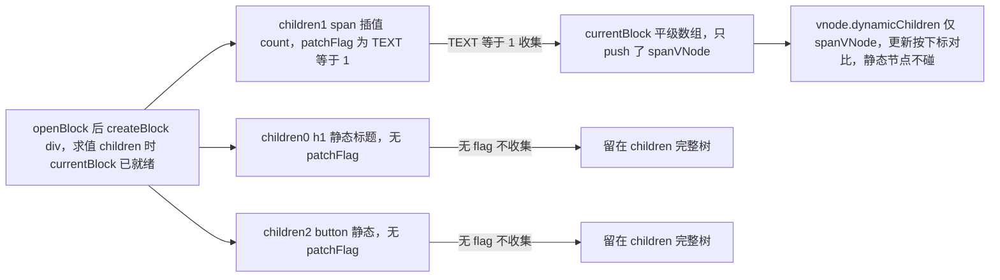
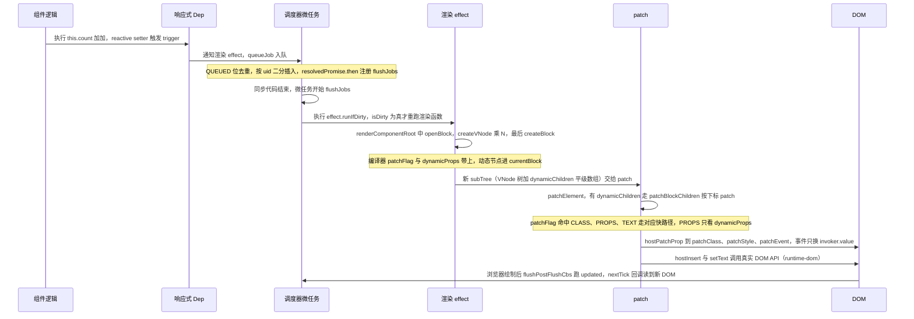

# 第 3 章 VNode 与渲染器

> 上一章：[第 2 章 响应式系统](./02-reactivity.md) ｜ 下一章：[第 4 章 Diff 算法](./04-diff-algorithm.md)

## 学习目标

- 理解 VNode 的本质：一个「UI 描述对象」，以及它与 React ReactElement 的共性与关键差异。
- 掌握 VNode 接口核心字段、`createVNode` 对 class/style/ref/key 的规范化、`shapeFlag` 的编码方式。
- 背下两套位标志 `ShapeFlags`（我是谁）与 `PatchFlags`（我哪里会变），知道 3.5 的改名。
- 搞清 Block 机制为何能把更新从「全树递归」变成「只对比动态节点平级数组」。
- 读懂 `createRenderer(options)` 工厂、`patch` 分派总表、`mountElement` 真实顺序与 anchor 概念。
- 读懂 `patchElement` 靶向更新（patchFlag + dynamicProps + dynamicChildren）、unmount 分支与事件 vei 缓存。
- 掌握调度器去重、uid 排序、微任务 flush、`nextTick` 与 3.5 的 `runIfDirty()` 脏检查。

## 3.1 引入：模板是怎么变成 DOM 的

```vue
<div class="card" :class="{ active: isActive }">
  <span>{{ count }}</span>
  <button @click="count++">+1</button>
</div>
```

`count` 变化后只有 `<span>` 的文字更新。Vue 怎么知道按钮不用动？答案分三层：① **编译期**编译器在创建 VNode 时打标记（「class 会变」「文字会变」「按钮无动态绑定」）；② **渲染期**渲染函数产出 VNode 树，动态节点还被额外收集进一个平级数组；③ **补丁期**渲染器读标记走快路径，直接命令 DOM 改那一个属性。本章研究 ②③，全部行号基于 **Vue 3.5.43**。与 React 先对比一笔：ReactElement 和 VNode 本质相同——**都不是真实 DOM，只是 `{ type, props, children }` 的普通 JS 对象**；差异在 React 元素本身不带「哪里会变」的标记、靠 Fiber 运行时协调，而 **Vue 把一部分聪明前置给编译器**，VNode 自带 `patchFlag`/`dynamicProps`/`dynamicChildren`。

## 3.2 VNode 的字段全表

接口定义在 [vnode.ts:148-245](file:///Users/yangzhijie/Desktop/practice_projects/claude-code-test/react-vue-source-deep-dive/sources/vue/packages/runtime-core/src/vnode.ts#L148-L245)：

出处：packages/runtime-core/src/vnode.ts:153-180（Vue 3.5.43，节选）
[vnode.ts](file:///Users/yangzhijie/Desktop/practice_projects/claude-code-test/react-vue-source-deep-dive/sources/vue/packages/runtime-core/src/vnode.ts#L153-L180)

```ts
__v_isVNode: true            // 身份牌：isVNode() 靠它识别
[ReactiveFlags.SKIP]: true    // __v_skip：VNode 永不被响应式化
type: VNodeTypes             // 标签字符串 / 组件对象 / Text/Fragment…
props: (VNodeProps & ExtraProps) | null  // 事件、class、style 都在里面
key: PropertyKey | null      // 列表 diff 的身份标识（第 4 章主角）
ref: VNodeNormalizedRef | null          // 创建时已标准化的模板 ref
scopeId: string | null       // SFC scoped CSS 的 data-v-xxx
slotScopeIds: string[] | null
children: VNodeNormalizedChildren       // 字符串 / VNode 数组 / slots
component: ComponentInternalInstance | null  // 组件挂载后指向实例
dirs: DirectiveBinding[] | null          // 自定义指令
transition: TransitionHooks<HostElement> | null
```

其余字段按用途分组：

| 字段（行号） | 含义 |
| --- | --- |
| `el`(186) / `placeholder`(187) | 挂载后指向真实 DOM；异步组件占位注释节点 |
| `anchor`(188) | Fragment 的结束锚点（Fragment 没有真实包裹元素） |
| `target`/`targetStart`/`targetAnchor`(189-191) | Teleport 目标容器与插入锚点 |
| `staticCount`(196) | 静态 VNode 包含的真实节点数（hydration 用） |
| `suspense`/`ssContent`/`ssFallback`(199-207) | Suspense 边界与内容/降级子树 |
| `shapeFlag`(210) / `patchFlag`(211) | 「我是谁」/「我哪里会变」两个位掩码 |
| `dynamicProps`(215) | 可能变化的 props key 列表，限定 diff 范围 |
| `dynamicChildren`(219) | Block 收集的动态子节点平级数组 |
| `appContext`(222) / `ctx`(227) | 全局上下文（仅根 VNode）/ 词法所属组件实例 |
| `memo`(232) / `cacheIndex`(236) | v-memo 缓存与 renderCache 下标 |

> VNode **没有 `subTree` 字段**：`subTree` 挂在组件实例上，表示组件渲染函数产出的子树，别混淆。

四个虚拟类型全部用 `Symbol.for`（注册到全局表，多副本也能相等）；Teleport/Suspense 不是 Symbol，而是带标记的普通对象。

出处：packages/runtime-core/src/vnode.ts:64-72（Vue 3.5.43）
[vnode.ts](file:///Users/yangzhijie/Desktop/practice_projects/claude-code-test/react-vue-source-deep-dive/sources/vue/packages/runtime-core/src/vnode.ts#L64-L72)

```ts
export const Fragment = Symbol.for('v-fgt') as any  // 多根片段
export const Text: unique symbol = Symbol.for('v-txt')    // 纯文本
export const Comment: unique symbol = Symbol.for('v-cmt') // 注释/v-if 占位
export const Static: unique symbol = Symbol.for('v-stc')  // 编译期静态节点
```

[Teleport.ts:78-80](file:///Users/yangzhijie/Desktop/practice_projects/claude-code-test/react-vue-source-deep-dive/sources/vue/packages/runtime-core/src/components/Teleport.ts#L78-L80) 里是 `const TeleportImpl = { __isTeleport: true, process, ... }`，判定函数 `isTeleport = type => type.__isTeleport`（第 31 行）。

## 3.3 createVNode：规范化工厂

手写渲染用 `h()`，编译器直接调 `createVNode()`/`createBaseVNode()`。注意 [h.ts:199-226](file:///Users/yangzhijie/Desktop/practice_projects/claude-code-test/react-vue-source-deep-dive/sources/vue/packages/runtime-core/src/h.ts#L199-L226) 内部先 `setBlockTracking(-1)`——**手写 `h()` 默认拿不到 Block 优化，走全量 diff**。

### 3.3.1 shapeFlag：把类型编码成二进制

出处：packages/runtime-core/src/vnode.ts:628-639（Vue 3.5.43）
[vnode.ts](file:///Users/yangzhijie/Desktop/practice_projects/claude-code-test/react-vue-source-deep-dive/sources/vue/packages/runtime-core/src/vnode.ts#L628-L639)

```ts
// 把 vnode 类型信息编码成位图
const shapeFlag = isString(type)
  ? ShapeFlags.ELEMENT                              // 'div'
  : __FEATURE_SUSPENSE__ && isSuspense(type)
    ? ShapeFlags.SUSPENSE
    : isTeleport(type)
      ? ShapeFlags.TELEPORT
      : isObject(type)
        ? ShapeFlags.STATEFUL_COMPONENT
        : isFunction(type)
          ? ShapeFlags.FUNCTIONAL_COMPONENT
          : 0
```

之后 `createBaseVNode` 还会按 children 类型 `|=` 上 `TEXT_CHILDREN`/`ARRAY_CHILDREN`（vnode.ts:489-495），所以「数组孩子的有状态组件」是 `4 | 16 = 20`。

### 3.3.2 props 归一化：class / style / key / ref

出处：packages/runtime-core/src/vnode.ts:611-626（Vue 3.5.43，节选）
[vnode.ts](file:///Users/yangzhijie/Desktop/practice_projects/claude-code-test/react-vue-source-deep-dive/sources/vue/packages/runtime-core/src/vnode.ts#L611-L626)

```ts
if (props) {
  props = guardReactiveProps(props)! // reactive 对象先浅拷贝再改写
  let { class: klass, style } = props
  if (klass && !isString(klass)) {
    props.class = normalizeClass(klass) // 数组/对象 class -> 字符串
  }
  if (isObject(style)) {
    if (isProxy(style) && !isArray(style)) style = extend({}, style)
    props.style = normalizeStyle(style) // 数组/对象 style -> 归一对象
  }
}
```

为什么必须归一？patch 时直接做 `oldProps.class !== newProps.class` 引用比较，数组/对象写法每帧都是新引用会误更新。key 经 `normalizeKey`（423-424）归一成 `null` 或原值；ref 经 `normalizeRef`（426-441）包成 `{ i: 所属实例, r: 真实ref, k: ref_key, f: ref_for }`，卸载时才知道清实例上的哪个引用。

三个常用工具：① `isSameVNodeType`——diff 体系判断身份的唯一标准（type 与 key 全等，HMR 特例除外）；② `normalizeVNode`(807-827)——`null/false`→注释、数组→Fragment（会 `.slice()` 防污染）、字符串/数字→Text；③ `cloneVNode`(672-758)——**追加 props 时 patchFlag 必须补上 `FULL_PROPS`**（714-719），因为编译器原来的优化承诺作废了。

出处：packages/runtime-core/src/vnode.ts:379-392（Vue 3.5.43，节选）
[vnode.ts](file:///Users/yangzhijie/Desktop/practice_projects/claude-code-test/react-vue-source-deep-dive/sources/vue/packages/runtime-core/src/vnode.ts#L379-L392)

```ts
export function isSameVNodeType(n1: VNode, n2: VNode): boolean {
  if (__DEV__ && n2.shapeFlag & ShapeFlags.COMPONENT && n1.component) {
    const dirtyInstances = hmrDirtyComponents.get(n2.type as ConcreteComponent)
    if (dirtyInstances && dirtyInstances.has(n1.component)) return false // HMR
  }
  return n1.type === n2.type && n1.key === n2.key
}
```

## 3.4 ShapeFlags 位表

整个文件只有 13 行，建议通读。出处：packages/shared/src/shapeFlags.ts:1-13（Vue 3.5.43）
[shapeFlags.ts](file:///Users/yangzhijie/Desktop/practice_projects/claude-code-test/react-vue-source-deep-dive/sources/vue/packages/shared/src/shapeFlags.ts#L1-L13)

```ts
export enum ShapeFlags {
  ELEMENT = 1,
  FUNCTIONAL_COMPONENT = 1 << 1,                 // 2
  STATEFUL_COMPONENT = 1 << 2,                   // 4
  TEXT_CHILDREN = 1 << 3,                        // 8
  ARRAY_CHILDREN = 1 << 4,                       // 16
  SLOTS_CHILDREN = 1 << 5,                       // 32
  TELEPORT = 1 << 6,                             // 64
  SUSPENSE = 1 << 7,                             // 128
  COMPONENT_SHOULD_KEEP_ALIVE = 1 << 8,          // 256
  COMPONENT_KEPT_ALIVE = 1 << 9,                 // 512
  COMPONENT = STATEFUL_COMPONENT | FUNCTIONAL_COMPONENT, // 6 组合位
}
```

记忆法：前 3 位是节点类型、中 3 位是孩子形态、后 3 位是特殊身份。渲染器里处处是 `shapeFlag & ShapeFlags.ELEMENT` 这样的按位与，一次位运算完成判定。

## 3.5 PatchFlags 位表

定义在 [patchFlags.ts:19-124](file:///Users/yangzhijie/Desktop/practice_projects/claude-code-test/react-vue-source-deep-dive/sources/vue/packages/shared/src/patchFlags.ts#L19-L124)，是**编译器生成**的提示，手写 `h()` 默认为 0。

| 标志 | 值 | 含义 |
| --- | --- | --- |
| `TEXT` | 1 | 动态文本 `{{ count }}` |
| `CLASS` | 2 | 动态 class |
| `STYLE` | 4 | 动态 style |
| `PROPS` | 8 | class/style 外的动态属性，配合 dynamicProps |
| `FULL_PROPS` | 16 | 动态 key，必须全量 diff props |
| `NEED_HYDRATION` | 32 | 仅注水需要（事件、带修饰符绑定） |
| `STABLE_FRAGMENT` | 64 | 顺序不变的片段（模板多根） |
| `KEYED_FRAGMENT` | 128 | 带 key 的 v-for 片段 |
| `UNKEYED_FRAGMENT` | 256 | 不带 key 的 v-for 片段 |
| `NEED_PATCH` | 512 | 只需非 props 更新（ref、指令钩子） |
| `DYNAMIC_SLOTS` | 1024 | 动态插槽，组件强制更新 |
| `DEV_ROOT_FRAGMENT` | 2048 | 仅 dev：根级注释片段 |
| `CACHED` | -1 | v-once/提升的缓存静态节点 |
| `BAIL` | -2 | 退出优化模式，回退全量 diff |

负值是两个**特殊标志，只能 `===` 全等比较，绝不能按位与**：

出处：packages/shared/src/patchFlags.ts:111-123（Vue 3.5.43，节选）
[patchFlags.ts](file:///Users/yangzhijie/Desktop/practice_projects/claude-code-test/react-vue-source-deep-dive/sources/vue/packages/shared/src/patchFlags.ts#L111-L123)

```ts
// Special flags are negative integers. They are never matched against using
// bitwise operators (... only in branches where patchFlag > 0) ...
CACHED = -1,   // 缓存静态 vnode，注水也可整段跳过
BAIL = -2,     // 手动 cloneVNode / 非编译器插槽：退出优化模式
```

## 3.6 Block 机制：把「树递归」压成「数组遍历」

一棵 1000 节点的模板可能只有 3 个节点会变，全树 diff 等于问 1000 遍「你变了吗」。Block 的思路：**渲染时顺手把会变的节点记进平级数组，更新只遍历数组**。

出处：packages/runtime-core/src/vnode.ts:271-278（Vue 3.5.43）
[vnode.ts](file:///Users/yangzhijie/Desktop/practice_projects/claude-code-test/react-vue-source-deep-dive/sources/vue/packages/runtime-core/src/vnode.ts#L271-L278)

```ts
export function openBlock(disableTracking = false): void {
  // v-for 的 fragment 传 true：内部不收集，孩子自己开 block
  blockStack.push((currentBlock = disableTracking ? null : []))
}
export function closeBlock(): void {
  blockStack.pop()
  currentBlock = blockStack[blockStack.length - 1] || null
}
```

编译产物是 `(openBlock(), createBlock('div', null, [...]))`：**先 openBlock 再求值 children**，孩子创建时 `currentBlock` 已就绪；最后 `setupBlock`（vnode.ts:311-323）把数组挂到 `vnode.dynamicChildren`、弹栈、并把 block 自身 push 进父 block（block 永远需要被 patch）。

什么样的 VNode 会被收集？判定在 `createBaseVNode`：

出处：packages/runtime-core/src/vnode.ts:521-538（Vue 3.5.43）
[vnode.ts](file:///Users/yangzhijie/Desktop/practice_projects/claude-code-test/react-vue-source-deep-dive/sources/vue/packages/runtime-core/src/vnode.ts#L521-L538)

```ts
if (
  isBlockTreeEnabled > 0 &&        // 没被 v-once / h() 暂停
  !isBlockNode &&                  // block 不收集自己（防自引用）
  currentBlock &&                  // 存在打开的 block
  // patchFlag>0 需要更新；组件即使不更新也必须收集（要传递旧实例）
  (vnode.patchFlag > 0 || shapeFlag & ShapeFlags.COMPONENT) &&
  // NEED_HYDRATION 只服务注水；事件可能被 cacheHandlers 缓存，不算动态
  vnode.patchFlag !== PatchFlags.NEED_HYDRATION
) {
  currentBlock.push(vnode)
}
```

注意**没有单独的 ref/teleport 判定**：只带 ref/指令的元素编译器打 `NEED_PATCH`(512>0)；Teleport/Suspense 以组件对象身份按 COMPONENT 收集。



`children` 决定首次挂载的完整层级；`dynamicChildren` 只用于更新时按下标对比。`v-if`/`v-for` 会开新 Block（结构可能变，父 Block 不替它做主），形成嵌套 block 树。

## 3.7 createRenderer 与 patch 分派

runtime-core 不认识 `document`：它声明所需宿主方法，由 runtime-dom 注入（与 React Reconciler 的 host config 同思想，换 options 即可渲染到 DOM/Native/Canvas）。

出处：packages/runtime-core/src/renderer.ts:362-375（Vue 3.5.43）
[renderer.ts](file:///Users/yangzhijie/Desktop/practice_projects/claude-code-test/react-vue-source-deep-dive/sources/vue/packages/runtime-core/src/renderer.ts#L362-L375)

```ts
const {
  insert: hostInsert,                  // insertBefore(child, anchor)
  remove: hostRemove,
  patchProp: hostPatchProp,            // 增删改一个属性/事件
  createElement: hostCreateElement,
  createText: hostCreateText,
  createComment: hostCreateComment,
  setText: hostSetText,
  setElementText: hostSetElementText,
  parentNode: hostParentNode,
  nextSibling: hostNextSibling,
  insertStaticContent: hostInsertStaticContent,
} = options
```

出处：packages/runtime-core/src/renderer.ts:379-389（Vue 3.5.43，节选）
[renderer.ts](file:///Users/yangzhijie/Desktop/practice_projects/claude-code-test/react-vue-source-deep-dive/sources/vue/packages/runtime-core/src/renderer.ts#L379-L389)

```ts
const patch: PatchFn = (
  n1, n2, container, anchor = null,
  parentComponent = null, parentSuspense = null,
  namespace = undefined, slotScopeIds = null,
  // 有 dynamicChildren 自动进优化模式（HMR 除外）
  optimized = __DEV__ && isHmrUpdating ? false : !!n2.dynamicChildren,
) => {
```

进入分派前：类型不同（isSameVNodeType 不成立）先卸载旧树再把 n1 置空（394-399）；新节点带 `BAIL` 则关闭优化（401-404）。分派总表：

| 判定 | 处理函数（行号） | 干什么 |
| --- | --- | --- |
| `type===Text` | processText (511) | 挂文本 / 改 nodeValue |
| `type===Comment` | processCommentNode (526) | 挂注释；注释不支持动态更新 |
| `type===Static` | mountStaticNode (544) | 整段 innerHTML 插入；仅 dev patch |
| `type===Fragment` | processFragment (1070) | 管理两个文本锚点之间的孩子 |
| `ELEMENT` | processElement (613) | 普通 DOM 元素（本章重点） |
| `COMPONENT` | processComponent (1178) | 组件，第 5 章详讲 |
| `TELEPORT`/`SUSPENSE` | 各自 Impl.process (472/485) | 传送 / 异步边界 |

## 3.8 mountElement：元素挂载全流程

完整函数在 [renderer.ts:667-767](file:///Users/yangzhijie/Desktop/practice_projects/claude-code-test/react-vue-source-deep-dive/sources/vue/packages/runtime-core/src/renderer.ts#L667-L767)。**真实顺序与不少老文章相反**：先建元素、再挂孩子、再设 props、最后插入。

出处：packages/runtime-core/src/renderer.ts:681-703（Vue 3.5.43，节选）
[renderer.ts](file:///Users/yangzhijie/Desktop/practice_projects/claude-code-test/react-vue-source-deep-dive/sources/vue/packages/runtime-core/src/renderer.ts#L681-L703)

```ts
el = vnode.el = hostCreateElement(   // ① 创建游离的空元素
  vnode.type as string, namespace, props && props.is, props,
)
// ② 先挂孩子：某些 props 依赖孩子已渲染，如 <select value>
if (shapeFlag & ShapeFlags.TEXT_CHILDREN) {
  hostSetElementText(el, vnode.children as string)
} else if (shapeFlag & ShapeFlags.ARRAY_CHILDREN) {
  mountChildren(vnode.children as VNodeArrayChildren, el, null, ...)
}
```

随后指令 created 钩子、setScopeId、③ 遍历 props 调 `hostPatchProp`，且 **`value` 被放到最后单独强制设置**（711-728，因为它对顺序敏感，要在 min/max 之后）；④ 第 748 行 `hostInsert(el, container, anchor)` 才真正入文档。mounted/transition enter 经 `queuePostRenderEffect` 推迟到插入后的微任务。先在游离节点上组装好再一次性插入，可减少多次布局/重排。**anchor（锚点）**：DOM 只有 `insertBefore(child, anchor)` 一个插入原语，插到 anchor 之前、null 即追加；列表头插、Fragment、节点移动全靠维护正确 anchor。Fragment 用一对空文本节点当边界：`[#start] 孩子们... [#end]`。

## 3.9 patchElement：靶向更新快路径

更新时复用同一 DOM（`n2.el = n1.el`），孩子与 props 分两条线。孩子线：Block 数组优先，全量 diff 兜底：

出处：packages/runtime-core/src/renderer.ts:894-921（Vue 3.5.43，节选）
[renderer.ts](file:///Users/yangzhijie/Desktop/practice_projects/claude-code-test/react-vue-source-deep-dive/sources/vue/packages/runtime-core/src/renderer.ts#L894-L921)

```ts
if (dynamicChildren) {
  patchBlockChildren(n1.dynamicChildren!, dynamicChildren, el, ...)
} else if (!optimized) {
  patchChildren(n1, n2, el, null, ..., false) // 手写 render 的全量 diff
}
```

props 线完全由 patchFlag 驱动：

出处：packages/runtime-core/src/renderer.ts:928-964（Vue 3.5.43，节选）
[renderer.ts](file:///Users/yangzhijie/Desktop/practice_projects/claude-code-test/react-vue-source-deep-dive/sources/vue/packages/runtime-core/src/renderer.ts#L928-L964)

```ts
if (patchFlag & PatchFlags.FULL_PROPS) {
  patchProps(el, oldProps, newProps, parentComponent, namespace)
} else {
  if (patchFlag & PatchFlags.CLASS) {
    if (oldProps.class !== newProps.class)
      hostPatchProp(el, 'class', null, newProps.class, namespace)
  }
  if (patchFlag & PatchFlags.STYLE) {
    hostPatchProp(el, 'style', oldProps.style, newProps.style, namespace)
  }
  if (patchFlag & PatchFlags.PROPS) {
    const propsToUpdate = n2.dynamicProps! // 只可能是这几个 key 会变！
    for (let i = 0; i < propsToUpdate.length; i++) {
      const key = propsToUpdate[i]
      if (newProps[key] !== oldProps[key] || key === 'value') {
        hostPatchProp(el, key, oldProps[key], newProps[key], namespace, ...)
      }
    }
  }
}
```

`<div :id="x" :class="y" title="静态">` 编译出 `dynamicProps=['id']`、flag 为 `CLASS|PROPS`，更新时静态 `title` 连读都不会读；TEXT 标志直接 `hostSetElementText`（969-973）；无 flag 且非优化时 `patchProps`（1032-1068）才老实遍历（旧有新无 remove、新旧不等 set、value 最后）。`patchBlockChildren`（988-1030）则因编译器保证 Block 内动态节点**数量位置稳定**，直接下标一一对应、连 key 都不比，以 `optimized=true` 调 patch；仅 Fragment/类型替换/组件等场景才花一次 `hostParentNode`。

## 3.10 unmount：卸载分支

入口 [renderer.ts:2157](file:///Users/yangzhijie/Desktop/practice_projects/claude-code-test/react-vue-source-deep-dive/sources/vue/packages/runtime-core/src/renderer.ts#L2157)：先解绑 ref、清 v-memo 缓存，再按身份分派。KeepAlive 节点走 `deactivate`（不真删）；组件走 `unmountComponent`；Suspense/Teleport 走各自的 unmount/remove：

出处：packages/runtime-core/src/renderer.ts:2197-2219（Vue 3.5.43，节选）
[renderer.ts](file:///Users/yangzhijie/Desktop/practice_projects/claude-code-test/react-vue-source-deep-dive/sources/vue/packages/runtime-core/src/renderer.ts#L2197-L2219)

```ts
if (shapeFlag & ShapeFlags.COMPONENT_SHOULD_KEEP_ALIVE) {
  ;(parentComponent!.ctx as KeepAliveContext).deactivate(vnode)
  return // 移入缓存，不真删 DOM
}
// ...onVnodeBeforeUnmount...
if (shapeFlag & ShapeFlags.COMPONENT) {
  unmountComponent(vnode.component!, parentSuspense, doRemove)
} else {
  if (__FEATURE_SUSPENSE__ && shapeFlag & ShapeFlags.SUSPENSE) {
    vnode.suspense!.unmount(parentSuspense, doRemove)
    return
  }
```

非组件节点处理孩子时同样有 Block 快路径（2233-2260）：有 dynamicChildren 且非 v-once/非 v-for 片段时，只 `unmountChildren(dynamicChildren)`——静态节点随父元素一起消失，无需逐个卸；全量模式才卸载整个 children 数组。最后的 `remove`（2289-2344）：Fragment 用 `removeFragment` 逐个删两个锚点间真实节点；Static 按 el→anchor 区间删；普通元素先走 transition leave 再 `hostRemove`。

## 3.11 runtime-dom：最后一公里的适配器

**nodeOps 管「节点生死与位置」，patchProp 管「一个属性的增删改」。** [nodeOps.ts](file:///Users/yangzhijie/Desktop/practice_projects/claude-code-test/react-vue-source-deep-dive/sources/vue/packages/runtime-dom/src/nodeOps.ts#L44-L139) 全是 DOM 薄封装：

出处：packages/runtime-dom/src/nodeOps.ts:44-64（Vue 3.5.43，节选）
[nodeOps.ts](file:///Users/yangzhijie/Desktop/practice_projects/claude-code-test/react-vue-source-deep-dive/sources/vue/packages/runtime-dom/src/nodeOps.ts#L44-L64)

```ts
export const nodeOps = {
  insert: (child, parent, anchor) => {
    parent.insertBefore(child, anchor || null) // anchor 为 null 即追加
  },
  remove: child => {
    const parent = child.parentNode
    if (parent) { parent.removeChild(child) }
  },
  createElement: (tag, namespace, is, props) =>
    namespace === 'svg' ? doc.createElementNS(svgNS, tag)
      : namespace === 'mathml' ? doc.createElementNS(mathmlNS, tag)
      : is ? doc.createElement(tag, { is }) : doc.createElement(tag),
```

其余：createTextNode/createComment、nodeValue、textContent、parentNode/nextSibling 透传；`insertStaticContent` 用 `<template>` 一次解析整段 HTML，并支持 cloneNode 缓存复用。

[patchProp.ts](file:///Users/yangzhijie/Desktop/practice_projects/claude-code-test/react-vue-source-deep-dive/sources/vue/packages/runtime-dom/src/patchProp.ts#L25-L82) 回答「这个 key 怎么设置到 DOM」：

出处：packages/runtime-dom/src/patchProp.ts:34-50（Vue 3.5.43，节选）
[patchProp.ts](file:///Users/yangzhijie/Desktop/practice_projects/claude-code-test/react-vue-source-deep-dive/sources/vue/packages/runtime-dom/src/patchProp.ts#L34-L50)

```ts
if (key === 'class') {
  patchClass(el, nextValue, isSVG)
} else if (key === 'style') {
  patchStyle(el, prevValue, nextValue)   // 先删旧 key 再设新，含 CSS 变量
} else if (isOn(key)) {
  if (!isModelListener(key)) {           // v-model 的 onUpdate: 不算 DOM 事件
    patchEvent(el, key, prevValue, nextValue, parentComponent)
  }
} else if (/* . / ^ 前缀或 */ shouldSetAsProp(el, key, nextValue, isSVG)) {
  patchDOMProp(el, key, nextValue, parentComponent)   // 优先 el[key]=value
} else {
  patchAttr(el, key, nextValue, isSVG, parentComponent) // 退回 setAttribute
}
```

`shouldSetAsProp`（84-160）维护黑名单：SVG 多数属性、`<input list>`、`<textarea type>`、字符串形式 onclick 等必须走 attribute，其余 `key in el` 走 property。class 模块普通元素直接 `el.className`（比 setAttribute 快，[class.ts:19-25](file:///Users/yangzhijie/Desktop/practice_projects/claude-code-test/react-vue-source-deep-dive/sources/vue/packages/runtime-dom/src/modules/class.ts#L19-L25)）；style 模块「先清旧再设新」，`--xxx` CSS 变量走 `setProperty`（[style.ts:100-107](file:///Users/yangzhijie/Desktop/practice_projects/claude-code-test/react-vue-source-deep-dive/sources/vue/packages/runtime-dom/src/modules/style.ts#L100-L107)），并与 `v-bind()` 注入的 CSS_VAR_TEXT 合并。

### 事件 vei：换监听不重建监听

真正注册到 DOM 的是一个稳定的 **invoker 包装函数**，用户 handler 存在 `invoker.value`：

出处：packages/runtime-dom/src/modules/events.ts:43-67（Vue 3.5.43，节选）
[events.ts](file:///Users/yangzhijie/Desktop/practice_projects/claude-code-test/react-vue-source-deep-dive/sources/vue/packages/runtime-dom/src/modules/events.ts#L43-L67)

```ts
// vei = vue event invokers
const invokers = el[veiKey] || (el[veiKey] = {})
const existingInvoker = invokers[rawName]
if (nextValue && existingInvoker) {
  // patch：只改 value，绝不重新 addEventListener！
  existingInvoker.value = __DEV__
    ? sanitizeEventValue(nextValue, rawName) : (nextValue as EventValue)
} else {
  const [name, options] = parseName(rawName) // onClickCapture -> click+{capture}
  if (nextValue) {
    const invoker = (invokers[rawName] = createInvoker(nextValue, instance))
    addEventListener(el, name, invoker, options) // 真正绑定只有一次
  } else if (existingInvoker) {
    removeEventListener(el, name, existingInvoker, options)
    invokers[rawName] = undefined
  }
}
```

3.5 缓存挂在 Symbol 键 `const veiKey = Symbol('_vei')`（events.ts:34）。invoker 内还防一个时序 bug（#6566）：记录绑定时间戳，事件 `_vts <= invoker.attached` 就拦截（112-117），避免事件冒泡的微任务间隙中新监听被旧事件误触发。意义：① 避免高频更新反复 add/removeEventListener；② 与编译器 `cacheHandlers` 协同，使纯事件绑定只打 `NEED_HYDRATION`、不被 Block 收集（见 3.6 的过滤条件）。

## 3.12 调度器：异步批量更新与 nextTick

响应式变化触发渲染 effect 后并不同步重渲染，而是进 [scheduler.ts](file:///Users/yangzhijie/Desktop/practice_projects/claude-code-test/react-vue-source-deep-dive/sources/vue/packages/runtime-core/src/scheduler.ts)，先看 job 状态位。出处：packages/runtime-core/src/scheduler.ts:5-25（Vue 3.5.43，节选）
[scheduler.ts](file:///Users/yangzhijie/Desktop/practice_projects/claude-code-test/react-vue-source-deep-dive/sources/vue/packages/runtime-core/src/scheduler.ts#L5-L25)

```ts
export enum SchedulerJobFlags {
  QUEUED = 1 << 0,         // 已入队（靠它去重，3.5 已不是 Set）
  PRE = 1 << 1,            // pre watch，排在同 id 组件更新之前
  ALLOW_RECURSE = 1 << 2,  // 允许递归触发自身（组件更新 / watch）
  DISPOSED = 1 << 3,       // 已销毁，flush 时跳过
}
```

出处：packages/runtime-core/src/scheduler.ts:99-123（Vue 3.5.43，节选）
[scheduler.ts](file:///Users/yangzhijie/Desktop/practice_projects/claude-code-test/react-vue-source-deep-dive/sources/vue/packages/runtime-core/src/scheduler.ts#L99-L123)

```ts
export function queueJob(job: SchedulerJob): void {
  if (!(job.flags! & SchedulerJobFlags.QUEUED)) {
    const jobId = getId(job)
    const lastJob = queue[queue.length - 1]
    if (!lastJob ||
      (!(job.flags! & SchedulerJobFlags.PRE) && jobId >= getId(lastJob))) {
      queue.push(job) // 常见路径：id 递增直接尾插，O(1)
    } else {
      queue.splice(findInsertionIndex(jobId), 0, job) // 二分找插入位
    }
    job.flags! |= SchedulerJobFlags.QUEUED
    queueFlush()
  }
}
function queueFlush() {
  if (!currentFlushPromise) {
    currentFlushPromise = resolvedPromise.then(flushJobs) // 微任务！
  }
}
```

`job.id` 就是组件 uid：父组件先创建 uid 更小，队列天然保证**父先于子更新**；父更新中卸载的子组件可被 DISPOSED 跳过。同一 tick 改 100 次数据，QUEUED 位保证只入队一次。`flushJobs`（221-275）跑完主队列再跑 post 队列（mounted/updated 在这），期间新产生的 job 递归再 flush。

出处：packages/runtime-core/src/scheduler.ts:50-67（Vue 3.5.43，节选）
[scheduler.ts](file:///Users/yangzhijie/Desktop/practice_projects/claude-code-test/react-vue-source-deep-dive/sources/vue/packages/runtime-core/src/scheduler.ts#L50-L67)

```ts
const resolvedPromise = Promise.resolve() as Promise<any>
let currentFlushPromise: Promise<void> | null = null
// nextTick 就是「等当前这轮 flush 完成」的 promise
export function nextTick<T, R>(this: T, fn?: (this: T) => R | Promise<R>) {
  const p = currentFlushPromise || resolvedPromise
  return fn ? p.then(this ? fn.bind(this) : fn) : p
}
```

### 📌 3.5 的 runIfDirty 脏检查

组件挂载时入队的 job 绑定的是 `runIfDirty` 而非无头脑的 run：

出处：packages/runtime-core/src/renderer.ts:1616-1620（Vue 3.5.43）
[renderer.ts](file:///Users/yangzhijie/Desktop/practice_projects/claude-code-test/react-vue-source-deep-dive/sources/vue/packages/runtime-core/src/renderer.ts#L1616-L1620)

```ts
const update = (instance.update = effect.run.bind(effect))
const job: SchedulerJob = (instance.job = effect.runIfDirty.bind(effect))
job.i = instance
job.id = instance.uid
effect.scheduler = () => queueJob(job)
```

出处：packages/reactivity/src/effect.ts:219-223（Vue 3.5.43）
[effect.ts](file:///Users/yangzhijie/Desktop/practice_projects/claude-code-test/react-vue-source-deep-dive/sources/vue/packages/reactivity/src/effect.ts#L219-L223)

```ts
runIfDirty(): void {
  if (isDirty(this)) {  // 依赖版本号没变 -> 跳过整个渲染函数
    this.run()
  }
}
```

意义：一次 flush 前组件可能被多次标记（自身状态 + 父 props 更新），执行前先问「真的脏了吗」，不脏就跳过整棵 render+patch。这是 3.5 反应式系统重构（依赖链表 + 版本号）的收益之一。

## 3.13 端到端流程串讲



## 3.14 版本勘误 📌

以下均以 3.5.43 源码为准，旧博客常见说法已过时：

1. **`HOISTED` 已改名 `CACHED = -1`**（patchFlags.ts:115），v-once 与提升节点共用。
2. **`HYDRATE_EVENTS(32)` 已改名 `NEED_HYDRATION`**，语义从「事件」扩大到「仅注水需要的 props」（patchFlags.ts:64）。
3. **调度器不再用 Set 去重**：3.5 是数组 `queue` + `QUEUED` 位标记（scheduler.ts:43/100/113），更早版本用 `queue.includes()`；排序为尾插快路径 + 二分插入。
4. **事件缓存不是字符串 `el._vei`**，而是 `Symbol('_vei')` 键（events.ts:34）。
5. **mountElement 真实顺序是「建元素 → 挂孩子 → 设 props（value 最后）→ insert」**（renderer.ts:681-748），不是「先 props 后 children」；注释解释 `<select value>` 依赖选项孩子先存在。
6. `cloneVNode` 追加 props 会补 `FULL_PROPS`（vnode.ts:714-719），手动包一层会使编译优化失效；VNode 无 `subTree` 字段，它在组件实例上。

## 3.15 初学者易错点 ⚠️

1. **以为 VNode 就是 DOM。** 它只是普通对象，挂载前 `el=null`；脱离 app 手动 `createVNode('div')` 不会产生任何 DOM。
2. **在手写 `h()` 里找 Block 优化。** `h()` 会 `setBlockTracking(-1)`（h.ts:202），产出的节点 patchFlag=0、dynamicChildren=null，永远全量 diff；优化是模板编译器专属。
3. **滥用动态 key `:[k]="v"`。** 它会打 FULL_PROPS 让 props 退回全量 diff；同理给编译节点手动 `cloneVNode` 加 props 也会如此。
4. **对 CACHED/BAIL 做按位与。** 它们是负数，`flag & -1` 恒真，必须用 `===` 比较。
5. **以为换 `@click` 回调会反复 addEventListener。** 实际只改 `invoker.value`；但绕过 Vue 原生绑定的监听要自己解绑。
6. **改完数据同步读 DOM。** 更新是微任务批量异步的，同步代码里 DOM 仍旧；请用 `nextTick`（Promise 微任务，不是 setTimeout）。

## 3.16 本章小结

- VNode 是描述 UI 的普通对象，React/Vue 在此同构；Vue 额外携带 shapeFlag/patchFlag/dynamicProps/dynamicChildren 四类编译期情报；内置类型用 `Symbol.for`，Teleport/Suspense 是标记对象。
- `createVNode` 做类型编码与 class/style/ref/key 归一化；`isSameVNodeType` 只认 type+key。
- Block 通过 openBlock 栈把动态节点拍平收集，更新时只按下标对比平级数组；收集条件是 patchFlag>0 或组件（NEED_HYDRATION 除外）。
- 渲染器是 host 方法注入的工厂：patch 按 type/shapeFlag 分派；mountElement 游离构建后一次插入；patchElement 按 flag 靶向更新；runtime-dom 中 nodeOps 管节点、patchProp 管属性，事件 vei 只换 invoker.value。
- 调度器 QUEUED 位去重、uid 排序、Promise 微任务 flush；3.5 的 job 执行 `runIfDirty()` 再做一道脏检查。

## 3.17 下一章导读

本章多次提到更新孩子时「按下标 patch」，也留了 `patchKeyedChildren` 这个名字没展开。当 `v-for` 列表发生增删与乱序，Block 的位置稳定前提被打破，Vue 必须回答：谁能复用、谁新建、谁删除、谁移动且移动最少。下一章逐行攻破 `patchChildren` 的 3×3 决策矩阵、五步 keyed 算法与 O(n log n) 的最长递增子序列 `getSequence`，并完整推演两个数值案例。
