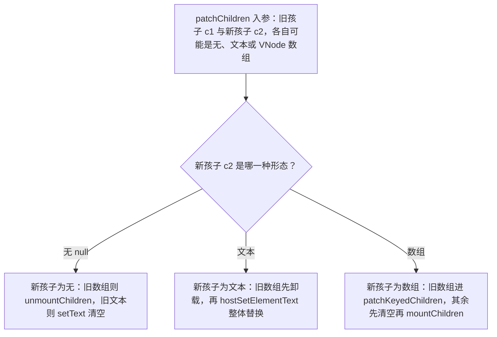
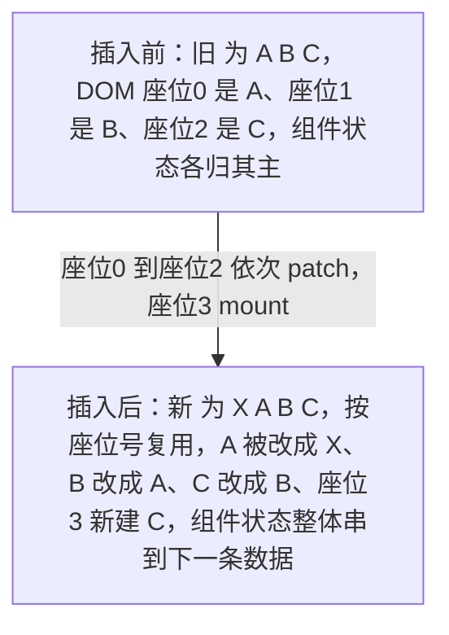
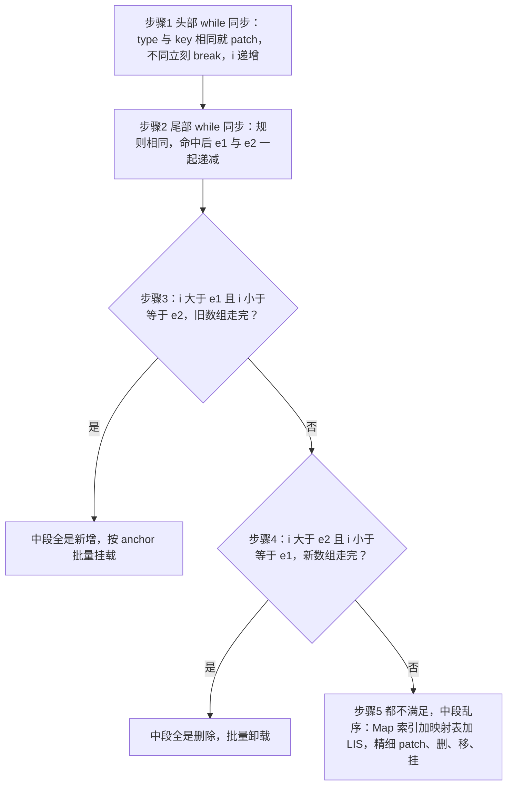
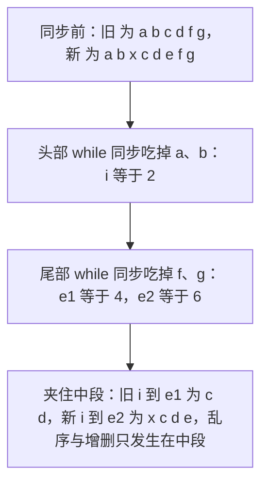
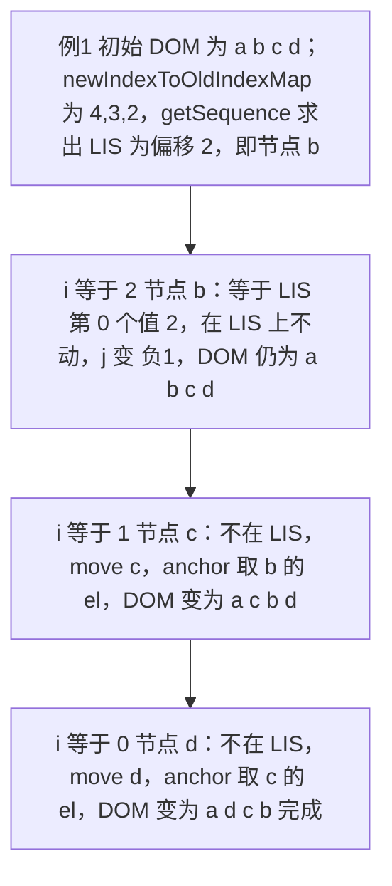
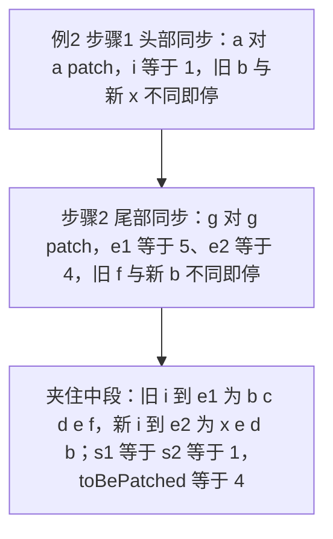
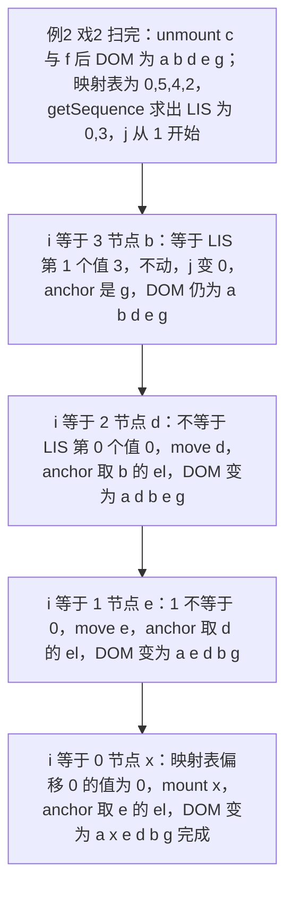
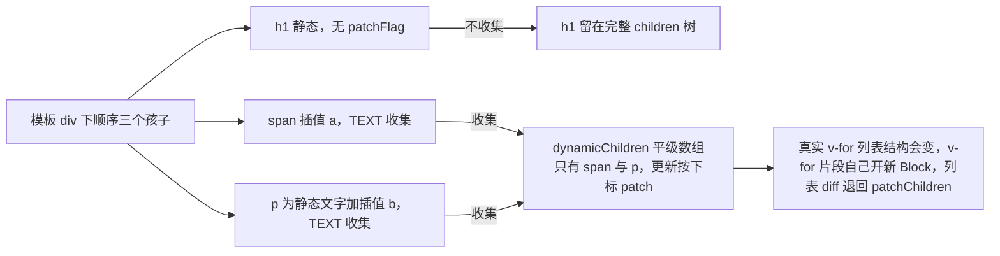
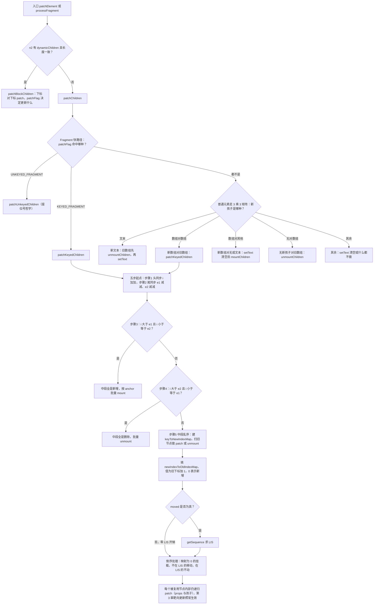

# 第 4 章 Diff 算法

> 上一章：[第 3 章 VNode 与渲染器](./03-vnode-and-renderer.md) ｜ 下一章：[第 5 章 组件系统](./05-component-system.md)

## 学习目标

- 背下 `patchChildren` 的 3×3 决策矩阵：新旧孩子分别为「无 / 文本 / 数组」时的九种组合。
- 理解无 key 列表为什么在头部插入时整体错位（`patchUnkeyedChildren`）。
- 逐行掌握 `patchKeyedChildren` 五步算法：头部同步、尾部同步、纯新增、纯删除、乱序中段。
- 彻底搞懂 `newIndexToOldIndexMap` 的 +1/0 约定，以及 `getSequence` 如何用 O(n log n) 求最长递增子序列（LIS）。
- 能独立手推两个数值案例（纯乱序、增删移混合），算出 Map、映射表、LIS 与挂载/移动/删除清单。
- 理解 `patchBlockChildren` 为什么可以「无 key 对比」，以及 Block 边界在哪里。
- 建立 key 的工程纪律（稳定唯一、不要 index、不要随机数），并能说出 Vue LIS 方案与 React `lastPlacedIndex` 方案的风格差异。
- 区分 STABLE/KEYED/UNKEYED 三种 Fragment 的处理路径。

## 4.1 引入：第 3 章留下的函数名

第 3 章我们反复看到：`patchElement` 在没有 dynamicChildren 时会调 `patchChildren(n1, n2, el, ...)`。它要回答一个问题——



怎么把「旧的一组孩子」变成「新的一组孩子」，且 DOM 操作尽量少？本章所有源码都在 [renderer.ts](file:///Users/yangzhijie/Desktop/practice_projects/claude-code-test/react-vue-source-deep-dive/sources/vue/packages/runtime-core/src/renderer.ts)，行号基于 **Vue 3.5.43**。

先明确一个贯穿全章的事实：**Vue 3 的列表 diff 不是 Vue 2 的「双端比较」，也不是 React 的单指针贪心，而是「头/尾同步 + key 索引 Map + 最长递增子序列」**。旧博客凡是写「Vue3 双端 diff」的，都是把 Vue2 的算法记串了。

## 4.2 patchChildren：3×3 决策矩阵

孩子的类型只有三种：**没有孩子（null）、文本孩子、数组孩子**。入口先做一次 Fragment 标志快路径（v-for 编译产物直接分流）：

出处：packages/runtime-core/src/renderer.ts:1675-1706（Vue 3.5.43，节选）
[renderer.ts](file:///Users/yangzhijie/Desktop/practice_projects/claude-code-test/react-vue-source-deep-dive/sources/vue/packages/runtime-core/src/renderer.ts#L1675-L1706)

```ts
if (patchFlag > 0) {
  if (patchFlag & PatchFlags.KEYED_FRAGMENT) {
    // 可能全带 key，也可能部分带 key；有 flag 保证两边都是数组
    patchKeyedChildren(c1 as VNode[], c2 as VNodeArrayChildren, container, ...)
    return
  } else if (patchFlag & PatchFlags.UNKEYED_FRAGMENT) {
    patchUnkeyedChildren(c1 as VNode[], c2 as VNodeArrayChildren, container, ...)
    return
  }
}
```

普通元素的九种组合在下面的通用分支：

出处：packages/runtime-core/src/renderer.ts:1708-1756（Vue 3.5.43，节选）
[renderer.ts](file:///Users/yangzhijie/Desktop/practice_projects/claude-code-test/react-vue-source-deep-dive/sources/vue/packages/runtime-core/src/renderer.ts#L1708-L1756)

```ts
// children has 3 possibilities: text, array or no children.
if (shapeFlag & ShapeFlags.TEXT_CHILDREN) {
  if (prevShapeFlag & ShapeFlags.ARRAY_CHILDREN) {
    unmountChildren(c1 as VNode[], parentComponent, parentSuspense)
  }
  if (c2 !== c1) {
    hostSetElementText(container, c2 as string)   // 文本直接整体替换
  }
} else {
  if (prevShapeFlag & ShapeFlags.ARRAY_CHILDREN) {
    if (shapeFlag & ShapeFlags.ARRAY_CHILDREN) {
      patchKeyedChildren(c1 as VNode[], c2 as VNodeArrayChildren, ...) // 数组×数组
    } else {
      unmountChildren(c1 as VNode[], parentComponent, parentSuspense, true)
    }
  } else {
    if (prevShapeFlag & ShapeFlags.TEXT_CHILDREN) {
      hostSetElementText(container, '')           // 旧文本先清空
    }
    if (shapeFlag & ShapeFlags.ARRAY_CHILDREN) {
      mountChildren(c2 as VNodeArrayChildren, container, anchor, ...)
    }
  }
}
```

九种组合汇总（行号都在 [1708-1758](file:///Users/yangzhijie/Desktop/practice_projects/claude-code-test/react-vue-source-deep-dive/sources/vue/packages/runtime-core/src/renderer.ts#L1708-L1758)）：

| 旧孩子 ＼ 新孩子 | ① 无（null） | ② 文本 | ③ 数组 |
| --- | --- | --- | --- |
| **A 无** | 什么都不做 | `setText` 写文本 | `mountChildren` 全量挂载 |
| **B 文本** | `setText('')` 清空 | 文本不同才 `setText`（先卸旧数组，与本行无关） | `setText('')` + `mountChildren` |
| **C 数组** | `unmountChildren` 全卸 | 先 `unmountChildren` 再 `setText` | **patchKeyedChildren（本章主角）** |

注意矩阵里根本没有「递归 patch 旧文本」这种操作——**文本是原子值，变了就整体替换，没有 diff**。唯一复杂的格子是 C③：数组对数组。而数组对数组还分两种走法：没 key 的 `patchUnkeyedChildren` 与有 key（含混合）的 `patchKeyedChildren`。

## 4.3 无 key：patchUnkeyedChildren 的位置哲学

无 key 时算法「不认人，只认座位号」：按下标逐个 patch，长度差的部分整体挂载或卸载。

出处：packages/runtime-core/src/renderer.ts:1771-1816（Vue 3.5.43，节选）
[renderer.ts](file:///Users/yangzhijie/Desktop/practice_projects/claude-code-test/react-vue-source-deep-dive/sources/vue/packages/runtime-core/src/renderer.ts#L1771-L1816)

```ts
c1 = c1 || EMPTY_ARR
c2 = c2 || EMPTY_ARR
const oldLength = c1.length
const newLength = c2.length
const commonLength = Math.min(oldLength, newLength)
let i
for (i = 0; i < commonLength; i++) {
  const nextChild = (c2[i] = optimized
    ? cloneIfMounted(c2[i] as VNode) : normalizeVNode(c2[i]))
  patch(c1[i], nextChild, container, null, parentComponent, ...) // 同座位号 patch
}
if (oldLength > newLength) {
  unmountChildren(c1, parentComponent, parentSuspense, true, false, commonLength)
} else {
  mountChildren(c2, container, anchor, parentComponent, ..., commonLength)
}
```

### ⚠️ 头部插入为什么会整体错位

列表 `[A, B, C]` 头部插入一个 X，变成 `[X, A, B, C]`。座位号对齐后：



算法眼里「0 号位还是一个同类元素」，于是原地复用：如果孩子是带内部状态的组件（输入框、展开状态），**状态会整体「串」到下一条数据上**。尾部插入则恰好没问题（commonLength 内全是原节点）。这就是 v-for 必须写 key 的根本原因——给算法一个与位置无关的「身份」。

## 4.4 patchKeyedChildren 五步总览

四个游标先初始化（[renderer.ts:1831-1834](file:///Users/yangzhijie/Desktop/practice_projects/claude-code-test/react-vue-source-deep-dive/sources/vue/packages/runtime-core/src/renderer.ts#L1831-L1834)）：

```ts
let i = 0                  // 头部同步游标，两头一起往后走
const l2 = c2.length
let e1 = c1.length - 1     // 旧数组尾部游标，从后往前走
let e2 = l2 - 1            // 新数组尾部游标
```

五步路线图：



①②③④任意一步命中就结束，绝大多数常见列表更新（头尾追加、头尾删除）根本到不了第⑤步。

## 4.5 步骤①②：头部与尾部同步

出处：packages/runtime-core/src/renderer.ts:1839-1860（Vue 3.5.43，节选）
[renderer.ts](file:///Users/yangzhijie/Desktop/practice_projects/claude-code-test/react-vue-source-deep-dive/sources/vue/packages/runtime-core/src/renderer.ts#L1839-L1860)

```ts
// 1. sync from start
while (i <= e1 && i <= e2) {
  const n1 = c1[i]
  const n2 = (c2[i] = optimized
    ? cloneIfMounted(c2[i] as VNode) : normalizeVNode(c2[i]))
  if (isSameVNodeType(n1, n2)) {
    patch(n1, n2, container, null, parentComponent, ...)
  } else {
    break
  }
  i++
}
```

尾部循环结构相同（[1865-1887](file:///Users/yangzhijie/Desktop/practice_projects/claude-code-test/react-vue-source-deep-dive/sources/vue/packages/runtime-core/src/renderer.ts#L1865-L1887)），只是取 `c1[e1]`/`c2[e2]`，命中后 `e1--; e2--`。两次同步的意义是**尽快夹住中间真正变化的区间**：



`isSameVNodeType` 就是第 3 章那个标准：**type 和 key 全等才算同一个节点**；只 key 同但 type 不同（`<li :key="1">` 变成 `<div :key="1">`），照样 break，后续按「旧的卸载、新的挂载」处理。

## 4.6 步骤③④：纯新增与纯删除

夹完之后若旧数组先耗尽，中段必然全是新节点：

出处：packages/runtime-core/src/renderer.ts:1896-1917（Vue 3.5.43，节选）
[renderer.ts](file:///Users/yangzhijie/Desktop/practice_projects/claude-code-test/react-vue-source-deep-dive/sources/vue/packages/runtime-core/src/renderer.ts#L1896-L1917)

```ts
if (i > e1) {
  if (i <= e2) {
    const nextPos = e2 + 1
    // anchor 取中段后一个节点的真实 el；越界则用父 anchor
    const anchor = nextPos < l2 ? (c2[nextPos] as VNode).el : parentAnchor
    while (i <= e2) {
      patch(null, (c2[i] = optimized
        ? cloneIfMounted(c2[i] as VNode) : normalizeVNode(c2[i])),
        container, anchor, parentComponent, ...)
      i++
    }
  }
}
```

anchor 是这段的灵魂：**新节点要插到「中段后一个已存在节点」的前面**。尾部追加时 `nextPos` 越界，anchor=null（追加末尾）；头部插入时 anchor 是头同步后第一个旧节点，于是新节点们被依次插到它前面。

反之新数组先耗尽，旧中段全部卸载：

出处：packages/runtime-core/src/renderer.ts:1926-1931（Vue 3.5.43）
[renderer.ts](file:///Users/yangzhijie/Desktop/practice_projects/claude-code-test/react-vue-source-deep-dive/sources/vue/packages/runtime-core/src/renderer.ts#L1926-L1931)

```ts
// 4. common sequence + unmount
else if (i > e2) {
  while (i <= e1) {
    unmount(c1[i], parentComponent, parentSuspense, true)
    i++
  }
}
```

## 4.7 步骤⑤：乱序中段的三场戏

进入第⑤步时（[1937](file:///Users/yangzhijie/Desktop/practice_projects/claude-code-test/react-vue-source-deep-dive/sources/vue/packages/runtime-core/src/renderer.ts#L1937)），记 `s1=s2=i`，旧中段 `[s1..e1]`、新中段 `[s2..e2]`。

**戏 1：新中段建 key→新下标 Map（5.1）**

出处：packages/runtime-core/src/renderer.ts:1941-1957（Vue 3.5.43，节选）
[renderer.ts](file:///Users/yangzhijie/Desktop/practice_projects/claude-code-test/react-vue-source-deep-dive/sources/vue/packages/runtime-core/src/renderer.ts#L1941-L1957)

```ts
const keyToNewIndexMap: Map<PropertyKey, number> = new Map()
for (i = s2; i <= e2; i++) {
  const nextChild = (c2[i] = optimized
    ? cloneIfMounted(c2[i] as VNode) : normalizeVNode(c2[i]))
  if (nextChild.key != null) {
    if (__DEV__ && keyToNewIndexMap.has(nextChild.key)) {
      warn(`Duplicate keys found during update:`, JSON.stringify(nextChild.key))
    }
    keyToNewIndexMap.set(nextChild.key, i)
  }
}
```

重复 key 只在 dev 警告（Map 被后者覆盖），所以**线上重复 key 不会报错而是直接错乱**——这是 key 必须唯一的源码级证据。

**戏 2：扫旧中段，更新/卸载并填映射表（5.2）**

出处：packages/runtime-core/src/renderer.ts:1967-2019（Vue 3.5.43，节选）
[renderer.ts](file:///Users/yangzhijie/Desktop/practice_projects/claude-code-test/react-vue-source-deep-dive/sources/vue/packages/runtime-core/src/renderer.ts#L1967-L2019)

```ts
// Map<新下标, 旧下标+1>；0 保留给「没有旧对应的新节点」
const newIndexToOldIndexMap = new Array(toBePatched)
for (i = 0; i < toBePatched; i++) newIndexToOldIndexMap[i] = 0
for (i = s1; i <= e1; i++) {
  const prevChild = c1[i]
  if (patched >= toBePatched) { unmount(prevChild, ...); continue } // 新孩子已够
  let newIndex
  if (prevChild.key != null) {
    newIndex = keyToNewIndexMap.get(prevChild.key)   // O(1) 查身份
  } else {
    for (j = s2; j <= e2; j++) {                     // 无 key：退化线性找同类型
      if (newIndexToOldIndexMap[j - s2] === 0 &&
          isSameVNodeType(prevChild, c2[j] as VNode)) { newIndex = j; break }
    }
  }
  if (newIndex === undefined) {
    unmount(prevChild, parentComponent, parentSuspense, true) // 新数组里没有 -> 删
  } else {
    newIndexToOldIndexMap[newIndex - s2] = i + 1     // 记下：新位←旧位（+1!）
    if (newIndex >= maxNewIndexSoFar) maxNewIndexSoFar = newIndex
    else moved = true   // 新位置比前面见过的都小，相对顺序被打破 -> 需要移动
    patch(prevChild, c2[newIndex] as VNode, container, null, ...)
    patched++
  }
}
```

注意三个细节：① 映射表存的是 **oldIndex+1**，0 被保留给「全新节点」；② `moved` 靠 `maxNewIndexSoFar` 单调判断——旧节点按旧顺序遍历，如果新下标序列整体递增说明没人换位置；③ 无 key 节点要在内层 for 里线性找空位，这是混合列表的性能陷阱，工程上应让所有节点都带 key。

**戏 3：求 LIS，倒序移动与挂载（5.3）**

出处：packages/runtime-core/src/renderer.ts:2023-2060（Vue 3.5.43，节选）
[renderer.ts](file:///Users/yangzhijie/Desktop/practice_projects/claude-code-test/react-vue-source-deep-dive/sources/vue/packages/runtime-core/src/renderer.ts#L2023-L2060)

```ts
const increasingNewIndexSequence = moved
  ? getSequence(newIndexToOldIndexMap)
  : EMPTY_ARR
j = increasingNewIndexSequence.length - 1
// 倒序：用「后一个已经就位的节点」当 anchor
for (i = toBePatched - 1; i >= 0; i--) {
  const nextIndex = s2 + i
  const nextChild = c2[nextIndex] as VNode
  const anchorVNode = c2[nextIndex + 1] as VNode
  const anchor = nextIndex + 1 < l2
    ? anchorVNode.el || resolveAsyncComponentPlaceholder(anchorVNode)
    : parentAnchor
  if (newIndexToOldIndexMap[i] === 0) {
    patch(null, nextChild, container, anchor, parentComponent, ...) // 挂载新节点
  } else if (moved) {
    if (j < 0 || i !== increasingNewIndexSequence[j]) {
      move(nextChild, container, anchor, MoveType.REORDER) // 不在 LIS 上 -> 移
    } else {
      j--                                                   // 在 LIS 上 -> 不动
    }
  }
}
```

为什么倒序？因为 anchor 永远取「后一个节点」：从右往左处理时，右边节点已经在正确位置，`insertBefore` 一次即可就位，不用查父容器。

## 4.8 getSequence：O(n log n) 最长递增子序列

LIS 的直觉：**在「新下标→旧下标」的映射序列里，找出最长的、旧下标严格递增的一段。这段节点在新旧列表中的相对顺序一致，移动时全部原地不动；只移动其余节点，移动次数最少。**

源码（[renderer.ts:2597-2636](file:///Users/yangzhijie/Desktop/practice_projects/claude-code-test/react-vue-source-deep-dive/sources/vue/packages/runtime-core/src/renderer.ts#L2597-L2636)）是教科书级实现，但有两个 Vue 特有的坑。

出处：packages/runtime-core/src/renderer.ts:2597-2620（Vue 3.5.43，节选）
[renderer.ts](file:///Users/yangzhijie/Desktop/practice_projects/claude-code-test/react-vue-source-deep-dive/sources/vue/packages/runtime-core/src/renderer.ts#L2597-L2620)

```ts
function getSequence(arr: number[]): number[] {
  const p = arr.slice()          // 前驱索引表：回溯真实 LIS 用
  const result = [0]             // 📌 存的是「arr 的下标」，不是 arr 的值！
  let i, j, u, v, c
  const len = arr.length
  for (i = 0; i < len; i++) {
    const arrI = arr[i]
    if (arrI !== 0) {            // 0 = 新挂载节点，不参与 LIS
      j = result[result.length - 1]
      if (arr[j] < arrI) {
        p[i] = j                 // 比末尾大：直接追加，记前驱
        result.push(i)
        continue
      }
      // 否则二分找「值 >= arrI」的最左位置，替换它（贪心：尾值越小越好接长）
      u = 0
      v = result.length - 1
      while (u < v) {
        c = (u + v) >> 1
        if (arr[result[c]] < arrI) { u = c + 1 } else { v = c }
      }
```

出处：packages/runtime-core/src/renderer.ts:2621-2636（Vue 3.5.43，节选）
[renderer.ts](file:///Users/yangzhijie/Desktop/practice_projects/claude-code-test/react-vue-source-deep-dive/sources/vue/packages/runtime-core/src/renderer.ts#L2621-L2636)

```ts
      if (arrI < arr[result[u]]) {
        if (u > 0) {
          p[i] = result[u - 1]   // 记录被替换位置的前驱，供回溯
        }
        result[u] = i
      }
    }
  }
  // result 经过替换后不是真实序列，沿 p 回溯还原
  u = result.length
  v = result[u - 1]
  while (u-- > 0) {
    result[u] = v
    v = p[v]
  }
  return result
}
```

逐行要点：

1. **result 存索引不存值**（📌 面试常考）：比较时写 `arr[result[c]]`，返回的也是索引数组，调用方拿来当下标用。
2. **贪心替换 + 二分**：每个元素要么追加（延长序列），要么替换「第一个 ≥ 它」的位置（让序列尾值尽可能小）。二分把内层查找压到 O(log n)，总体 O(n log n)。
3. **p 前驱表**：替换会让 result 不再对应一条真实路径，所以每次替换记下 `p[i] = result[u-1]`，最后从 result 末尾沿 p 倒着回溯出真实 LIS。
4. **0 的角色**：新节点在映射表里是 0，被 `arrI !== 0` 跳过；但 result 初始为 `[0]`，而所有真实旧下标都 ≥1，这个 0 恰好充当「虚拟最小值」不影响追加判断。最终序列里若含 0 位也无害——戏 3 对 map=0 的位置先走挂载分支，永远不会执行移动判断。

## 4.9 数值推演（例 1）：纯乱序 [a b c d] → [a d c b]

下列推演已用脚本按源码逐行复刻自验（结论 PASS）。

**① 头同步**：i=0 时 a≡a，patch a，i=1；i=1 时旧 b vs 新 d，不同，停。
**② 尾同步**：旧 `c1[3]`=d vs 新 `c2[3]`=b，不同，**第一次就停**（e1=3,e2=3 不变）。
**③④都不满足**，进入⑤：s1=s2=1，toBePatched=3。

**戏 1 Map**（新中段 [d,c,b]）：`d→1, c→2, b→3`。
**戏 2 按旧顺序扫中段**，初始 map=`[0,0,0]`，max=0：

| 旧节点 | 新下标 | map（偏移0/1/2 ↦ 旧下标+1） | max/moved |
| --- | --- | --- | --- |
| b (旧1) | 3 | `[0,0,2]` | max=3 |
| c (旧2) | 2 | `[0,3,2]` | 2<3 → moved=true |
| d (旧3) | 1 | `[4,3,2]` | 1<3 → moved=true |

三个节点都 patch（props 就地更新），无删除。**戏 3 LIS**：`getSequence([4,3,2])`——i=0 的 4 与初始 `result=[0]` 所指值相等，不触发替换；随后 3、2 依次严格变小、替换 `result[0]`，最终返回 **`[2]`**——即新偏移 2（新列表第 4 个节点 **b**）是唯一不动锚点。完全逆序时任选一个长度 1 的子序列移动次数等价，贪心替换使结果落在旧下标最小的节点上，即 b。

**倒序移动**（右侧无越界，anchor 为后一个新节点的 el）：



挂载 0 个、卸载 0 个、移动 2 次（c、d），b 没动但它的新位置是靠 c、d 依次插到它前面「让位」得到的。

## 4.10 数值推演（例 2）：增删移混合

旧 `[a b c d e f g]`（下标 0-6）→ 新 `[a x e d b g]`（下标 0-5）。

**① 头同步**：a≡a，patch a，i=1；旧 b vs 新 x，停。
**② 尾同步**：旧 g≡新 g，patch g，e1=5、e2=4；再比旧 f vs 新 b，不同，停。



**⑤** s1=s2=1，toBePatched=4。Map（新中段 [x,e,d,b]）：`x→1, e→2, d→3, b→4`。扫旧中段（i=1..5），map 初始 `[0,0,0,0]`：

| 旧 i | 节点 | 新下标 | map（偏移0..3） | 动作 |
| --- | --- | --- | --- | --- |
| 1 | b | 4 | `[0,0,0,2]` | patch，max=4 |
| 2 | c | undefined | 不变 | **unmount c** |
| 3 | d | 3 | `[0,0,4,2]` | patch，3<4 moved=true |
| 4 | e | 2 | `[0,5,4,2]` | patch，2<3 |
| 5 | f | undefined | 不变 | **unmount f** |

最终 **map = `[0,5,4,2]`**（偏移 0 的 x 是全新节点）。`getSequence([0,5,4,2])`：0 被跳过；5 追加；4 替换 5；2 替换 4；回溯返回 **`[0,3]`**。偏移 3 是 b（已存在的真实不动锚点）；偏移 0 的 x 虽在序列里，但 map=0 会走进挂载分支，序列成员身份对它无意义。

**倒序处理**（j 从 1 开始）：



操作清单：**patch** a、g（头尾同步）与 b、d、e（就地更新 props）；**unmount** c、f；**mount** x；**move** d、e；a、b、g 零移动。两例脚本自验均输出 PASS。

## 4.11 patchBlockChildren：另一条「不需要 key」的赛道

第 3 章讲过，编译器产出的 Block 带 `dynamicChildren`。更新元素时 `patchElement` 优先走 `patchBlockChildren`（[renderer.ts:997-1029](file:///Users/yangzhijie/Desktop/practice_projects/claude-code-test/react-vue-source-deep-dive/sources/vue/packages/runtime-core/src/renderer.ts#L997-L1029)）：for 循环按下标 `patch(oldChildren[i], newChildren[i], ..., true)`。它**不建 Map、不求 LIS、也不看 key**，因为编译器保证同一个 Block 内动态节点的数量与位置恒定——每个动态节点该更新什么，由它自己的 patchFlag 决定（TEXT 改字、CLASS 改 class……），静态节点压根不在数组里。



**Block 边界**就是「结构可能改变」的地方：模板根开 Block、`v-if` 分支开 Block、`v-for` 的每一项是 Block（且 v-for 的 Fragment 以 `disableTracking=true` openBlock，自己不收集孩子，见第 3 章 3.6）。所以两条赛道分工明确：**结构稳定用 Block 平级数组，结构会变（列表、手写 render、BAIL）才上 keyed 五步**。

## 4.12 key 的工程规则与 React 对比

规则只有三条，但每一条都有源码依据：

1. **稳定**：同一条数据在多次渲染间 key 必须不变。别用 `Math.random()`/`Date.now()`——每次渲染 key 都不同，五步算法查 Map 全部 miss，结果是**全卸全挂**：组件 state 全丢、输入框清空、DOM 节点全重建，比不写 key 更糟。
2. **唯一**：同层兄弟间不能重复。重复 key 仅 dev 警告（4.7 戏 1），线上 Map 互相覆盖，两个节点抢一个身份。
3. **不要用数组 index**：index 描述的是「座位号」不是「身份」。头部插入、排序、筛选后座位号重排，正好退化成 4.3 的错位现场；只有「纯尾部追加且不重排」时 index 才恰好安全。

与 React 的风格差异（React 第 5 章已详细讲过 `lastPlacedIndex`，这里先埋点，最终对比章再展开）：

| 维度 | Vue 3 patchKeyedChildren | React 单指针协调 |
| --- | --- | --- |
| 复用判定 | type+key，新旧各自头尾同步 | type+key，从左到右单轮 |
| 移动决策 | 求 LIS，**移动次数最少** | `lastPlacedIndex` 贪心单指针，不回溯 |
| 时间复杂度 | O(n log n)（LIS 二分） | O(n) |
| 取舍 | 多花算力换更少 DOM 移动 | 算法简单可中断；可能多移节点 |

哲学差异呼应两套架构：React 的协调可能在并发模式下被中断、重放，必须保持简单单向；Vue 的编译期优化已经把静态成本扣掉，运行时在列表这一「重灾区」选择用 LIS 把 DOM 操作压到最少。

## 4.13 Fragment 键控片段

v-for 产出的不是元素而是 Fragment（多根模板时更明显），`processFragment`（[1070-1176](file:///Users/yangzhijie/Desktop/practice_projects/claude-code-test/react-vue-source-deep-dive/sources/vue/packages/runtime-core/src/renderer.ts#L1070-L1176)）给片段插两个空文本锚点，更新时按 patchFlag 分三条路：

出处：packages/runtime-core/src/renderer.ts:1125-1144（Vue 3.5.43，节选）
[renderer.ts](file:///Users/yangzhijie/Desktop/practice_projects/claude-code-test/react-vue-source-deep-dive/sources/vue/packages/runtime-core/src/renderer.ts#L1125-L1144)

```ts
if (
  patchFlag > 0 &&
  patchFlag & PatchFlags.STABLE_FRAGMENT &&
  dynamicChildren &&
  n1.dynamicChildren &&
  n1.dynamicChildren.length === dynamicChildren.length
) {
  // 稳定片段（模板多根 / <template v-for>）：顺序不变，只 patch 动态孩子
  patchBlockChildren(n1.dynamicChildren, dynamicChildren, container, ...)
  if (__DEV__) {
    traverseStaticChildren(n1, n2)
  }
} else {
  // keyed/unkeyed 或手写片段：v-for 孩子各自是 block，片段自身没有 dynamicChildren
  patchChildren(n1, n2, container, fragmentEndAnchor, ...)
}
```

- **STABLE_FRAGMENT(64)**：模板多根，孩子顺序永不变，走 patchBlockChildren，连 key 算法都不碰。
- **KEYED_FRAGMENT(128)/UNKEYED_FRAGMENT(256)**：v-for 片段，孩子顺序会变，走 patchChildren，再由 4.2 顶部的快路径分流到 keyed/unkeyed；锚点用 `fragmentEndAnchor`，保证移动操作发生在片段边界内。
- dev 下根级注释产生的 DEV_ROOT_FRAGMENT 强制全量 diff（1086-1095）。

## 4.14 端到端流程串讲



## 4.15 版本勘误 📌

1. **Vue 3 不是「双端 diff」**。头尾指针双向同步 + Map + LIS 的组合从 3.0 起就是如此；四个指针互相比较的「双端比较」是 Vue 2 的算法，网上大量「Vue3 双端 diff」文章名不副实。
2. **3.5 移动锚点对未解析异步组件做了兜底**：[renderer.ts:2034-2035](file:///Users/yangzhijie/Desktop/practice_projects/claude-code-test/react-vue-source-deep-dive/sources/vue/packages/runtime-core/src/renderer.ts#L2034-L2035) 为 `anchorVNode.el || resolveAsyncComponentPlaceholder(anchorVNode)`（#13559、#14173），旧版本直接取 `anchorVNode.el`，异步占位时可能拿到 null。
3. `getSequence` 本体多年未变（仍是 result 存索引 + p 回溯 + 二分），但它的输入语义随 PatchFlags/Block 演进过：只有 `moved=true` 才会调用，纯新增/纯删除/顺序不变时直接 `EMPTY_ARR`，零 LIS 开销。
4. 第 3 章的改名同样影响本章：旧文里的 `HYDRATE_EVENTS` 现为 `NEED_HYDRATION`；事件监听不作为动态节点参与 Block/diff。
5. 无 key 混合节点的内层线性查找（1987-1995）在 3.x 一直存在，「没 key 也能智能复用同类型节点」是有性能代价的，别当成可依赖的行为。

## 4.16 初学者易错点 ⚠️

1. **用 index 当 key 还觉得「能跑就行」。** 头部插入/重排后状态错位是必然事件；测试数据尾部追加时永远复现不了，上线才爆。
2. **用 `Math.random()` 当 key。** 每次渲染身份全变，五步算法退化为全卸全挂，子组件 state、滚动位置、输入内容全部丢失。
3. **同层 key 重复指望框架兜底。** 重复 key 只在 dev warn，线上 Map 静默覆盖；报 warning 必须修。
4. **以为 keyed diff 是 O(n²)。** key 命中是 O(1) Map + O(n log n) LIS；只有混入无 key 节点时内层退化线性扫描，所以列表要全员 key。
5. **以为 LIS 数组里存的是节点值。** `result` 全程存 arr 的下标（比较要写 `arr[result[c]]`），返回的也是下标。
6. **以为「同 key 必复用 DOM」。** 还要过 type 这关：`isSameVNodeType` 要求 type、key 全等；同 key 换标签照样卸载重建。
7. **在 v-for 上纠结写不写 key「反正 Vue 会优化」。** Block 优化只管结构稳定的动态绑定，列表顺序变化必须靠 keyed 五步；不写 key 走 unkeyed，Vue 无法替你恢复身份。

## 4.17 本章小结

- `patchChildren` 是一张 3×3 矩阵：文本原子替换、单方数组挂/卸、双方数组进 keyed（Fragment 标志可提前分流）。
- 无 key 列表按下标 patch，头部插入必然整体错位。
- keyed 五步：头同步、尾同步夹住中段；纯增/纯删走批量；乱序中段用 key Map 识别身份、`newIndexToOldIndexMap`（旧下标+1，0 表新增）记录映射、`maxNewIndexSoFar` 判 moved。
- `getSequence` 用「贪心替换 + 二分 + p 前驱回溯」在 O(n log n) 求出索引形式的 LIS；LIS 上的节点不动，其余倒序按 anchor 移动，map=0 的挂载，Map 查不到的卸载。
- Block 赛道按下标 patch 动态数组，与 keyed 赛道按结构稳定性分工；Fragment 以 STABLE/KEYED/UNKEYED 三标志选路。
- key 要稳定、唯一、非 index、非随机；Vue 求 LIS 追求最少移动，React 用单指针贪心追求简单可中断。

## 4.18 下一章导读

两章以来，`shapeFlag & COMPONENT` 的分支我们都只标了一句「组件，第 5 章详讲」。组件 VNode 挂载时要 createComponentInstance、跑 setup、建渲染 effect；更新时同一个 effect 如何把新 props 灌进实例、子组件为什么「props 没变就不更新」；以及 slots、attrs 透传、生命周期钩子挂载点——下一章进入 [组件系统](file:///Users/yangzhijie/Desktop/practice_projects/claude-code-test/react-vue-source-deep-dive/sources/vue/packages/runtime-core/src/component.ts)，把第 2 章的响应式、第 3 章的渲染器与本章的 diff 串成完整的组件生命周期。
