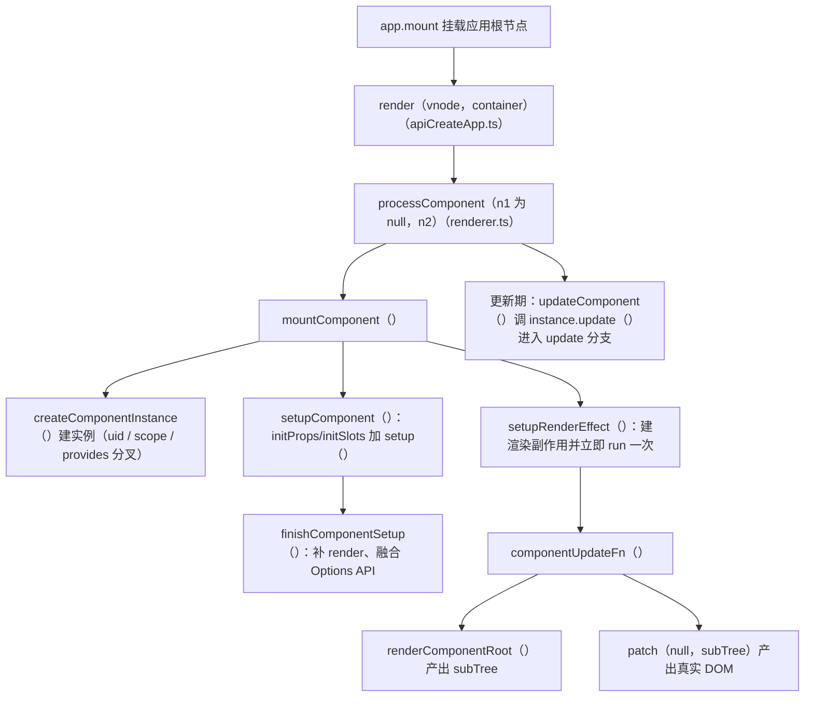
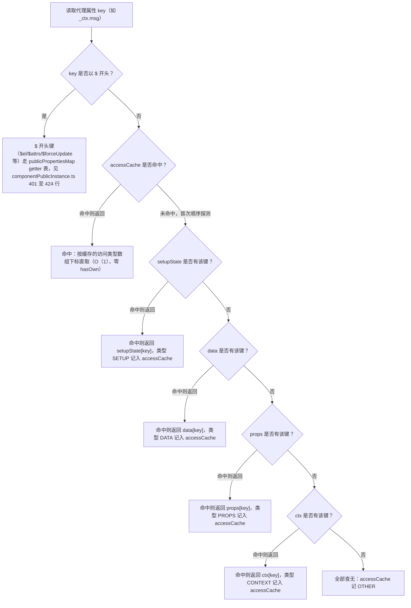
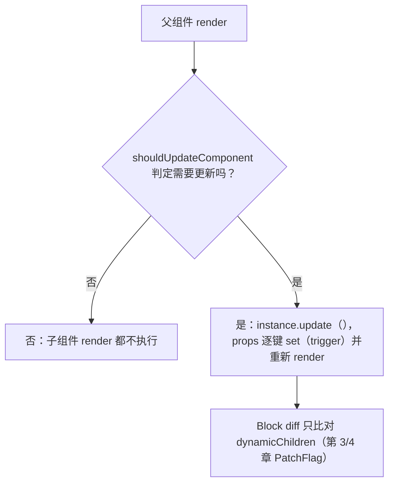
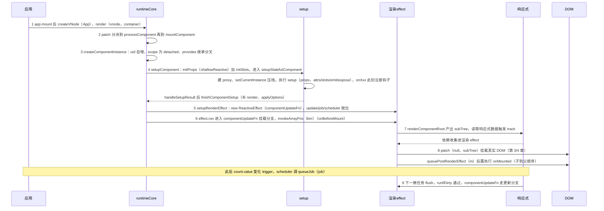
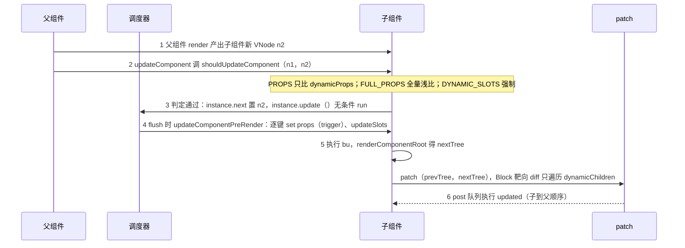

# 第 5 章 组件系统：从 setup() 到真实 DOM 的完整生命周期

> 上一章：[第 4 章 · Diff 算法](./04-diff-algorithm.md) ｜ 下一章：[第 6 章 · Composition API 与内置能力](./06-composition-api.md)

## 学习目标

读完本章，你应当能够：

1. 说清 `ComponentInternalInstance` 关键字段的用途，以及 `proxy`、`ctx`、`setupState` 为什么要分成三个对象。
2. 背出创建管线：`createComponentInstance → setupComponent → setupStatefulComponent → handleSetupResult → finishComponentSetup`。
3. 解释模板里的 `{{ msg }}` 如何同时命中 setup 返回值、data、props——`PublicInstanceProxyHandlers` 的查找顺序与 `accessCache` 加速。
4. 理解组件渲染副作用（ReactiveEffect）如何收集依赖，它的 `scheduler` 如何接调度队列。
5. 说清「父组件更新 → 子组件是否重渲染」的判定链路：`shouldUpdateComponent`、浅响应式 props、`instance.next`。
6. 说出卸载时的清理顺序，以及 KeepAlive 为什么不走普通卸载。

## 引入：你写的组件，在框架里到底是什么？

你每天写一个 `<script setup>` 组件，它在 Vue 内部会经历这样的一生：

1. `<template>` 构建期被编译成 `render` 函数（第 7 章详讲）。
2. 父组件 render 遇到组件标签，产出一个**组件 VNode**。
3. 渲染器 `patch()` 看到 `ShapeFlags.STATEFUL_COMPONENT`，分派给 `processComponent`。
4. 框架 new 出一个**内部实例**（`ComponentInternalInstance`），执行 `setup()` 拿到响应式状态。
5. 用一个 `ReactiveEffect` 包住「render → patch 子树」，这就是组件的**渲染副作用**。
6. 此后它读取过的响应式数据一旦变化，调度器就让这个 effect 重跑——组件「更新」了。
7. 组件被移除时：effect 停止、watcher 全停、DOM 卸载、钩子触发。

本章主角是第 4~7 步，核心代码在 [component.ts](file:///Users/yangzhijie/Desktop/practice_projects/claude-code-test/react-vue-source-deep-dive/sources/vue/packages/runtime-core/src/component.ts) 与 [renderer.ts](file:///Users/yangzhijie/Desktop/practice_projects/claude-code-test/react-vue-source-deep-dive/sources/vue/packages/runtime-core/src/renderer.ts)。先放全景图，后面逐节填充：



## 5.1 组件内部实例：ComponentInternalInstance

### 5.1.1 概念

Vue 2 里你听过的 `vm`，在 Vue 3 中对应**内部实例** `ComponentInternalInstance`。注意它**不是**模板里 `this` 指向的对象——`this` 是外面包的一层 proxy（5.3）。实例本身只是个普通对象，挂着组件运行的全部「行李」：VNode、props、状态、渲染函数、副作用、钩子、注入容器。接口定义见 [component.ts:326-608](file:///Users/yangzhijie/Desktop/practice_projects/claude-code-test/react-vue-source-deep-dive/sources/vue/packages/runtime-core/src/component.ts#L326-L608)。

### 5.1.2 字段全表（按职责分组）

| 分组 | 字段 | 含义 |
| --- | --- | --- |
| 身份 | `uid` | 自增 id，同时用作调度 job 的 id（决定更新顺序） |
| 身份 | `type` | 组件定义对象（`{ setup, render, props }`） |
| 树 | `parent` / `root` / `appContext` | 父实例、根实例、应用全局上下文（全局组件/指令/provides） |
| VNode | `vnode` | 代表本组件在**父树**中的 VNode |
| VNode | `next` | 父组件带来的待更新 VNode；自身状态触发时为 null |
| VNode | `subTree` | 本组件 render 产出的**自己的** VNode 树 |
| 渲染 | `render` | 渲染函数（setup 返回或模板编译） |
| 渲染 | `effect` | **渲染副作用** ReactiveEffect（3.5.43 字段名仍为 effect，见勘误） |
| 渲染 | `update` | `effect.run.bind(effect)`，无条件强制执行一次渲染 |
| 渲染 | `job` | `effect.runIfDirty.bind(effect)`，入调度队列用的任务 |
| 响应式 | `scope` | 组件级 EffectScope，卸载时 `stop()` 一次清掉所有 watcher/effect |
| 公共面 | `ctx` | 代理目标，生产环境就是 `{ _: instance }` |
| 公共面 | `proxy` | 模板/render 中的 `this` |
| 公共面 | `withProxy` | 仅运行时编译（`with(this){}`）的 render 使用 |
| 状态 | `props` | 声明的 props，**浅**响应式 `shallowReactive` |
| 状态 | `attrs` | 未声明为 props 的透传属性（含事件） |
| 状态 | `slots` / `emit` | 插槽 / 已 bind 实例的 emit |
| 状态 | `data` / `setupState` / `refs` | Options data、setup 返回值、模板 ref 集合 |
| 暴露 | `exposed` / `exposeProxy` | `expose()`/`defineExpose` 产物 |
| 缓存 | `accessCache` | 属性访问类型缓存（5.3 重点） |
| 缓存 | `renderCache` | render 第二参数 `_cache`（v-once/内联事件，第 7 章） |
| DI | `provides` | 注入容器，原型链继承自父级 |
| 状态位 | `isMounted` / `isUnmounted` / `isDeactivated` | 三个生命周期状态位 |
| 钩子 | `bc c bm m bu u bum um da a rtg rtc ec sp` | 14 个钩子槽位（第 6 章给映射表） |
| 异步 | `suspense` / `asyncDep` / `asyncResolved` | 异步 setup 与 Suspense 协作（第 6 章） |

### 5.1.3 创建实例：三件最值得看的事

`createComponentInstance` 基本是个巨型对象字面量，挑信息量最大的片段：

出处：packages/runtime-core/src/component.ts:624-644（Vue 3.5.43）
[component.ts](file:///Users/yangzhijie/Desktop/practice_projects/claude-code-test/react-vue-source-deep-dive/sources/vue/packages/runtime-core/src/component.ts#L624-L644)

```ts
const instance: ComponentInternalInstance = {
  uid: uid++,
  vnode, type, parent, appContext,
  root: null!,        // 紧接着补上
  next: null,
  subTree: null!,     // 创建后同步赋值
  effect: null!,      // 三件套先占位
  update: null!,
  job: null!,
  scope: new EffectScope(true /* detached */), // ① 独立作用域
  render: null,
  proxy: null,
  exposed: null, exposeProxy: null, withProxy: null,

  // ② provides 的原型链分叉
  provides: parent ? parent.provides : Object.create(appContext.provides),
  ids: parent ? parent.ids : ['', 0, 0],
  accessCache: null!,
  renderCache: [],
  // ...
}
```

- **① 每个组件自带 detached EffectScope。** 不挂父作用域——组件生死由自己的卸载流程管理。setup 期间 `scope.on()` 激活，期间创建的 `watch`/`watchEffect` 全部自动收编，卸载时一句 `scope.stop()` 清光。
- **② provides 原型链分叉。** 子实例默认直接**引用**父实例的 `provides`；根实例以 `appContext.provides` 为原型建对象。等组件自己第一次 `provide()` 时才 `Object.create(parentProvides)` 切断引用（第 6 章 6.2）。
- **③ effect/update/job 先占位。** 它们在 `setupRenderEffect` 才填充（5.4），是理解 3.5 调度的关键。

对象建完后还有收尾两行（[component.ts:702-708](file:///Users/yangzhijie/Desktop/practice_projects/claude-code-test/react-vue-source-deep-dive/sources/vue/packages/runtime-core/src/component.ts#L702-L708)）：生产环境 `instance.ctx = { _: instance }`，proxy trap 通过 `_` 取回实例；`instance.emit = emit.bind(null, instance)` 让 emit 永远闭包当前实例。

## 5.2 组件创建管线：五个函数的接力

### 5.2.1 入口：processComponent 与 mountComponent

第 3 章讲过 `patch()` 大分派，组件分支在 `processComponent`：

出处：packages/runtime-core/src/renderer.ts:1189-1212（Vue 3.5.43）
[renderer.ts](file:///Users/yangzhijie/Desktop/practice_projects/claude-code-test/react-vue-source-deep-dive/sources/vue/packages/runtime-core/src/renderer.ts#L1189-L1212)

```ts
n2.slotScopeIds = slotScopeIds
if (n1 == null) {
  if (n2.shapeFlag & ShapeFlags.COMPONENT_KEPT_ALIVE) {
    ;(parentComponent!.ctx as KeepAliveContext).activate( // KeepAlive 命中
      n2, container, anchor, namespace, optimized)
  } else {
    mountComponent(n2, container, anchor, parentComponent,
      parentSuspense, namespace, optimized)
  }
} else {
  updateComponent(n1, n2, optimized) // 5.5 讲
}
```

`mountComponent` 内部：建实例 → `setupComponent` → `setupRenderEffect`。注意 KeepAlive 与渲染器是**反向依赖**——渲染器不 import KeepAlive（利于 tree-shaking），而把内部方法 `patch/move/unmount` 挂到 KeepAlive 实例的 `ctx.renderer` 上（[renderer.ts:1246-1248](file:///Users/yangzhijie/Desktop/practice_projects/claude-code-test/react-vue-source-deep-dive/sources/vue/packages/runtime-core/src/renderer.ts#L1246-L1248)）。

### 5.2.2 setupComponent：初始化 props/slots，再进 setup

出处：packages/runtime-core/src/component.ts:816-826（Vue 3.5.43）
[component.ts](file:///Users/yangzhijie/Desktop/practice_projects/claude-code-test/react-vue-source-deep-dive/sources/vue/packages/runtime-core/src/component.ts#L816-L826)

```ts
const { props, children } = instance.vnode
const isStateful = isStatefulComponent(instance)
initProps(instance, props, isStateful, isSSR)   // 浅响应式 props
initSlots(instance, children, optimized || isSSR)

const setupResult = isStateful
  ? setupStatefulComponent(instance, isSSR)     // 有状态组件才调 setup
  : undefined
return setupResult
```

函数式组件没有实例状态，跳过 setup，后续直接拿函数当 render。props 为什么是**浅**响应式？看 initProps 结尾：

出处：packages/runtime-core/src/componentProps.ts:224-226（Vue 3.5.43）
[componentProps.ts](file:///Users/yangzhijie/Desktop/practice_projects/claude-code-test/react-vue-source-deep-dive/sources/vue/packages/runtime-core/src/componentProps.ts#L224-L226)

```ts
if (isStateful) {
  instance.props = isSSR ? props : shallowReactive(props)
}
```

替换 `props.user`（换引用）能被追踪；组件内部改 `props.user.name` 不触发更新。props 被定位为「父组件给的只读快照」，深层可变既违反单向数据流，也会让 props 对比代价飙升。

### 5.2.3 setupStatefulComponent：建代理、调 setup

先建 `accessCache` 和渲染代理：

出处：packages/runtime-core/src/component.ts:859-862（Vue 3.5.43）
[component.ts](file:///Users/yangzhijie/Desktop/practice_projects/claude-code-test/react-vue-source-deep-dive/sources/vue/packages/runtime-core/src/component.ts#L859-L862)

```ts
instance.accessCache = Object.create(null)
instance.proxy = new Proxy(instance.ctx, PublicInstanceProxyHandlers)
```

然后真正调用用户的 `setup()`，三个细节：`pauseTracking()`、按需创建 setupContext、`setCurrentInstance` 压栈：

出处：packages/runtime-core/src/component.ts:867-884（Vue 3.5.43）
[component.ts](file:///Users/yangzhijie/Desktop/practice_projects/claude-code-test/react-vue-source-deep-dive/sources/vue/packages/runtime-core/src/component.ts#L867-L884)

```ts
const { setup } = Component
if (setup) {
  pauseTracking() // setup 本体不是渲染 effect，执行期间不收集依赖
  const setupContext = (instance.setupContext =
    setup.length > 1 ? createSetupContext(instance) : null)
  const reset = setCurrentInstance(instance) // 压栈：onMounted 才找得到实例
  const setupResult = callWithErrorHandling(
    setup, instance, ErrorCodes.SETUP_FUNCTION,
    [__DEV__ ? shallowReadonly(instance.props) : instance.props, setupContext],
  )
  const isAsyncSetup = isPromise(setupResult)
  resetTracking()
  reset() // 出栈
```

- setup 的两个参数就是 `props` 与 `{ attrs, slots, emit, expose }`（`SetupContext`，[component.ts:288-300](file:///Users/yangzhijie/Desktop/practice_projects/claude-code-test/react-vue-source-deep-dive/sources/vue/packages/runtime-core/src/component.ts#L288-L300)）。
- **`setCurrentInstance` 是生命周期钩子能注册的根本**：`onMounted` 内部读全局 `currentInstance`，所以钩子只能在 setup 同步期注册。
- setup 返回 Promise 时：`instance.asyncDep = setupResult`，挂载暂停交给 Suspense 的 `registerDep`（第 6 章）。

### 5.2.4 handleSetupResult：三种返回值，三种命运

出处：packages/runtime-core/src/component.ts:939-971（Vue 3.5.43）
[component.ts](file:///Users/yangzhijie/Desktop/practice_projects/claude-code-test/react-vue-source-deep-dive/sources/vue/packages/runtime-core/src/component.ts#L939-L971)

```ts
if (isFunction(setupResult)) {
  instance.render = setupResult as InternalRenderFunction // 函数→render
} else if (isObject(setupResult)) {
  // 对象→proxyRefs 包成 setupState，模板里 count 等价 count.value
  instance.setupState = proxyRefs(setupResult)
} else if (__DEV__ && setupResult !== undefined) {
  warn(`setup() should return an object. Received: ...`)
}
finishComponentSetup(instance, isSSR)
```

`proxyRefs` 在 get 时自动脱 ref、set 时写回 `.value`，于是模板里 `{{ count }}` 和 `count++` 都能直接工作。

### 5.2.5 finishComponentSetup：补齐 render 与 Options API

setup 没返回函数时 render 还没有着落，先尝试运行时编译模板：

出处：packages/runtime-core/src/component.ts:1015-1018、1050-1064（Vue 3.5.43）
[component.ts](file:///Users/yangzhijie/Desktop/practice_projects/claude-code-test/react-vue-source-deep-dive/sources/vue/packages/runtime-core/src/component.ts#L1015-L1064)

```ts
if (!instance.render) {
  if (!isSSR && compile && !Component.render) {
    const template = Component.template
      || (__FEATURE_OPTIONS_API__ && resolveMergedOptions(instance).template)
    if (template) {
      // ...合并 app.config.compilerOptions 与组件 compilerOptions
      Component.render = compile(template, finalCompilerOptions)
    }
  }
  instance.render = (Component.render || NOOP) as InternalRenderFunction
  if (installWithProxy) { installWithProxy(instance) } // with 块专用代理
}
```

随后融合 Options API（[component.ts:1068-1077](file:///Users/yangzhijie/Desktop/practice_projects/claude-code-test/react-vue-source-deep-dive/sources/vue/packages/runtime-core/src/component.ts#L1068-L1077)）：`applyOptions(instance)` 把 `data()` 响应式化挂 `instance.data`、`methods` 挂 `ctx`、`computed` 用 reactivity 的 computed 实现、生命周期并入钩子数组。这就是两种 API 能混用的原因——最终写进同一组实例字段。

> 只有完整版 `vue` 包注入了运行时编译器（[vue/src/index.ts:104](file:///Users/yangzhijie/Desktop/practice_projects/claude-code-test/react-vue-source-deep-dive/sources/vue/packages/vue/src/index.ts#L104) `registerRuntimeCompiler`）；runtime-only 构建里 `compile` 为 undefined，写 `template` 选项只会收到警告。

## 5.3 PublicInstanceProxyHandlers：模板里的 this 是谁

### 5.3.1 为什么需要代理

模板编译产物大致长这样（第 7 章实测）：

```js
function render(_ctx, _cache) {
  return _createElementVNode('span', null, _toDisplayString(_ctx.msg))
}
```

`_ctx` 就是 `instance.proxy`。同一个 `msg` 可能来自 setup、data、props 或全局属性，编译器无法预知——运行时用一层 Proxy 统一查找，handler 定义在 [componentPublicInstance.ts:449](file:///Users/yangzhijie/Desktop/practice_projects/claude-code-test/react-vue-source-deep-dive/sources/vue/packages/runtime-core/src/componentPublicInstance.ts#L449)。

### 5.3.2 get 查找顺序与 accessCache

get trap 是渲染最热路径，源码注释直说「多次 hasOwn() 是最贵的部分」。访问类型枚举：

出处：packages/runtime-core/src/componentPublicInstance.ts:430-436（Vue 3.5.43）
[componentPublicInstance.ts](file:///Users/yangzhijie/Desktop/practice_projects/claude-code-test/react-vue-source-deep-dive/sources/vue/packages/runtime-core/src/componentPublicInstance.ts#L430-L436)

```ts
enum AccessTypes {
  OTHER,    // 0 以上都不是
  SETUP,    // 1 setupState
  DATA,     // 2 data
  PROPS,    // 3 props
  CONTEXT,  // 4 ctx（methods/inject/自定义属性）
}
```

get 核心：第一次依次探测并记账，之后走数组下标：

出处：packages/runtime-core/src/componentPublicInstance.ts:469-501（Vue 3.5.43）
[componentPublicInstance.ts](file:///Users/yangzhijie/Desktop/practice_projects/claude-code-test/react-vue-source-deep-dive/sources/vue/packages/runtime-core/src/componentPublicInstance.ts#L469-L501)

```ts
if (key[0] !== '$') {
  const n = accessCache![key]
  if (n !== undefined) {                 // 已记账：下标直取，零 hasOwn
    switch (n) {
      case AccessTypes.SETUP:   return setupState[key]
      case AccessTypes.DATA:    return data[key]
      case AccessTypes.CONTEXT: return ctx[key]
      case AccessTypes.PROPS:   return props![key]
    }
  } else if (hasSetupBinding(setupState, key)) {
    accessCache![key] = AccessTypes.SETUP
    return setupState[key]
  } else if (__FEATURE_OPTIONS_API__ && data !== EMPTY_OBJ
             && hasOwn(data, key)) {
    accessCache![key] = AccessTypes.DATA
    return data[key]
  } else if (hasOwn(props, key)) {
    accessCache![key] = AccessTypes.PROPS
    return props![key]
  } else if (ctx !== EMPTY_OBJ && hasOwn(ctx, key)) {
    accessCache![key] = AccessTypes.CONTEXT
    return ctx[key]
  }
}
```

查找优先级与缓存机制：



### 5.3.3 set 写入路由与 withProxy

set trap（[componentPublicInstance.ts:571-592](file:///Users/yangzhijie/Desktop/practice_projects/claude-code-test/react-vue-source-deep-dive/sources/vue/packages/runtime-core/src/componentPublicInstance.ts#L571-L592)）：setupState 可写写 setupState（proxyRefs 处理 ref），否则 data；**写 props 直接拒绝并警告**；其余落到 `ctx`。

`withProxy` 仅为**运行时编译**的 render 准备：完整版 Vue 编译模板生成 `with(this){...}`，`with` 对每个标识符触发 `has` trap；`RuntimeCompiledPublicInstanceProxyHandlers` 改写 `has`，拦截 `Math`/`Date` 等全局白名单（[componentPublicInstance.ts:661-671](file:///Users/yangzhijie/Desktop/practice_projects/claude-code-test/react-vue-source-deep-dive/sources/vue/packages/runtime-core/src/componentPublicInstance.ts#L661-L671)）。SFC 构建期编译不用 `with`，业务里 withProxy 通常为 null。

## 5.4 渲染副作用：把第 2 章的 effect 接到组件上

### 5.4.1 三个字段的分工

出处：packages/runtime-core/src/renderer.ts:1612-1625（Vue 3.5.43）
[renderer.ts](file:///Users/yangzhijie/Desktop/practice_projects/claude-code-test/react-vue-source-deep-dive/sources/vue/packages/runtime-core/src/renderer.ts#L1612-L1625)

```ts
instance.scope.on()
const effect = (instance.effect = new ReactiveEffect(componentUpdateFn))
instance.scope.off()

const update = (instance.update = effect.run.bind(effect))
const job: SchedulerJob = (instance.job = effect.runIfDirty.bind(effect))
job.i = instance
job.id = instance.uid
effect.scheduler = () => queueJob(job)       // 数据变化 → 入队
toggleRecurse(instance, true)                // 允许递归更新
```

| 字段 | 绑定 | 语义 | 调用者 |
| --- | --- | --- | --- |
| `effect` | `new ReactiveEffect(fn)` | 渲染副作用本体 | 框架内部 |
| `update` | `effect.run` | **无条件**重跑 | 首挂载、父更新、$forceUpdate |
| `job` | `effect.runIfDirty` | **依赖真变脏**才执行 | 调度器 queueJob |

第 2 章讲过：数据变化时 effect 不直接重跑，而调 `scheduler`。组件的 scheduler 把 job 按 uid 排序入队、下个微任务统一 flush，因此同一 tick 的多次修改只渲染一次。

### 5.4.2 依赖在何时被收集

`effect.run()` 首跑时，`componentUpdateFn` 调 `renderComponentRoot`，内部执行 `render.call(proxy, ...)`。render 读到的 `props.xxx`、`setupState.xxx`（ref 的 get 会 track）全部把「Dep → 渲染 effect」关系记下；之后 set → trigger → `queueJob(job)`。render 的实际调用：

出处：packages/runtime-core/src/componentRenderUtils.ts:82-111（Vue 3.5.43）
[componentRenderUtils.ts](file:///Users/yangzhijie/Desktop/practice_projects/claude-code-test/react-vue-source-deep-dive/sources/vue/packages/runtime-core/src/componentRenderUtils.ts#L82-L111)

```ts
if (vnode.shapeFlag & ShapeFlags.STATEFUL_COMPONENT) {
  const proxyToUse = withProxy || proxy      // 优先 withProxy
  result = normalizeVNode(
    render!.call(
      thisProxy,
      proxyToUse,
      renderCache,                            // ↔ 编译产物的 _cache
      __DEV__ ? shallowReadonly(props) : props,
      setupState, data, ctx,                  // ↔ 编译产物的 $setup/$data/$options
    ),
  )
  fallthroughAttrs = attrs
}
```

## 5.5 更新：componentUpdateFn 的双分支

### 5.5.1 挂载分支：bm → render → patch → m

`componentUpdateFn` 用 `isMounted` 分两条路径。挂载分支先跑 beforeMount（[renderer.ts:1345-1349](file:///Users/yangzhijie/Desktop/practice_projects/claude-code-test/react-vue-source-deep-dive/sources/vue/packages/runtime-core/src/renderer.ts#L1345-L1349)），再生成子树并 patch：

出处：packages/runtime-core/src/renderer.ts:1411-1437（Vue 3.5.43）
[renderer.ts](file:///Users/yangzhijie/Desktop/practice_projects/claude-code-test/react-vue-source-deep-dive/sources/vue/packages/runtime-core/src/renderer.ts#L1411-L1437)

```ts
const subTree = (instance.subTree = renderComponentRoot(instance))
patch(
  null,          // n1=null：挂载（第 3/4 章全部 diff 逻辑在此）
  subTree,
  container, anchor, instance, parentSuspense, namespace,
)
initialVNode.el = subTree.el
// ...
if (m) {
  queuePostRenderEffect(m, parentSuspense)   // mounted 后置执行
}
```

mounted 为什么要 `queuePostRenderEffect` 而不是直接调？组件树是深度优先 patch 的，父组件走到这里时深层后代可能还没挂完；钩子统一排到本次 flush 的后置队列，才能保证 `onMounted` 触发时**所有后代 DOM 已就位**，且执行顺序为子→父。

### 5.5.2 更新分支：合并 next → bu → patch(prev,next) → u

出处：packages/runtime-core/src/renderer.ts:1523-1574（Vue 3.5.43）
[renderer.ts](file:///Users/yangzhijie/Desktop/practice_projects/claude-code-test/react-vue-source-deep-dive/sources/vue/packages/runtime-core/src/renderer.ts#L1523-L1574)

```ts
if (next) {
  next.el = vnode.el
  updateComponentPreRender(instance, next, optimized) // 合并 props/slots
} else {
  next = vnode                                  // 自身触发：沿用旧 vnode
}
if (bu) { invokeArrayFns(bu) }                  // beforeUpdate

const nextTree = renderComponentRoot(instance)  // 重新 render
const prevTree = instance.subTree
instance.subTree = nextTree
patch(
  prevTree, nextTree,                           // ↔ 第 4 章 diff 主战场
  hostParentNode(prevTree.el!)!,
  getNextHostNode(prevTree),
  instance, parentSuspense, namespace,
)
next.el = nextTree.el
if (u) { queuePostRenderEffect(u, parentSuspense) } // updated 后置
```

`updateComponentPreRender` 做的事很朴素（[renderer.ts:1644-1655](file:///Users/yangzhijie/Desktop/practice_projects/claude-code-test/react-vue-source-deep-dive/sources/vue/packages/runtime-core/src/renderer.ts#L1644-L1655)）：替换 vnode、`updateProps` 逐键 set 到 shallowReactive props、`updateSlots`，再 flush 掉 pre 阶段 watcher。

### 5.5.3 shouldUpdateComponent：子组件要不要更新的闸门

出处：packages/runtime-core/src/renderer.ts:1295-1326（Vue 3.5.43）
[renderer.ts](file:///Users/yangzhijie/Desktop/practice_projects/claude-code-test/react-vue-source-deep-dive/sources/vue/packages/runtime-core/src/renderer.ts#L1295-L1326)

```ts
const instance = (n2.component = n1.component)!
if (shouldUpdateComponent(n1, n2, optimized)) {
  if (/* 异步 setup 未 resolve */) {
    updateComponentPreRender(instance, n2, optimized) // 只更新 props/slots
    return
  }
  instance.next = n2
  instance.update()   // 无条件跑一次渲染 effect
} else {
  n2.el = n1.el       // 不更新：仅搬 el、换引用
  instance.vnode = n2
}
```

判定逻辑在 [componentRenderUtils.ts:373-439](file:///Users/yangzhijie/Desktop/practice_projects/claude-code-test/react-vue-source-deep-dive/sources/vue/packages/runtime-core/src/componentRenderUtils.ts#L373-L439)：

- **编译优化路径**：`DYNAMIC_SLOTS`（插槽引用了 v-for 变量）→ 强制更新；`FULL_PROPS`（动态键 `v-bind="$attrs"`）→ 全量浅比较；`PROPS` → 只遍历 `dynamicProps` 数组里的键；比较跳过纯 emit 监听器。
- **手写 render 路径**：有 children 且插槽非 `$stable` 即强制更新；否则全量浅比较。

出处：packages/runtime-core/src/componentRenderUtils.ts:462-473（Vue 3.5.43）
[componentRenderUtils.ts](file:///Users/yangzhijie/Desktop/practice_projects/claude-code-test/react-vue-source-deep-dive/sources/vue/packages/runtime-core/src/componentRenderUtils.ts#L462-L473)

```ts
function hasPropValueChanged(nextProps, prevProps, key) {
  const nextProp = nextProps[key]
  const prevProp = prevProps[key]
  if (key === 'style' && isObject(nextProp) && isObject(prevProp)) {
    return !looseEqual(nextProp, prevProp) // style 宽松比较
  }
  return nextProp !== prevProp              // 其余引用比较
}
```

所以「父更新 → 子是否重渲染」有两道独立关卡：



## 5.6 卸载：unmountComponent 的清理顺序

出处：packages/runtime-core/src/renderer.ts:2367-2414（Vue 3.5.43）
[renderer.ts](file:///Users/yangzhijie/Desktop/practice_projects/claude-code-test/react-vue-source-deep-dive/sources/vue/packages/runtime-core/src/renderer.ts#L2367-L2414)

```ts
const { bum, scope, job, subTree, um, m, a } = instance
invalidateMount(m); invalidateMount(a)     // 未触发的 mounted 作废

if (bum) { invokeArrayFns(bum) }             // ① beforeUnmount

scope.stop()                                 // ② 停掉所有 effect/watcher

if (job) {
  job.flags! |= SchedulerJobFlags.DISPOSED   // ③ 队列再扫到直接跳过
  unmount(subTree, instance, parentSuspense, doRemove)
}
if (um) { queuePostRenderEffect(um, parentSuspense) } // ④ unmounted 后置
queuePostRenderEffect(() => {
  instance.isUnmounted = true
}, parentSuspense)
```

设计意图：先 `scope.stop()`，避免 DOM 移除过程中触发的响应式变化唤醒本组件 effect；job 打 DISPOSED 位防止批量更新中残留的 job 执行；unmounted 等子树移除完再触发。**KeepAlive 例外**：带 `COMPONENT_SHOULD_KEEP_ALIVE` 的组件改走 `deactivate`——DOM 搬进离屏容器、触发 `deactivated`，实例与 effect 全部保留（第 6 章 6.4）。

## 端到端流程串讲

### 首次挂载 9 步（含 track/trigger 与钩子注入点）



### 更新 6 步



## 版本勘误 📌

1. **3.5.43 渲染副作用字段仍叫 `effect`，不是 `sub`。** 见 [component.ts:348](file:///Users/yangzhijie/Desktop/practice_projects/claude-code-test/react-vue-source-deep-dive/sources/vue/packages/runtime-core/src/component.ts#L348)：`effect: ReactiveEffect`，同时并存 `update`（`effect.run`）与 3.5 新增的 `job`（`effect.runIfDirty`）。部分 3.5 早期测试版曾改名 `sub`，读旧文看到 `instance.sub` 请映射为 `instance.effect`。
2. **不存在 `renderProxy` 字段。** Vue 2 的 `_renderProxy` 在 Vue 3 中对应 `proxy`（普通渲染代理）与 `withProxy`（运行时 with 块专用）两个字段。
3. **mounted/updated 不是同步调用**，而是 `queuePostRenderEffect` 进后置队列，flush 末尾统一执行。
4. **`$forceUpdate` 走 `queueJob(i.update)`**（[componentPublicInstance.ts:417-421](file:///Users/yangzhijie/Desktop/practice_projects/claude-code-test/react-vue-source-deep-dive/sources/vue/packages/runtime-core/src/componentPublicInstance.ts#L417-L421)），跳过脏检查强制执行，与普通响应式触发的 `job` 路径不同。

## 初学者易错点 ⚠️

1. **以为 `this`、`instance`、`setupState` 是同一个对象。** 它们是三层：内部实例（行李架）→ `ctx`（target，仅 `{ _: instance }`）→ `proxy`（模板 this）。`getCurrentInstance()` 拿到的是内部实例，业务代码不应依赖其内部字段。
2. **在 setup 同步期之外注册生命周期钩子。** `onMounted` 依赖全局 `currentInstance`，写进 `setTimeout`/Promise 回调/事件回调里会警告；异步 setup 还要在第一个 `await` 之前注册。
3. **直接修改 props 或深层 mutation 期待更新。** props 是 shallowReactive 且开发环境 shallowReadonly。要改请子组件 `emit('update:xxx')` 让父组件改（v-model 模式）。
4. **把 onMounted 当「数据变化后的 DOM 时机」。** 它只在首次挂载后触发一次；数据变化后操作 DOM 应用 `onUpdated` 或 `watch(..., { flush: 'post' })`。
5. **以为父组件一 render 所有子组件都重渲染。** 中间有 `shouldUpdateComponent` 浅比较 + Block 靶向 diff 双保险；但手写 `h()` 绕过编译优化时，children 变化会强制更新，性能画像与模板不同。
6. **卸载后仍操作实例。** scope 已 stop、job 已 DISPOSED；异步回调里要自行判断 `isUnmounted`（框架内部也是这么做的）。

## 本章小结

- 每个有状态组件对应一个 `ComponentInternalInstance`：VNode、状态、渲染 effect、EffectScope、14 个钩子槽位全挂在上面。
- 创建管线：`createComponentInstance`（建对象 + provides 分叉）→ `setupComponent`（props/slots）→ `setupStatefulComponent`（proxy + setup）→ `handleSetupResult`（函数=render / 对象=proxyRefs）→ `finishComponentSetup`（运行时编译 + applyOptions）。
- 模板统一访问面是 proxy：get 按 setupState → data → props → ctx 查找，`accessCache` 把重复 hasOwn 探测降为数组下标。
- 渲染由 `new ReactiveEffect(componentUpdateFn)` 驱动：`update` 无条件跑、`job` 带脏检查、scheduler 接 queueJob。
- 更新先过 `shouldUpdateComponent` 浅比较，再在 update 分支 `patch(prevTree, nextTree)`；卸载顺序 bum → scope.stop → DISPOSED+卸载 subTree → um。

## 下一章导读

钩子是怎么注册进 `instance.bm/m/...` 的？provide/inject 的原型链细节？KeepAlive、Suspense、defineAsyncComponent 如何与本章管线协作？又如何用同一套 runtime-core 渲染到 Canvas/小程序？第 6 章逐个拆解：

→ [第 6 章 · Composition API 与内置能力](./06-composition-api.md)
