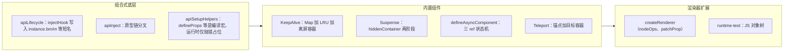
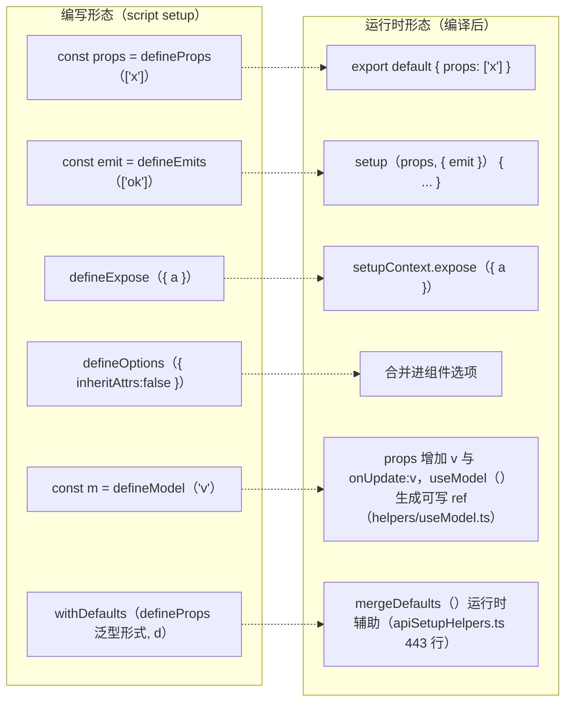
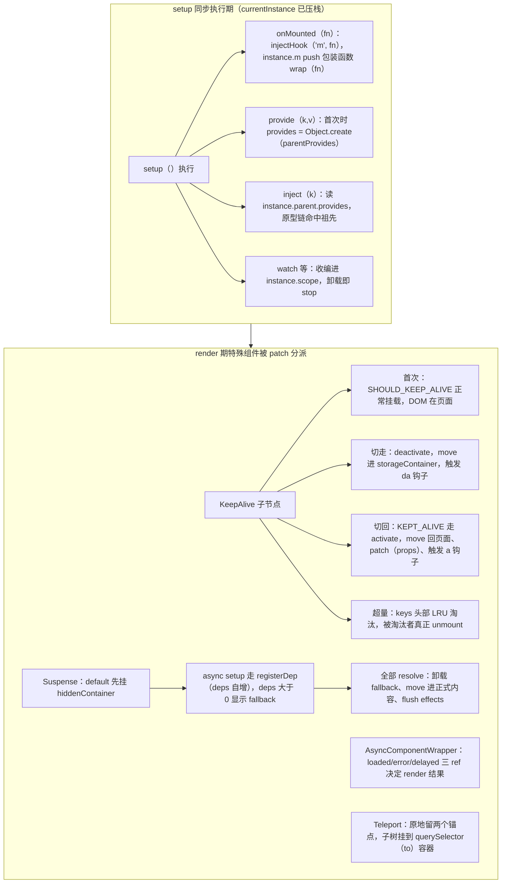

# 第 6 章 Composition API 与内置能力：生命周期、依赖注入、KeepAlive、Suspense 与自定义渲染器

> 上一章：[第 5 章 · 组件系统](./05-component-system.md) ｜ 下一章：[第 7 章 · 编译器与编译优化](./07-compiler.md)

## 学习目标

1. 说清 `onMounted` 这类 API 内部如何通过 `injectHook` 把回调写进实例的短名字段，以及为什么它们只能在 setup 同步期调用。
2. 掌握 provide/inject 的原型链分叉机制，理解注入 ref 为什么依然响应式。
3. 弄清 `defineProps/defineEmits/defineModel` 等**编译宏**与真实运行时 API 的区别。
4. 读懂 KeepAlive 的缓存结构、LRU 淘汰与 activate/deactivate 流程。
5. 理解 Suspense 的两阶段挂载与 `registerDep` 协调机制；defineAsyncComponent 的状态机本质。
6. 了解 Teleport 的实现思路，并能通过 `createRenderer` 接口解释「为什么一套 runtime-core 能渲染到任意目标」。

## 引入：Composition API 不只是「写法不同」

第 5 章看到实例上预留了 14 个钩子槽位，但没解释回调怎么放进去；也没讲 provide/inject 如何跨层级传递。本章先补齐组合式函数背后的机制，再讲四个高级组件（KeepAlive、Suspense、defineAsyncComponent、Teleport），最后落到渲染器接口。



## 6.1 生命周期：injectHook 与 14 个短名

### 6.1.1 短名映射表

钩子在实例上不是用长名字存的，而是缩写。枚举定义在 [enums.ts:1-16](file:///Users/yangzhijie/Desktop/practice_projects/claude-code-test/react-vue-source-deep-dive/sources/vue/packages/runtime-core/src/enums.ts#L1-L16)：

| 枚举 | 短名（实例字段） | 公共 API | 触发时机（第 5 章位置） |
| --- | --- | --- | --- |
| BEFORE_CREATE | `bc` | （仅 Options API `beforeCreate`） | setup 之前 |
| CREATED | `c` | （仅 Options API `created`） | setup 之后 |
| BEFORE_MOUNT | `bm` | `onBeforeMount` | 首次 render 之前 |
| MOUNTED | `m` | `onMounted` | 首次挂载 DOM 之后（后置队列） |
| BEFORE_UPDATE | `bu` | `onBeforeUpdate` | 更新 render 之前 |
| UPDATED | `u` | `onUpdated` | 更新 DOM 之后（后置队列） |
| BEFORE_UNMOUNT | `bum` | `onBeforeUnmount` | 卸载开始 |
| UNMOUNTED | `um` | `onUnmounted` | 子树卸载之后（后置队列） |
| DEACTIVATED | `da` | `onDeactivated` | 被 KeepAlive 停用 |
| ACTIVATED | `a` | `onActivated` | 被 KeepAlive 重新激活 |
| RENDER_TRIGGERED | `rtg` | `onRenderTriggered` | 渲染 effect 被 trigger（调试） |
| RENDER_TRACKED | `rtc` | `onRenderTracked` | 渲染 effect 收集依赖（调试） |
| ERROR_CAPTURED | `ec` | `onErrorCaptured` | 后代抛错冒泡 |
| SERVER_PREFETCH | `sp` | `onServerPrefetch` | SSR 期间取数（客户端也可注册） |

注意 `LifecycleHook` 的类型是 `(TFn & SchedulerJob)[] | null`（[component.ts:285](file:///Users/yangzhijie/Desktop/practice_projects/claude-code-test/react-vue-source-deep-dive/sources/vue/packages/runtime-core/src/component.ts#L285)）——**每个槽位是数组**，所以同一个钩子可以注册多次（mixin、组合函数都会往里 push），不需要手动去重。

### 6.1.2 injectHook：所有 onXxx 的共同内核

`onBeforeMount/onMounted/...` 全部由同一个高阶函数 `createHook` 生成（[apiLifecycle.ts:66-97](file:///Users/yangzhijie/Desktop/practice_projects/claude-code-test/react-vue-source-deep-dive/sources/vue/packages/runtime-core/src/apiLifecycle.ts#L66-L97)），核心是 `injectHook`：

出处：packages/runtime-core/src/apiLifecycle.ts:20-51（Vue 3.5.43）
[apiLifecycle.ts](file:///Users/yangzhijie/Desktop/practice_projects/claude-code-test/react-vue-source-deep-dive/sources/vue/packages/runtime-core/src/apiLifecycle.ts#L20-L51)

```ts
export function injectHook(
  type: LifecycleHooks,
  hook: Function & { __weh?: Function },
  target: ComponentInternalInstance | null = currentInstance,
  prepend: boolean = false,
): Function | undefined {
  if (target) {
    const hooks = target[type] || (target[type] = [])
    // 用 __weh 缓存“带错误处理的包装函数”，使同一函数可被调度器去重
    const wrappedHook =
      hook.__weh ||
      (hook.__weh = (...args: unknown[]) => {
        pauseTracking()                       // 钩子内不收集依赖
        const reset = setCurrentInstance(target) // 执行期临时恢复实例
        const res = callWithAsyncErrorHandling(hook, target, type, args)
        reset()
        resetTracking()
        return res
      })
    prepend ? hooks.unshift(wrappedHook) : hooks.push(wrappedHook)
    return wrappedHook
  } else if (__DEV__) {
    warn(`... can only be used during execution of setup().`)
  }
}
```

三个关键点：

1. **默认 target 是全局 `currentInstance`**。它只在 setup 同步执行期间被 `setCurrentInstance` 设置（第 5 章 5.2.3）。target 为 null 就发警告——这就是「钩子只能 setup 期间注册」的全部原因，没有任何魔法。
2. **包一层 `__weh`（with error handling）**：钩子统一经 `callWithAsyncErrorHandling` 执行，错误走 `errorHandling.ts` 的冒泡链（`onErrorCaptured` → `app.config.errorHandler`），不会炸掉整个渲染流程。
3. **执行时临时 `setCurrentInstance(target)`**：所以钩子内部调用 `getCurrentInstance()` 仍能拿到实例。

### 6.1.3 onActivated/onDeactivated 的特殊处理

这两个定义在 [KeepAlive.ts:411-461](file:///Users/yangzhijie/Desktop/practice_projects/claude-code-test/react-vue-source-deep-dive/sources/vue/packages/runtime-core/src/components/KeepAlive.ts#L411-L461)，比普通钩子多两件事：

- 包装函数运行时沿 parent 链检查 `isDeactivated`——如果组件处在已停用的分支里，钩子直接跳过。
- 除了注册在目标实例上，还会**向上注入到每一层 KeepAlive 根实例**，这样 KeepAlive 激活时无需遍历整棵子树，直接调自己实例上的钩子数组即可触发后代的 a/da。

`onServerPrefetch`（sp）则是唯一在 SSR setup 阶段也允许注册的钩子（[apiLifecycle.ts:72-78](file:///Users/yangzhijie/Desktop/practice_projects/claude-code-test/react-vue-source-deep-dive/sources/vue/packages/runtime-core/src/apiLifecycle.ts#L72-L78)），服务端渲染器会 await 它的返回值。

### 6.1.4 与 React Hooks 规则的对比

React 要求 hooks 不能写在条件/循环里，靠的是「每次 render 按固定顺序执行、用链表下标对齐」。Vue 的生命周期注册不一样：

- Vue 钩子在 **setup 同步期**注册，而 setup **每个组件只执行一次**——没有「反复执行按顺序对齐」的约束。注册结果是 push 进实例上的数组，写在 `if` 里完全合法。
- 因此组合式函数（composables）内部可以自由 `onMounted`/`onUnmounted`，调用者只需保证「同步调用组合函数」（本质是保证 currentInstance 还在）。
- 代价是 setup 之外（异步回调、事件处理器）注册不了钩子；React 的 `useEffect` 则可以在每次 render 的函数体任意位置写，但要处理依赖数组与闭包陈旧问题。

## 6.2 provide / inject：原型链上的依赖注入

### 6.2.1 provide：第一次提供时才分叉

出处：packages/runtime-core/src/apiInject.ts:19-33（Vue 3.5.43）
[apiInject.ts](file:///Users/yangzhijie/Desktop/practice_projects/claude-code-test/react-vue-source-deep-dive/sources/vue/packages/runtime-core/src/apiInject.ts#L19-L33)

```ts
if (currentInstance) {
  let provides = currentInstance.provides
  // 默认继承父级 provides 对象；自己要 provide 时，
  // 才以父级 provides 为原型创建新对象，切断直接引用
  const parentProvides =
    currentInstance.parent && currentInstance.parent.provides
  if (parentProvides === provides) {
    provides = currentInstance.provides = Object.create(parentProvides)
  }
  provides[key as string] = value
}
```

回顾第 5 章：子实例创建时 `provides: parent.provides`（直接引用）。所以这里用 `parentProvides === provides` 判断「我是否从未 provide 过」——一旦相等就 `Object.create(parentProvides)` 分叉。分叉后当前层写入不会污染父层，而祖先层的 key 靠**原型链**天然可见。

### 6.2.2 inject：沿原型链读，响应式自动保留

出处：packages/runtime-core/src/apiInject.ts:64-81（Vue 3.5.43）
[apiInject.ts](file:///Users/yangzhijie/Desktop/practice_projects/claude-code-test/react-vue-source-deep-dive/sources/vue/packages/runtime-core/src/apiInject.ts#L64-L81)

```ts
let provides = currentApp
  ? currentApp._context.provides
  : instance
    ? instance.parent == null || instance.ce
      ? instance.vnode.appContext && instance.vnode.appContext.provides
      : instance.parent.provides
    : undefined

if (provides && (key as string | symbol) in provides) {
  return provides[key as string]   // in 操作符会沿原型链查找
} else if (arguments.length > 1) {
  return treatDefaultAsFactory && isFunction(defaultValue)
    ? defaultValue.call(instance && instance.proxy)
    : defaultValue                 // 支持默认值 / 工厂函数
}
```

要点：

- 注入取的是 **`instance.parent.provides`**（不是自己的），方向不会搞反；根组件则回落到 `appContext.provides`，所以 `app.provide()` 全局可见。
- `key in provides` 走原型链，祖先任意层级 provide 的值都能找到。
- **注入 ref 仍然响应式**：provide/inject 只搬运引用，不做解包。祖先 provide 的是 `ref`/`reactive`，后代 inject 到的就是同一个响应式对象，在 render/computed 里读取照样建立依赖。若想禁止后代修改，可自行 `provide(key, readonly(x))`。
- inject 通常只在 setup 取一次：拿到的是对象引用，值变化通过响应式系统通知，不需要重复 inject。

## 6.3 编译宏不是运行时 API

你在 `<script setup>` 里写的 `defineProps`、`defineEmits`、`defineExpose`、`defineOptions`、`defineSlots`、`defineModel`、`withDefaults`，**在 Vue 运行时包里并不存在有效实现**。它们的「真身」在 [apiSetupHelpers.ts](file:///Users/yangzhijie/Desktop/practice_projects/claude-code-test/react-vue-source-deep-dive/sources/vue/packages/runtime-core/src/apiSetupHelpers.ts) 里只是 dev 占位：

出处：packages/runtime-core/src/apiSetupHelpers.ts:38-44、92-97（Vue 3.5.43）
[apiSetupHelpers.ts](file:///Users/yangzhijie/Desktop/practice_projects/claude-code-test/react-vue-source-deep-dive/sources/vue/packages/runtime-core/src/apiSetupHelpers.ts#L38-L97)

```ts
// dev only
const warnRuntimeUsage = (method: string) =>
  warn(
    `${method}() is a compiler-hint helper that is only usable inside ` +
      `<script setup> of a single file component. Its arguments should be ` +
      `compiled away and passing it at runtime has no effect.`,
  )
// ...
export function defineProps() {
  if (__DEV__) {
    warnRuntimeUsage(`defineProps`)
  }
  return null as any
}
```

`defineEmits/defineExpose/defineOptions/defineSlots/defineModel/withDefaults` 同构：函数体只在 dev 下发警告，类型重载才是它们存在的主要价值（给 TypeScript 和 IDE 用）。

它们真正的语义由 **compiler-sfc 在构建期**消化：



所以第 5 章 setup 收到的 `props`/`emit` 才是真实运行时形态——宏只是把声明「提升」成了组件选项。这也解释了为什么宏不需要 import、为什么不能在普通 `.js` 文件里调用。

> 顺带一提：同文件里 `useSlots()`/`useAttrs()` 是**真**运行时 API（[apiSetupHelpers.ts:408-414](file:///Users/yangzhijie/Desktop/practice_projects/claude-code-test/react-vue-source-deep-dive/sources/vue/packages/runtime-core/src/apiSetupHelpers.ts#L408-L414)），它们从 setupContext 取 slots/attrs，别和宏混淆。

## 6.4 KeepAlive：把组件「晾」在离屏容器里

### 6.4.1 数据结构与离屏容器

KeepAlive 本身是个带 `__isKeepAlive: true` 标记的有状态组件（[KeepAlive.ts:79-93](file:///Users/yangzhijie/Desktop/practice_projects/claude-code-test/react-vue-source-deep-dive/sources/vue/packages/runtime-core/src/components/KeepAlive.ts#L79-L93)）。setup 闭包里维护三样东西：

出处：packages/runtime-core/src/components/KeepAlive.ts:111-129（Vue 3.5.43）
[KeepAlive.ts](file:///Users/yangzhijie/Desktop/practice_projects/claude-code-test/react-vue-source-deep-dive/sources/vue/packages/runtime-core/src/components/KeepAlive.ts#L111-L129)

```ts
const cache: Cache = new Map()   // CacheKey -> VNode
const keys: Keys = new Set()    // 访问次序集合，迭代器头部即“最久未用”
let current: VNode | null = null
// ...
const {
  renderer: {
    p: patch,
    m: move,
    um: _unmount,
    o: { createElement },
  },
} = sharedContext
const storageContainer = createElement('div') // 离屏容器（DOM 外的游离 div）
```

| 结构 | 作用 |
| --- | --- |
| `cache: Map` | key（vnode.key 或组件定义）→ 缓存的 VNode（含 el、component 实例） |
| `keys: Set` | 记录访问次序：命中时 delete 再 add 到末尾；淘汰取 `keys.values().next().value`（LRU） |
| `storageContainer` | 游离 `div`，deactivate 时把 DOM 整块 move 进去，事件/状态都不丢 |

### 6.4.2 render 中的标记与 LRU 淘汰

KeepAlive 的 render 读取默认插槽的第一个子 VNode，做 include/exclude 匹配，然后给它打两个 shapeFlag：

出处：packages/runtime-core/src/components/KeepAlive.ts:350-371（Vue 3.5.43）
[KeepAlive.ts](file:///Users/yangzhijie/Desktop/practice_projects/claude-code-test/react-vue-source-deep-dive/sources/vue/packages/runtime-core/src/components/KeepAlive.ts#L350-L371)

```ts
if (cachedVNode) {
  // 复用已缓存的 DOM 与组件实例
  vnode.el = cachedVNode.el
  vnode.component = cachedVNode.component
  // ...
  vnode.shapeFlag |= ShapeFlags.COMPONENT_KEPT_ALIVE  // 让 processComponent 走 activate
  keys.delete(key); keys.add(key)                     // 刷新为“最新”
} else {
  keys.add(key)
  if (max && keys.size > parseInt(max as string, 10)) {
    pruneCacheEntry(keys.values().next().value!)      // LRU：淘汰最久未用
  }
}
vnode.shapeFlag |= ShapeFlags.COMPONENT_SHOULD_KEEP_ALIVE // 卸载时改走 deactivate
```

两个标记位分工：`SHOULD_KEEP_ALIVE` 在卸载阶段被识别（改 deactivate）；`KEPT_ALIVE` 在挂载阶段被识别（改 activate，见第 5 章 processComponent）。include/exclude 变化时用一个 `flush: 'post'` 的 watch 调用 `pruneCache` 清理（[KeepAlive.ts:232-240](file:///Users/yangzhijie/Desktop/practice_projects/claude-code-test/react-vue-source-deep-dive/sources/vue/packages/runtime-core/src/components/KeepAlive.ts#L232-L240)），匹配支持逗号字符串、正则、数组。

### 6.4.3 activate / deactivate

出处：packages/runtime-core/src/components/KeepAlive.ts:131-195（Vue 3.5.43）
[KeepAlive.ts](file:///Users/yangzhijie/Desktop/practice_projects/claude-code-test/react-vue-source-deep-dive/sources/vue/packages/runtime-core/src/components/KeepAlive.ts#L131-L195)

```ts
sharedContext.activate = (vnode, container, anchor, namespace, optimized) => {
  const instance = vnode.component!
  move(vnode, container, anchor, MoveType.ENTER, parentSuspense) // DOM 移回页面
  patch(
    instance.vnode, vnode, container, anchor, instance,
    parentSuspense, namespace, vnode.slotScopeIds, optimized,
  ) // props 可能变化，patch 一遍恢复
  queuePostRenderEffect(() => {
    instance.isDeactivated = false
    if (instance.a) { invokeArrayFns(instance.a) } // activated 钩子
  }, parentSuspense)
}

sharedContext.deactivate = (vnode: VNode) => {
  const instance = vnode.component!
  invalidateMount(instance.m); invalidateMount(instance.a)
  move(vnode, storageContainer, null, MoveType.LEAVE, parentSuspense) // 搬到离屏
  queuePostRenderEffect(() => {
    if (instance.da) { invokeArrayFns(instance.da) } // deactivated 钩子
    instance.isDeactivated = true
  }, parentSuspense)
}
```

注意 activate 时仍要 `patch(旧vnode, 新vnode)`——离开期间父组件可能已经更新过 props。整个过程组件实例、响应式 effect、滚动 DOM 状态全部活着，只是 DOM 被挪进了游离 div。

## 6.5 Suspense：异步依赖的两阶段协调

### 6.5.1 两阶段与 hiddenContainer

Suspense 把内容分成两个插槽：`#default`（可能含异步 setup 组件）和 `#fallback`（加载态）。挂载时先把 default 子树 patch 到一个**离屏容器**：

出处：packages/runtime-core/src/components/Suspense.ts:180-227（Vue 3.5.43）
[Suspense.ts](file:///Users/yangzhijie/Desktop/practice_projects/claude-code-test/react-vue-source-deep-dive/sources/vue/packages/runtime-core/src/components/Suspense.ts#L180-L227)

```ts
const hiddenContainer = createElement('div')
const suspense = (vnode.suspense = createSuspenseBoundary(
  vnode, parentSuspense, parentComponent, container, hiddenContainer, ...
))
// ① default 内容先挂到离屏容器
patch(
  null,
  (suspense.pendingBranch = vnode.ssContent!),
  hiddenContainer, null, parentComponent, suspense, namespace, slotScopeIds,
)
// ② 过程中若注册了异步依赖（deps>0）：显示 fallback
if (suspense.deps > 0) {
  triggerEvent(vnode, 'onPending')
  triggerEvent(vnode, 'onFallback')
  patch(null, vnode.ssFallback!, container, anchor,
    parentComponent, null /* fallback 无 suspense 上下文 */, namespace, slotScopeIds)
  setActiveBranch(suspense, vnode.ssFallback!)
} else {
  suspense.resolve(false, true) // 没有异步依赖：同步 resolve
}
```

边界对象 `SuspenseBoundary` 的状态字段（[Suspense.ts:440-468](file:///Users/yangzhijie/Desktop/practice_projects/claude-code-test/react-vue-source-deep-dive/sources/vue/packages/runtime-core/src/components/Suspense.ts#L440-L468)）：`pendingBranch`（离屏中的新树）、`activeBranch`（当前页面上的树）、`deps`（未完成异步计数）、`pendingId`（每次切换递增，过期结果靠它丢弃）、`isInFallback`、`effects`（resolve 后要执行的 mounted 类钩子）。

### 6.5.2 registerDep：异步 setup 的挂起点

第 5 章见过：`mountComponent` 发现 `instance.asyncDep`（async setup 的 Promise）时不直接 setupRenderEffect，而是调 `parentSuspense.registerDep`：

出处：packages/runtime-core/src/components/Suspense.ts:736-775（Vue 3.5.43）
[Suspense.ts](file:///Users/yangzhijie/Desktop/practice_projects/claude-code-test/react-vue-source-deep-dive/sources/vue/packages/runtime-core/src/components/Suspense.ts#L736-L775)

```ts
registerDep(instance, setupRenderEffect, optimized) {
  const isInPendingSuspense = !!suspense.pendingBranch
  if (isInPendingSuspense) {
    suspense.deps++                         // 又多一个异步依赖
  }
  // ...
  instance
    .asyncDep!.catch(err => { handleError(err, instance, ErrorCodes.SETUP_FUNCTION) })
    .then(asyncSetupResult => {
      if (instance.isUnmounted || suspense.isUnmounted
          || suspense.pendingId !== instance.suspenseId) {
        return                              // 已过期（切换/卸载）：丢弃结果
      }
      instance.asyncResolved = true
      handleSetupResult(instance, asyncSetupResult, false)
      // ...
      setupRenderEffect(instance, vnode, ...) // 重新进入第 5 章的挂载流程
      if (isInPendingSuspense && --suspense.deps === 0) {
        suspense.resolve()                  // 最后一个依赖完成 → resolve
      }
    })
}
```

全部依赖 resolve 后，`resolve()` 卸载 fallback、用 `move(pendingBranch, container)` 把离屏子树整体搬进真实容器（[Suspense.ts:617-619](file:///Users/yangzhijie/Desktop/practice_projects/claude-code-test/react-vue-source-deep-dive/sources/vue/packages/runtime-core/src/components/Suspense.ts#L617-L619)），再 flush 收集到的 mounted 钩子。嵌套 Suspense 通过 `suspensible` 选项把自己计入父边界的 `deps`（[Suspense.ts:507-513](file:///Users/yangzhijie/Desktop/practice_projects/claude-code-test/react-vue-source-deep-dive/sources/vue/packages/runtime-core/src/components/Suspense.ts#L507-L513)），实现父子协调。

## 6.6 defineAsyncComponent：一个会切换 render 结果的包装组件

它的本质：返回一个名为 `AsyncComponentWrapper` 的普通组件（带 `__asyncLoader` 标记），在自己的 setup 里维护加载状态，render 按状态返回不同子树。选项与默认值：

出处：packages/runtime-core/src/apiAsyncComponent.ts:55-64（Vue 3.5.43）
[apiAsyncComponent.ts](file:///Users/yangzhijie/Desktop/practice_projects/claude-code-test/react-vue-source-deep-dive/sources/vue/packages/runtime-core/src/apiAsyncComponent.ts#L55-L64)

```ts
const {
  loader,
  loadingComponent,
  errorComponent,
  delay = 200,        // 200ms 内加载完就不闪 loading
  hydrate: hydrateStrategy,
  timeout,            // undefined = 永不超时
  suspensible = true, // 默认与上层 Suspense 整合
  onError: userOnError,
} = source
```

setup 内用三个 ref 表达状态机：`loaded` / `error` / `delayed`，外加 `timeoutTimer`、`delayTimer` 两个定时器，卸载时在 `onUnmounted` 里清掉（[apiAsyncComponent.ts:203-233](file:///Users/yangzhijie/Desktop/practice_projects/claude-code-test/react-vue-source-deep-dive/sources/vue/packages/runtime-core/src/apiAsyncComponent.ts#L203-L233)）。render 就是状态分派：

出处：packages/runtime-core/src/apiAsyncComponent.ts:254-267（Vue 3.5.43）
[apiAsyncComponent.ts](file:///Users/yangzhijie/Desktop/practice_projects/claude-code-test/react-vue-source-deep-dive/sources/vue/packages/runtime-core/src/apiAsyncComponent.ts#L254-L267)

```ts
return () => {
  if (loaded.value && resolvedComp) {
    return createInnerComp(resolvedComp, instance)       // 正式组件
  } else if (error.value && errorComponent) {
    return createVNode(errorComponent, { error: error.value }) // 错误态
  } else if (loadingComponent && !delayed.value) {
    return createInnerComp(loadingComponent as ConcreteComponent, instance)
  }
  // 否则渲染注释占位
}
```

重试不是声明式选项，而是通过 `onError(err, retry, fail, attempts)` 回调把 `retry()` 交给你（[apiAsyncComponent.ts:82-93](file:///Users/yangzhijie/Desktop/practice_projects/claude-code-test/react-vue-source-deep-dive/sources/vue/packages/runtime-core/src/apiAsyncComponent.ts#L82-L93)）——你可以用它实现指数退避。`suspensible: true` 且处于 Suspense 内时，setup 直接 `return load().then(...)`，由 Suspense 接管，不显示 loadingComponent。

## 6.7 Teleport：占位锚点 + 目标容器

Teleport 的 process 实现在组件自身 [Teleport.ts:81](file:///Users/yangzhijie/Desktop/practice_projects/claude-code-test/react-vue-source-deep-dive/sources/vue/packages/runtime-core/src/components/Teleport.ts#L81)。挂载时先在原位置插入两个空文本锚点，再决定子树挂哪里：

出处：packages/runtime-core/src/components/Teleport.ts:178-199（Vue 3.5.43）
[Teleport.ts](file:///Users/yangzhijie/Desktop/practice_projects/claude-code-test/react-vue-source-deep-dive/sources/vue/packages/runtime-core/src/components/Teleport.ts#L178-L199)

```ts
if (n1 == null) {
  // 主视图里保留两个锚点（teleport start / end），用于移动与卸载定位
  const placeholder = (n2.el = __DEV__
    ? createComment('teleport start') : createText(''))
  const mainAnchor = (n2.anchor = __DEV__
    ? createComment('teleport end') : createText(''))
  insert(placeholder, container, anchor)
  insert(mainAnchor, container, anchor)
  // ...
  if (disabled) {
    mount(n2, container, mainAnchor) // disabled：就地渲染在锚点之间
  }
}
```

- `to` 通过渲染器可选的 `querySelector` 解析（[Teleport.ts:47-55](file:///Users/yangzhijie/Desktop/practice_projects/claude-code-test/react-vue-source-deep-dive/sources/vue/packages/runtime-core/src/components/Teleport.ts#L47-L55)），目标存在则把子节点 `mountChildren` 到目标容器内的专属锚点前；目标解析失败在 dev 下警告。
- `disabled` 时就地渲染；`disabled`/`to` 更新时框架负责在「原地 ↔ 目标」之间 move 子树。
- 卸载时无论 disabled 与否都会卸载自己的子节点；多根（children 是数组）天然支持，边界靠那两个锚点维持，所以逻辑组件树位置（provide/inject、事件冒泡的 Vue 层关系）不变，只是 DOM 物理位置换了地方。

## 6.8 自定义渲染器：一套 runtime，任意目标

### 6.8.1 createRenderer 的宿主接口

runtime-core 不碰任何 DOM API，所有平台操作都收敛为创建渲染器时传入的 `RendererOptions`（[renderer.ts:113-150](file:///Users/yangzhijie/Desktop/practice_projects/claude-code-test/react-vue-source-deep-dive/sources/vue/packages/runtime-core/src/renderer.ts#L113-L150)）：

| 方法 | 职责 | DOM 版实现 |
| --- | --- | --- |
| `insert(el, parent, anchor?)` | 插入/移动节点 | `parent.insertBefore` |
| `remove(el)` | 删除节点 | `el.parentNode.removeChild` |
| `createElement(type, ns?)` | 创建元素 | `document.createElement` |
| `createText(text)` / `createComment(text)` | 创建文本/注释 | `document.createTextNode` |
| `setText(node, text)` | 写文本节点 | `node.nodeValue =` |
| `setElementText(el, text)` | 写元素文本 | `el.textContent =` |
| `parentNode(node)` / `nextSibling(node)` | 树查询 | 同名 DOM API |
| `patchProp(el, key, prev, next, ...)` | 属性/事件/class/style 更新 | runtime-dom 提供 |
| `querySelector?` | Teleport 目标解析 | `document.querySelector` |
| `cloneNode?` / `insertStaticContent?` | 静态提升相关 | runtime-dom 可选优化 |

runtime-dom 就是「这份接口的浏览器实现 + 事件/属性补丁规则」；SSR 则是另一条只生成字符串的分支（不用 nodeOps）。小程序、Canvas、Native 渲染器的工作同理：把 VNode 的 mount/patch/move/unmount 翻译成你平台的命令即可。

### 6.8.2 官方范例：runtime-test 把页面渲染成 JS 对象

Vue 仓库自带的 `@vue/runtime-test` 用普通 JS 对象模拟 DOM，是学习自定义渲染器最好的样板。注册只有一行：

出处：packages/runtime-test/src/index.ts:12-17（Vue 3.5.43）
[runtime-test 索引](file:///Users/yangzhijie/Desktop/practice_projects/claude-code-test/react-vue-source-deep-dive/sources/vue/packages/runtime-test/src/index.ts#L12-L17)

```ts
const { render: baseRender, createApp: baseCreateApp } = createRenderer(
  extend({ patchProp }, nodeOps), // 同一套接口：对象树操作 + 属性补丁
)
export const render = baseRender
export const createApp = baseCreateApp
```

它的「DOM 节点」是带 `children/props/eventListeners` 的普通对象，`createElement` 只是 new 一个对象：

出处：packages/runtime-test/src/nodeOps.ts:18-26、74-83（Vue 3.5.43）
[nodeOps.ts](file:///Users/yangzhijie/Desktop/practice_projects/claude-code-test/react-vue-source-deep-dive/sources/vue/packages/runtime-test/src/nodeOps.ts#L18-L83)

```ts
export interface TestElement {
  id: number
  type: TestNodeTypes.ELEMENT
  parentNode: TestElement | null
  tag: string
  children: TestNode[]
  props: Record<string, any>
  eventListeners: Record<string, Function | Function[]> | null
}
// ...
function createElement(tag: string): TestElement {
  const node: TestElement = {
    id: nodeId++,
    type: TestNodeTypes.ELEMENT,
    tag,
    children: [],
    props: {},
    // ...
  }
}
```

Vue 自己的上千个运行时测试就跑在这个「假 DOM」上：render 之后断言对象树结构与 `dumpOps()` 记录的 create/insert/remove 操作序列，既快又不依赖浏览器。小程序渲染器（如把节点映射为 setData 指令）、Canvas/终端 UI（Ink 风格）乃至 AST 转换，都可以套用同一模式：**复用 runtime-core 的组件系统、响应式、调度与 diff，只替换宿主操作**。

## 端到端流程串讲

把本章能力放回第 5 章的挂载主线上：



## 版本勘误 📌

1. **`defineAsyncComponent` 在 3.5.43 没有 `retries` / `retryDelay` 声明式选项。** 见 [apiAsyncComponent.ts:28-42](file:///Users/yangzhijie/Desktop/practice_projects/claude-code-test/react-vue-source-deep-dive/sources/vue/packages/runtime-core/src/apiAsyncComponent.ts#L28-L42) 的选项接口：只有 `loader/loadingComponent/errorComponent/delay(默认200)/timeout/suspensible(默认true)/hydrate/onError`。重试通过 `onError(err, retry, fail, attempts)` 回调手动调用 `retry()`。不少博客里的 `retries: 3` 写法在本版本不存在。
2. **KeepAlive 的缓存文件没有改名，仍是 `cache: Map` + `keys: Set` + `storageContainer`**（[KeepAlive.ts:111-129](file:///Users/yangzhijie/Desktop/practice_projects/claude-code-test/react-vue-source-deep-dive/sources/vue/packages/runtime-core/src/components/KeepAlive.ts#L111-L129)）。网上部分文章称 3.5 重构为 `storageElement` 等命名，请以源码为准。
3. **`onActivated/onDeactivated` 不是从 apiLifecycle 导出的实现**：[apiLifecycle.ts:18](file:///Users/yangzhijie/Desktop/practice_projects/claude-code-test/react-vue-source-deep-dive/sources/vue/packages/runtime-core/src/apiLifecycle.ts#L18) 只是 re-export，真正实现在 KeepAlive.ts（需要向 KeepAlive 根实例多层注入）。
4. **生命周期字段是数组不是单函数**，`bc/c` 两个槽位只由 Options API 与框架内部使用，组合式 API 没有对应的 `onBeforeCreate/onCreated`——setup 本身就处在这两个时机之间。

## 初学者易错点 ⚠️

1. **在异步回调里调 `onMounted`/`inject`。** 它们隐式依赖 setup 同步期的 currentInstance；async setup 中第一个 `await` 之后实例上下文已释放，需要的值要么在 await 前 inject 好，要么用编译器生成的 `withAsyncContext`（SFC 自动处理顶层 await）。
2. **provide 一个后被原地替换的对象，困惑后代为什么不更新。** provide/inject 不做响应式魔法：要响应式就 provide `ref`/`reactive`（或 `readonly` 包裹）；provide 普通对象，后代拿到的就是普通引用。
3. **把 `defineProps` 当运行时函数做动态调用。** 宏不能用变量传参、不能在函数里条件调用；想复用 props 类型请用 TS 类型体操，而不是「运行时调用 defineProps」。
4. **在 KeepAlive 缓存组件的 `onMounted` 里做每次进入都要执行的逻辑。** 缓存命中走的是 activate，mounted 只触发一次；这类逻辑应放 `onActivated`，清理放 `onDeactivated`。
5. **给 v-for 的异步组件包 KeepAlive 却不写稳定 key。** KeepAlive 的 cacheKey 默认是组件定义对象，多实例共用一个 key 会互相串缓存；动态列表务必显式提供唯一 `key`。
6. **以为 Teleport 改变了组件层级。** 变的只是 DOM 物理位置；provide/inject、父子实例关系、Transiton 控制仍按原逻辑树工作。另外目标容器必须在 Teleport mount 时已存在。
7. **以为 Suspense 的 `@resolve` 等得是「网络请求」。** 它只认 async setup（与 suspensible 异步组件）这一种依赖；普通的 ref loading 状态不会触发 fallback。

## 本章小结

- 生命周期注册只有一个内核 `injectHook`：把错误包装后的回调 push 进实例的短名数组（bm/m/...共 14 个）；能否注册取决于 currentInstance，故限定 setup 同步期。
- provide/inject 靠「默认引用父级 provides，首次 provide 时 `Object.create` 分叉」+ 原型链查找实现；响应式随引用保留。
- defineProps 一族是编译宏，运行时仅存 dev 抛错占位；真实形态是组件选项 + `setup(props, { emit })`。
- KeepAlive = Map+Set(LRU)+离屏容器，靠两个 shapeFlag 把挂载/卸载重定向为 activate/deactivate；Suspense = hiddenContainer 两阶段 + deps 计数 + pendingId 防过期；defineAsyncComponent = 三 ref 状态机包装组件；Teleport = 锚点 + 目标容器。
- `createRenderer({ nodeOps, patchProp })` 是平台边界：runtime-test 用 JS 对象树证明了同一套 runtime 可以渲染到任意目标。

## 下一章导读

本章多次提到「编译期」：宏是编译器消化的、KeepAlive 的 shapeFlag 由编译器打、Suspense 的 `ssContent/ssFallback` 也是编译器切分的。模板字符串究竟怎样一步步变成带 PatchFlag、`_cache`、`_hoisted_` 的渲染函数？第 7 章我们进入 `compiler-core`，并用 `@vue/compiler-dom@3.5.43` 真实编译三个模板逐行验证：

→ [第 7 章 · 编译器与编译优化](./07-compiler.md)
