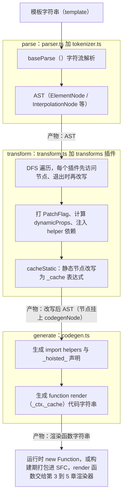
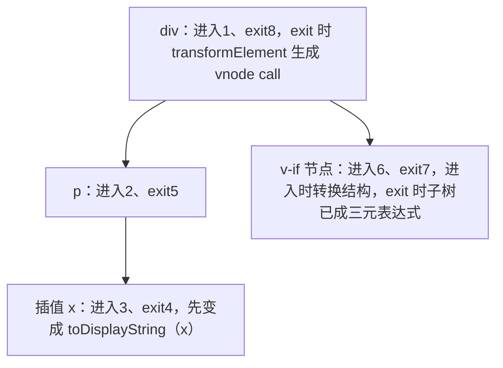
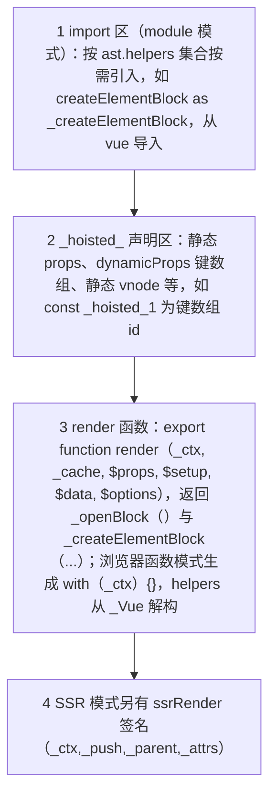
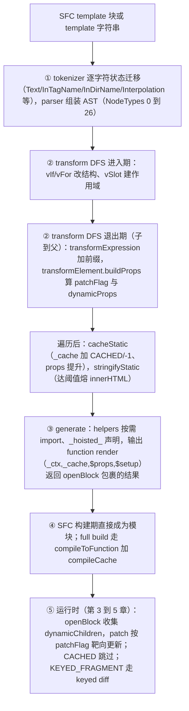

# 第 7 章 编译器与编译优化：从模板字符串到带标记的渲染函数

> 上一章：[第 6 章 · Composition API 与内置能力](./06-composition-api.md) ｜ 下一章：[回到总目录 · React vs Vue 对比章预告](../../README.md)

## 学习目标

1. 建立「parse → transform → generate」三段流水线的整体心智模型，说清编译发生的两个时机。
2. 读懂 tokenizer 状态机如何把 `<div :id="x">{{m}}</div>` 切成 AST 节点，记住 `NodeTypes`、`ConstantTypes` 枚举。
3. 理解 transform 的 DFS + 退出回调（exitFns）机制，以及核心插件各自打了什么标记。
4. 掌握 3.5 静态优化三件套的真实行为：静态节点进 `_cache`（不再 `_hoisted_`）、静态 props 仍提升、连续静态节点 stringify 成 innerHTML。
5. 对照真实编译产物（`@vue/compiler-dom@3.5.43` 实测）逐行认出 patchFlag、dynamicProps、renderList、withCache。
6. 完成「模板语法 → 编译期标记 → 运行时消费」的闭环，为对比章的「Vue 编译期优化 vs React 纯运行时」蓄力。

## 引入：为什么 Vue 的 diff 敢「只看动态节点」

第 3、4 章反复出现一个前提：Block 的 `dynamicChildren` 只收集动态节点，PatchFlag 告诉运行时该更新什么。这些信息运行时不可能凭空知道——它来自**编译器**。你写的模板是静态字符串，框架却知道「这个 class 会变、那个 `<h1>` 永远不动」，靠的就是编译期分析。

Vue 的编译器独立成两个包：

- `@vue/compiler-core`：平台无关的核心（parser/tokenizer、AST、transform、codegen）。
- `@vue/compiler-dom`：在核心之上注入浏览器相关配置（HTML 解析规则、v-html/v-show 等 DOM 指令、class/style 特化）。

## 7.1 三段流水线总览



三步的总入口 `baseCompile` 非常直白：

出处：packages/compiler-core/src/compile.ts:67-121（Vue 3.5.43）
[compile.ts](file:///Users/yangzhijie/Desktop/practice_projects/claude-code-test/react-vue-source-deep-dive/sources/vue/packages/compiler-core/src/compile.ts#L67-L121)

```ts
export function baseCompile(
  source: string | RootNode,
  options: CompilerOptions = {},
): CodegenResult {
  // ...
  const ast = isString(source) ? baseParse(source, resolvedOptions) : source
  const [nodeTransforms, directiveTransforms] =
    getBaseTransformPreset(prefixIdentifiers)

  transform(
    ast,
    extend({}, resolvedOptions, {
      nodeTransforms: [
        ...nodeTransforms,
        ...(options.nodeTransforms || []),   // 用户/平台插件
      ],
      directiveTransforms: extend(
        {}, directiveTransforms,
        options.directiveTransforms || {},
      ),
    }),
  )

  return generate(ast, resolvedOptions)
}
```

**编译发生的两个时机：**

1. **构建期（主流）**：Vite 的 `@vitejs/plugin-vue` 调 `@vue/compiler-sfc`，把 `<template>` 与 `<script setup>` 一起编译成普通 JS 模块。产物体积小、运行时零编译开销。
2. **运行时（完整版 vue 包）**：`vue/dist/vue.global.js` 等 full build 注入了编译器。组件带 `template` 字符串选项时，[vue/src/index.ts:30-101](file:///Users/yangzhijie/Desktop/practice_projects/claude-code-test/react-vue-source-deep-dive/sources/vue/packages/vue/src/index.ts#L30-L101) 的 `compileToFunction` 现场 `new Function` 编译，并用一个无原型对象做缓存：

出处：packages/vue/src/index.ts:43-47、61-68、94-101（Vue 3.5.43）
[vue/src/index.ts](file:///Users/yangzhijie/Desktop/practice_projects/claude-code-test/react-vue-source-deep-dive/sources/vue/packages/vue/src/index.ts#L43-L101)

```ts
const key = genCacheKey(template, options)
const cached = compileCache[key]
if (cached) {
  return cached                       // 同一模板只编译一次
}
// ...
const opts = extend(
  { hoistStatic: true, onError: __DEV__ ? onError : undefined },
  options,
)
const { code } = compile(template, opts)
const render = new Function('Vue', code)(runtimeDom) as RenderFunction
;(render as InternalRenderFunction)._rc = true // 标记为运行时编译
return (compileCache[key] = render)
```

## 7.2 parse：字符流 → AST

### 7.2.1 tokenizer 状态机

3.5 的解析器分成 [parser.ts](file:///Users/yangzhijie/Desktop/practice_projects/claude-code-test/react-vue-source-deep-dive/sources/vue/packages/compiler-core/src/parser.ts)（树构建）与 [tokenizer.ts](file:///Users/yangzhijie/Desktop/practice_projects/claude-code-test/react-vue-source-deep-dive/sources/vue/packages/compiler-core/src/tokenizer.ts)（字符级状态机）。tokenizer 每读一个字符就按当前 `State` 决定迁移，状态枚举有 30+ 个（[tokenizer.ts:86-137](file:///Users/yangzhijie/Desktop/practice_projects/claude-code-test/react-vue-source-deep-dive/sources/vue/packages/compiler-core/src/tokenizer.ts#L86-L137)）。以 `<div :id="x">{{m}}</div>` 为例：

| 输入片段 | 进入状态 | 动作 / 产物 |
| --- | --- | --- |
| （起始） | `Text` | 累积文本 |
| `<` | `BeforeTagName` | 下一个字母决定是开始标签 |
| `div` | `InTagName` | 标签名累积为 `div` |
| 空格 | `BeforeAttrName` | 准备读属性 |
| `:id` | `InDirName` | `:` 前缀 → 这是指令 `bind`，参数 `id` |
| `="x"` | `InAttrValueDq` | 指令表达式 `x` |
| `>` | 回到 `Text` | 元素入栈 |
| `{{` | `InterpolationOpen→Interpolation` | 开始插值 |
| `m` | `Interpolation` | 插值表达式 `m` |
| `}}` | `InterpolationClose→Text` | 产出 INTERPOLATION 节点 |
| `</` | `BeforeClosingTagName` | 闭合标签，元素出栈 |

解析完得到的 AST 长这样：`RootNode → ElementNode(div, props=[DirectiveNode(bind:id)]) → children=[InterpolationNode(SimpleExpressionNode(m))]`。

### 7.2.2 NodeTypes 枚举（0~26）

出处：packages/compiler-core/src/ast.ts:28-60（Vue 3.5.43）
[ast.ts](file:///Users/yangzhijie/Desktop/practice_projects/claude-code-test/react-vue-source-deep-dive/sources/vue/packages/compiler-core/src/ast.ts#L28-L60)

| 值 | 枚举 | 含义 |
| --- | --- | --- |
| 0 | ROOT | 根节点 |
| 1 | ELEMENT | 元素（含组件、template、slot，由 tagType 细分） |
| 2 | TEXT | 纯文本 |
| 3 | COMMENT | 注释 |
| 4 | SIMPLE_EXPRESSION | 表达式原子（`x`、`item.id`） |
| 5 | INTERPOLATION | `{{ ... }}` |
| 6 | ATTRIBUTE | 静态属性 `id="a"` |
| 7 | DIRECTIVE | 指令/动态绑定 `:id`、`v-if`、`@click` |
| 8 | COMPOUND_EXPRESSION | 文本与表达式混合（如 `a{{x}}b`） |
| 9/10 | IF / IF_BRANCH | v-if 容器与每个分支 |
| 11 | FOR | v-for |
| 12 | TEXT_CALL | 文本 + 插值的合并调用 |
| 13 | VNODE_CALL | 代码生成期的 createVNode 调用 |
| 14~20 | JS_CALL/JS_OBJECT/JS_PROPERTY/JS_ARRAY/JS_FUNCTION/JS_CONDITIONAL/JS_CACHE_EXPRESSION | JS 表达式节点 |
| 21~26 | JS_BLOCK_STATEMENT ... JS_RETURN_STATEMENT | SSR 代码生成专用 |

`ElementTypes`（[ast.ts:62-67](file:///Users/yangzhijie/Desktop/practice_projects/claude-code-test/react-vue-source-deep-dive/sources/vue/packages/compiler-core/src/ast.ts#L62-L67)）把 ELEMENT 再分为 `ELEMENT(0)` 原生标签、`COMPONENT(1)`、`SLOT(2)`、`TEMPLATE(3)`。

### 7.2.3 ConstantTypes：一个表达式「有多常量」

出处：packages/compiler-core/src/ast.ts:215-220（Vue 3.5.43）
[ast.ts](file:///Users/yangzhijie/Desktop/practice_projects/claude-code-test/react-vue-source-deep-dive/sources/vue/packages/compiler-core/src/ast.ts#L215-L220)

```ts
export enum ConstantTypes {
  NOT_CONSTANT = 0, // 含响应式变量
  CAN_SKIP_PATCH,   // 1 首次后无需再 patch
  CAN_CACHE,        // 2 可以缓存整个 vnode（3.5 由旧 CAN_HOIST 改名）
  CAN_STRINGIFY,    // 3 连 vnode 都不用建，可直接 innerHTML 字符串化
}
```

这个等级由 transform 阶段逐节点计算（`getConstantType`，定义在 [cacheStatic.ts:253](file:///Users/yangzhijie/Desktop/practice_projects/claude-code-test/react-vue-source-deep-dive/sources/vue/packages/compiler-core/src/transforms/cacheStatic.ts#L253)），是 7.4 静态优化的判定依据。

## 7.3 transform：DFS 改写与核心插件

### 7.3.1 遍历机制：进入回调 + exitFns 逆序执行

出处：packages/compiler-core/src/transform.ts:425-485（Vue 3.5.43）
[transform.ts](file:///Users/yangzhijie/Desktop/practice_projects/claude-code-test/react-vue-source-deep-dive/sources/vue/packages/compiler-core/src/transform.ts#L425-L485)

```ts
export function traverseNode(
  node: RootNode | TemplateChildNode,
  context: TransformContext,
): void {
  context.currentNode = node
  const { nodeTransforms } = context
  const exitFns = []
  for (let i = 0; i < nodeTransforms.length; i++) {
    const onExit = nodeTransforms[i](node, context) // 进入节点时调用
    if (onExit) {
      if (isArray(onExit)) { exitFns.push(...onExit) }
      else { exitFns.push(onExit) }
    }
    if (!context.currentNode) { return } // 插件可能删除/替换了节点
    else { node = context.currentNode }
  }
  switch (node.type) {
    // ...按类型递归 traverseChildren
  }
  // exit transforms：子节点全部处理完后逆序执行（先注册的后改写）
  let i = exitFns.length
  while (i--) { exitFns[i]() }
}
```

为什么要「先子后父」地逆序退出？因为父节点的 PatchFlag 取决于子节点的常量性、v-if/v-for 结构需要在子表达式已成型后才能整体改写成三元/`renderList`。`transform()` 在遍历之后还会跑 `cacheStatic` 与根代码生成（[transform.ts:333-355](file:///Users/yangzhijie/Desktop/practice_projects/claude-code-test/react-vue-source-deep-dive/sources/vue/packages/compiler-core/src/transform.ts#L333-L355)）。



插件分两条管线（`getBaseTransformPreset`，[compile.ts:32-63](file:///Users/yangzhijie/Desktop/practice_projects/claude-code-test/react-vue-source-deep-dive/sources/vue/packages/compiler-core/src/compile.ts#L32-L63)）：`nodeTransforms` 处理节点结构，`directiveTransforms` 是 `{ on: transformOn, bind: transformBind, model: transformModel }` 指令速查表。

### 7.3.2 核心插件职责

| 插件 | 职责 |
| --- | --- |
| `transformExpression` | 给标识符加前缀：setup 变量 → `$setup.x`（并自动 `_unref`），未知 → `_ctx.x`；配合 bindingMetadata 区分 props/setup/data |
| `transformElement` | 核心中的核心：`buildProps` 分类静态/动态 props，算出 **PatchFlag 与 dynamicProps**，把元素节点改写成 VNODE_CALL |
| `vIf` | `v-if/v-else-if/v-else` 改写成 JS 三元（或嵌套三元），分支各自是 Block |
| `vFor` | 改写成 `renderList(source, (item,index)=>...)`，内部开 `openBlock(true)`（keyed fragment） |
| `vSlot` | 插槽作用域分析、`createSlots/renderSlot` 生成 |
| `vOn` | 事件改写；`cacheHandlers` 开启时内联函数包进 `_cache`（见 7.6 实测），不每次新建 |
| `vModel` | 拆成 `modelValue` prop + `onUpdate:modelValue` + 平台指令（DOM 版 `vModelText`） |
| `transformSlotOutlet` | `<slot/>` → `renderSlot(...)` |
| `transformText` | 相邻文本/插值合并为 `createTextVNode`/TEXT_CALL，减少节点数 |
| `vOnce` / `vMemo` | 改写为 `_cache` 存取 / `withMemo([deps], fn, _cache, index)` |

## 7.4 静态优化三件套（3.5 行为已变，重点）

### 7.4.1 cacheStatic：静态 vnode 进 render 的 `_cache`

3.5 里原 `transforms/hoistStatic.ts` 已删除，逻辑由 [cacheStatic.ts](file:///Users/yangzhijie/Desktop/practice_projects/claude-code-test/react-vue-source-deep-dive/sources/vue/packages/compiler-core/src/transforms/cacheStatic.ts) 承担。注意：**静态元素不再提升为 `_hoisted_` 变量复用，而是放进每次 render 都能访问的 `_cache` 数组**：

出处：packages/compiler-core/src/transforms/cacheStatic.ts:78-84、211-214（Vue 3.5.43）
[cacheStatic.ts](file:///Users/yangzhijie/Desktop/practice_projects/claude-code-test/react-vue-source-deep-dive/sources/vue/packages/compiler-core/src/transforms/cacheStatic.ts#L78-L214)

```ts
const constantType = doNotHoistNode
  ? ConstantTypes.NOT_CONSTANT
  : getConstantType(child, context)
if (constantType > ConstantTypes.NOT_CONSTANT) {
  if (constantType >= ConstantTypes.CAN_CACHE) {
    ;(child.codegenNode as VNodeCall).patchFlag = PatchFlags.CACHED // -1
    toCache.push(child)
    continue
  }
}
// ...
if (!cachedAsArray) {
  for (const child of toCache) {
    child.codegenNode = context.cache(child.codegenNode!) // 改写为 _cache[i] 表达式
  }
}
```

为什么从「模块级提升」改成「render 内缓存」？静态 vnode 提升复用同一个对象时，运行时 mount 会把 DOM 引用写回 vnode，热更新/多实例下容易产生状态串扰；放进 `_cache` 后首次 render 时才创建并打 `PatchFlag.CACHED(-1)`，diff 时直接整块跳过（hydration 也据此跳过子树），兼顾安全与性能。

**但静态 props 对象仍然走 `context.hoist()` 提升为 `_hoisted_x`**（[cacheStatic.ts:100-107](file:///Users/yangzhijie/Desktop/practice_projects/claude-code-test/react-vue-source-deep-dive/sources/vue/packages/compiler-core/src/transforms/cacheStatic.ts#L100-L107)），因为它是不可变纯数据，提升最省。dynamicProps 键名数组同理。

### 7.4.2 stringifyStatic：连续静态节点熔成 innerHTML

DOM 平台额外注册了 `transformHoist: stringifyStatic`（[compiler-dom/src/index.ts:61](file:///Users/yangzhijie/Desktop/practice_projects/claude-code-test/react-vue-source-deep-dive/sources/vue/packages/compiler-dom/src/index.ts#L61)）。阈值是：

出处：packages/compiler-dom/src/transforms/stringifyStatic.ts:41-44（Vue 3.5.43）
[stringifyStatic.ts](file:///Users/yangzhijie/Desktop/practice_projects/claude-code-test/react-vue-source-deep-dive/sources/vue/packages/compiler-dom/src/transforms/stringifyStatic.ts#L41-L44)

```ts
export enum StringifyThresholds {
  ELEMENT_WITH_BINDING_COUNT = 5,  // 连续静态“带绑定的元素”达到 5 个
  NODE_COUNT = 20,                 // 或连续静态节点达到 20 个
}
```

达标后整段被编译为 `createStaticVNode("<div>...</div>", 节点数)`，运行时一次 innerHTML 生成 DOM，连 vnode 对象都省了（插槽内容不做此优化）。

### 7.4.3 v-once 与 v-memo

- `v-once`（[vOnce.ts:8-27](file:///Users/yangzhijie/Desktop/practice_projects/claude-code-test/react-vue-source-deep-dive/sources/vue/packages/compiler-core/src/transforms/vOnce.ts#L8-L27)）：给子树包 `_cache[i]`，并在首次求值前后插入 `setBlockTracking(-1)/setBlockTracking(1)`，让它不进入父 Block 的动态收集。
- `v-memo="[a,b]"`：编译成 `withMemo([a,b], () => (...), _cache, index)`，依赖数组浅比较相同就整棵子树跳过 render/patch，常用于大列表按行记忆。

## 7.5 codegen：生成最终代码字符串

`generate` 的输出分四块（[codegen.ts:283-406](file:///Users/yangzhijie/Desktop/practice_projects/claude-code-test/react-vue-source-deep-dive/sources/vue/packages/compiler-core/src/codegen.ts#L283-L406)）：



`_cache` 读写由 `genCacheExpression` 输出（[codegen.ts:1021-1040](file:///Users/yangzhijie/Desktop/practice_projects/claude-code-test/react-vue-source-deep-dive/sources/vue/packages/compiler-core/src/codegen.ts#L1021-L1040)），形态就是 `_cache[i] || (_cache[i] = ...)`。helper 符号与导出名的对照定义在 [runtimeHelpers.ts](file:///Users/yangzhijie/Desktop/practice_projects/claude-code-test/react-vue-source-deep-dive/sources/vue/packages/compiler-core/src/runtimeHelpers.ts)：

| helper 符号 | 生成代码中的名字 | 用途 |
| --- | --- | --- |
| FRAGMENT | `Fragment` | 多根/keyed 片段 |
| OPEN_BLOCK | `openBlock` | 开启 Block 动态收集 |
| CREATE_BLOCK | `createBlock` | 创建组件/通用 Block |
| CREATE_ELEMENT_BLOCK | `createElementBlock` | 创建原生元素 Block |
| CREATE_VNODE | `createVNode` | 创建普通 vnode（组件等） |
| CREATE_ELEMENT_VNODE | `createElementVNode` | 创建原生元素 vnode |
| CREATE_TEXT | `createTextVNode` | 含动态部分的文本节点 |
| CREATE_COMMENT | `createCommentVNode` | 注释/v-if 占位 |
| CREATE_STATIC | `createStaticVNode` | stringifyStatic 的产物 |
| TO_DISPLAY_STRING | `toDisplayString` | `{{ x }}` 的值输出 |
| RESOLVE_COMPONENT | `resolveComponent` | 模板里的组件名解析 |
| RESOLVE_DIRECTIVE | `resolveDirective` | 自定义指令解析 |
| RENDER_LIST | `renderList` | v-for |
| RENDER_SLOT | `renderSlot` | `<slot>` 出口 |
| CREATE_SLOTS | `createSlots` | 具名插槽对象 |
| WITH_DIRECTIVES | `withDirectives` | v-model/v-show 等指令包裹 |
| NORMALIZE_CLASS / NORMALIZE_STYLE | `normalizeClass/normalizeStyle` | 动态 class/style 合并 |
| MERGE_PROPS | `mergeProps` | 多来源 props 合并 |
| SET_BLOCK_TRACKING | `setBlockTracking` | v-once 暂停收集 |
| WITH_MEMO / IS_MEMO_SAME | `withMemo/isMemoSame` | v-memo |
| UNREF | `unref` | setup ref 自动解包 |

> 📌 `PUSH_SCOPE_ID`（pushScopeId）在 3.5 已标记 `@deprecated`，源码注释明确「no longer needed because we no longer hoist element nodes」（[runtimeHelpers.ts:69-77](file:///Users/yangzhijie/Desktop/practice_projects/claude-code-test/react-vue-source-deep-dive/sources/vue/packages/compiler-core/src/runtimeHelpers.ts#L69-L77)），scope id 现在在 vnode 创建时直接处理。

## 7.6 实战：3.5.43 真实编译产物逐行标注

以下输出为 **@vue/compiler-dom@3.5.43 实测输出**，命令：

```bash
npm install @vue/compiler-dom@3.5.43 --prefix /tmp/vc35 --registry=https://registry.npmjs.org
node /tmp/vc35/run.js   # compile(template, { mode:'module', hoistStatic:true,
                        #   cacheHandlers:true, bindingMetadata:{...} })
```

### 7.6.1 模板①：静态节点 + 插值 + 动态 class/id

```js
import { createElementVNode as _createElementVNode, toDisplayString as _toDisplayString, normalizeClass as _normalizeClass, openBlock as _openBlock, createElementBlock as _createElementBlock } from "vue"

const _hoisted_1 = ["id"]

export function render(_ctx, _cache, $props, $setup, $data, $options) {
  return (_openBlock(), _createElementBlock("div", {
    class: "wrap",
    id: $setup.uid
  }, [
    _cache[0] || (_cache[0] = _createElementVNode("h1", null, "标题", -1 /* CACHED */)),
    _createElementVNode("p", null, "你好 " + _toDisplayString($setup.message), 1 /* TEXT */),
    _createElementVNode("span", {
      class: _normalizeClass($setup.cls)
    }, _toDisplayString($setup.count) + " 次", 3 /* TEXT, CLASS */)
  ], 8 /* PROPS */, _hoisted_1))
}
```

逐行解读：

- `const _hoisted_1 = ["id"]`：动态键名数组提到 render 外（**这就是静态 props 提升**），作为最后的 `dynamicProps` 参数。
- `<h1>标题</h1>` 是纯静态节点：进入 `_cache[0]`，patchFlag `-1 (CACHED)`。首次 render 创建，之后整体跳过——**注意它不是 `_hoisted_` 变量，这是 3.5 与旧版最直观的差异**。
- `<p>` 的 patchFlag 是 `1 (TEXT)`：只有文本可能变，class/props 更新时连看都不看。
- `<span>` 的 patchFlag 是 `3 = TEXT(1) | CLASS(2)`：文本和动态 class 要更新，故 import 了 `_normalizeClass`。
- 根 `<div>` 的 flag 是 `8 (PROPS)` + dynamicProps `["id"]`：第 5 章 `shouldUpdateComponent`/`patchFlag` 分支正是消费这些数字。
- `$setup.uid`：bindingMetadata 告诉编译器 uid 是 setup ref，直接走 `$setup`，无需运行时 proxy 查找。

### 7.6.2 模板②：keyed v-for 列表

```js
import { renderList as _renderList, Fragment as _Fragment, openBlock as _openBlock, createElementBlock as _createElementBlock, toDisplayString as _toDisplayString } from "vue"

const _hoisted_1 = ["onClick"]

export function render(_ctx, _cache, $props, $setup, $data, $options) {
  return (_openBlock(), _createElementBlock("ul", null, [
    (_openBlock(true), _createElementBlock(_Fragment, null, _renderList($setup.items, (item) => {
      return (_openBlock(), _createElementBlock("li", {
        key: item.id,
        onClick: $event => ($setup.onClick(item))
      }, _toDisplayString(item.name), 9 /* TEXT, PROPS */, _hoisted_1))
    }), 128 /* KEYED_FRAGMENT */))
  ]))
}
```

- `_renderList($setup.items, (item)=>...)` 就是 v-for；每个 `<li>` 自带 `key: item.id`。
- 外层 Fragment 用 `_openBlock(true)`（参数 true = 不稳定 Block，收集数组子节点），patchFlag `128 = KEYED_FRAGMENT`——第 4 章 keyed diff 的入口标记。
- 每个 `<li>` flag `9 = TEXT(1) | PROPS(8)`，dynamicProps `["onClick"]`。
- **这里的内联事件没有进 `_cache`**：因为它闭包了 v-for 的 `item`，每个迭代必须新建（vOn 插件的 `hasScopeRef` 判定，[vOn.ts:112-114](file:///Users/yangzhijie/Desktop/practice_projects/claude-code-test/react-vue-source-deep-dive/sources/vue/packages/compiler-core/src/transforms/vOn.ts#L112-L114)）。

### 7.6.3 模板③：v-if + 内联事件 + v-model

```js
import { createElementVNode as _createElementVNode, vModelText as _vModelText, withDirectives as _withDirectives, openBlock as _openBlock, createElementBlock as _createElementBlock, createCommentVNode as _createCommentVNode } from "vue"

const _hoisted_1 = { key: 1 }

export function render(_ctx, _cache, $props, $setup, $data, $options) {
  return (_openBlock(), _createElementBlock("div", null, [
    _createElementVNode("button", {
      onClick: _cache[0] || (_cache[0] = $event => ($setup.open = !$setup.open))
    }, "切换"),
    ($setup.open)
      ? _withDirectives((_openBlock(), _createElementBlock("input", {
          key: 0,
          "onUpdate:modelValue": _cache[1] || (_cache[1] = $event => (($setup.text) = $event))
        }, null, 512 /* NEED_PATCH */)), [
          [_vModelText, $setup.text]
        ])
      : (_openBlock(), _createElementBlock("p", _hoisted_1, "已关闭"))
  ]))
}
```

- 按钮与 input 的事件都包成 `_cache[0]/_cache[1]`：`cacheHandlers` 让内联函数只创建一次，避免每次 render 新函数导致无谓 patch（对比模板②的闭包场景）。
- v-if/v-else 编译成三元；两个分支带 `key: 0` 与提升的 `_hoisted_1 = { key: 1 }`，确保分支切换时不同类型正确重建。
- `v-model="text"` = `withDirectives(vnode, [[_vModelText, $setup.text]])` + `onUpdate:modelValue` 回写，input 的 flag `512 = NEED_PATCH`（指令/ref 类非 props 更新）。
- `_createCommentVNode` 被 import：某些形态下 v-if 隐藏分支以注释占位（第 5 章异步挂载也用注释占位）。

### 7.6.4 加映：v-once 与 v-memo

对 `<span v-once>{{title}}</span><p v-memo="[a,b]">...` 的实测（节选）：

```js
_cache[0] || (
  _setBlockTracking(-1, true),
  (_cache[0] = _createElementVNode("span", null, [
    _createTextVNode(_toDisplayString($setup.title), 1 /* TEXT */)
  ])).cacheIndex = 0,
  _setBlockTracking(1),
  _cache[0]
),
_withMemo([$setup.a,$setup.b], () => (_openBlock(), _createElementBlock("p", null, [
  _createTextVNode(_toDisplayString($setup.a) + "-" + _toDisplayString($setup.b), 1 /* TEXT */)
])), _cache, 1)
```

`setBlockTracking(-1)` 让 v-once 子树不进父 Block 的动态数组；`withMemo(依赖数组, 渲染函数, _cache, 索引=1)` 与代码生成完全对应。

## 7.7 compiler-dom 的增量

compiler-dom 的 `compile` 只是给 `baseCompile` 追加平台配置（[compiler-dom/src/index.ts:41-64](file:///Users/yangzhijie/Desktop/practice_projects/claude-code-test/react-vue-source-deep-dive/sources/vue/packages/compiler-dom/src/index.ts#L41-L64)）：

- **parserOptions**（[parserOptions.ts:6-20](file:///Users/yangzhijie/Desktop/practice_projects/claude-code-test/react-vue-source-deep-dive/sources/vue/packages/compiler-dom/src/parserOptions.ts#L6-L20)）：`parseMode:'html'`、`isVoidTag`（br/img 等）、`isNativeTag`（HTML/SVG/MathML）、`isPreTag`、`getNamespace`（进入 svg/math 命名空间）、`isBuiltInComponent`（识别 Transition）。
- **class/style 字符串特化**：`transformStyle` 把静态 style 字符串/对象提升为常量；`normalizeClass/normalizeStyle` 按浏览器规则合并。
- **DOM 专属指令**：`v-html → html`、`v-text → text`、`v-show → show`，并**覆盖** core 的 `model`（含 checkbox/radio/select 处理）与 `on`（按键修饰符等），`v-cloak` 是 noop（[index.ts:32-39](file:///Users/yangzhijie/Desktop/practice_projects/claude-code-test/react-vue-source-deep-dive/sources/vue/packages/compiler-dom/src/index.ts#L32-L39)）。
- **stringifyStatic**：作为 `transformHoist` 注入（7.4.2），且浏览器构建下关闭（`__BROWSER__ ? null : stringifyStatic`）。

## 7.8 协同表：模板语法 → 编译期标记 → 运行时消费

| 模板写法 | 编译期产物 | 运行时消费位置（第 3~5 章） |
| --- | --- | --- |
| 纯静态元素 | `_cache[i]` + patchFlag `-1 CACHED` | patchElement 见 -1 整块跳过 |
| `{{ x }}` | `toDisplayString($setup.x)` + flag `1 TEXT` | patchFlag&TEXT → 只设文本 |
| `:class` / `:style` | `normalizeClass/Style` + flag `2/4` | patchClass/patchStyle 定向更新 |
| 其他动态属性 | flag `8 PROPS` + `dynamicProps` 数组 | 只遍历 dynamicProps 比较（shouldUpdateComponent） |
| `v-bind="$attrs"` | flag `16 FULL_PROPS` | 全量浅比较 props |
| 多根模板 | Fragment + flag `64 STABLE_FRAGMENT` | processFragment |
| keyed `v-for` | renderList + flag `128 KEYED_FRAGMENT` | patchKeyedChildren（第 4 章 LIS） |
| ref/指令（v-model 等） | withDirectives + flag `512 NEED_PATCH` | 全量 patchElement 钩子/指令 |
| 插槽引用 v-for 变量 | flag `1024 DYNAMIC_SLOTS` | 子组件强制更新 |
| `v-if` | 三元 + 每分支独立 Block | 不同 Block 整体替换 |
| `v-once` | _cache + setBlockTracking(-1) | 不收集、不更新 |
| `v-memo` | withMemo([deps], fn, _cache, i) | 依赖浅比相同则跳过子树 |
| 连续 ≥20 静态节点 | createStaticVNode(html, n) | innerHTML 一次性生成 |
| 内联 `@click` | cacheHandlers 时 `_cache[i]` | 函数引用稳定，props 不脏 |

这张表就是 Vue「编译时知道一切、运行时按需消费」设计哲学的总清单。React 的 JSX 编译后基本是无语义的 `jsx()` 调用，优化全靠运行时 Fiber 协调；Vue 则把大量工作前移到构建期，用编译标记换运行时更少的比较。两种路线的系统对比，正是下一章的主题。

## 端到端流程串讲



## 版本勘误 📌

1. **3.5 没有 `hoistStatic.ts` 了。** 实现文件是 [cacheStatic.ts](file:///Users/yangzhijie/Desktop/practice_projects/claude-code-test/react-vue-source-deep-dive/sources/vue/packages/compiler-core/src/transforms/cacheStatic.ts)，但**选项名仍叫 `hoistStatic`**（[transform.ts:337](file:///Users/yangzhijie/Desktop/practice_projects/claude-code-test/react-vue-source-deep-dive/sources/vue/packages/compiler-core/src/transform.ts#L337) `if (options.hoistStatic) cacheStatic(root, context)`）。
2. **静态 vnode 不再以 `_hoisted_N` 变量提升复用**，而是放进 render 的 `_cache` 并打 `PatchFlags.CACHED(-1)`；旧版的 `-1 HOISTED` 名字已改为 `CACHED`（[patchFlags.ts:111-115](file:///Users/yangzhijie/Desktop/practice_projects/claude-code-test/react-vue-source-deep-dive/sources/vue/packages/shared/src/patchFlags.ts#L111-L115)）。仍然 `_hoisted_` 的是静态 props 对象与 dynamicProps 键数组。
3. **`ConstantTypes.CAN_HOIST` 已改名 `CAN_CACHE`（=2）**，枚举现为 NOT_CONSTANT=0/CAN_SKIP_PATCH=1/CAN_CACHE=2/CAN_STRINGIFY=3。
4. 网上教程常说「parse.ts 一个文件搞定解析」，3.5 已拆为 `parser.ts`（树构建）+ `tokenizer.ts`（字符状态机）。
5. `PUSH_SCOPE_ID/POP_SCOPE_ID` 仅为向后兼容保留，新编译产物里不再出现 scopeId 的 push/pop 包裹。

## 初学者易错点 ⚠️

1. **以为编译优化只在生产构建生效、debug 时对不上号。** patchFlag、Block、_cache 在开发构建同样生成；开发版只是多了警告、`createCommentVNode` 保留模板注释与 DEV_ROOT_FRAGMENT 标记，排查优化行为时直接看 dev 产物即可。
2. **手写 render/h() 时还期待 PatchFlag 优化。** 编译器不给手写函数做分析，运行时走非优化路径（children 变化即强制更新等）。需要优化时优先用模板，或手动给 createVNode 传 patchFlag（不推荐业务中这么做）。
3. **把 `_hoisted_` 的消失当成「没做静态优化」。** 3.5 只是换成了 `_cache` 方案：看到 `_cache[0] || (_cache[0] = _createElementVNode(..., -1))` 就等于看到了静态提升。
4. **奇怪为什么内联 `@click` 有时缓存有时不缓存。** `cacheHandlers` 只缓存不引用 v-for/插槽作用域变量的处理器；闭包了 `item` 的事件每次迭代必须新建，这是正确性而非性能 bug。
5. **v-for 里漏 key 还以为有 KEYED_FRAGMENT 优化。** 无 key 列表打的是 `UNKEYED_FRAGMENT(256)`，走更粗的两段式比对；`:key` 必须真实且稳定，用 index 在数据重排时等于退化为无 key。
6. **指望编译器能识别「逻辑上不变但写法动态」的内容。** 静态判定是语法层面的：哪怕函数总返回同样结果，模板里调用 `fn()` 的节点仍是 NOT_CONSTANT。要缓存请显式用 v-once/v-memo 或 computed。

## 本章小结

- 编译器是三段流水线：parse（tokenizer 状态机 → AST）→ transform（DFS + exitFns，打 PatchFlag/dynamicProps、注入 helper、cacheStatic）→ generate（imports + _hoisted_ + render 代码字符串）。
- 3.5 的静态优化：静态元素进 render 内 `_cache`（flag -1 CACHED），静态 props 仍 `_hoisted_` 提升，连续 20 节点/5 带绑定元素熔成 createStaticVNode；v-once、v-memo 复用同一缓存机制。
- patchFlag 数字（1 TEXT/2 CLASS/4 STYLE/8 PROPS/16 FULL_PROPS/128 KEYED_FRAGMENT/512 NEED_PATCH/1024 DYNAMIC_SLOTS/-1 CACHED）是编译器与运行时之间的契约，直接决定第 4、5 章 diff 与组件更新的工作量。
- compiler-dom 通过 parserOptions、class/style 特化、DOM 指令集和 stringifyStatic 把核心流水线适配到浏览器。

## 下一章导读

Vue 内核七章到此告一段落：从响应式系统（第 2 章）出发，经过 VNode/渲染器（第 3 章）、diff（第 4 章）、组件系统（第 5 章）、组合式能力（第 6 章），到本章的编译期优化，我们已经能在源码层面解释「一次 `count++` 如何变成一次精准的 DOM 更新」。

下一章补上 Vue 生态的关键一环：[第 8 章 · Vue Router 路由](./08-vue-router.md)，看 v4 如何用 Vue 响应式接管 URL、用洋葱模型组织导航守卫、靠 matcher 打分实现路径匹配。读完后再进 **React vs Vue 系统对比** 章会更有体感——Pull vs Push、调度模型、diff 策略、状态管理哲学、选型决策都会落到具体实现上对照。
