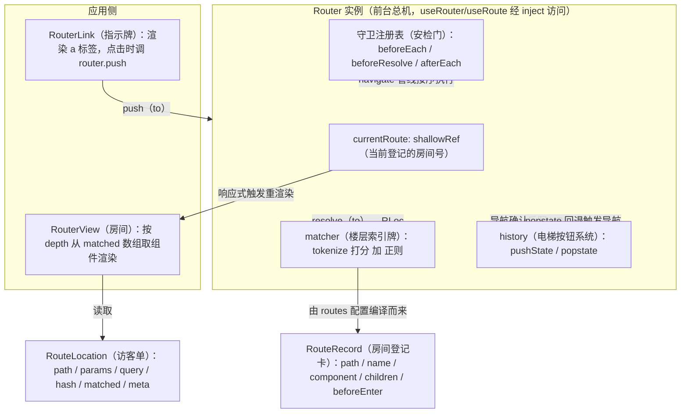
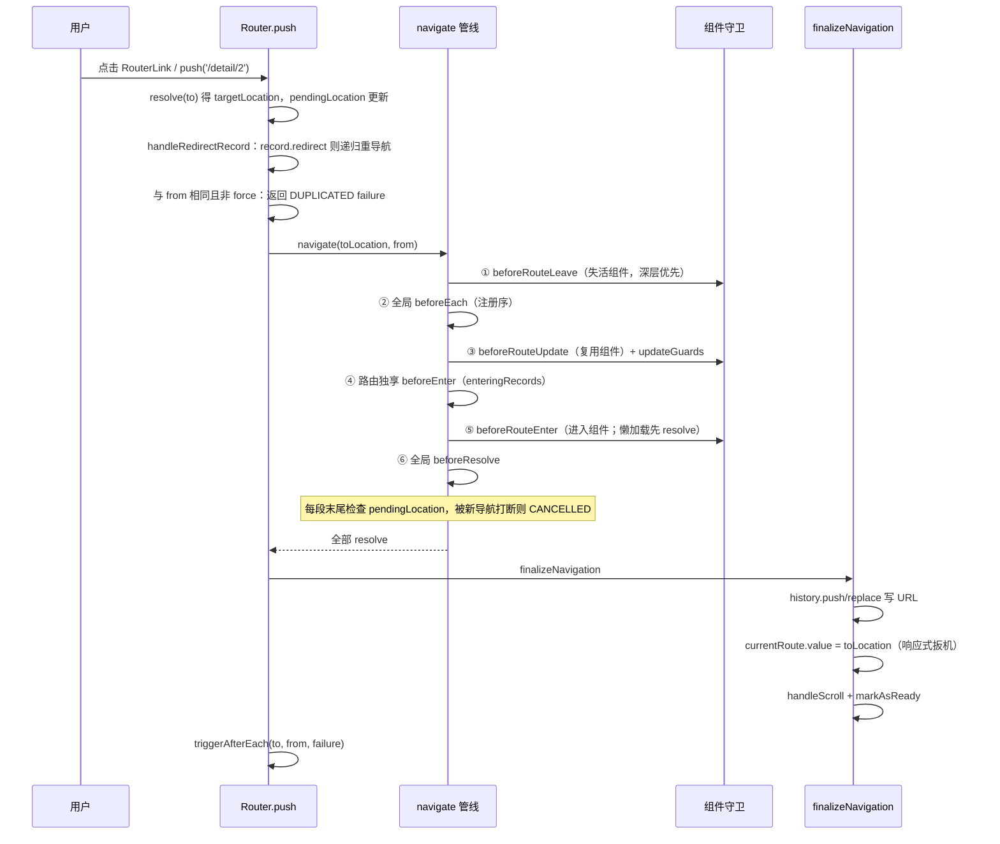
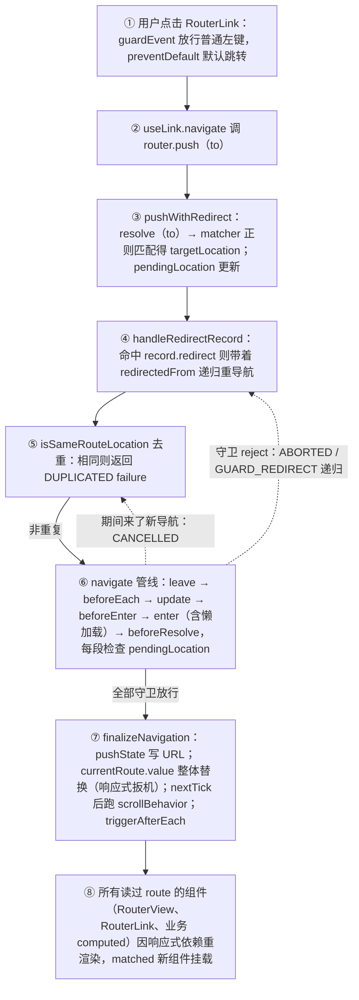

# 第 8 章 Vue Router：基于响应式的声明式路由

> 上一章：[第 7 章 · 编译器与编译优化](./07-compiler.md) ｜ 下一章：[第 9 章 · Pinia 状态管理](./09-pinia.md)

> 本章分析基准：[`vue-router@4.5.1`](https://github.com/vuejs/router/tree/v4.5.1)（v4.5.x 系列，配合 Vue 3.5.43），仓库为 `vuejs/router`，源码在 `packages/router/src/` 下。

## 学习目标

读完本章，你应当能够：

1. 说清 SPA 路由的三要素：拦截 URL 变化、URL → 组件映射表、视图出口；并能解释 hash 与 history 两种模式的本质差异。
2. 画出 `createRouter` 返回对象的结构，背出 `install(app)` 的六项职责（注册组件、`$router`/`$route`、初始导航、响应式 route、三个 provide、卸载清理）。
3. 解释 matcher 如何把 `/users/:id` 经 tokenize → 打分 → 编译成正则，并说明为什么静态段永远优先于动态段、catchAll 永远垫底。
4. 按顺序背出完整守卫链：beforeRouteLeave → beforeEach → beforeRouteUpdate → beforeEnter → beforeRouteEnter → beforeResolve → afterEach，并解释 `guardToPromiseFn` 如何把 `next()` 包装成 Promise。
5. 说清 RouterView 的 depth 计算规则、RouterLink 的 active 判定依据，以及 `useRoute()` 返回对象的响应式原理。
6. 区分三种 `NavigationFailureType`（aborted / cancelled / duplicated），理解 redirect 链与 `scrollBehavior` 的执行时机。

## 8.1 引入：SPA 路由的本质

把单页应用想象成一栋**只有一层的大厦**：所有「页面」其实是同一层里的一间间房间，切换页面并不需要换楼（重新加载 HTML），只需要前台把你带到另一个房间。Vue Router 就是这栋大厦的**前台 + 电梯调度员**：你按下按钮（点击链接 / `router.push`），它先查「楼层索引牌」（路由表 matcher）确认目标房间存在；沿途经过一排**安检门**（导航守卫），任何一道门都可以放行、拒绝或把你引导到别的房间；确认后它更新「当前登记的房间号」（`currentRoute`），房间里的灯（RouterView）随之亮起对应的组件；同时它悄悄按下电梯的楼层记录（`history.pushState`），让浏览器前进/后退按钮依然可用。

技术上，SPA 路由要做三件事：

1. **改变 URL 但不刷新页面**。history 模式用 `history.pushState()` / `history.replaceState()`（改 URL 不发请求），hash 模式改 `location.hash`（`#` 之后的部分本来就不会发给服务器）。两种模式都要监听 `popstate` 事件来响应浏览器的前进/后退。
2. **维护一张 URL → 组件的映射表**。这就是 routes 配置，运行时被编译成一组带正则的 matcher。
3. **把当前匹配到的组件渲染到出口**。RouterView 负责这件事，嵌套路由时一层层往下找。

Vue Router v4 与 v3 最大的设计差异，是它**完全长在 Vue 3 的响应式系统上**：`currentRoute` 是一个 `shallowRef`，`useRoute()` 拿到的是一个由 getter 转发到该 ref 的响应式对象。路由一变，所有读过 `route.params` / `route.query` 的组件自动重渲染——这套机制你在第 2 章已经学过了，本章只是看它如何被 Router 复用。

## 8.2 核心概念地图



关键数据类型先记住三个：

- **RouteRecord**：你写在 routes 配置里的每一条记录，规范化后挂在 matcher 树上。
- **RouteLocation / RouteLocationNormalizedLoaded**：一次导航解析出的「目标位置」，含 `path`、`params`、`query`、`hash`、`matched`（记录链）、`meta`。**Router** 则是 `createRouter` 返回的总机对象，暴露 `push/replace/go`、守卫注册、`install`。

起点常量也值得先见一面——应用刚启动、还没导航时，路由就是这个空对象：

出处：packages/router/src/location.ts:263-274（vue-router 4.5.1）

```ts
export const START_LOCATION_NORMALIZED: RouteLocationNormalizedLoaded = {
  path: '/',
  name: undefined,
  params: {},
  query: {},
  hash: '',
  fullPath: '/',
  matched: [],
  meta: {},
  redirectedFrom: undefined,
}
```

## 8.3 createRouter 与 install

### 8.3.1 createRouter 的头部：三件套就位

`createRouter(options)` 开头做了三件影响全局的事：建 matcher、建守卫注册表、建 `currentRoute`：

出处：packages/router/src/router.ts:385-402（vue-router 4.5.1）

```ts
export function createRouter(options: RouterOptions): Router {
  const matcher = createRouterMatcher(options.routes, options)
  const parseQuery = options.parseQuery || originalParseQuery
  const stringifyQuery = options.stringifyQuery || originalStringifyQuery
  const routerHistory = options.history

  const beforeGuards = useCallbacks<NavigationGuardWithThis<undefined>>()
  const beforeResolveGuards = useCallbacks<NavigationGuardWithThis<undefined>>()
  const afterGuards = useCallbacks<NavigationHookAfter>()
  const currentRoute = shallowRef<RouteLocationNormalizedLoaded>(
    START_LOCATION_NORMALIZED
  )
  let pendingLocation: RouteLocation = START_LOCATION_NORMALIZED
  // ...
}
```

- `useCallbacks` 是一个带 `add/remove/list` 的回调集合，`router.beforeEach(fn)` 本质就是 `beforeGuards.add(fn)`。
- **`currentRoute` 是 `shallowRef`**：整个 RouteLocation 对象每次导航整体替换，不需要深响应式——这正是「路由变化 → 依赖它的组件重渲染」的扳机。`pendingLocation` 则记录「正在导航中的目标」，用来检测「上一次导航还没跑完、新导航又来了」的取消场景（8.10）。

### 8.3.2 router 对象字面量

函数末尾把所有能力装进一个字面量返回（router.ts:1232-1319）：

```ts
const router: Router = {
  currentRoute,          // 注意：这是 ref 本体，外部应经 $route/useRoute 访问
  listening: true,
  addRoute, removeRoute, clearRoutes: matcher.clearRoutes,
  hasRoute, getRoutes, resolve,
  options,
  push, replace, go,
  back: () => go(-1),
  forward: () => go(1),
  beforeEach: beforeGuards.add,
  beforeResolve: beforeResolveGuards.add,
  afterEach: afterGuards.add,
  onError: errorListeners.add,
  isReady,
  install(app: App) { /* ... */ },
}
```

### 8.3.3 install：app.use(router) 到底干了什么

`app.use(router)` 就是调用这个 `install` 方法，六项职责逐行看：

出处：packages/router/src/router.ts:1257-1318（vue-router 4.5.1）

```ts
install(app: App) {
  const router = this
  app.component('RouterLink', RouterLink)              // ① 两个全局组件
  app.component('RouterView', RouterView)

  app.config.globalProperties.$router = router          // ② Options API 的 this.$router
  Object.defineProperty(app.config.globalProperties, '$route', {
    enumerable: true,
    get: () => unref(currentRoute),                    // ③ $route 是 getter：永远读最新值
  })

  if (isBrowser && !started
      && currentRoute.value === START_LOCATION_NORMALIZED) {
    started = true
    push(routerHistory.location).catch(err => { /* dev 警告 */ })  // ④ 初始导航
  }

  const reactiveRoute = {} as RouteLocationNormalizedLoaded
  for (const key in START_LOCATION_NORMALIZED) {
    Object.defineProperty(reactiveRoute, key, {
      get: () => currentRoute.value[key as keyof RouteLocationNormalized],
      enumerable: true,
    })
  }

  app.provide(routerKey, router)                        // ⑤ 三个注入
  app.provide(routeLocationKey, shallowReactive(reactiveRoute))
  app.provide(routerViewLocationKey, currentRoute)

  const unmountApp = app.unmount
  installedApps.add(app)
  app.unmount = function () {                           // ⑥ 应用卸载时清理
    installedApps.delete(app)
    if (installedApps.size < 1) {                       // 最后一个应用卸载才拆除
      pendingLocation = START_LOCATION_NORMALIZED
      removeHistoryListener && removeHistoryListener()
      removeHistoryListener = null
      currentRoute.value = START_LOCATION_NORMALIZED
      started = false; ready = false
    }
    unmountApp()
  }
}
```

逐行讲：

- **③ `$route` 为什么是 getter 而不是普通赋值**：如果直接赋值，它永远是安装那一刻的旧对象。getter 让每次 `this.$route` 都解包最新的 `currentRoute`。
- **④ 初始导航只在浏览器执行一次**：把当前地址栏 URL 当作一次 `push` 走完整守卫管线。SSR 时不做（服务端导航由 `router.push` 手动触发）。
- **⑤ `reactiveRoute` 的技巧**：它不是 `reactive(currentRoute.value)`，而是**对 START 的每个 key 定义 getter 转发到 `currentRoute.value[key]`**，再整体包一层 `shallowReactive`。这样 `useRoute().params.id` 读取时会 track 到 `currentRoute` 这个 ref（getter 里 `.value` 触发收集），路由一切换，所有读过任意字段的地方都被通知——而每个字段本身不需要独立的 ref。
- **⑥ 多应用共享一个 router 时**，只有最后一个应用卸载才拆除 history 监听并重置状态。

## 8.4 路径匹配：matcher 与 tokenize

routes 配置在 `createRouterMatcher` 里被编译成一棵 matcher 树 + 一个**按分数排序的扁平数组**（matcher/index.ts:57-70）：

```ts
export function createRouterMatcher(routes, globalOptions): RouterMatcher {
  const matchers: RouteRecordMatcher[] = []   // 有序（分数从高到低）
  const matcherMap = new Map()                // name → matcher
  // ...
}
```

### 8.4.1 tokenizePath：把路径切成 token

`tokenizePath` 是一个五态字符状态机（与第 7 章 compiler 的 tokenizer 同构）：

出处：packages/router/src/matcher/pathTokenizer.ts:7-13（vue-router 4.5.1）

```ts
const enum TokenizerState {
  Static,          // 读普通字符
  Param,           // 读到 : 进入参数名
  ParamRegExp,     // 读到 ( 进入自定义正则
  ParamRegExpEnd,  // 正则结束，检查 ? + * 修饰符
  EscapeNext,      // 反斜杠转义
}
```

`/users/:id(\d+)?/posts` 会被切成两段（segment）：`[Static("users")]` 和 `[Param(id, regexp:"\d+", optional:true)]`、`[Static("posts")]`。每个 token 记录类型、值、是否 repeatable（`*`/`+`）、是否 optional（`*`/`?`）。

### 8.4.2 打分：谁的路由更「具体」

tokens 随后交给 `tokensToParser` 编译成正则，同时按下面的分值表累计**分数**：

出处：packages/router/src/matcher/pathParserRanker.ts:100-114（vue-router 4.5.1）

```ts
const enum PathScore {
  _multiplier = 10,
  Root = 9 * _multiplier,          // 90  只有 /
  Segment = 4 * _multiplier,       // 40  每段基础分
  SubSegment = 3 * _multiplier,    // 30  段内多个 token
  Static = 4 * _multiplier,        // 40  静态段加分
  Dynamic = 2 * _multiplier,       // 20  动态参数加分
  BonusCustomRegExp = 1 * _multiplier,  // 10  带自定义正则
  BonusWildcard = -4 * _multiplier - BonusCustomRegExp, // -50 catchAll
  BonusRepeatable = -2 * _multiplier,   // -20 可重复
  BonusOptional = -0.8 * _multiplier,   // -8  可选
  BonusStrict = 0.07 * _multiplier,
  BonusCaseSensitive = 0.025 * _multiplier,
}
```

打分逻辑在 `tokensToParser` 的循环里（pathParserRanker.ts:139-207）：每个 segment 从 40 起评，Static token 加 40（共 80），Param 加 20（共 60），有自定义正则再加 10，`.*` 通配倒扣 50。于是：

- `/users/new` 得 `[80, 80]`；`/users/:id` 得 `[80, 60]`；`/:pathMatch(.*)*` 得 `[40+20+10-50-20-8] = [-8]`。
- 插入时用 `comparePathParserScore` 逐段比较（pathParserRanker.ts:334-358），**分数越高、越具体的路由排在越前**；`insertMatcher` 用二分查找定位插入点（matcher/index.ts:231-237）。所以你不需要关心 routes 的书写顺序：`/users/new` 永远赢过 `/users/:id`，catchAll 永远垫底。

### 8.4.3 编译成正则与解析

每个 Param token 生成捕获组（pathParserRanker.ts:157-197）：默认正则是 `[^/]+?`（非贪婪、不含斜杠），自定义正则原样嵌入并 `new RegExp` 校验合法性，repeatable 包成 `((?:re)(?:/(?:re))*)`，optional 末尾补 `?`。整条 pattern 以 `^` 开头、`/?$` 结尾（非 strict 时允许尾斜杠），生成如 `^/users/([^/]+?)/?$` 的正则挂在 matcher 的 `re` 上，参数名数组挂在 `keys` 上。`matcher.parse(path)` 用 `path.match(re)` 后按 `keys` 顺序组装 params（pathParserRanker.ts:224-237），repeatable 参数再按 `/` 切成数组。

### 8.4.4 resolve：按 name 或按 path 两路

导航时 `router.resolve(to)` 最终落到 matcher 的 `resolve`：

出处：packages/router/src/matcher/index.ts:247-312（vue-router 4.5.1，节选）

```ts
if ('name' in location && location.name) {
  matcher = matcherMap.get(location.name)
  if (!matcher)
    throw createRouterError(ErrorTypes.MATCHER_NOT_FOUND, { location })
  // 只保留 matcher.keys 声明过的 params，多余的在 dev 下警告丢弃
  params = assign(paramsFromLocation(currentLocation.params, /* keys */), ...)
  path = matcher.stringify(params)      // params → 拼回路径字符串
} else if (location.path != null) {
  path = location.path
  matcher = matchers.find(m => m.re.test(path))  // 有序数组第一个命中者
  if (matcher) {
    params = matcher.parse(path)!       // 路径 → 提取 params
    name = matcher.record.name
  }
}
```

两个方向的互逆操作一目了然：**name 导航走 `stringify`（params 拼路径），path 导航走 `parse`（正则提 params）**。`matchers.find` 能直接信任「第一个命中即最优」，靠的就是 8.4.2 的排序。最后沿 `parent` 链向上收集出 `matched` 数组（父在前、子在后，matcher/index.ts:331-338）——这个数组是 8.7 RouterView 嵌套渲染的输入。注意 v4 起 `path: '*'` 会直接抛错（matcher/index.ts:135-139），必须写成 `/:pathMatch(.*)*`，原因正是打分系统需要知道通配的程度。

## 8.5 history 适配层

`createRouter` 不认识浏览器，它只面对统一的 `RouterHistory` 接口（`location / state / push / replace / go / listen / createHref / destroy`）。三种工厂各是一种适配：

| 工厂 | 机制 | 适用 |
| --- | --- | --- |
| `createWebHistory` | `pushState/replaceState` + `popstate` | 生产环境（需服务端回退配置） |
| `createWebHashHistory` | base 加 `#` 后复用上者 | 静态托管、无服务端配置 |
| `createMemoryHistory` | 纯数组队列，不碰地址栏 | SSR、测试、非浏览器环境 |

### 8.5.1 createWebHistory = 状态导航 + 事件监听

出处：packages/router/src/history/html5.ts:314-353（vue-router 4.5.1）

```ts
export function createWebHistory(base?: string): RouterHistory {
  base = normalizeBase(base)
  const historyNavigation = useHistoryStateNavigation(base)   // push/replace 封装
  const historyListeners = useHistoryListeners(
    base, historyNavigation.state, historyNavigation.location,
    historyNavigation.replace,
  )
  function go(delta: number, triggerListeners = true) {
    if (!triggerListeners) historyListeners.pauseListeners()
    history.go(delta)
  }
  const routerHistory: RouterHistory = assign(
    { location: '', base, go, createHref: createHref.bind(null, base) },
    historyNavigation, historyListeners,
  )
  // location / state 改为 getter 转发
  return routerHistory
}
```

`useHistoryStateNavigation` 维护两个 `ValueContainer`：`currentLocation`（当前 URL 字符串）与 `historyState`（当前历史条目的 state）。核心是 `changeLocation`：

出处：packages/router/src/history/html5.ts:207-242（vue-router 4.5.1，节选）

```ts
function changeLocation(to, state, replace): void {
  // base 含 #（hash 模式）时只取 # 之后的部分拼 URL
  const hashIndex = base.indexOf('#')
  const url = hashIndex > -1
    ? (location.host && document.querySelector('base') ? base : base.slice(hashIndex)) + to
    : createBaseLocation() + base + to
  try {
    history[replace ? 'replaceState' : 'pushState'](state, '', url)
    historyState.value = state
  } catch (err) {
    // Safari 30 秒内 100 次 pushState 会抛 SecurityError，降级为整页跳转
    location[replace ? 'replace' : 'assign'](url)
  }
}
```

每条历史记录的 state 是一个 `StateEntry`（html5.ts:24-31）：`{ back, current, forward, position, replaced, scroll }`——`position` 用 `history.length` 估算序号，`scroll` 保存滚动位置，前进/后退时全靠它算 delta 和恢复滚动。

### 8.5.2 popstate：浏览器按钮如何变成导航

`useHistoryListeners` 注册 `popstate` 监听（html5.ts:70-110）：

```ts
const popStateHandler: PopStateListener = ({ state }) => {
  const to = createCurrentLocation(base, location)
  const from = currentLocation.value
  const fromState = historyState.value
  let delta = 0
  if (state) {
    currentLocation.value = to
    historyState.value = state
    if (pauseState && pauseState === from) { pauseState = null; return } // 静默回退
    delta = fromState ? state.position - fromState.position : 0
  } else {
    replace(to)   // state 被外部清掉时，重建一条记录
  }
  // 通知所有 listen 回调：{ delta, type: pop, direction: forward/back/unknown }
  listeners.forEach(listener => listener(currentLocation.value, from, info))
}
```

用户点浏览器「后退」→ 浏览器换 URL 并触发 popstate → handler 算出方向和距离 → 通知所有 `listen` 回调。Router 在 `setupListeners`（router.ts:1010-1030）里注册的那个回调会重新 `resolve(to)` 并走一遍 `pushWithRedirect`——**前进/后退在 Router 眼里就是一次普通导航，守卫照常执行**。

另外两个细节：`beforeunload` 时把当前滚动位置 `replaceState` 回历史条目（html5.ts:129-136），保证刷新后还能还原；`pauseListeners` 配合 `go(delta, false)` 实现「静默回退」（比如守卫拒绝了这次 pop）。

### 8.5.3 hash 与 memory

`createWebHashHistory`（history/hash.ts:29-46）只有一件事：把 base 规范化成以 `#` 结尾（如 `/` → `/#/`），然后 `return createWebHistory(base)`。URL 形如 `/#/users`，`createCurrentLocation` 看到 base 含 `#` 就从 hash 里取路径——hash 模式的全部秘密就这点。`createMemoryHistory`（history/memory.ts:21-49）则用一个 `queue: [url, state][]` 数组和 `position` 游标模拟历史栈：`push` 时截掉游标之后的记录再入队，`go(delta)` 移动游标并手动触发 listeners，完全不碰 `window`，所以 SSR 和单元测试都用它。

## 8.6 导航解析管线

### 8.6.1 三类 record：离开 / 复用 / 进入

导航前先按 `matched` 数组把新旧路由的记录分三堆（router.ts:1332-1358）：同一 record 两边都在 → `updatingRecords`（触发 beforeRouteUpdate）；旧有新无 → `leavingRecords`（beforeRouteLeave）；新有旧无 → `enteringRecords`（beforeEnter、beforeRouteEnter）。比较用的是引用级别的 `isSameRouteRecord`（alias 指向同一原始记录）。

### 8.6.2 navigate：六段 Promise 链

`navigate(to, from)` 是整个 Router 的心脏，结构是六段 `.then` 串起来的队列（router.ts:831-948）：

```ts
function navigate(to, from): Promise<any> {
  let guards: Lazy<any>[]
  const [leavingRecords, updatingRecords, enteringRecords] =
    extractChangingRecords(to, from)
  // 第 1 段：失活组件的 beforeRouteLeave（注意 .reverse()：深层先走）
  guards = extractComponentsGuards(leavingRecords.reverse(), 'beforeRouteLeave', to, from)
  for (const record of leavingRecords)
    record.leaveGuards.forEach(guard => guards.push(guardToPromiseFn(guard, to, from)))
  const canceledNavigationCheck = checkCanceledNavigationAndReject.bind(null, to, from)
  guards.push(canceledNavigationCheck)
  return runGuardQueue(guards)
    .then(() => { /* 第 2 段：全局 beforeEach */ })
    .then(() => { /* 第 3 段：复用组件的 beforeRouteUpdate + updateGuards */ })
    .then(() => { /* 第 4 段：进入记录的 beforeEnter（配置在 routes 里） */ })
    .then(() => { /* 第 5 段：进入组件的 beforeRouteEnter（先清 enterCallbacks） */ })
    .then(() => { /* 第 6 段：全局 beforeResolve */ })
    .catch(err =>
      isNavigationFailure(err, ErrorTypes.NAVIGATION_CANCELLED)
        ? err : Promise.reject(err))
}
```

每一段的末尾都 push 一个 `canceledNavigationCheck`：只要这段守卫执行期间用户又点了别的链接（`pendingLocation` 变了），立即以 `NAVIGATION_CANCELLED` 拒绝整条链——**旧导航不会覆盖新导航**。队列本身简单到只有五行：

出处：packages/router/src/router.ts:1322-1327（vue-router 4.5.1）

```ts
function runGuardQueue(guards: Lazy<any>[]): Promise<any> {
  return guards.reduce(
    (promise, guard) => promise.then(() => runWithContext(guard)),
    Promise.resolve()
  )
}
```

reduce 把守卫数组折成 Promise 链：任一守卫 reject，后续全部短路；`runWithContext` 借助 `app.runWithContext`（Vue 3.3+）让守卫内部也能用 `inject`。

### 8.6.3 guardToPromiseFn：next() 如何变成 Promise

守卫有两种写法：回调式 `next()` 或 async 直接 return。统一适配层：

出处：packages/router/src/navigationGuards.ts:136-187（vue-router 4.5.1，节选）

```ts
return () => new Promise((resolve, reject) => {
  const next: NavigationGuardNext = (valid) => {
    if (valid === false) {
      reject(createRouterError(ErrorTypes.NAVIGATION_ABORTED, { from, to }))
    } else if (valid instanceof Error) {
      reject(valid)
    } else if (isRouteLocation(valid)) {
      reject(createRouterError(ErrorTypes.NAVIGATION_GUARD_REDIRECT,
        { from: to, to: valid }))
    } else {
      if (enterCallbackArray && typeof valid === 'function') {
        enterCallbackArray.push(valid)   // next(vm => {...}) 的回调暂存
      }
      resolve()
    }
  }
  const guardReturn = runWithContext(() =>
    guard.call(record && record.instances[name!], to, from,
      __DEV__ ? canOnlyBeCalledOnce(next, to, from) : next))
  let guardCall = Promise.resolve(guardReturn)
  if (guard.length < 3) guardCall = guardCall.then(next)  // 声明少于 3 参：返回值自动过 next
  guardCall.catch(err => reject(err))
})
```

三个映射关系要背下来：**`next(false)` → ABORTED；`next('/login')` 或 `return '/login'` → GUARD_REDIRECT；`next()` 或 `return true/undefined` → resolve 放行**。`guard.length < 3` 的判断让「不声明 next 形参」的守卫用返回值走 next 逻辑；`next(vm => {})` 收集的回调存进 `record.enterCallbacks[name]`，等组件实例创建后由 RouterView 触发（8.7）。开发环境下 next 被 `canOnlyBeCalledOnce` 包裹（navigationGuards.ts:214-229），调用两次会警告且第二次被忽略。

### 8.6.4 守卫链时序图



## 8.7 RouterView 与 RouterLink 组件

### 8.7.1 RouterView：depth 与 matched

RouterView 的全部智慧在 setup 的四个注入/计算（RouterView.ts:64-92）：

出处：packages/router/src/RouterView.ts:64-92（vue-router 4.5.1，节选）

```ts
const injectedRoute = inject(routerViewLocationKey)!          // 上层给的路由（默认 currentRoute）
const routeToDisplay = computed(() => props.route || injectedRoute.value)
const injectedDepth = inject(viewDepthKey, 0)                 // 我是第几层 RouterView
const depth = computed<number>(() => {
  let initialDepth = unref(injectedDepth)
  const { matched } = routeToDisplay.value
  let matchedRoute
  while ((matchedRoute = matched[initialDepth]) && !matchedRoute.components) {
    initialDepth++   // 无组件的「纯路径」记录跳过（passthrough）
  }
  return initialDepth
})
const matchedRouteRef = computed(() => routeToDisplay.value.matched[depth.value])

provide(viewDepthKey, computed(() => depth.value + 1))   // 子孙 RouterView 自动 +1
provide(matchedRouteKey, matchedRouteRef)                // 给 onBeforeRouteLeave 用
provide(routerViewLocationKey, routeToDisplay)           // 嵌套视图读到自己的 route
```

`matched` 数组按「父在前」排列，第 0 层 RouterView 渲染 `matched[0]` 的组件，它内部的下一层 RouterView 注入到 `depth+1` 渲染 `matched[1]`——嵌套路由就这样靠 provide/inject 逐层下潜。render 函数（RouterView.ts:138-205）取出 `matchedRoute.components[name]`，合并 route `props` 配置（`props: true` → 把 `route.params` 当 props 传入）后 `h()` 创建组件 vnode，并挂 `ref: viewRef`。另一个关键 watch（RouterView.ts:98-136）：当组件实例与 record 对上了，把实例写进 `record.instances[name]`（守卫里 `this` 的来源），组件复用时把旧 record 的 `leaveGuards/updateGuards` 搬给新 record；实例创建后逐个触发 `to.enterCallbacks[name]`——这就是 `beforeRouteEnter` 里 `next(vm => {...})` 回调的执行点，用 `{ flush: 'post' }` 保证在 DOM 挂载后。

### 8.7.2 RouterLink：active 判定与点击拦截

RouterLink 的逻辑抽成了 `useLink`（RouterLink.ts:142-242）：

出处：packages/router/src/RouterLink.ts:212-242（vue-router 4.5.1，节选）

```ts
const isActive = computed(() =>
  activeRecordIndex.value > -1 &&
  includesParams(currentRoute.params, route.value.params))
const isExactActive = computed(() =>
  activeRecordIndex.value > -1 &&
  activeRecordIndex.value === currentRoute.matched.length - 1 &&
  isSameRouteLocationParams(currentRoute.params, route.value.params))

function navigate(e: MouseEvent = {} as MouseEvent) {
  if (guardEvent(e)) {
    const p = router[unref(props.replace) ? 'replace' : 'push'](unref(props.to))
      .catch(noop)   // 失败已被 router 记录，这里吞掉避免 uncaught
    // viewTransition 支持略
    return p
  }
  return Promise.resolve()
}
```

- `activeRecordIndex`：在 `currentRoute.matched` 里找「链接目标最后一条 record」的位置，找到即 active（父路由链接在子路由页面上也 active）。**active 与 exactActive 的区别**：`isActive` 用 `includesParams`（当前 params 包含链接 params 即可），`isExactActive` 要求索引正好是 matched 末位且 params 全等（`isSameRouteLocationParams`）——这就是 `router-link-active` 与 `router-link-exact-active` 两个 class 的数据源。
- `guardEvent`（RouterLink.ts:395-408）放过这些点击：带 meta/alt/ctrl/shift 键（用户想新标签打开）、已 `preventDefault`、右键、`target="_blank"`。只有「普通左键」才被 `e.preventDefault()` 拦截改走 `router.push`。

## 8.8 Composition API：useRouter 与 useRoute

整个文件只有 25 行，却是日常开发用得最多的 API：

出处：packages/router/src/useApi.ts:11-25（vue-router 4.5.1）

```ts
export function useRouter(): Router {
  return inject(routerKey)!
}

export function useRoute() {
  return inject(routeLocationKey) as RouteLocationNormalizedLoaded
}
```

两个 `inject` 读的就是 8.3.3 里 `install` provide 的东西：`routerKey` → router 实例；`routeLocationKey` → 那个 getter 转发的 `shallowReactive(reactiveRoute)`。所以：

- `useRoute()` 返回的**不是 ref**，而是响应式代理对象，模板里直接 `route.params.id`，响应式由 getter 内读 `currentRoute.value` 时完成依赖收集。因为 `inject` 只能在 setup 同步期工作，`useRoute()` 不能写进 `setTimeout` 回调或事件处理函数里（要的话在 setup 顶层先取出来）。
- 五个注入 key 全部定义在 injectionSymbols.ts:13-53（`routerKey`、`routeLocationKey`、`routerViewLocationKey`、`viewDepthKey`、`matchedRouteKey`），测试时也可以自己 provide 假值做隔离。

组件内守卫的组合式版本 `onBeforeRouteLeave` / `onBeforeRouteUpdate`（navigationGuards.ts:52-107）则 inject `matchedRouteKey` 拿到当前 record，把守卫塞进 `record.leaveGuards/updateGuards` 这两个 `Set`，并挂在 `onUnmounted`/`onDeactivated` 上自动移除——所以它们必须在 `<router-view>` 渲染的组件**内部**调用，在 App.vue 里调会收到警告。

## 8.9 懒加载与代码分割

路由组件写成 `component: () => import('./Detail.vue')` 时，record 里存的是个函数。解析发生在**导航管线取守卫的时候**：

出处：packages/router/src/navigationGuards.ts:303-341（vue-router 4.5.1，节选）

```ts
} else {
  // rawComponent 是 () => import(...)，先发起 chunk 请求
  let componentPromise = (rawComponent as Lazy<RouteComponent>)()
  guards.push(() =>
    componentPromise.then(resolved => {
      if (!resolved)
        throw new Error(`Couldn't resolve component "${name}" at "${record.path}"`)
      const resolvedComponent = isESModule(resolved) ? resolved.default : resolved
      record.mods[name] = resolved                       // 原始模块留给 data loaders 等插件
      record.components![name] = resolvedComponent       // 关键：函数被替换成组件本体
      const options = (resolvedComponent as any).__vccOpts || resolvedComponent
      const guard = options[guardType]
      return guard && guardToPromiseFn(guard, to, from, record, name, runWithContext)()
    })
  )
}
```

逐行讲：

1. 进入守卫提取阶段就**立即调用** `rawComponent()` 发起动态 import（chunk 请求与守卫执行并行，不白等）。
2. Promise resolve 后做两件事的缓存：`record.mods[name]` 存原始模块、`record.components[name]` 直接**改写**为组件本体——第二次导航到同一路由时 `isRouteComponent(rawComponent)` 为真，走同步分支，import 不再发生。
3. 组件解析完才提取它上面的 `beforeRouteEnter` 等守卫执行——懒组件的守卫天然只能在加载后生效；chunk 加载失败（如发版后旧 chunk 被删）会让 Promise reject，错误沿守卫链冒泡到 `router.onError`——这是「导航失败」最常见的生产事故，业务里常在 onError 捕获 `Failed to fetch dynamically imported module` 后强制整页刷新。

注意 dev 下对两种错误写法有专门警告（navigationGuards.ts:264-288）：`component: import('./X.vue')`（少了 `() =>`，直接给了 Promise）和 `defineAsyncComponent(() => import(...))`（Router 有自己的懒加载通道，不需要 Vue 的异步组件包装）。

## 8.10 scrollBehavior 与导航结果

### 8.10.1 scrollBehavior 的执行时机

`finalizeNavigation` 确认导航后调 `handleScroll`（router.ts:1204-1225）：

```ts
function handleScroll(to, from, isPush, isFirstNavigation): Promise<unknown> {
  const { scrollBehavior } = options
  if (!isBrowser || !scrollBehavior) return Promise.resolve()
  const scrollPosition =
    (!isPush && getSavedScrollPosition(getScrollKey(to.fullPath, 0))) ||
    ((isFirstNavigation || !isPush) && history.state && history.state.scroll) ||
    null
  return nextTick()
    .then(() => scrollBehavior(to, from, scrollPosition))
    .then(position => position && scrollToPosition(position))
    .catch(err => triggerError(err, to, from))
}
```

- 为什么包 `nextTick()`：等 RouterView 把新页面渲染出来再滚动，否则目标元素还不存在。
- 滚动位置的双重来源：popstate 回退时优先取 `scrollPositions` Map 里存的值（key 为 `position + path`，scrollBehavior.ts:157-176），其次是历史条目 state 里的 `scroll`（8.5.2 beforeunload 时写入）。你写的 `scrollBehavior(to, from, savedPosition)` 返回 `{ top: 0 }`、`{ el: '#hash' }` 或 `savedPosition`，返回 `false`/空则不动。

### 8.10.2 NavigationFailure：失败也是返回值

`router.push()` 的 Promise **不 reject 业务级失败**，而是 resolve 一个带 `type` 的错误对象。类型枚举是位运算友好的数字：

出处：packages/router/src/errors.ts:11-19、33-49（vue-router 4.5.1）

```ts
export const enum ErrorTypes {
  MATCHER_NOT_FOUND = 1,        // resolve 阶段就找不到记录（抛错，不走 failure）
  NAVIGATION_GUARD_REDIRECT = 2, // 内部使用：守卫里 redirect
  NAVIGATION_ABORTED = 4,        // next(false) / return false
  NAVIGATION_CANCELLED = 8,      // 被更新的导航取代
  NAVIGATION_DUPLICATED = 16,    // 重复导航到当前位置
}

export enum NavigationFailureType {
  aborted = ErrorTypes.NAVIGATION_ABORTED,
  cancelled = ErrorTypes.NAVIGATION_CANCELLED,
  duplicated = ErrorTypes.NAVIGATION_DUPLICATED,
}
```

判断用 `isNavigationFailure(failure, NavigationFailureType.cancelled)`。三者的区分在排查「导航没生效」时极有用：`duplicated` 是你 push 了当前地址；`aborted` 是某个守卫显式拒绝；`cancelled` 是守卫还在跑、用户又发起了新导航（异步守卫里最常见）。

### 8.10.3 redirect 链

守卫里 `return '/login'` 产生的是 `NAVIGATION_GUARD_REDIRECT`（type=2）——它不是终态，而是 `pushWithRedirect` 的递归燃料（router.ts:740-788）：捕获到该类型后，把 `failure.to` 作为新目标**重新走一遍完整管线**，并把原目标记进 `redirectedFrom`。dev 下用 `redirectedFrom._count` 计数，超过 30 次判定为无限重定向直接 reject——生产环境没有这个保险，写守卫时必须确保 redirect 条件收敛。

## 端到端流程串讲



## 版本勘误 📌

以下写法网上仍大量流传，但它们是 **Vue Router 3.x（配 Vue 2）** 的 API，在 v4 中已失效：

1. **`new Router({ mode: 'history', routes })` → `createRouter({ history: createWebHistory(), routes })`。** v4 没有 mode 字符串，history 是显式工厂函数；Router 实例也不再是 class。
2. **`path: '*'` 404 路由已删除**，必须写 `{ path: '/:pathMatch(.*)*' }`。v4 的 matcher 遇到 `*` 直接抛错（matcher/index.ts:135-139），因为打分系统需要感知通配程度；想在 params 里拿到通配部分就用 `pathMatch`。
3. **`router.addRoutes([...])` → `router.addRoute(...)`（单数）**，且返回值是移除该路由的函数。
4. **`router.push` 重复导航不再以裸 Error reject**。v3 常见的 `.catch(() => {})` 套路在 v4 里不需要：失败以 `NavigationFailure` 对象 **resolve** 返回，用 `isNavigationFailure` 判断类型即可。
5. **`<router-view>` 不能再直接包在 `<transition>`/`<keep-alive>` 里**（v3 可以）。v4 必须写 `<router-view v-slot="{ Component }"><transition><component :is="Component"/></transition></router-view>`，旧写法 dev 下会收到警告（RouterView.ts:241-263）。
6. **`beforeRouteEnter` 的 `next(vm => {})` 依然拿不到 this**（组件还没创建），但 v4 里组合式 API 给了替代：直接在 setup 里用 `onBeforeRouteUpdate` / `onBeforeRouteLeave`（注意没有 `onBeforeRouteEnter`，enter 守卫仍需写在路由配置或组件选项上）。Options API 的 `this.$route` / `this.$router` 也只在 `app.use(router)` 后存在；v4 主推 `useRoute()` / `useRouter()`，二者数据源相同（都是 install 时 provide 的）。

## 初学者易错点 ⚠️

1. **一个守卫里 next() 与 return 混用导致多次调用。** 比如 `if (ok) { next() } return '/login'`——dev 下 `canOnlyBeCalledOnce` 只警告一次、第二次被忽略，但逻辑已经跑偏。规则：声明了 `next` 形参就只调 next；没声明就只 return，二选一。
2. **异步守卫造成无限重定向。** 典型：未登录时 `return '/login'`，但 `/login` 页面又触发同一守卫再 return 一遍。v4 只在 dev 下计数 30 次后保护（router.ts:755-767），生产环境会栈爆。redirect 前必须先判断 `to.path !== '/login'`。
3. **以为 params 能像 query 一样自由附加。** 用 name 导航时，未在路径里声明的 params 会被静默丢弃（dev 下警告，matcher/index.ts:256-268）；刷新页面后 params 也丢失（它们只存在于内存中的 location 对象）。要持久请放 path 或 query。
4. **在复用组件里靠 `onMounted` 响应 params 变化。** `/users/1` 跳到 `/users/2` 时组件实例复用、不会重新挂载，钩子不触发。正确姿势：`watch(() => route.params.id, ...)` 或 `onBeforeRouteUpdate`。
5. **在 setup 顶层之外调 `useRoute()` / `useRouter()`。** 它们本质是 `inject`，离开 setup 同步上下文就拿到 undefined。异步回调、事件处理里要用，先在 setup 顶部取出来。
6. **懒加载少了 `() =>`。** `component: import('./X.vue')` 传入的是 Promise 而非函数，dev 会警告且行为未定义；正确写法是 `component: () => import('./X.vue')`。
7. **`router.push` 不处理返回值就断言导航成功。** 守卫拒绝、重复导航、被新导航取消都会让 push 静默「没跳」，排查时先打印返回值并用 `isNavigationFailure` 分型。同理，hash 模式下 `#` 之后的内容永不发送到服务器，日志和 SEO 爬虫都看不到——这不是 bug，换 history 模式并配好服务端回退才是解法。

## 本章小结

- Vue Router = 前台总机（Router 实例）+ 楼层索引牌（matcher）+ 电梯按钮（history 适配层）+ 安检门（守卫链）+ 房间（RouterView）；整套系统长在 Vue 响应式上，`currentRoute` 是 `shallowRef`。
- `app.use(router)` 触发 `install`：注册 RouterView/RouterLink、挂 `$router`/`$route`（getter）、执行初始导航、provide 三个注入、构造 getter 转发的响应式 route、接管 unmount 清理。
- matcher 把每条路由 tokenize 后打分编译成正则：静态段 80 分 > 动态段 60 分 > catchAll 负分，插入有序数组保证「第一个命中即最优」；name 导航走 `stringify`，path 导航走 `parse`。
- 三种 history：`createWebHistory`（pushState + popstate + StateEntry）、`createWebHashHistory`（base 加 `#` 复用前者）、`createMemoryHistory`（数组队列，SSR/测试用）。
- 守卫链六段式：beforeRouteLeave → beforeEach → beforeRouteUpdate → beforeEnter → beforeRouteEnter → beforeResolve，段间插入取消检查；`guardToPromiseFn` 把 `next(false)` 映射 ABORTED、`next(location)` 映射 REDIRECT、`next()` 映射放行，`runGuardQueue` 用 reduce 串成 Promise 链。
- RouterView 靠 provide 的 `viewDepthKey` 逐层下潜渲染 `matched[depth]`；RouterLink 用 `includesParams` 判 active、`isSameRouteLocationParams` 判 exactActive，`guardEvent` 只拦截普通左键。
- 导航失败不 reject 而是 resolve `NavigationFailure`（aborted/cancelled/duplicated 三种）；守卫 redirect 以 `NAVIGATION_GUARD_REDIRECT` 驱动 `pushWithRedirect` 递归；`scrollBehavior` 在导航确认后的 `nextTick` 执行。

## 返回总目录

Vue 篇到此结束：从响应式（第 2 章）、渲染器（第 3 章）、diff（第 4 章）、组件系统（第 5 章）、组合式能力（第 6 章）、编译器（第 7 章），到本章的路由，你已经能从源码层面讲清一个 Vue SPA 从 URL 到像素的完整链路。接下来是正面对决——**终章：React vs Vue 系统对比**。React 的哲学是「JSX 编译后近乎无语义，一切优化在运行时 Fiber」；Vue 则把分析前移到编译器、把路由这类生态库直接焊在响应式系统上。Pull vs Push、调度模型、diff 策略、状态管理、选型决策，带着这十八章的源码底牌去读，会有完全不同的体感。

→ [返回教程总目录 · React vs Vue 系统对比](../../README.md)
