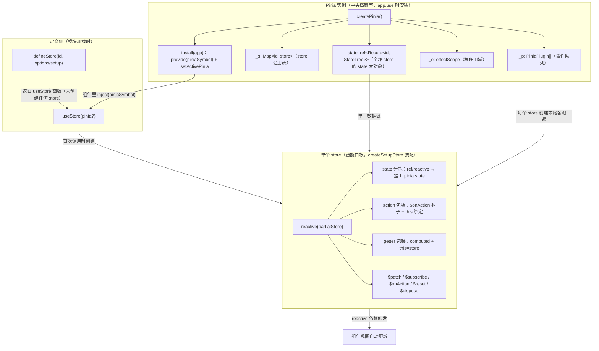
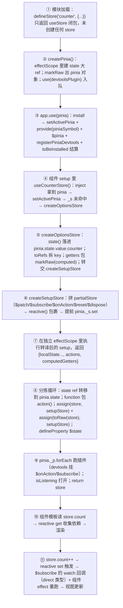

# 第 9 章 Pinia：立足响应式的轻量状态管理

> 上一章：[第 8 章 · Vue Router 路由](./08-vue-router.md) ｜ 下一章：[第 10 章 · Vuex](./10-vuex.md)

> 本章分析基准：[`pinia@2.3.1`](https://github.com/vuejs/pinia/tree/v2.3.1)（配合 Vue 3.5.43），仓库为 `vuejs/pinia`，源码在 `packages/pinia/src/` 下。选 2.3.x 而非 3.x：v3 主要是移除 Vue 2 兼容层（vue-demi），实现主线不变，但行号与本文引用错位较大。

## 学习目标

读完本章，你应当能够：

1. 说清 `createPinia()` 返回对象的结构（`install / use / state / _p / _a / _e / _s`），背出 `install(app)` 的四项职责，并解释 `toBeInstalled` 队列为什么存在。
2. 画出 `defineStore` 三种重载（id + options / 单 options / id + setup）归一化到 `createOptionsStore` / `createSetupStore` 的路径，说明 options store 如何被转写成一个 setup 函数。
3. 按顺序讲出 `createSetupStore` 的装配流程：建 partial store → `reactive()` 包裹 → 注册进 `pinia._s` → 在 effectScope 里执行 setup → 遍历返回值分拣 state / action / getter → `assign` 回 store → 定义 `$state` → 跑插件。
4. 默写 `$patch` 两种形态的分支（对象走 `mergeReactiveObjects`、函数直接突变 state），解释 `isListening / isSyncListening` 两个标志如何配合 `watch` 与 `activeListener` 实现「patch 只触发一次订阅」。
5. 说清 action 包装函数的 five 段式结构（触发 `$onAction` → 执行原函数 → 捕获同步异常 → Promise 分支 → 触发 after/onError 回调），以及 `this` 绑定的兜底规则。
6. 写出 5 行实现 `$reset` 的插件，解释 `pinia._p.forEach` 的执行时机（每个 store 创建末尾），并说明 SSR 下「每请求一份 pinia」的原因。

## 9.1 引入：Vuex 的「重」与 Pinia 的「轻」

先用一个类比定调，全章都会用到它：

- **Vuex 像公司财务室**。钱的进出必须开发票（mutation）、走审批流（action）、按部门分柜（module + namespace），查账（devtools 时间旅行）极其方便，但报销一包纸巾也要填三张单子；想让 `this.$store.state.user.profile.name` 有 TS 类型，还得手写一整套接口增强。
- **Pinia 像项目组的智能共享白板**。每个项目挂一块白板（一个 store），谁都能直接往上写字（`store.count++`）。但白板本身是 `reactive` 的：写上去的字所有人（组件）立刻看到；角落的摄像头（`$subscribe` / devtools）把每一笔改动都拍了下来。想加新规定（插件），白板出厂时贴一张就行。

「轻」的三层含义，本章逐层验证：

1. **API 轻**：没有 mutation/action 分层、没有 namespace、没有 module 嵌套。store 就是 `{ state, getters, actions }` 或一个 setup 函数，`useXxxStore()` 一调就有。
2. **实现轻**：Pinia 没有自建通知系统——`state` 是 `ref`，store 是 `reactive`，getters 是 `computed`，订阅是 `watch`。第 2 章的响应式系统被原封复用，Pinia 只做「装配」。
3. **类型轻**：TS 推导几乎全自动，setup 风格 store 返回什么类型就是什么类型。

顺便说下名字梗：Pinia 是西班牙语「菠萝」（piña）——就是 piña colada（椰林飘香）里那个菠萝。所以源码里遍地 🍍（报错前缀、`[🍍]` 警告），logo 也是一颗菠萝；跟鸡尾酒一起喝口感更佳。

对照同一个计数器的样板量。Vuex 4：定义 `state / mutations / actions` 三分 → `createStore` → `app.use(store)` → 组件里 `store.commit('increment')` 或 `store.dispatch(...)`。Pinia：

```ts
export const useCounterStore = defineStore('counter', {
  state: () => ({ count: 0 }),
  actions: {
    increment() { this.count++ },  // 直接改，没有 mutation
  },
})
// 组件里
const store = useCounterStore()
store.increment()        // 或者直接 store.count++
```

生态位一句话：Vuex 强在**严格变更审计**与**超大型团队流程约束**；Pinia 强在**低心智成本**（会 `reactive` 就会用）、**TS 自动推导**与**扁平免嵌套**（store 靠 id 区分）。Vue 官方已把 Pinia 列为推荐状态库，Vuex 进入维护模式——第 10 章拆开 Vuex 时，你会更清楚 Pinia 省掉了什么。

## 9.2 核心概念地图

Pinia 的源码物理上只有一层：`packages/pinia/src/` 下约十个文件，核心三个——`createPinia.ts`（81 行）、`store.ts`（995 行，全文最重）、`subscriptions.ts`（36 行）。其余是类型（`types.ts`，744 行，纯 TS 零运行时）、`storeToRefs.ts`（125 行）、HMR 支持（`hmr.ts`）与 devtools 桥接（`devtools/`）。



先把名词对齐，后面不再重复：

- **Pinia 实例**：`createPinia()` 的返回值，是所有 store 的「档案室」——`state` 是一个超大的 `ref<Record<string, StateTree>>`，全部 store 的 state 都存这里；`_s` 是 id → store 注册表；`_p` 是插件队列；`_e` 是根 `effectScope`。
- **StoreDefinition / useStore**：`defineStore` 的返回值是一个**函数**（不是 store！），带 `$id` 属性，调用它才真正创建（或取出）store。
- **Store**：`useStore()` 的返回，本质是 `reactive(partialStore + setup 返回值)`，业务代码读写的就是它。
- **activePinia**：模块级变量（packages/pinia/src/rootStore.ts:25），记录「当前活跃的 pinia 实例」——这是 `setup` 之外（路由守卫、工具函数）能用 `useStore()` 的关键，也是 SSR 陷阱的源头（9.3.3）。

## 9.3 createPinia 与 install：注册总线

### 9.3.1 createPinia：一个 markRaw 的字面对象

`createPinia()` 的全部实现只有五十余行——没有 class、没有继承，就是一个被 `markRaw` 的对象字面量：

出处：packages/pinia/src/createPinia.ts:10-65（pinia 2.3.1）

```ts
export function createPinia(): Pinia {
  const scope = effectScope(true)
  const state = scope.run<Ref<Record<string, StateTree>>>(() =>
    ref<Record<string, StateTree>>({})
  )!
  let _p: Pinia['_p'] = []
  // plugins added before calling app.use(pinia)
  let toBeInstalled: PiniaPlugin[] = []
  const pinia: Pinia = markRaw({
    install(app: App) { /* 9.3.2 */ },
    use(plugin) { /* 9.3.2 */ },
    _p,        // 已安装插件
    _a: null,  // 关联的 app（install 后填入）
    _e: scope, // 根 effectScope
    _s: new Map<string, StoreGeneric>(),  // id → store 注册表
    state,
  })
  if (__USE_DEVTOOLS__ && IS_CLIENT && typeof Proxy !== 'undefined') {
    pinia.use(devtoolsPlugin)
  }
  return pinia
}
```

逐段讲：

- **`effectScope(true)` + `scope.run(...)`**（createPinia.ts:11-16）：大 `state` ref 在独立作用域里创建，与任何组件无关。`detach` 为 `true`，生命周期由 `disposePinia` 手动管理（createPinia.ts:74-81，`pinia._e.stop()` 一把全停）。
- **`state` 是唯一的 `ref`**：所有 store 的 state 都是这个大对象上的属性（`pinia.state.value['counter']`）。这让 SSR 序列化变得平凡：服务端 `JSON.stringify(pinia.state.value)`，客户端一次回填。
- **`markRaw`**：pinia 实例绝不能被 `reactive` 代理（否则 `install` 里的 `this`、插件队列都会被套 Proxy）。
- **`pinia.use(devtoolsPlugin)`**（createPinia.ts:60-62）：devtools 支持不是硬编码，而是**作为第一个内置插件**走进插件系统——「插件机制是一等公民」的自证。

### 9.3.2 install 的四项职责与 toBeInstalled 队列

`app.use(pinia)` 触发 `install`，核心四件事：

出处：packages/pinia/src/createPinia.ts:23-47（pinia 2.3.1）

```ts
install(app: App) {
  // this allows calling useStore() outside of a component setup after
  // installing pinia's plugin
  setActivePinia(pinia)                    // ① 置为当前活跃实例
  if (!isVue2) {
    pinia._a = app                         // ② 记录 app（runWithContext 用）
    app.provide(piniaSymbol, pinia)        // ③ 组件里 inject 用
    app.config.globalProperties.$pinia = pinia
    if (__USE_DEVTOOLS__ && IS_CLIENT) {
      registerPiniaDevtools(app, pinia)    // ④ 注册 devtools 面板
    }
    toBeInstalled.forEach((plugin) => _p.push(plugin))  // ⑤ 结算插件队列
    toBeInstalled = []
  }
},

use(plugin) {
  if (!this._a && !isVue2) {
    toBeInstalled.push(plugin)             // app.use(pinia) 之前：先入队
  } else {
    _p.push(plugin)                        // 之后：直接进正式队列
  }
  return this
},
```

最值得讲的是 **⑤ `toBeInstalled` 队列的存在理由**。`pinia.use(plugin)` 与 `app.use(pinia)` 的顺序并不固定（常先 `pinia.use(persistedstate)` 再 `app.use(pinia)`），但插件只有在 install 后才能拿到 `app` 与完整上下文，所以 install 之前注册的插件先暂存，install 时统一搬进 `_p`。判断条件 `!this._a`（createPinia.ts:41）就是「还没装到 app 上吗」。这个模式在 Vue Router 的动态路由里也见过：**凡「注册时机可能早于生效时机」的 API，都需要暂存队列**。

`setActivePinia(pinia)`（packages/pinia/src/rootStore.ts:34）一行：`activePinia = pinia`，写入模块级变量。`getActivePinia`（packages/pinia/src/rootStore.ts:45-46）先尝试从当前组件上下文 `inject(piniaSymbol)`，失败再退回模块级变量——「组件里靠 provide/inject（支持多 app 多 pinia），组件外靠模块级单例」的双轨制。

### 9.3.3 SSR：为什么每个请求必须 new 一份 pinia

`activePinia` 是**模块级单例**（packages/pinia/src/rootStore.ts:25），而 Node.js 里模块被所有并发请求共享。服务端只 `createPinia()` 一次的话，请求 A 的异步渲染与请求 B 会交叉污染：A 用户写进 `pinia.state.value` 的 token 可能被打包进 B 用户的 HTML。所以官方 SSR 指南要求把 `createSSRApp(App)` 与 `createPinia()` 放进**每次请求都执行的工厂函数**，渲染完把 `pinia.state.value` 序列化注入 `window.__PINIA__`，客户端 `createPinia()` 后一次回填——`state` 设计成大 ref 的收益正在于此：水合就是一次 `pinia.state.value = window.__PINIA__`。

## 9.4 defineStore：三种形态统一

### 9.4.1 三个重载，一个实现

`defineStore` 对外暴露三种写法，类型上是三个重载（store.ts:823-870），实现上是一个函数：

出处：packages/pinia/src/store.ts:873-908（pinia 2.3.1）

```ts
export function defineStore(
  idOrOptions: any,
  setup?: any,
  setupOptions?: any
): StoreDefinition {
  let id: string
  let options: DefineStoreOptions<...> | DefineSetupStoreOptions<...>

  const isSetupStore = typeof setup === 'function'
  if (typeof idOrOptions === 'string') {
    id = idOrOptions
    // the option store setup will contain the actual options in this case
    options = isSetupStore ? setupOptions : setup
  } else {
    options = idOrOptions
    id = idOrOptions.id
    // __DEV__ 且 id 非字符串时抛错
  }
  // ...
}
```

归一化逻辑就两个判断：**第二参是不是函数**（`isSetupStore`，store.ts:894）决定走 setup 还是 options 路线；**第一参是不是字符串**决定 id 从哪来。归一化后，`defineStore` 返回一个 `useStore` 闭包函数（store.ts:910-980），注意此时**什么 store 都没创建**——真正的创建被推迟到第一次调用 `useStore()`。这个懒加载设计让「import 了一堆 store 但当前路由只用到一个」的应用零成本。

### 9.4.2 useStore：inject 优先、active 兜底、首次创建

`useStore` 是业务代码的入口，四十余行里藏着 Pinia 的上下文哲学：

出处：packages/pinia/src/store.ts:910-980（pinia 2.3.1）

```ts
function useStore(pinia?: Pinia | null, hot?: StoreGeneric): StoreGeneric {
  const hasContext = hasInjectionContext()
  pinia =
    (__TEST__ && activePinia && activePinia._testing ? null : pinia) ||
    (hasContext ? inject(piniaSymbol, null) : null)
  if (pinia) setActivePinia(pinia)

  if (__DEV__ && !activePinia) {
    throw new Error(`[🍍]: "getActivePinia()" was called but there was no active Pinia...`)
  }
  pinia = activePinia!

  if (!pinia._s.has(id)) {
    // creating the store registers it in `pinia._s`
    if (isSetupStore) {
      createSetupStore(id, setup, options, pinia)
    } else {
      createOptionsStore(id, options as any, pinia)
    }
    if (__DEV__) useStore._pinia = pinia
  }

  const store: StoreGeneric = pinia._s.get(id)!
  // ...hot 分支、devtools _pStores 记录略
  return store as any
}
useStore.$id = id
return useStore
```

解析 pinia 实例的三级策略（store.ts:911-917）：**显式传参** > 组件 setup 里 `inject(piniaSymbol)`（多 app 场景）> 模块级 `activePinia`。拿到后立刻 `setActivePinia(pinia)` 自我登记——所以路由守卫里先调一次 `useStore()`，后续其它 `useStore()` 都能借光。`!pinia._s.has(id)`（store.ts:929）是懒创建闸门：首次调用按 `isSetupStore` 分派，之后永远从注册表取同一实例——**同 id 的 store 天然单例**。结尾 `useStore.$id = id`（store.ts:978）让函数可辨识，HMR 的 `isUseStore`（packages/pinia/src/hmr.ts:19-21）就靠它识别「是不是 store 定义」。

### 9.4.3 createOptionsStore：options 如何被翻译成 setup

options 风格的 store 并不走独立实现，而是被**转写成一个 setup 函数**再交给 `createSetupStore`：

出处：packages/pinia/src/store.ts:149-220（pinia 2.3.1）

```ts
function createOptionsStore<Id extends string, S extends StateTree, ...>(
  id: Id, options: DefineStoreOptions<Id, S, G, A>, pinia: Pinia, hot?: boolean
): Store<Id, S, G, A> {
  const { state, actions, getters } = options
  const initialState: StateTree | undefined = pinia.state.value[id]

  let store: Store<Id, S, G, A>
  function setup() {
    if (!initialState && (!__DEV__ || !hot)) {
      // isVue2 分支略
      pinia.state.value[id] = state ? state() : {}   // ① state 先落户大 ref
    }
    // avoid creating a state in pinia.state.value（hot 分支略）
    const localState = toRefs(pinia.state.value[id]) // ② 把每个 key 转成 ref
    return assign(
      localState,
      actions,                                       // ③ actions 原样混入
      Object.keys(getters || {}).reduce((computedGetters, name) => {
        computedGetters[name] = markRaw(
          computed(() => {
            setActivePinia(pinia)
            const store = pinia._s.get(id)!
            return getters![name].call(store, store) // ④ getter → computed
          })
        )
        return computedGetters
      }, {} as Record<string, ComputedRef>)
    )
  }

  store = createSetupStore(id, setup, options, pinia, hot, true)  // ⑤ 转交
  return store as any
}
```

这个函数是全章第一个「啊哈」时刻：**options API 只是 setup API 的语法糖**。翻译四步——state 落进 `pinia.state.value[id]` 后 `toRefs` 拆成逐 key 的 ref（后面统一分拣时被识别为 state）；actions 原样返回（后面统一包装）；getters 逐个包成 `computed` 并 `markRaw`（computed 内部已有 effect，不能再被 reactive 代理）；最后 `createSetupStore(id, setup, options, pinia, hot, true)`，第六参 `isOptionsStore = true` 是后面 `$reset`、水合分支的依据。getter 里 `getters![name].call(store, store)`（store.ts:207）同时满足两种写法：`(state) => state.count * 2` 的第一参与 `double() { return this.count * 2 }` 的 `this`，拿到的都是 store。

## 9.5 createSetupStore：核心装配工厂

`createSetupStore`（store.ts:222-784）约 560 行，是 Pinia 的心脏。它的工作可以概括成一句话：**执行用户 setup，把返回值分拣装配成一个 reactive store，并挂上一组 `$` 前缀的系统方法**。先看它的「骨架五件套」——内部状态：

出处：packages/pinia/src/store.ts:273-296（pinia 2.3.1）

```ts
// internal state
let isListening: boolean // set to true at the end
let isSyncListening: boolean // set to true at the end
let subscriptions: SubscriptionCallback<S>[] = []
let actionSubscriptions: StoreOnActionListener<Id, S, G, A>[] = []
let debuggerEvents: DebuggerEvent[] | DebuggerEvent
const initialState = pinia.state.value[$id] as UnwrapRef<S> | undefined

// avoid setting the state for option stores if it is set by the setup
if (!isOptionsStore && !initialState && (!__DEV__ || !hot)) {
  // isVue2 分支略
  pinia.state.value[$id] = {}       // setup store 先占个空壳
}

const hotState = ref({} as S)
// #1129：避免连续 patch 触发过多监听
let activeListener: Symbol | undefined
```

`isListening / isSyncListening` 两个标志控制 `$subscribe` 的通知开关（9.6 详解）；`subscriptions / actionSubscriptions` 是两个回调数组（注意是数组不是 Set，触发时会先 `slice()` 快照）；setup store 一进来先在 `pinia.state.value[$id]` 占一个空对象——**state 的真正填充发生在分拣阶段**（9.5.2）。

### 9.5.1 partialStore：系统方法的集合体

在装配用户返回值之前，先把 `$patch / $reset / $subscribe / $onAction / $dispose` 装进一个「毛坯 store」：

出处：packages/pinia/src/store.ts:443-479（pinia 2.3.1）

```ts
const partialStore = {
  _p: pinia,
  // _s: scope,
  $id,
  $onAction: addSubscription.bind(null, actionSubscriptions),
  $patch,
  $reset,
  $subscribe(callback, options = {}) { /* 9.6.2 */ },
  $dispose,
} as _StoreWithState<Id, S, G, A>
```

`$onAction` 直接 `bind` 了 `addSubscription`（packages/pinia/src/subscriptions.ts:6-27）——订阅机制零特殊化，与 `$subscribe` 共用同一套工具。接着是整个 Pinia 最贵的一行：

出处：packages/pinia/src/store.ts:487-503（pinia 2.3.1）

```ts
const store: Store<Id, S, G, A> = reactive(
  __DEV__ || (__USE_DEVTOOLS__ && IS_CLIENT)
    // dev 下额外混入 _hmrPayload 与 _customProperties（devtools 用）
    ? assign({ _hmrPayload, _customProperties: markRaw(new Set<string>()) }, partialStore)
    : partialStore
) as unknown as Store<Id, S, G, A>

// store the partial store now so the setup of stores can instantiate each
// other before they are finished without creating infinite loops.
pinia._s.set($id, store as Store)
```

两个关键决策：

1. **`reactive()` 包裹**：store 本体的响应式就是这么来的——`store.count` 的读取被组件 effect 追踪，修改触发重渲染。Pinia 没有自建通知系统，靠的就是它。dev 模式额外混入 `_hmrPayload` 与 `_customProperties`，生产只有 partialStore，开销最小。
2. **先注册再执行 setup**（store.ts:503 注释自陈）：`pinia._s.set($id, store)` 在 setup 执行**之前**。store A 的 setup 里 `useBStore()` 触发 B 的创建，B 又 `useAStore()` 时能从 `_s` 拿到 A 的「半成品」（state 还没分拣完，但引用存在），避免无限递归。代价是「先注册者拿到的是未装配完的引用」——易错点第 4 条呼应。

### 9.5.2 执行 setup 与三分拣

出处：packages/pinia/src/store.ts:505-511（pinia 2.3.1）

```ts
const runWithContext =
  (pinia._a && pinia._a.runWithContext) || fallbackRunWithContext

const setupStore = runWithContext(() =>
  pinia._e.run(() => (scope = effectScope()).run(() => setup({ action }))!)
)!
```

三层嵌套各有分工：`runWithContext`（Vue 3.3+ 的 `app.runWithContext`）让 setup 里可以 `inject` 路由等 app 级 provide；`pinia._e.run` 把 store 的 effectScope 挂到 pinia 根作用域下（`disposePinia` 连锁销毁）；`(scope = effectScope()).run(() => setup({ action }))` 才执行用户函数——**每 store 一个独立 effectScope**，里面的 `computed`、`watch` 由它托管，`$dispose` 时 `scope.stop()`（store.ts:362）一把清。传给 setup 的 `{ action }` 是唯一 helper，允许手动包装函数成 action（内部给 options 转译用）。

随后是分拣循环，逐 key 检查 setup 返回值：

出处：packages/pinia/src/store.ts:514-584（pinia 2.3.1）

```ts
for (const key in setupStore) {
  const prop = setupStore[key]

  if ((isRef(prop) && !isComputed(prop)) || isReactive(prop)) {
    // state 分支（hot/isVue2 分支略）
    if (!isOptionsStore) {
      // setup store：先水合同步，再把 ref 转移进 pinia state 树
      if (initialState && shouldHydrate(prop)) {
        if (isRef(prop)) {
          prop.value = initialState[key as keyof UnwrapRef<S>]
        } else {
          mergeReactiveObjects(prop, initialState[key])
        }
      }
      pinia.state.value[$id][key] = prop   // 关键：ref 被「转移」到大 state
    }
    // __DEV__ 时 _hmrPayload.state.push(key)
  } else if (typeof prop === 'function') {
    // action 分支
    const actionValue = __DEV__ && hot ? prop : action(prop as _Method, key)
    // @ts-expect-error
    setupStore[key] = actionValue
    // list actions so they can be used in plugins
    // @ts-expect-error
    optionsForPlugin.actions[key] = prop
    // __DEV__ 时 _hmrPayload.actions[key] = prop
  } else if (__DEV__ && isComputed(prop)) {
    _hmrPayload.getters[key] = /* ... */   // 登记进 devtools 清单
  }
}
```

分拣规则一句话：**`ref`（非 computed）或 `reactive` → state；`function` → action；`computed` → getter**。这回答了经典疑惑——「setup 风格 store 为什么直接 `return { count, double, increment }` 就行」：`count = ref(0)` 命中第一分支，被**转移**到 `pinia.state.value[$id][key]`（ref 是对象，转移后大 state 与你的 ref 共享同一个 `.value`，天然同步）；`increment` 命中第二分支被 `action()` 包装；`double = computed(...)` 命中第三分支登记进 devtools 清单。`shouldHydrate`（store.ts:138-140）配合 `skipHydrate()`（store.ts:128-130）给 SSR 留后门：不想被水合覆盖的对象（如 router 实例）可以打标跳过。

分拣完毕后两连 `assign` 收工：

出处：packages/pinia/src/store.ts:592-597（pinia 2.3.1）

```ts
} else {
  assign(store, setupStore)
  // allows retrieving reactive objects with `storeToRefs()`. Must be called
  // after assigning to the reactive object.
  // Make `storeToRefs()` work with `reactive()` #799
  assign(toRaw(store), setupStore)
}
```

第一遍把分拣结果挂上 reactive store（`store.count` 可读可写）；第二遍把**原始 ref** 挂到 raw 对象上——`storeToRefs` 遍历的正是 raw store（packages/pinia/src/storeToRefs.ts:98），没有这一行它拿到的会是被 reactive 拆包后的值而非 ref 本体，#799 修的就是这个。

### 9.5.3 $state 与插件应用

`$state` 不是普通属性，而是 `Object.defineProperty` 定义的访问器：

出处：packages/pinia/src/store.ts:602-614（pinia 2.3.1）

```ts
Object.defineProperty(store, '$state', {
  get: () => (__DEV__ && hot ? hotState.value : pinia.state.value[$id]),
  set: (state) => {
    // hot 分支抛错略
    $patch(($state) => {
      assign($state, state)
    })
  },
})
```

getter 直指大 state 的对应分片；setter 复用 `$patch`（保证订阅只发一次）。`store.$state` 与 `pinia.state.value[$id]` 永远同一引用——SSR 序列化、devtools 快照、`$subscribe` 回调里的 `state` 参数，全都是它。

最后一步，**每个 store 创建的末尾**跑一遍所有插件：

出处：packages/pinia/src/store.ts:725-753（pinia 2.3.1）

```ts
// apply all plugins
pinia._p.forEach((extender) => {
  /* istanbul ignore else */
  if (__USE_DEVTOOLS__ && IS_CLIENT) {
    const extensions = scope.run(() =>
      extender({ store: store as Store, app: pinia._a, pinia, options: optionsForPlugin })
    )!
    Object.keys(extensions || {}).forEach((key) =>
      store._customProperties.add(key)
    )
    assign(store, extensions)
  } else {
    // 无 devtools：直接 assign 插件返回值
    assign(store, scope.run(() => extender({ store, app: pinia._a, pinia, options })!))
  }
})
```

插件签名 `(context: PiniaPluginContext) => Partial<...> | void`（packages/pinia/src/rootStore.ts:139-151）：收 `{ store, app, pinia, options }` 四件套，返回对象被 `assign` 到 store 上（dev 下 key 还记入 `_customProperties` 供 devtools 展示）。注意三点：插件在 `scope.run` 里执行——里面写的 `watch` 生命周期跟随 store；`optionsForPlugin` 是分拣阶段收集的 actions 清单（store.ts:567），插件可枚举 action 名；**每创建一个 store 就跑全部插件**，别在插件里放全局单例假设。

收尾前 `isListening = true; isSyncListening = true`（store.ts:781-782）打开通知开关，`return store`。dev 下还有一道防线（store.ts:755-767）：`state: () => new MyClass()` 这种 class 实例 state 会被警告——class 实例无法被安全合并，也无法 JSON 序列化。

## 9.6 $patch 与 $subscribe / $onAction：变更三件套

### 9.6.1 $patch：两种形态与「只通知一次」的机关

`$patch` 是 Pinia 唯一的「显式变更入口」，两个重载两种行为：

出处：packages/pinia/src/store.ts:297-340（pinia 2.3.1）

```ts
function $patch(stateMutation: (state: UnwrapRef<S>) => void): void
function $patch(partialState: _DeepPartial<UnwrapRef<S>>): void
function $patch(
  partialStateOrMutator:
    | _DeepPartial<UnwrapRef<S>>
    | ((state: UnwrapRef<S>) => void)
): void {
  let subscriptionMutation: SubscriptionCallbackMutation<S>
  isListening = isSyncListening = false          // ① 先关掉 watch 通知
  // __DEV__ 时 debuggerEvents = []
  if (typeof partialStateOrMutator === 'function') {
    partialStateOrMutator(pinia.state.value[$id] as UnwrapRef<S>)  // ② 直接突变
    subscriptionMutation = { type: MutationType.patchFunction, storeId: $id, events: debuggerEvents as DebuggerEvent[] }
  } else {
    mergeReactiveObjects(pinia.state.value[$id], partialStateOrMutator)  // ③ 深合并
    subscriptionMutation = { type: MutationType.patchObject, payload: partialStateOrMutator, storeId: $id, events: debuggerEvents as DebuggerEvent[] }
  }
  const myListenerId = (activeListener = Symbol())
  nextTick().then(() => {
    if (activeListener === myListenerId) {
      isListening = true                       // ④ 下一拍再开回来
    }
  })
  isSyncListening = true
  // because we paused the watcher, we need to manually call the subscriptions
  triggerSubscriptions(                        // ⑤ 手动补发一次通知
    subscriptions,
    subscriptionMutation,
    pinia.state.value[$id] as UnwrapRef<S>
  )
}
```

这套「关-改-开-补」四步是 `$patch` 的灵魂：**① 先把 `isListening` 置 false**，让 `$subscribe` 内部那个 watch 在 patch 期间静默（否则改 5 个字段可能收到多条通知）；**②③ 执行变更**——函数形态直接拿 state 分片突变（适合数组 push、Map/Set 操作），对象形态交给 `mergeReactiveObjects` 递归深合并；**④ `activeListener` + `nextTick`** 解决连续 patch：第二个 `$patch` 的 Symbol 覆盖第一个，只有最后一次负责把开关开回来（注释链接的 #1129 就是这个 bug）；**⑤ 手动 `triggerSubscriptions`** 补发一条汇总通知，mutation 类型分别是 `MutationType.patchFunction` / `patchObject`（packages/pinia/src/types.ts:43-65），对象形态还带 `payload`——devtools 时间旅行里「patch object」条目就是这么来的。

`mergeReactiveObjects`（store.ts:81-115）也值得一看：Map 对 Map 走 `forEach set`、Set 对 Set 走 `forEach add`；普通对象递归——但只在「新旧值都是 plain object 且新值非 ref/reactive」时递归，否则直接覆盖。**$patch 默认深合并**，嵌套对象只改你给的字段，这与 Vuex 的「整体替换 state」不同。

### 9.6.2 $subscribe：一个 watch 的封装

出处：packages/pinia/src/store.ts:450-477（pinia 2.3.1）

```ts
$subscribe(callback, options = {}) {
  const removeSubscription = addSubscription(
    subscriptions, callback, options.detached, () => stopWatcher()
  )
  const stopWatcher = scope.run(() =>
    watch(
      () => pinia.state.value[$id] as UnwrapRef<S>,
      (state) => {
        if (options.flush === 'sync' ? isSyncListening : isListening) {
          callback(
            { storeId: $id, type: MutationType.direct, events: debuggerEvents as DebuggerEvent },
            state
          )
        }
      },
      assign({}, $subscribeOptions, options)   // $subscribeOptions = { deep: true }
    )
  )!
  return removeSubscription
},
```

真相大白：**`$subscribe` 就是对 `pinia.state.value[$id]` 的一个 `deep: true` 的 watch**。`store.count++` 直接改 state 时，通知走这个 watch（mutation 类型 `MutationType.direct`）；`flush` 选项原样透传给 watch（默认 `'pre'`，`flush: 'sync'` 时改读 `isSyncListening` 标志，配合 `$patch` 的开关语义）。`addSubscription`（packages/pinia/src/subscriptions.ts:6-27）把回调塞进数组、在组件 setup 里调用时自动 `onScopeDispose` 退订（组件卸载即清理），`detached: true` 可解绑。`triggerSubscriptions`（packages/pinia/src/subscriptions.ts:29-35）触发前先 `slice()` 拍快照——回调里再退订也不打乱正在进行的遍历。

### 9.6.3 $onAction 与 action 包装：五段式拦截

`$onAction` 注册的回调存在 `actionSubscriptions` 数组里，触发点是每个 action 被调用时。action 包装函数（9.4.3 与 9.5.2 里都调用的 `action()`）是 Pinia 里最精巧的一段：

出处：packages/pinia/src/store.ts:373-434（pinia 2.3.1）

```ts
const action = <Fn extends _Method>(fn: Fn, name: string = ''): Fn => {
  if (ACTION_MARKER in fn) {
    // 已包装过：补上名字后直接返回
    ;(fn as unknown as MarkedAction<Fn>)[ACTION_NAME] = name
    return fn
  }

  const wrappedAction = function (this: any) {
    setActivePinia(pinia)                        // ① 组件外调用也能找对 pinia
    const args = Array.from(arguments)

    const afterCallbackList: Array<(resolvedReturn: any) => any> = []
    const onErrorCallbackList: Array<(error: unknown) => unknown> = []
    function after(callback) { afterCallbackList.push(callback) }
    function onError(callback) { onErrorCallbackList.push(callback) }

    // @ts-expect-error
    triggerSubscriptions(actionSubscriptions, {  // ② 触发 $onAction 回调
      args,
      name: wrappedAction[ACTION_NAME],
      store,
      after,
      onError,
    })

    let ret: unknown
    try {
      ret = fn.apply(this && this.$id === $id ? this : store, args)  // ③ 执行
    } catch (error) {                        // ④ 同步异常 → onError 后重抛
      triggerSubscriptions(onErrorCallbackList, error)
      throw error
    }

    if (ret instanceof Promise) {            // ⑤ async：then/catch 挂回调
      return ret
        .then((value) => {
          triggerSubscriptions(afterCallbackList, value)
          return value
        })
        .catch((error) => {
          triggerSubscriptions(onErrorCallbackList, error)
          return Promise.reject(error)
        })
    }
    triggerSubscriptions(afterCallbackList, ret)  // 同步路径直接 after
    return ret
  } as MarkedAction<Fn>

  wrappedAction[ACTION_MARKER] = true
  wrappedAction[ACTION_NAME] = name // will be set later
  return wrappedAction
}
```

五段式结构：**① 每次调用先 `setActivePinia`**——action 经常在组件外（axios 拦截器、别的 store）被调，保证内部逻辑总找对上下文；**② 触发 `$onAction` 回调**，把 `{ name, args, store, after, onError }` 交出去——`after / onError` 是「寄存钩子」的函数，本次调用的完成回调收进两个局部数组；**③ `fn.apply(this && this.$id === $id ? this : store, args)`** 是 `this` 绑定兜底：调用方本身就是这个 store（`store.increment()`）时保持原样，否则（解构出的裸函数 `const { increment } = store; increment()`）强制绑到 store——**options 风格 action 里的 `this.count` 永远有效**；**④ 同步 throw** 先喂 onError 再原样上抛；**⑤ 返回值是 Promise** 时 after/onError 改挂 then/catch——「async action 天然支持」的全部秘密：**Pinia 根本不区分同步异步**，Promise 只是返回值的一种形态。`ACTION_MARKER` 防重包（hmr 场景同一函数会被反复处理），`ACTION_NAME` 留给 devtools 显示。

## 9.7 getters：computed 的魔法

getter 的实现已经在两处见过：options 风格在 `createOptionsStore` 里被包成 `markRaw(computed(...))`（store.ts:194-209），setup 风格直接返回 `computed(...)`（分拣第三分支仅登记）。要点三条：

1. **getter = computed，缓存白送**。`store.doubleCount` 的读取走 computed 惰性求值与缓存，依赖不变不重算——这与 Vuex getter 的「每次访问重算」形成鲜明对照。
2. **`this` 与第一参都是 store**。options getter 用 `getters[name].call(store, store)` 执行（store.ts:207），`(state) => ...` 形参与 `this` 拿到的都是 store 代理，两种写法等价。`call` 之前 `setActivePinia(pinia)`（store.ts:196）再兜底一次上下文。
3. **getter 里可以跨 store**。computed 回调里 `useOtherStore()` 靠「先注册」机制兜底（9.5.1）；getter 是惰性的，首次读取才执行，通常能避开 setup 期死锁。

为什么 `markRaw`？computed 对象内部已有自己的 effect 与依赖表，再被 store 的 `reactive` 代理一层纯属浪费。这也解释了 `storeToRefs` 用 `value.effect` 嗅探 computed 的技巧（packages/pinia/src/storeToRefs.ts:105）：computed ref 与 plain ref 的唯一运行时差异就是挂了 `effect` 属性。

## 9.8 actions：自动绑定与异步

关于 action，9.6.3 已经看过实现，这里只收拢用法层的三个推论：

- **自动 `this` 绑定**：`fn.apply(this && this.$id === $id ? this : store)`（store.ts:404）意味着解构 action 是安全的——`const { increment } = store` 后裸调，`this` 依然指向 store。对比 state 解构（丢响应式，必须 `storeToRefs`），action 解构零代价——「actions 随便解构，state 不行」口诀的源码依据。
- **async 天然支持**：返回 Promise 时 after/onError 自动改挂 then/catch（store.ts:411-421），业务里直接 `async fetchUser() { this.user = await api.get(...) }`，不需要 Vuex 的「action 里 commit mutation」二段式。devtools 里 async action 显示为 🛫/🛬 分组时间线（packages/pinia/src/devtools/plugin.ts:335-391）。
- **action 可互相调用、可跨 store 调用**：`this` 绑的是 store 代理，`this.otherAction()` 与 `useOtherStore().someAction()` 都走包装后的函数，hooks 链完整。

## 9.9 插件系统：$reset / persistence / devtools

### 9.9.1 五分钟写一个 $reset 插件

setup 风格 store 默认**没有** `$reset`——看 `createSetupStore` 里的定义：

出处：packages/pinia/src/store.ts:342-359（pinia 2.3.1）

```ts
const $reset = isOptionsStore
  ? function $reset(this: _StoreWithState<Id, S, G, A>) {
      const { state } = options as DefineStoreOptions<Id, S, G, A>
      const newState: _DeepPartial<UnwrapRef<S>> = state ? state() : {}
      // we use a patch to group all changes into one single subscription
      this.$patch(($state) => {
        assign($state, newState)
      })
    }
  : __DEV__
    ? () => { throw new Error(`🍍: Store "${$id}" is built using the setup syntax and does not implement $reset().`) }
    : noop
```

原因很直白：options store 的初始 state 可以从 `options.state()` 再造一份；setup store 的初始 state 藏在 setup 闭包里（`const count = ref(0)` 的 0），Pinia 事后拿不到「初始值」。但插件能拿到 `options`——社区标准做法是在 store 创建时显式记录初始快照：

```ts
// 5 行插件：给 setup store 补上 $reset
pinia.use(({ store }) => {
  const initialState = JSON.parse(JSON.stringify(store.$state))
  store.$reset = () => {
    store.$patch(($state) => assign($state, JSON.parse(JSON.stringify(initialState))))
  }
})
```

（深拷贝用 JSON 只是演示，生产建议 `structuredClone`。）这个插件恰好演示了 9.5.3 的插件协议：收 `{ store }`，往 store 挂方法，每个 store 创建时各执行一次。

### 9.9.2 持久化插件的原理

`pinia-plugin-persistedstate` 这类插件的核心不超过二十行，全部建立在本章 API 上：`$subscribe` 里把 `store.$state`（或白名单子集）`JSON.stringify` 写进 storage；store 创建时（插件回调里）先读 storage 回填 `$patch`。它能工作靠三个设计：**state 集中在 `pinia.state.value`**（序列化天然可得）、**`$patch` 深合并**（回填不覆盖新加字段）、**插件在每 store 创建末尾执行**（回填先于组件使用）。SSR 下 storage 不可用，插件回调里判断 `import.meta.client` 跳过即可。

### 9.9.3 devtools 桥：插件体系的活教材

官方 devtools 支持分两半：**install 时** `registerPiniaDevtools(app, pinia)`（packages/pinia/src/createPinia.ts:33）注册面板、timeline 层与 inspector；**每个 store 创建时**，内置插件 `devtoolsPlugin`（packages/pinia/src/devtools/plugin.ts:561-600）给 store 打 `_isOptionsAPI` 标记、包装 action 分组，再由 `addStoreToDevtools` 做两件 instrumentation——`store.$onAction(...)` 把每次 action 的开始/结束/异常画成 timeline 事件（🛫/🛬/💥 三态），`store.$subscribe(...)` 把 direct/patch 变更同步进 inspector 与时间旅行。**整个 devtools 能力没有一行写死在 store 装配流程里**，全部经由 `$onAction` / `$subscribe` / 插件协议组合出来——这是检验扩展点设计是否及格的最佳判据：官方增强能否用公开 API 写成第三方插件。Pinia 过了。

## 9.10 TypeScript 类型流

Pinia 的类型体系全部在 `types.ts`（744 行，零运行时），核心三个映射：

- **`Store<Id, S, G, A>` 的合成**（packages/pinia/src/types.ts:485-502）：`_StoreWithState<...> & UnwrapRef<S> & _StoreWithGetters<G> & A & PiniaCustomProperties & PiniaCustomStateProperties`——state 先 `UnwrapRef`（`ref<number>` 在 store 上呈现为 `number`），getters 经 `_StoreWithGetters` 映射成返回值类型（readonly），actions 原样保留。两个 `PiniaCustom*` 是**空接口**（packages/pinia/src/types.ts:544-554），插件作者用 `declare module 'pinia'` 增强它们，类型自动长进每个 store——与 Zustand 的 `StoreMutators` 注册表同款手法。
- **`StoreDefinition`**（packages/pinia/src/types.ts:514-539）：带 `$id` 与 `_pinia?` 的函数接口，签名 `(pinia?: Pinia | null, hot?: StoreGeneric) => Store<Id, S, G, A>`——`useStore` 的类型本体。
- **setup 风格的自动提取**：`_ExtractStateFromSetupStore<SS>` 等（packages/pinia/src/types.ts:605-621）靠 key 过滤区分三类——state 剔除 `_Method | ComputedRef`，getter 只留 `ComputedRef`，action 只留 `_Method`。**setup 返回什么就推导成什么**，不需要手写泛型——这就是「setup 风格 TS 体验优于 options 风格」的类型学解释：options 风格靠 `DefineStoreOptions`（packages/pinia/src/types.ts:634-699）里的 `ThisType<...>` 交叉类型反推 `this`，getter 用箭头函数访问 `this` 就推不出；setup 风格压根没有 `this` 问题。

`storeToRefs` 的返回类型 `StoreToRefs<SS>`（packages/pinia/src/storeToRefs.ts:69-81）则是运行时逻辑的类型镜像：state → `ToRef`，writable computed → `WritableComputedRef`，readonly computed → `ComputedRef`，actions 被剔除。

## 端到端流程串讲



把开头的问题逐一回收：**「轻」在实现**——state 是 ref、store 是 reactive、getter 是 computed、订阅是 watch，Pinia 只写装配代码；**「轻」在时序**——`defineStore` 零成本，`useStore` 首次调用才创建；**「轻」在上下文**——inject 与 activePinia 双轨，组件内外都能用。

## 版本勘误 📌

以下说法在网上仍大量流传，与 pinia 2.x（尤其 2.1+）的实际行为对不上：

1. **「setup store 也有 `$reset`」——2.1 起明确没有。** `createSetupStore` 里 `$reset` 对非 options store 在 dev 下直接抛错（store.ts:352-359），生产是 `noop`。原因：setup 闭包里的初始值 Pinia 拿不到。要么换 options 风格，要么用 9.9.1 的插件自行快照。
2. **`$subscribe` 的 `flush` 与 `$patch` 的关系被误读。** 类型注释写明「the `flush` option does not affect calls to `store.$patch()`」（packages/pinia/src/types.ts:318 起 `_StoreWithState.$subscribe` 的 jsdoc）：`$patch` 手动 `triggerSubscriptions` 补发通知（store.ts:335-339），与 watch 的 flush 时机无关；`flush` 只影响 direct 变更的通知时机。
3. **HMR API 已变。** `acceptHMRUpdate(useStore, import.meta.hot)` 写法依然有效，但实现从「替换整个 store」改为 `_hotUpdate` 原地合并（store.ts:619-696，配合 `patchObject` 保留运行中的 state，packages/pinia/src/hmr.ts:32-66）；`__hot:` 前缀的临时 store（store.ts:947）创建后即焚（state 与注册表条目都删，store.ts:955-956）。
4. **「`defineStore(options)` 单参形式被废弃」**——jsdoc 确标了 `@deprecated`（store.ts:841 的重载注释），推荐显式 `defineStore(id, options)`，但运行时尚未移除，老代码不报错。
5. **`$dispose` 不删 state。** 类型注释写明「this doesn't delete the state of the store, you have to do it manually with `delete pinia.state.value[store.$id]`」（types.ts 中 `_StoreWithState.$dispose` 的 jsdoc）——只停 scope、清订阅、移出注册表；再次 `useStore()` 会复用旧 state。「$dispose 后数据还在」的困惑源于此。

## 初学者易错点 ⚠️

1. **解构 state 丢响应式。** `const { count } = useCounterStore()` 拿到的是 number 快照——store 是 `reactive`，解构与 `reactive` 对象解构同病。正解：`const { count } = storeToRefs(store)`（packages/pinia/src/storeToRefs.ts:89-123：state 走 `toRef(store, key)`、computed 走新包一层的 `computed({get,set})`，actions 自动跳过）。action 则可随便解构（9.8 的 this 兜底）。
2. **在 `app.use(pinia)` 之前或组件外调 `useStore()` 报「no active Pinia」。** `useStore` 三级解析（store.ts:911-917）全部落空时 dev 直接抛错（store.ts:919-925）。路由守卫、axios 拦截器里要用，先把 pinia 实例 import 进来显式传参 `useStore(pinia)`。
3. **SSR 共享单例 pinia 跨请求污染。** `activePinia` 是模块级变量（rootStore.ts:25），Node 多请求并发渲染会互相覆盖。每请求必须新建 `createPinia()`（9.3.3），客户端用 `pinia.state.value = window.__PINIA__` 一次回填。
4. **跨 store 循环依赖在 setup 顶层立即读值。** A 的 setup 顶层读 `useBStore().someState`，B 又读 A——「先注册后装配」机制（store.ts:503 注释）保证不爆栈，但先注册方读到的是未装配完的半成品。把互相读取推迟到 getter/action（惰性执行）即可化解。
5. **期待 async action 像 mutation 一样被逐步追踪。** action 只记录「开始/结束」两个时间点，中间每次 state 变更是独立的 direct/patch 条目。想要「一个操作一条记录」的事务感，把多处修改收进一次 `$patch`。
6. **getter 里调用会改 state 的 action 造成循环。** getter 是 computed，执行期改 state 会让依赖失效→重算→再修改。getter 保持纯函数；需要派生写操作请用 action。
7. **把 class 实例等不可序列化对象塞进 state。** dev 下 class 实例 state 直接警告（store.ts:755-767）；`$patch` 深合并只对 plain object 递归（store.ts:97-107），SSR 序列化与 devtools 快照也都假设 state 可 JSON 化。特殊对象用 `skipHydrate()`（store.ts:128-130）标记并自行管理水合。

## 本章小结

- Pinia ≈ **Composition API 最佳实践的官方封装**：state 用 `ref`/`reactive`、getter 用 `computed`、副作用归 `effectScope` 管，通知系统零自建——`createPinia` 只有一个大 `ref` 存全部 state（createPinia.ts:14-16），store 本体是 `reactive()`（store.ts:487-499），`$subscribe` 是一个 `deep: true` 的 watch（store.ts:457-474）。
- `createPinia()` 返回 markRaw 字面量：`install` 里 `setActivePinia` + `provide(piniaSymbol)` + 注册 devtools + 结算 `toBeInstalled` 插件队列；`activePinia` 模块级单例让组件外可用，也是 SSR 必须每请求新建实例的原因。
- `defineStore` 三种形态归一化为 `useStore` 闭包；首次调用才创建：options 风格被 `createOptionsStore` 翻译成 setup 函数（state 落大 ref → toRefs 拆 key → getters 包 computed），与 setup 风格殊途同归进 `createSetupStore`。
- `createSetupStore` 装配流水线：partialStore → reactive → 提前注册（防循环依赖爆栈）→ effectScope 里执行 setup → 三分拣（ref/reactive→state、function→action、computed→getter）→ 双 assign → `$state` 访问器 → 逐 store 跑插件 → 打开 `isListening`。
- 变更三件套：`$patch` 对象形态走 `mergeReactiveObjects` 深合并、函数形态直接突变，配合「关-改-开-补」四步保证订阅只响一次；`$onAction` 经 action 包装函数五段式（触发钩子→执行→同步异常→Promise 分支→after/onError）实现；action 的 `this` 由 `this.$id === $id ? this : store` 兜底，async 只是返回值形态。
- 插件协议 `(context) => extensions` 在每 store 创建末尾执行，`$reset`、持久化、官方 devtools 全部由它组合出来——**Pinia 的「轻」不是没有能力，而是所有能力都长在 Vue 响应式系统与一套极简插件协议上**。

## 与 Vuex / Zustand 对照速查表

| 维度 | Pinia 2.3 | Vuex 4 | Zustand v5 |
| --- | --- | --- | --- |
| 心智模型 | 智能共享白板：每 store 一块，直接读写 | 财务室：dispatch/commit 单通道，mutation 留痕 | 公告栏 + 业主群：模块级单例 + selector 订阅 |
| 最小接入 | `createPinia()` + `app.use` + `defineStore` | `createStore` + `app.use` + 手写 mutations | `create()`，无 Provider 无 install |
| 状态变更 | 直接改 / `$patch`（深合并） | 必须 `commit(mutation)`（严格模式强制） | `set(partial)` 浅合并 / 替换 |
| 异步模型 | async action，无分层 | action 里 commit mutation，两段式 | 普通函数/异步函数，无概念分层 |
| 模块化 | 扁平多 store，id 区分，无嵌套 | module + namespace 树 | 扁平多 store 或单 store 切片 |
| TS 推导 | setup 风格全自动；options 靠 ThisType | 需手写 `Store` 增强，namespace 下艰难 | 柯里化 `create<T>()(...)` + Mutate 注册表 |
| 通知机制 | Vue 响应式（reactive + computed + watch） | Vue 响应式（reactive state + computed getter） | `listeners: Set` + `useSyncExternalStore` |
| devtools | 官方插件桥（$onAction/$subscribe 组合） | 原生深度集成，时间旅行 | `devtools` 中间件桥接 Redux DevTools |
| SSR | 每请求 `createPinia`，state 一次回填 | 每请求 `createStore`，`store.replaceState` | 每请求/每上下文自建，getInitialState 对齐 |
| 包体积（gzip） | ~2KB 级核心 | ~4KB 级 | ~1KB 级 |
| 何时选它 | Vue 3 默认答案，新项目直接上 | 存量 Vuex 项目、强审计刚需团队 | React 项目；或追求极致体积的非 Vue 场景 |

## 返回总目录

[返回教程总目录](../../README.md)
