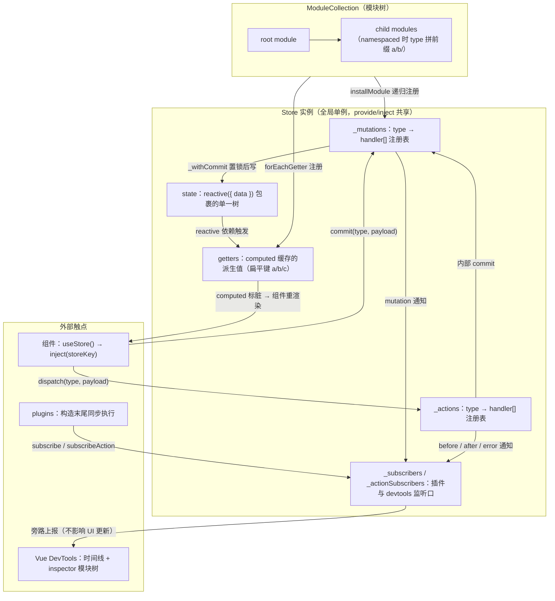
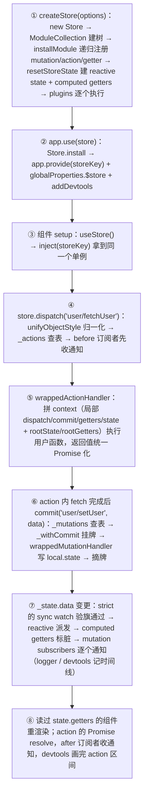

# 第 10 章 Vuex：集中式状态管理的经典形态

> 上一章：[第 9 章 · Pinia](./09-pinia.md) ｜ 下一章：[返回教程总目录](../../README.md)

> 本章分析基准：[`vuex@4.1.0`](https://github.com/vuejs/vuex/tree/v4.1.0)（配合 Vue 3.5.43），仓库为 `vuejs/vuex`，源码在 `src/` 下。

## 学习目标

读完本章，你应当能够：

1. 背出 `createStore` 构造期的四件事：`ModuleCollection` 建树、`installModule` 递归注册、`resetStoreState` 建响应式、`plugins` 逐个执行；并解释为什么 `dispatch` / `commit` 要在构造器里重新 bind。
2. 说清 `install` 的三项职责（`provide`、`$store`、devtools）与 `useStore` 的 `inject` 本质，解释为什么 store 实例本身就是插件、不需要独立的 `install` 导出。
3. 描述 `commit` 的完整路径（`unifyObjectStyle` → `_mutations` 查表 → `_withCommit` 置锁 → `_subscribers` 通知），并从 devtools 快照对比的角度解释 mutation 为什么必须同步。
4. 说清 `dispatch` 如何统一 Promise 化（`isPromise` 包装、多 handler 时 `Promise.all`）、action context 六个字段的来源，以及 `before` / `after` / `error` 三个订阅钩子的触发时机。
5. 画出 namespaced 模块的 type 拼接规则（`getNamespace` 沿 path 累计 `key + '/'`）、`makeLocalContext` 如何改写 `dispatch` / `commit`、`registerModule` 动态注册后为什么必须 `resetStoreState`。
6. 解释 strict 模式如何用 `watch(deep, flush: 'sync')` + `_committing` 标志抓非法修改，以及 devtools 如何通过 `subscribe` / `subscribeAction` 绘制时间线、用 `_withCommit` 包裹实现「合法的时光旅行」。

## 10.1 引入：Flux 思想在 Vue 的落地

第 12 章（React 篇）讲过：Redux 是 Flux 在 React 生态的落地——单一 state 树、只读 state、纯函数 reducer、中间件管线。Vuex 与 Redux 同血脉，概念几乎一一对应：`state` ↔ `state`、`mutation` ↔ `reducer + action type`、`action` ↔ `thunk action`、`getter` ↔ `selector`。但两者在一个根本问题上分道扬镳：

**Redux 自己造了一套订阅系统**（`listeners` 数组 + 不可变快照 + 引用比对），通知 UI 全靠手工遍历；**Vuex 则把「通知 UI」这一步整个外包给了 Vue 的响应式系统**——state 直接用 `reactive()` 包裹，getter 直接用 `computed()` 包裹，组件重渲染走依赖收集与派发更新的老路（第 2 章）。所以你在 Vuex 源码里找不到「遍历 listener 刷新视图」的逻辑：`_subscribers` 数组只是留给插件和 devtools 的旁路监听口，与 UI 更新无关。

这个分歧带来一系列连锁差异：**mutation 直接改 state**（reactive 代理天然追踪每次赋值，不需要不可变更新）；**不需要 selector 与重渲染优化**（computed 懒缓存 + 依赖级精确派发，天然解决 reselect 要对付的问题）；**模块系统更复杂**（任意嵌套 + 命名空间，字符串拼 type 的代价是 TS 推导几乎报废——Pinia 推翻重做的核心动机）。

背景先交代：**Vue 官方已推荐 Pinia 作为新项目的默认状态库**，Vuex 进入维护模式。但海量存量项目仍在用 Vuex 4，它的「mutation 同步提交」契约对审计、日志、时光旅行类需求依然是更严格的方案。读懂它，既是维护存量代码的刚需，也是理解 Pinia 设计取舍的最好参照。

## 10.2 核心概念地图



与 Redux 地图对照着看，少了「中间件洋葱」与「reducer 纯函数」，多了「模块树」与「响应式内核」。三句话记住数据流：

1. **写路径只有一条**：`dispatch` → action（可异步）→ `commit` → mutation（必同步）→ `_withCommit` 写 `state.data`。
2. **读路径全自动**：组件模板/computed 读 `store.state.x` 或 `store.getters.y`，依赖收集在 reactive/computed 内部完成，变更自动派发。
3. **观测口全部旁路**：`subscribe` / `subscribeAction` / devtools 都在主链路之外收通知，拦截不了、也改不了数据流。

## 10.3 createStore 与 install：注册全局单例

### 10.3.1 构造器：四件事按序发生

`createStore` 只是 `new Store` 的糖，构造器头部先把八块内部状态清零：

出处：src/store.js:15-48（vuex 4.1.0）

```js
export function createStore (options) {
  return new Store(options)
}

export class Store {
  constructor (options = {}) {
    // ...
    const {
      plugins = [],
      strict = false,
      devtools
    } = options

    // store internal state
    this._committing = false
    this._actions = Object.create(null)
    this._actionSubscribers = []
    this._mutations = Object.create(null)
    this._wrappedGetters = Object.create(null)
    this._modules = new ModuleCollection(options)
    this._modulesNamespaceMap = Object.create(null)
    this._subscribers = []
    this._makeLocalGettersCache = Object.create(null)
    this._scope = null   // EffectScope：防止 getter 的 computed 随组件卸载被销毁
    this._devtools = devtools
```

注意所有注册表都用 `Object.create(null)` 而不是 `{}`：mutation type 是任意字符串，无原型链的字典避免 `toString`、`constructor` 这类键名撞车。紧接着构造器做了三件影响全局的事——绑定方法、递归装模块、建响应式、跑插件：

出处：src/store.js:51-75（vuex 4.1.0）

```js
    // bind commit and dispatch to self
    const store = this
    const { dispatch, commit } = this
    this.dispatch = function boundDispatch (type, payload) {
      return dispatch.call(store, type, payload)
    }
    this.commit = function boundCommit (type, payload, options) {
      return commit.call(store, type, payload, options)
    }

    // strict mode
    this.strict = strict

    const state = this._modules.root.state

    // init root module：递归注册所有子模块，getter 收进 _wrappedGetters
    installModule(this, state, [], this._modules.root)

    // 建响应式 state，并把 _wrappedGetters 注册为 computed
    resetStoreState(this, state)

    // apply plugins
    plugins.forEach(plugin => plugin(this))
```

- **为什么重新 bind**：解构 `const { commit } = store` 后单独使用是常见写法（组件里、action 里 `commit` 字段都是它），类方法丢失 `this` 会当场爆炸。构造器用闭包把 `store` 钉死，之后怎么解构都不丢。
- **执行顺序不能乱**：先 `installModule`（把 mutation/action/getter 注册进 `_mutations` / `_actions` / `_wrappedGetters` 三张表），再 `resetStoreState`（把 state 包成 reactive、把 wrappedGetters 包成 computed），最后跑插件——插件里若 `subscribe`，必须发生在所有表就绪之后。

### 10.3.2 install：store 实例本身就是插件

Vue 3 的 `app.use(plugin)` 约定：插件是带 `install(app)` 方法的对象。Vuex 4 直接让 `Store` 类实现这个方法——**store 实例就是插件**，所以入口文件里没有一个独立的 `install` 导出（src/index.js:5-17 的导出清单里确实没有它）：

出处：src/store.js:78-89（vuex 4.1.0）

```js
  install (app, injectKey) {
    app.provide(injectKey || storeKey, this)
    app.config.globalProperties.$store = this

    const useDevtools = this._devtools !== undefined
      ? this._devtools
      : __DEV__ || __VUE_PROD_DEVTOOLS__

    if (useDevtools) {
      addDevtools(app, this)
    }
  }
```

三项职责一目了然：**provide 自己**（Composition API 的 `useStore` 靠它）、**挂 `$store`**（Options API 的 `this.$store` 靠它）、**接 devtools**（10.11 展开）。`injectKey` 参数服务于多 store 场景——你可以 `app.use(storeA, keyA)` 后 `useStore(keyA)` 取指定实例，现实中极少用。

### 10.3.3 useStore：一行 inject

出处：src/injectKey.js:3-7（vuex 4.1.0）

```js
export const storeKey = 'store'

export function useStore (key = null) {
  return inject(key !== null ? key : storeKey)
}
```

全部秘密就这一行 `inject`。推论与 Router 章的 `useRoute` 完全相同：`useStore()` 只能在 `setup` 同步期调用，写进 `setTimeout` 或事件回调里会拿到 `undefined`——要的话在 setup 顶层先取出来。`storeKey` 就是个字符串 `'store'`，没有 Symbol 化，测试时自己 `app.provide('store', mockStore)` 即可隔离。

## 10.4 state：reactive 包裹的单一树

`resetStoreState` 是 Vuex 与 Vue 响应式系统的焊接点，核心两行：

出处：src/store-util.js:60-62（vuex 4.1.0）

```js
  store._state = reactive({
    data: state
  })
```

**为什么多包一层 `{ data }` 而不是直接 `reactive(state)`**：为了「换根」。`replaceState`、热更新、模块卸载时需要把整棵 state 树换掉，直接 `reactive(state)` 没有可替换的挂载点；多一层壳后，只需 `_state.data = newState` 就完成换根，而 `_state` 这个 reactive 对象引用始终不变，所有依赖它的 track 关系不用重建。

**为什么是 reactive 而不是 ref**：state 是任意深度的嵌套树，每个模块的深层字段（`state.cart.items[0].qty`）都要可 track——`ref` 包对象内部也是转 reactive 且多一层 `.value`，`shallowRef` 又不追踪深层。这也是 Vuex 3 → 4 最大的内部改动：v3 用 `new Vue({ data })` 借 Vue 2 实例实现响应式，v4 直接调 `@vue/reactivity` 原语，甩掉一个完整 Vue 实例。

对外暴露用 getter/setter 把守：

出处：src/store.js:91-99（vuex 4.1.0）

```js
  get state () {
    return this._state.data
  }

  set state (v) {
    if (__DEV__) {
      assert(false, `use store.replaceState() to explicit replace store state.`)
    }
  }
```

`store.state` 只读——直接赋值在 dev 下被 `assert(false)` 打断。想整树替换必须走 `replaceState`（store.js:215-219），而它内部用 `_withCommit` 包裹，因此严格模式下合法、devtools 也能感知。这条「显式换根」通道是时光旅行、SSR 注水、持久化恢复的共同入口。

## 10.5 mutations：同步提交与 withCommit

### 10.5.1 注册：type → handler 数组

模块里的每个 mutation 被包一层后推进注册表——注意是**数组**，同一个 type 可以有多个 handler（10.8 讲模块时会看到来源）：

出处：src/store-util.js:222-227（vuex 4.1.0）

```js
function registerMutation (store, type, handler, local) {
  const entry = store._mutations[type] || (store._mutations[type] = [])
  entry.push(function wrappedMutationHandler (payload) {
    handler.call(store, local.state, payload)
  })
}
```

包装层干了两件事：钉死 `this` 为 store；把你写的 handler 的第一个参数从「root state」换成「local state」（模块自己的 state 切片）。所以 `mutations: { increment(state) {} }` 里的 `state` 永远是当前模块的局部 state——这是 Vuex 与 Redux「reducer 永远拿全局 state」的重要区别。

### 10.5.2 commit：查表 → 置锁 → 通知

出处：src/store.js:109-125（vuex 4.1.0）

```js
    const mutation = { type, payload }
    const entry = this._mutations[type]
    if (!entry) {
      if (__DEV__) {
        console.error(`[vuex] unknown mutation type: ${type}`)
      }
      return
    }
    this._withCommit(() => {
      entry.forEach(function commitIterator (handler) {
        handler(payload)
      })
    })

    this._subscribers
      .slice() // shallow copy to prevent iterator invalidation if subscriber synchronously calls unsubscribe
      .forEach(sub => sub(mutation, this.state))
```

三步职责分明：**查表**（未知 type 在 dev 下报错后静默返回）、**`_withCommit` 置锁执行**（所有 handler 同步跑完）、**通知订阅者**（`mutation` 对象 + 最新 state）。`.slice()` 拷贝与 Redux 的 `nextListeners` 双数组是同一个药方：订阅者在回调里同步 `unsubscribe` 时不会打乱当前这轮遍历。

`_withCommit` 本体只有四行：

出处：src/store.js:265-270（vuex 4.1.0）

```js
  _withCommit (fn) {
    const committing = this._committing
    this._committing = true
    fn()
    this._committing = committing
  }
```

它就是「正在记账」的挂牌：执行前把 `_committing` 置 `true`，执行完恢复原值（用局部变量暂存，支持嵌套调用）。严格模式的 watch（10.11）看到 state 变化时检查的就是这面旗——旗子没挂，说明这次修改来自 mutation 之外，非法。

### 10.5.3 为什么必须同步

Flux 系框架都回答过这个问题，答案围绕 **devtools 的前后快照对比**：

- mutation 是 state 变更的**最小原子单位**。devtools 为每次 mutation 记录「prev state → mutation → next state」三元组（plugins/logger.js:24-40 的 `createLogger` 就是这么干的），时光旅行、变更 diff、bug 回放全部建立在这个三元组上。
- 如果 mutation 里允许异步（`setTimeout(() => state.x = 1)`），commit 返回时变更还没发生，「next state」快照拿不到真值；多个异步 mutation 交错执行时，变更与 mutation 的归属关系彻底错乱。同时「`_committing` 挂牌 → 写 → 摘牌」的窗口只对同步代码可判定，异步一打岔，严格模式的挂牌检测也错位了。

所以 Vuex 的分工铁律是：**mutation 管「怎么改」（同步、纯），action 管「什么时候改、改之前做什么」（可异步、可有副作用）**。`commit({ type, payload })` 的对象风格传参由 `unifyObjectStyle` 归一化（store-util.js:283-295），它与 `commit(type, payload)` 完全等价，区别只在风格。

## 10.6 actions：异步封装与 Promise 化

### 10.6.1 注册：注入六字段 context

action 的包装层比 mutation 厚得多——你写的 action 函数收到的那个 context 对象，是在这里现拼出来的：

出处：src/store-util.js:229-252（vuex 4.1.0）

```js
function registerAction (store, type, handler, local) {
  const entry = store._actions[type] || (store._actions[type] = [])
  entry.push(function wrappedActionHandler (payload) {
    let res = handler.call(store, {
      dispatch: local.dispatch,
      commit: local.commit,
      getters: local.getters,
      state: local.state,
      rootGetters: store.getters,
      rootState: store.state
    }, payload)
    if (!isPromise(res)) {
      res = Promise.resolve(res)
    }
    if (store._devtoolHook) {
      // v3 遗留钩子：上报异常后原样抛出（v4 devtools 走 setupDevtoolsPlugin，正常不进此分支）
      return res.catch(err => {
        store._devtoolHook.emit('vuex:error', err)
        throw err
      })
    }
    return res
  })
}
```

逐行讲：

- **context 六字段**：`dispatch` / `commit` / `getters` / `state` 是**局部版**（namespaced 模块里自动带前缀、自动指向局部 state，10.8 展开），`rootState` / `rootGetters` 是全局版——局部与全局的边界在这一刻就固定了。
- **统一 Promise 化**：`isPromise`（util.js:60-62，判定 `val.then` 是函数）不过关的返回值一律 `Promise.resolve` 包一层。所以无论你的 action 是 `async`、返回 Promise、还是同步 return 一个值，`store.dispatch(...)` 拿到的永远是 thenable——`await dispatch('x')` 永远安全。

### 10.6.2 dispatch：多 handler 合并与三段订阅通知

出处：src/store.js:154-197（vuex 4.1.0，节选）

```js
    try {
      this._actionSubscribers
        .slice() // shallow copy to prevent iterator invalidation if subscriber synchronously calls unsubscribe
        .filter(sub => sub.before)
        .forEach(sub => sub.before(action, this.state))
    } catch (e) {
      // dev 下 warn：before 订阅者抛错不阻断 action 执行
    }

    const result = entry.length > 1
      ? Promise.all(entry.map(handler => handler(payload)))
      : entry[0](payload)

    return new Promise((resolve, reject) => {
      result.then(res => {
        // ...触发 sub.after(action, this.state)
        resolve(res)
      }, error => {
        // ...触发 sub.error(action, this.state, error)
        reject(error)
      })
    })
```

三个设计点：

1. **`before` 在执行前、`after` 在成功后、`error` 在失败后**——三段通知都用 try/catch 护住，订阅者抛错不会污染业务 Promise 链。`subscribeAction` 的三个钩子（10.9）消费的就是它们。
2. **多 handler 用 `Promise.all` 合并**：非 namespaced 模块可以注册同名 action（比如 `cart` 和 `user` 模块都注册 `logout`），dispatch 一次全部触发，等最慢的那个完成才 resolve。mutation 的同名合并是「数组逐个同步跑」，action 则是「并行异步跑」——这个不对称正是「mutation 同步、action 异步」分工的直接推论。
3. **action 之间组合**靠 context 里的 `dispatch`：一个 action 里 `dispatch('anotherAction')` 会重新走 dispatch 完整流程（查表、before 通知、Promise 化），与从组件发起无异——没有私有快捷通道。

职责边界再强调一次：action 里可以 fetch、定时器、读 localStorage，可以条件性地决定 commit 哪个 mutation、commit 几次；唯独**不能直接改 state**——严格模式下会被抓，非严格模式下 devtools 里留不下「这笔变更属于哪个 mutation」的记录。

## 10.7 getters：computed 缓存

### 10.7.1 注册：四参数包装

出处：src/store-util.js:254-269（vuex 4.1.0）

```js
function registerGetter (store, type, rawGetter, local) {
  if (store._wrappedGetters[type]) {
    if (__DEV__) {
      console.error(`[vuex] duplicate getter key: ${type}`)
    }
    return
  }
  store._wrappedGetters[type] = function wrappedGetter (store) {
    return rawGetter(
      local.state, // local state
      local.getters, // local getters
      store.state, // root state
      store.getters // root getters
    )
  }
}
```

你写的 `getter(state, getters, rootState, rootGetters)` 四参数在这里对齐：前两个是局部的，后两个是全局的。重复 key（比如两个非 namespaced 模块注册了同名 getter）在 dev 下报错且**先到先赢**——后者被静默丢弃，这是模块整合时常见的暗坑。

### 10.7.2 computed 包装与 effectScope 续命

所有 getter 集中在 `resetStoreState` 里包成 computed：

出处：src/store-util.js:44-58（vuex 4.1.0）

```js
  const scope = effectScope(true)

  scope.run(() => {
    forEachValue(wrappedGetters, (fn, key) => {
      // use computed to leverage its lazy-caching mechanism
      // direct inline function use will lead to closure preserving oldState.
      // using partial to return function with only arguments preserved in closure environment.
      computedObj[key] = partial(fn, store)
      computedCache[key] = computed(() => computedObj[key]())
      Object.defineProperty(store.getters, key, {
        get: () => computedCache[key].value,
        enumerable: true // for local getters
      })
    })
  })
```

三个细节逐一拆：

- **为什么 getter 有缓存**：`computed` 的 dirty 标记机制（第 2 章）——依赖的 state 没变时直接返回缓存值，变了才重算。Vuex 不需要 reselect 那套手动记忆化，响应式系统天然给了等价物。getter 访问其他 getter 也没问题：computed 之间可以互相依赖，组成派生链。
- **`partial(fn, store)`**（util.js:68-72，就是 `() => fn(store)`）：把 wrappedGetter 的 `store` 形参预先绑定。注释里写得很清楚——直接用内联箭头函数会让闭包捕获**旧 state**，热更新/动态注册后 getter 读到过期数据；partial 每次 `resetStoreState` 重建，闭包里永远是新 store。
- **`effectScope(true)` 续命**：computed 默认会在所在 effect 作用域销毁时跟着销毁。如果 getter 的 computed 挂在某个组件的 scope 下，组件卸载后 getter 缓存就失效甚至报错。独立的 detached scope（参数 `true`）让这批 computed 只受 store 管辖；`resetStoreState` 重跑时 `oldScope.stop()`（store-util.js:84-86）统一销毁旧 scope 再建新的——这就是热更新后 getter 依然新鲜且不泄漏的机制。

最终 `store.getters.x` 的读取路径是：`defineProperty` 的 get → `computedCache[key].value` → 命中缓存或重算 wrappedGetter。所有 getter（含 namespaced 的 `a/b/c` 形式）都平铺在这一个对象上，没有层级。

## 10.8 modules：模块嵌套与命名空间

### 10.8.1 ModuleCollection：建树与 namespace 累计

构造器里的 `new ModuleCollection(options)`（store.js:38）把你的嵌套配置变成一棵 `Module` 树：

出处：src/module/module-collection.js:28-47（vuex 4.1.0）

```js
  register (path, rawModule, runtime = true) {
    if (__DEV__) {
      assertRawModule(path, rawModule)
    }

    const newModule = new Module(rawModule, runtime)
    if (path.length === 0) {
      this.root = newModule
    } else {
      const parent = this.get(path.slice(0, -1))
      parent.addChild(path[path.length - 1], newModule)
    }

    // register nested modules
    if (rawModule.modules) {
      forEachValue(rawModule.modules, (rawChildModule, key) => {
        this.register(path.concat(key), rawChildModule, runtime)
      })
    }
  }
```

`path` 是从根到当前模块的键名数组（`['user', 'profile']`），`Module` 类（module/module.js:4-19）存 `_children`、`_rawModule`，并把 `state` 落成对象——**模块的 state 支持函数形式**（`(typeof rawState === 'function' ? rawState() : rawState) || {}`，module/module.js:14），与组件 `data` 同理：模块被复用或 SSR 多请求时，每次注册拿到全新 state，避免跨实例污染。

namespace 的计算沿 path 逐段累计：

出处：src/module/module-collection.js:16-22（vuex 4.1.0）

```js
  getNamespace (path) {
    let module = this.root
    return path.reduce((namespace, key) => {
      module = module.getChild(key)
      return namespace + (module.namespaced ? key + '/' : '')
    }, '')
  }
```

规则就一条：**只有声明了 `namespaced: true` 的段才贡献 `key + '/'`**。`user(namespaced) / profile(未声明)` 的 namespace 是 `'user/'`；两段都声明则是 `'user/profile/'`。这个字符串随后拼在每个 mutation/action/getter 的 type 前面。

### 10.8.2 installModule：递归注册四件套

出处：src/store-util.js:101-137（vuex 4.1.0，节选）

```js
  // set state
  if (!isRoot && !hot) {
    const parentState = getNestedState(rootState, path.slice(0, -1))
    const moduleName = path[path.length - 1]
    store._withCommit(() => {
      // dev 下重名 state 字段警告略
      parentState[moduleName] = module.state
    })
  }

  const local = module.context = makeLocalContext(store, namespace, path)

  module.forEachMutation((mutation, key) => {
    registerMutation(store, namespace + key, mutation, local)  // mutation：拼前缀
  })

  module.forEachAction((action, key) => {
    const type = action.root ? key : namespace + key           // action.root:true 注册到全局 type
    registerAction(store, type, action.handler || action, local)
  })

  module.forEachGetter((getter, key) => {
    registerGetter(store, namespace + key, getter, local)      // getter：拼前缀
  })

  module.forEachChild((child, key) => {                        // 递归处理子模块
    installModule(store, rootState, path.concat(key), child, hot)
  })
```

四个注册循环回答了几个高频疑问：

- **local state 与 rootState 的隔离**：子模块 state 通过 `parentState[moduleName] = module.state` 挂到全局树的对应位置，物理上是同一棵树的一个分支；mutation/getter 拿到的 `state` 只是这个分支的引用（`getNestedState`，store-util.js:279-281，就是 `path.reduce((s, k) => s[k], state)`）。改局部就是改全局树的那一格，没有副本。
- **同名 type 数组合并的来源**：非 namespaced 模块的 type 不加前缀，两个模块注册同名 mutation/action 就推进同一个 `entry` 数组——10.5/10.6 的「handler 是数组」由此而来。namespaced 后天然隔离。
- **`action.root: true` 逃生舱**：namespaced 模块里的 action 写成 `{ root: true, handler }` 可以不加前缀注册到全局 type（store-util.js:125），handler 本体仍拿局部 context。

### 10.8.3 makeLocalContext：局部 dispatch / commit 的改写

namespaced 模块内部 `commit('setToken')` 为什么能自动变成 `commit('user/setToken')`？答案在 `makeLocalContext` 的包装：

出处：src/store-util.js:164-178（vuex 4.1.0）

```js
    commit: noNamespace ? store.commit : (_type, _payload, _options) => {
      const args = unifyObjectStyle(_type, _payload, _options)
      const { payload, options } = args
      let { type } = args

      if (!options || !options.root) {
        type = namespace + type
        if (__DEV__ && !store._mutations[type]) {
          console.error(`[vuex] unknown local mutation type: ${args.type}, global type: ${type}`)
          return
        }
      }

      store.commit(type, payload, options)
    }
```

`dispatch` 同构（store-util.js:148-162）。规则：**默认拼前缀；传 `{ root: true }` 则原样直达全局**。所以 namespaced 模块里提交全局 mutation 要写 `commit('globalMutation', null, { root: true })`。`local.getters` 则由 `makeLocalGetters`（store-util.js:197-220）惰性生成一个代理对象：遍历 `store.getters` 的扁平键，把以本 namespace 开头的键截掉前缀后转发——`getters['token']` 实际读的是 `store.getters['user/token']`。

### 10.8.4 动态注册与卸载

`registerModule` 三步走：

出处：src/store.js:221-233（vuex 4.1.0）

```js
  registerModule (path, rawModule, options = {}) {
    if (typeof path === 'string') path = [path]

    if (__DEV__) {
      assert(Array.isArray(path), `module path must be a string or an Array.`)
      assert(path.length > 0, 'cannot register the root module by using registerModule.')
    }

    this._modules.register(path, rawModule)
    installModule(this, this.state, path, this._modules.get(path), options.preserveState)
    // reset store to update getters...
    resetStoreState(this, this.state)
  }
```

- 为什么装完要 `resetStoreState`：新模块的 getter 进了 `_wrappedGetters`，必须重建 computed 缓存与 `store.getters` 的 defineProperty 映射，否则 `store.getters['newMod/x']` 是 `undefined`。代价是旧 effectScope 整个销毁重建（10.7.2），getter 缓存全清——动态注册是重操作，别放在高频路径上。
- `options.preserveState`：SSR 注水场景专用——服务端已把 state 序列化好了，注册模块时只装 mutation/action/getter，不覆盖现有 state（跳过 10.8.2 的 `parentState[moduleName] = module.state` 分支）。

`unregisterModule`（store.js:235-248）反向操作：树上摘除、`_withCommit` 里 `delete parentState[key]`、`resetStore` 全量重建。`hasModule`（store.js:250-258）查树判断是否存在——**动态注册前必须用它判重**，否则重复注册触发 duplicate getter 报错（10.7.1），SSR 每请求一次的代码路径里这是必修课。

## 10.9 plugins 与 subscribe / subscribeAction

插件契约极简：**一个接收 store 的函数，构造末尾同步执行**（`plugins.forEach(plugin => plugin(this))`，store.js:75）。因为执行时三张注册表与响应式 state 已就绪，插件可以做任何事——最常用的两个观测口：

出处：src/store.js:199-206（vuex 4.1.0）

```js
  subscribe (fn, options) {
    return genericSubscribe(fn, this._subscribers, options)
  }

  subscribeAction (fn, options) {
    const subs = typeof fn === 'function' ? { before: fn } : fn
    return genericSubscribe(subs, this._actionSubscribers, options)
  }
```

- `subscribe(fn)`：每次 mutation 提交**后**收到 `(mutation, state)`（commit 里那段 `_subscribers.forEach`，10.5.2）。传函数简写时等价于 mutation 后的监听。
- `subscribeAction(fn | { before, after, error })`：传函数等价于 `{ before: fn }`；对象形态可挂三钩子，触发时机对应 10.6.2 的三段通知。返回值都是退订函数；`options.prepend` 可插队到监听数组头部（`genericSubscribe`，store-util.js:4-16）。

官方插件 `createLogger` 是最好的阅读样本——它就是「`subscribe` + 深拷贝快照」的组合：

出处：src/plugins/logger.js:16-40（vuex 4.1.0，节选）

```js
  return store => {
    let prevState = deepCopy(store.state)

    if (logMutations) {
      store.subscribe((mutation, state) => {
        const nextState = deepCopy(state)

        if (filter(mutation, prevState, nextState)) {
          // 打印 prev state / mutation / next state 三段日志（略）
        }

        prevState = nextState
      })
    }
```

**快照与时光旅行的原理全在这里**：插件在每次 mutation 前后各做一次 `deepCopy`（util.js:22-47，带循环引用缓存的深拷贝），prev/next 两份快照加上 mutation 描述就是一条可回放的记录。时光旅行是反向操作——把某条历史快照通过 `replaceState`（或 devtools 内部的 `_withCommit` 包裹写入）灌回 `_state.data`：写入发生在 `_withCommit` 里，严格模式不误报，reactive 照常派发更新，界面瞬间「回到过去」。持久化插件（如 vuex-persistedstate）同理：`subscribe` 里序列化 state 写 localStorage，启动时 `replaceState` 恢复。

## 10.10 helpers：mapState / mapGetters / mapMutations / mapActions

四个 map 辅助函数是 Options API 时代的语法糖，结构高度同构。以 `mapState` 为例：

出处：src/helpers.js:9-34（vuex 4.1.0，节选）

```js
export const mapState = normalizeNamespace((namespace, states) => {
  const res = {}
  // dev 下参数校验略
  normalizeMap(states).forEach(({ key, val }) => {
    res[key] = function mappedState () {
      let state = this.$store.state
      let getters = this.$store.getters
      if (namespace) {
        const module = getModuleByNamespace(this.$store, 'mapState', namespace)
        if (!module) {
          return
        }
        state = module.context.state
        getters = module.context.getters
      }
      return typeof val === 'function'
        ? val.call(this, state, getters)
        : state[val]
    }
    // mark vuex getter for devtools
    res[key].vuex = true
  })
  return res
})
```

生成的每个 `mappedState` 是普通函数，展开进 `computed` 后由 Vue 以组件实例为 `this` 调用——**`this.$store` 是全部魔法的支点**（10.3.2 install 挂的 globalProperties）。其余三个同构：`mapGetters`（helpers.js:73-95）把 `val` 拼上 namespace 后读 `this.$store.getters[val]`；`mapMutations`（helpers.js:43-65）/`mapActions`（helpers.js:103-125）生成 methods，内部转发到 `module.context.commit` / `dispatch`。

namespace 参数的处理集中在两个小函数：`normalizeNamespace`（helpers.js:170-180）——第一个参数不是字符串就当 map 用、字符串没 `/` 结尾就补上；`getModuleByNamespace`（helpers.js:190-196）——从 `_modulesNamespaceMap` 取模块，取不到在 dev 下报错。嫌每次传 namespace 麻烦，`createNamespacedHelpers(namespace)`（helpers.js:132-137）返回预绑好前缀的四件套。

**为什么 Composition API 时代用得越来越少**：四个函数全部依赖 `this.$store`，在 `setup()` 里没有 `this`；硬把它们展开进 setup 返回值会丢失响应式上下文。组合式写法里 `const store = useStore(); computed(() => store.state.x)` 已经更短、且有完整 TS 推导——map helpers 成了 Options API 存量代码的专属工具。

## 10.11 严格模式与 devtools 桥

### 10.11.1 strict：一面旗 + 一个同步深度 watch

出处：src/store-util.js:271-277（vuex 4.1.0）

```js
function enableStrictMode (store) {
  watch(() => store._state.data, () => {
    if (__DEV__) {
      assert(store._committing, `do not mutate vuex store state outside mutation handlers.`)
    }
  }, { deep: true, flush: 'sync' })
}
```

机制与第 2 章的 watch 完全一致，妙在两个选项与一面旗的配合：

- **`deep: true`**：整棵 state 树的任何深层赋值都触发回调——没有遗漏角落。
- **`flush: 'sync'`**：依赖触发的**同一同步 tick 内**执行回调。此时若修改来自 mutation，执行栈还停在 `_withCommit` 的 `fn()` 里，`_committing` 旗子还挂着（10.5.2），断言通过；若来自组件里的裸赋值 `store.state.x = 1`，旗子是 `false`，立即抛错。若用默认的异步批处理 flush，回调执行时 `_withCommit` 早已摘牌，合法修改也会被误判——`sync` 是这套检测成立的前提。
- 代价：深度遍历 + 同步派发，大 state 树下每次修改都全树走一遍。所以官方口径是**开发环境开、生产环境关**，它在 `resetStoreState` 里按 `store.strict` 条件启用（store-util.js:69-71）。

### 10.11.2 devtools 桥：时间线 + inspector + 合法改写

v4 的 devtools 集成走 Vue 3 官方的 `@vue/devtools-api`，`install` 时按需挂载（10.3.2）：

出处：src/plugins/devtool.js:23-40（vuex 4.1.0，节选）

```js
      // 两条时间线：mutation 与 action 各一条
      api.addTimelineLayer({ id: MUTATIONS_LAYER_ID, label: 'Vuex Mutations', color: COLOR_LIME_500 })
      api.addTimelineLayer({ id: ACTIONS_LAYER_ID, label: 'Vuex Actions', color: COLOR_LIME_500 })

      api.addInspector({
        id: INSPECTOR_ID,
        label: 'Vuex',
        icon: 'storage',
        treeFilterPlaceholder: 'Filter stores...'
      })
```

桥接的四个通道：

1. **mutation 时间线**：`store.subscribe((mutation, state) => ...)`（devtool.js:81-102）把每次提交打成时间线事件，附带 payload 与 state 快照。
2. **action 时间线**：`store.subscribeAction({ before, after })`（devtool.js:104-152）给每个 action 分配 `_id` 与 `_time`，before 记「start」、after 记「end」并算耗时——action 的异步时长在 devtools 里可视化成一段区间，靠的就是这两个钩子的配对。
3. **inspector 模块树**：递归 `Module._children` 生成树节点（devtool.js:35-40 注册 + tree/state 回调），namespaced 模块打上标签，getter 按 `/` 拼成树形展示。
4. **devtools 里手改 state**：`editInspectorState` 回调（devtool.js:68-79）把面板上的编辑用 `store._withCommit(() => payload.set(store._state.data, path, value))` 写回——**连 devtools 都遵守「挂牌修改」的规矩**，严格模式不会误报，这正是 10.9 说的「合法的时光旅行」。

## 端到端流程串讲



三个「原来如此」都能在这条链上定位：`dispatch` 之后 `await` 拿到的永远是 Promise（注册时 `isPromise` 包装兜底）；namespaced 模块里 `commit('setUser')` 自动带前缀（`makeLocalContext` 拼的）；mutation 一提交 devtools 立刻有新记录（`subscribe` 在 `_withCommit` 之后同步触发）。

## 版本勘误 📌

以下写法网上仍大量流传，但它们是 **Vuex 3.x（配 Vue 2）** 的 API，在 v4 中已失效或改变：

1. **`new Vuex.Store({...})` → `createStore({...})`。** v4 不再有 `Vuex` 这个命名空间对象可用（默认导出仍保留但仅为兼容），且 **Vuex 4 只支持 Vue 3**——Vue 2 项目必须锁定 `vuex@3`。
2. **`Vue.use(Vuex)` 的全局安装步骤消失。** v3 要先 `Vue.use(Vuex)` 再 `new Vuex.Store()`；v4 里 Store 实例自带 `install` 方法（store.js:78-89），`app.use(store)` 一步完成，入口也不再导出独立的 `install` 函数（src/index.js:5-17）。
3. **mutation 的 `silent: true` 选项被移除。** v3 用它跳过 devtools 记录；v4 传入会在 dev 下收到警告（store.js:127-135），官方改用 devtools 的 filter 功能。
4. **`createLogger` 的引入路径变了。** v3 是 `import createLogger from 'vuex/dist/logger'`；v4 直接从主包具名导出 `import { createLogger } from 'vuex'`（src/index.js:4、15、28）。
5. **TypeScript 支持重做。** v3 靠 `vuex/types` 的全局声明让 `this.$store` 有类型；v4 这套作废，官方姿势是 `InjectionKey<Store<State>>` + 自定义 `useStore` 封装——字符串 type 拼接的模块系统决定了推导上限，这也是社区转向 Pinia 的首要原因。
6. **`subscribeAction` 新增 `error` 钩子。** v3 只有 `before` / `after`；v4 的 dispatch 在 action reject 时额外触发 `sub.error(action, state, error)`（store.js:184-194），写插件时别漏掉它。

## 初学者易错点 ⚠️

1. **在 mutation 里写异步。** `setTimeout` / `await` 出现在 mutation 里，commit 返回时变更未发生，devtools 的 next state 快照失真、时光旅行错乱；严格模式下异步落笔时 `_committing` 已摘牌，还会误报「outside mutation handlers」。异步一律挪到 action。
2. **解构 state 丢失响应式。** `const { count } = store.state` 取出的是当次快照值，之后 state 变了视图不动；setup 里要用 `computed(() => store.state.count)` 或 `toRefs(store.state)`。同理，`mapState` 展开进 setup 返回值也断链——那是 Options API 的工具。
3. **namespaced 模块里访问 root 写错姿势。** mutation/getter 的第一个参数是**局部** state，要 root 得用第三/四参数（`rootState`/`rootGetters`）；commit 全局 mutation 要 `commit('x', null, { root: true })`；getter 里读别家模块的 getter 同理走 `rootGetters['other/g']`——漏写前缀或忘了第三参是最常见的「拿不到值」。
4. **动态注册不判重。** 每次进页面都 `registerModule` 会触发 duplicate getter 报错（store-util.js:255-259）；SSR 下每请求一次更是必炸。先 `store.hasModule('x')` 再注册，卸载时配对 `unregisterModule`。
5. **严格模式带进生产，或在 strict 下直接改 state。** 前者让每次 mutation 付一次全树深遍历的代价；后者 dev 下直接抛错——v-model 绑 `store.state.x` 是最典型的踩坑场景，正确写法是给 input 绑 `:value` + `@input` 里 commit，或在组件 computed 上写 get/set。
6. **`useStore` 在 setup 同步期之外调用。** 它就是一行 `inject`（injectKey.js:5-7），异步回调、事件处理里调用拿到 `undefined`；需要在 setup 顶层取出 store 再闭包引用。
7. **以为 getter 传参会自动缓存。** `store.getters['mod/getById']` 若写成「返回一个函数」的形式（`(state) => (id) => ...`），每次调用都是新闭包、无缓存可言；列表页循环里这么用会全量重算。需要按参数缓存就自己在 getter 里做 Map 记忆化，或改用 computed 参数化方案。

## 本章小结

- Vuex 4 是 Flux 思想在 Vue 的经典落地：单一 state 树、mutation 同步提交、action 异步封装、getter 派生查询——概念与 Redux 一一对位，但它**把「通知 UI」整个外包给 Vue 响应式系统**：state 用 `reactive({ data })` 包裹（多包一层 `{ data }` 壳是为了 `replaceState` 能换根），getter 用独立 `effectScope` 里的 `computed` 缓存，组件更新走依赖收集的老路，源码里因此没有 Redux 那套 listener 遍历与引用比对。
- 写路径的唯一入口是 `commit`：`unifyObjectStyle` 归一化 → `_mutations` 查表 → `_withCommit` 挂牌 → handler 同步写 local state → `_subscribers` 旁路通知。「同步」不是风格偏好，而是 devtools 前后快照与严格模式挂牌检测的共同前提。`dispatch` 则把一切返回值 Promise 化，多模块同名 action 用 `Promise.all` 合并，`before/after/error` 三段通知喂给订阅者。
- 模块系统是 Vuex 最重的部分：`ModuleCollection` 按 path 建树，`getNamespace` 沿树累计 `key + '/'` 前缀，`makeLocalContext` 把局部 `dispatch`/`commit`/`getters` 改写成带前缀转发。它换来了大型应用的分治能力，代价是字符串拼 type 带来的弱 TS 推导与 `root: true` 之类的心智负担。
- 插件 = 构造末尾同步执行的函数，`subscribe`/`subscribeAction` 是两个旁路观测口；`createLogger` 用「前后 deepCopy 快照」示范了时光旅行的数据基础，devtools 的时间线与「手改 state」也都建立在 `_withCommit` 包裹的合法写通道上。严格模式则是 `watch(deep, flush: 'sync')` + `_committing` 旗子的组合，只在开发环境启用。
- 读懂 Vuex 4 的最大现实价值在于存量项目：它仍是无数生产系统的状态中枢。同时它也是理解 Pinia 的最好镜子——Pinia 砍掉的（mutation、namespace 字符串、map helpers）与保留的（响应式内核、devtools 桥、插件契约），每一处取舍都能在本章找到原型。

## 与 Pinia / Redux 对照速查表

| 维度 | Vuex 4 | Pinia | Redux（RTK） |
| --- | --- | --- | --- |
| 心智模型 | Flux：单一 state 树 + mutation/action 分工 | 多 store 实例，state/getters/actions 三段式，无 mutation | Flux：单一 store + reducer + 中间件管线 |
| 同步/异步分工 | mutation 同步、action 异步，契约刚性 | action 通吃同步异步，靠 devtools 钩 `$onAction` | reducer 同步、thunk 异步 |
| state 更新方式 | mutation 内直接改（reactive 追踪） | `state.x = 1` 或 `$patch` | Immer draft 改 → 产出不可变新树 |
| TS 推导 | 弱：字符串 type 拼接，需手写 InjectionKey | 强：`defineStore` 全量推导 | 强：`createSlice` 全量推导 |
| 模块化 | modules 嵌套 + namespaced 前缀 | store 即模块，相互 import 组合 | slice 平铺 + `combineReducers` |
| devtools | Vue DevTools：mutation/action 时间线 + inspector | Vue DevTools 同级支持 | Redux DevTools：action 流 + 时光旅行 |
| 服务端渲染 | `state: () => ...` + `preserveState` 注水 | 原生友好 | 需手动预取 + hydrate |
| 官方维护状态 | 维护模式（无新特性规划） | 官方推荐，活跃 | 官方推荐 RTK，活跃 |
| 推荐场景 | 存量项目维护；需要严格 mutation 审计日志 | Vue 3 新项目默认 | React 生态、大型团队协作 |

## 返回总目录

[返回教程总目录](../../README.md)
